# 任务：找到工作，读懂约定，核对承接与结果

这一页帮人找到要看的那项工作，读懂它要做什么、做到哪里、谁在接、交出了什么。

## 这一页回答什么

- 哪些工作和我有关，现在该看哪一项？
- 这项工作要做什么，怎样算完成？
- 谁具体接住了它，现在是否在运行？
- 交出了什么，有没有人实际用过？

## 布局

| 位置 | 放什么（目标） |
| --- | --- |
| 左栏 | 紧凑任务列表，每行一个标题和状态；上方是范围（全部工作 / 我的承接）、搜索、状态与类型筛选，以及排序（优先级、截止时间、最近进展、创建时间、对账阶段） |
| 中间 | 选中任务的正文：目标 → 完成条件 → 正文 → 进展与讨论时间线。可切换到“表格视图”，用六列表格给 Leader 对账、批量扫读。手机上 `/work` 默认是紧凑列表（每行是标题、进展、类型、承接和最近进展），“任务视图”里选“表格”后，这个浏览器记住选择 |
| 右栏 | 状态与对账阶段；承接 Session（显示并可设置绑定）；关联文档（主正文、需求总图、Leader 编排总览、固定依据、交付物）；交付与使用；版本；可收起 |

现状（#229 PR7、PR7b）：三处和正文下的五个页签都已按新设计实现。`/work` 是表格视图，`/tasks/{ID}` 读一项任务；筛选与排序写在地址里。需求总图和统筹总览没有单独标记，作为关联文档列出。1440px 以下右栏默认收起，窄屏用“任务信息”打开。

| 页签 | 放什么 |
| --- | --- |
| 当前工作 | 目标、完成条件、正文、进展与讨论（约定执行、协作、当前关注、阶段区间与计划、负责职责） |
| 依据与影响 | 开始时固定的依据和各文档现状；每项依据变化单独读两版、决定采用或保留 |
| 交付与使用 | 每次交付的固定成果、技术检查、来源运行和这次的使用观察；验收接力；验收与关闭 |
| 运行与关联 | 分派与确认（含分派记录）、执行队列、运行记录（可按链接定位）、自动循环、协作入口、Git 与外部来源登记（三种登记都是共同的提交表单；“复核此依据”直接展开采用表单并在表单里说明载入了什么；采用决定按打开表单时的任务版本和修订提交；记录正式关系时按标题选过程文档、按时间和作者选修订，Git 字段当场校验，见[仓库规范](repository.md)） |
| 历史 | 状态变化、修订时间线、依据复核决定、验收约定；固定修订只读，只给“返回当前任务” |
| 任务操作 | 当前身份在当前状态下能做的写入；执行时间与重复（与新建任务相同，按任务时区填当地日期和时间；约定时间后的时区写名称，如“（上海）”，与日程页相同）；做不了的只计数。指定验收身份按本项目成员名称选：必须本人验收和独立智能体验收只列此刻能写入、类型符合的成员（必须本人验收不能不指定）；保留旧约定时人的使用由复核者代登记，人列出全部成员，智能体仍要能写入。身份文件改过时写明重启后的变化；成员读取中、列不出或要填服务身份时按完整标识填写 |

## 内容与状态

共同规则见[设计原则](../principles.md)。本页要分清的事实：

| 要分清的 | 页面怎样显示 |
| --- | --- |
| 已分派 ≠ 已接受 ≠ 正在运行 | 三者分开写，不合成“已认领” |
| Run completed ≠ 已验收 | “运行中”“已发布”“已验收”各是一项事实 |
| 固定成果、技术检查、实际使用 | 分三项显示；没有本次交付的使用观察就写没有，旧记录不沿用 |
| 验收接力 | 逐项显示接收者、消息投递、运行处理、本人读取和使用观察；安排已保存或消息已排队时仍是“尚未使用”；旧交付被替代后，旧安排保留历史状态 |
| 当前承接与历史承接 | 已完成或已取消的任务显示“历史承接”；Session 现在忙碌不说明这项任务仍在运行 |
| 跨空间返回 | 右栏、运行与关联、表格里的“进入对话”等智能体链接带上来处（当前页签或表格所选行）和任务名，智能体页写“返回任务：<名称>”并回到原页签；从智能体、统筹安排、文档、日程或待我处理（三块都是）进入任务时，页首写“返回智能体：<名称>”“返回统筹安排”“返回文档：<名称>”“返回日程：<名称>”“返回待我验收与判断”，切换页签也保留。返回只认本项目的页面和链接生成时的当前身份 |
| 自动循环未配置 | 编排没配置时任务与循环的关联读取会 404，写“自动循环未配置或尚未启用”，不写“记录不存在或已被移除” |
| 固定依据与新版 | 任务保留开始时固定的版本，有新版时标“待复核” |
| 最近进展与时间 | 事件写成中文（如“任务内容或状态更新”），不显示内部事件名；时间都按全站格式显示读者本地时间 |
| 读取中、读取失败与未登记 | 读取中写“正在读取”，失败写“无法判断”并可重新读取；只有读到回答才写“未分派”“没有运行”“未登记”。绑定按钮在分派读回前不可用。自动循环的目标、阶段和任务名称分三种写：读取中“待读取”、读取失败“暂不可读取”、读完仍没有“未找到” |
| 保存与读回 | 写入成功先写“已保存”；登记列表重新读回后才说“已是重新读取的登记” |
| 文字上限 | 多行字段按合同写上限（正文 65536 字，其余 4000 字，名称 240 字）；超出时在字段下写明现有字数，不截断、不提交 |
| 修订的作者与理由 | 人写的理由照原样显示，不认识的也照原样。服务端写给智能体的改成中文（`apps/workbench/src/shared/revisionPresentation.ts`，任务修订和文档修订共用）：首个修订写“新建任务”；派发写“派发执行时开始任务并固定依据”“自动循环派发并开始任务”；日程生成的写“按日程「名称」生成，计划时间 …”，每天重复生成的写“按每天重复生成，计划时间 …”。计划时间是那一次运行的计划时刻，不是修订时间（修订时间在“第 N 版”后面）；按日程（或重复）自己的时区写，和日程页一样，时区没读到时按读者时区写并注明。原始作者、原始理由、日程 / 重复序列 / 派发的 ID 和 UTC 计划时间在“完整标识”（右栏“版本”）或“原始记录”（历史页签）；文档修订的作者 `schedule:<ID>` 同样写成“日程「名称」” |
| 正文里的标题 | 页面只有一个一级标题（任务名）。正文 Markdown 的标题整体排在所在段落之下：“正文”段从三级起，右栏速览、两版对照和历史修订从四级起，各级之间的距离不变 |
| 下一步与下一责任 | 按阶段用工作台自己的话写下一步；受阻时写出卡住它的事实（几项依据待复核、哪项前置任务未通过验收、队列暂停原因），责任写类型和名称（如“职责 · 开发职责”）；智能体的名称和智能体页一致（`agentDisplayName`）：没登记名称的写“职责 · 外部接入的智能体”，不写服务端生成名称里的短标识，页首、表格“承接者”列、手机列表和右栏都一样；名称未读回写“（名称待读取）”，服务端写给智能体的文字和原始 ID 只在“完整标识”里 |

**列表**

- 排序：列表接口目前只支持分页、不支持排序；在服务端支持前，排序作用于已载入的全部页，并在列表上注明范围。

- “我的承接”只按登录身份和分派的确切接收者判断，不从 Role 名称或当前聊天推断。
- “创建时间”取任务首个修订；“最近进展”取能归到这项任务的真实业务事件，没有就写“未记录”。
- 进度读不到的任务照常列出，标“待核对”。还有未读的后续页时，只说“已载入范围内没有匹配”。

**表格视图（Leader 对账）**

- 默认六列：任务、工作类型、当前进展、承接者、创建时间、最近进展。负责职责、下一动作、固定成果、任务版本从“列设置”加入；表格在自己的区域横向滚动。
- 对账摘要按阶段计数（待返工、受阻、待交付、待验收、待接手、可开始、运行中、未分派）并给下一责任。Leader 对确切任务版本记“已核对”或“暂缓”；相关事实变化后，旧决定退出摘要。
- “阶段与验收容量”列出各 Session 的持久占用、临时或常驻、能力缺项。空闲的 Session 不等于可接验收。

**正文与右栏**

- 首屏读到目标、完成条件和正文开头；运行、来源和低频操作按需展开。
- Role 是持续职责，具体承接看分派和接受回执；同 Role 的其他实例收在次级。
- 查看固定历史修订时，只给“返回当前任务”，不放跳到当前交付的快捷按钮。
- 修改、取消、重开等写入放在“任务操作”层。
- 表单展开时记下所见的版本（任务、分派、队列、依据、交付、执行时间）。没改动的表单跟随最新内容；有改动的先提示，可只保留改过的部分或重填；版本冲突先重读再选。

**重开与重复**

- 重新打开的任务不沿用旧交付的通过或使用记录。
- 每日重复产生独立的任务 A、B、C，各有自己的结果。编辑默认只改本次，“本次及后续”另选；停止系列和取消某一次分开。

### 新建任务

- 入口：任务页左栏的“＋”、表格视图的“新建任务”（`/tasks/new`）；从[目标与阶段](journey.md)进入时，所属阶段已选好。
- 分四块填：要做什么（名称、为什么要做、期望结果）、怎样算完成（独立验收、验收方式、按成员选使用者）、责任与归属（负责职责、所属阶段、类型）、执行时间（本地时间加时区，可每日重复）。属于阶段的任务还要写来源证据和停止条件。
- 整页是共同的提交表单，保存发出一次 `task.create`；缺项和超长写在各字段下，提示里列出字段名，隐藏的字段不算缺项。所选阶段之后变了，先请人查看再提交。每日重复要审阅权限和任务时间授权。“只作判断记录”的任务不问验收方式和使用者（使用者就是负责职责）。

**收件页**（待我处理）

| 块 | 列什么，打开哪里 |
| --- | --- |
| 待我验收 | 分配给我的验收安排与进度；说明读取与使用由验收人本人记录（用中文说，不写命令行原文）；打开任务，带返回参数 |
| 等我使用的交付 | 未关闭任务的当前交付（技术检查通过）声明我是使用者，我还没记“已使用”。工作索引逐页读完；最近一条观察是别人的，按任务记录核对我的。我对当前交付最近记的是“使用失败”时，下一步是执行者返工，不列出也不计数；记“未使用”的照常列出。每行写任务、交付时间、要求（必须使用才能关闭 / 只是声明的使用者）、我上次的结果；打开任务的“交付与使用”，带返回参数 |
| 依据变化 | 待复核的依据新版；打开任务的“依据与影响”，带返回参数 |

- 外层栏计数是三块之和。任一块读不到或没读完，计数改为待核对的问号，其他页顶部写明原因；页面上写“正在读取”“暂不可读取”，不写 0。
- 目标：按权限内待接、跨域或重大取舍、补证、外部编辑冲突、过期基线分组；每项能回到来源，权限不足时写明交给谁、何时再看。

## 截图

由 `npm run docs:screenshots` 用合成夹具生成，怎样重新生成见[页面截图](../architecture.md#页面截图)。

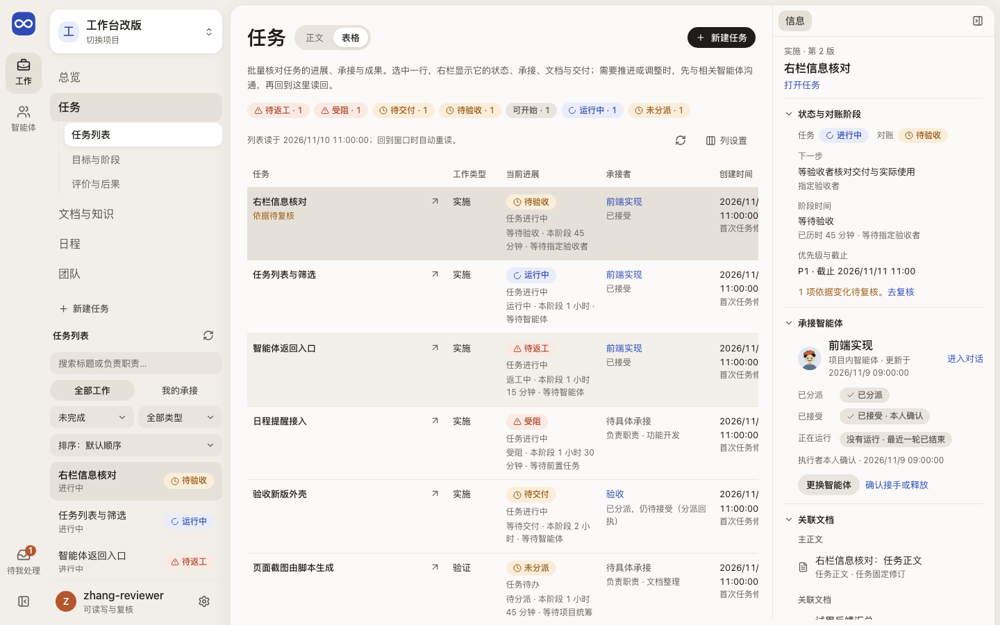

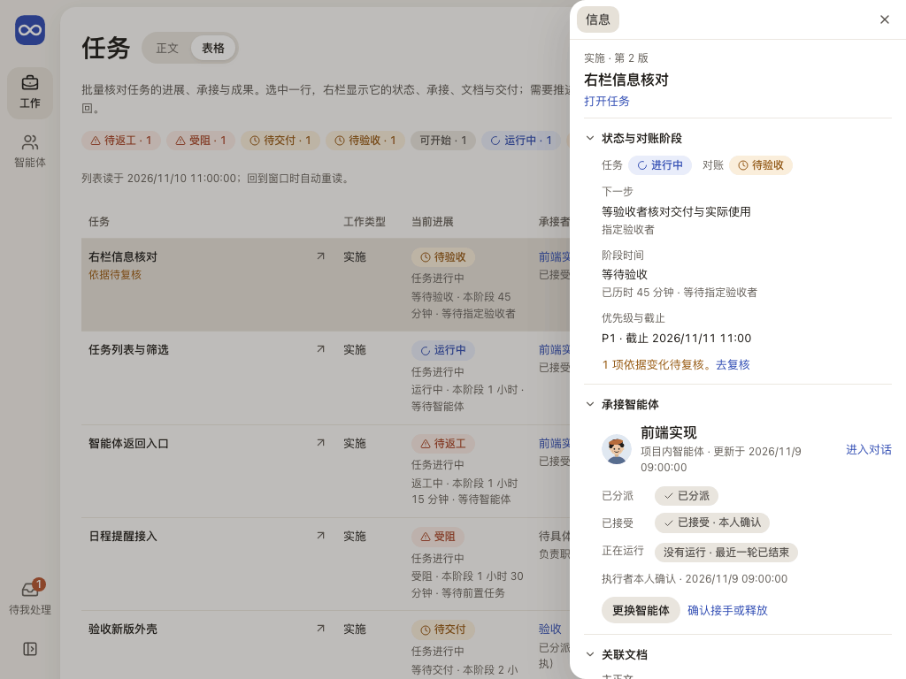

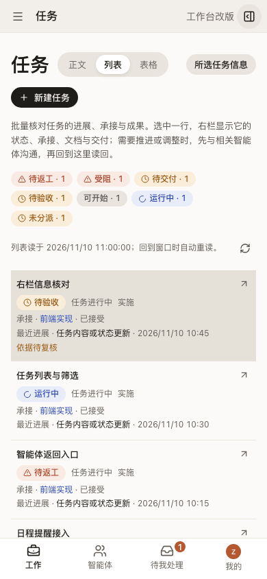

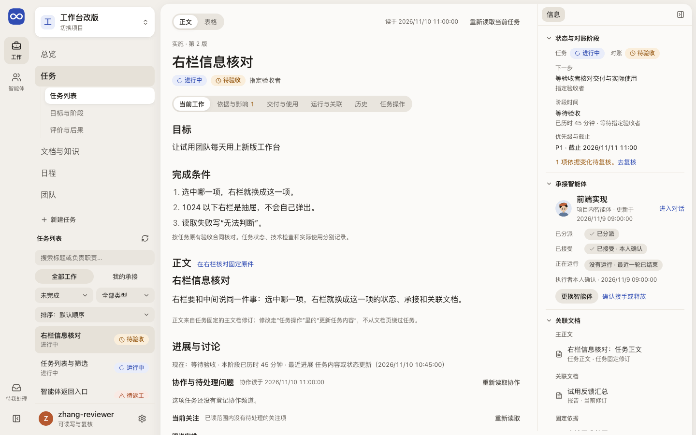

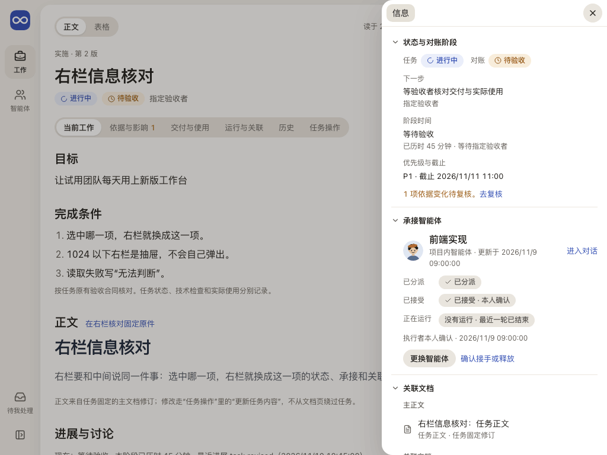

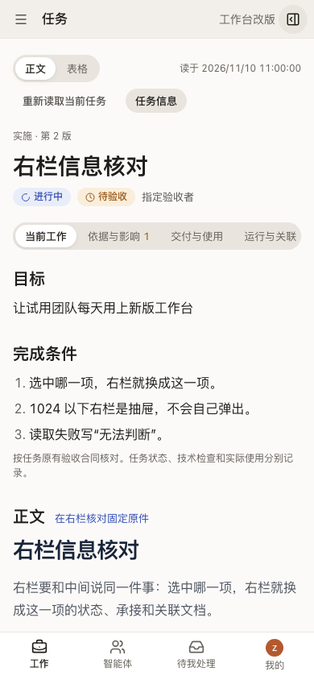

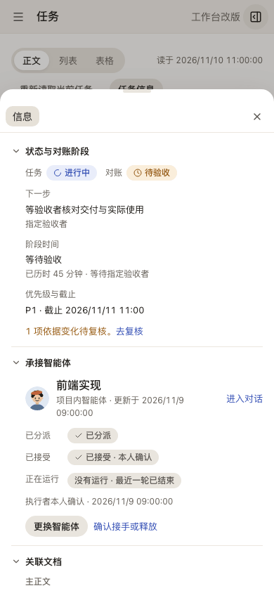

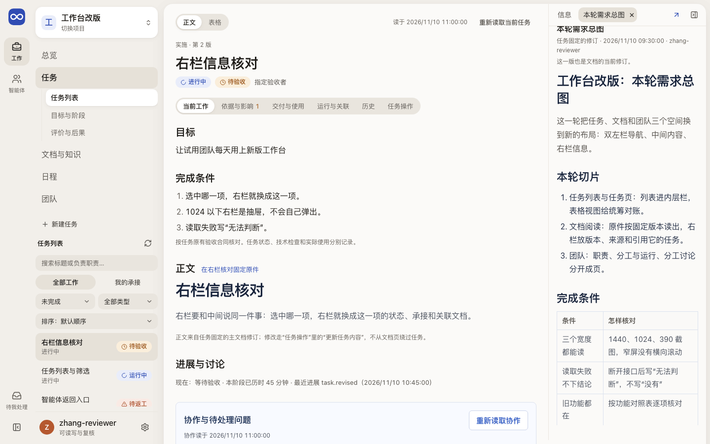

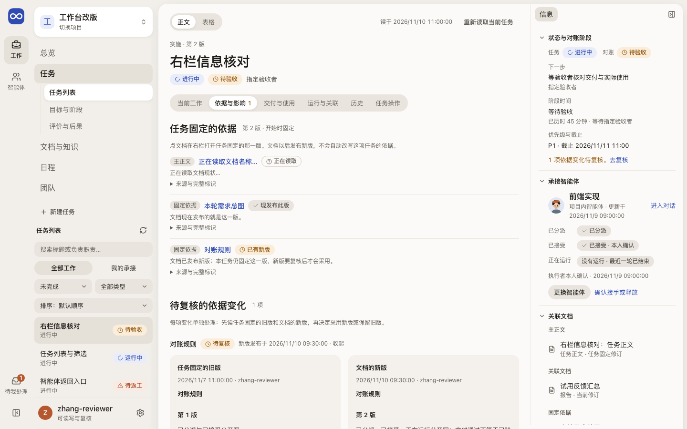

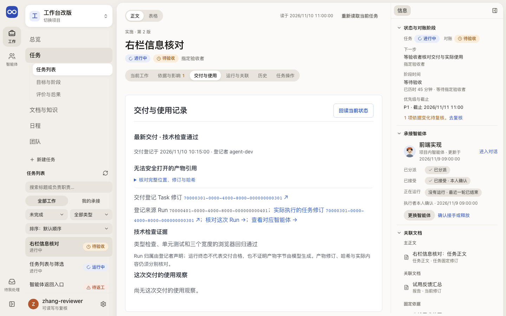

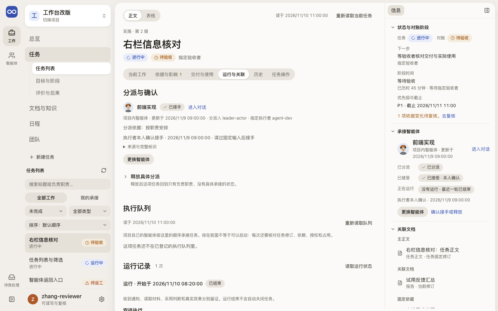

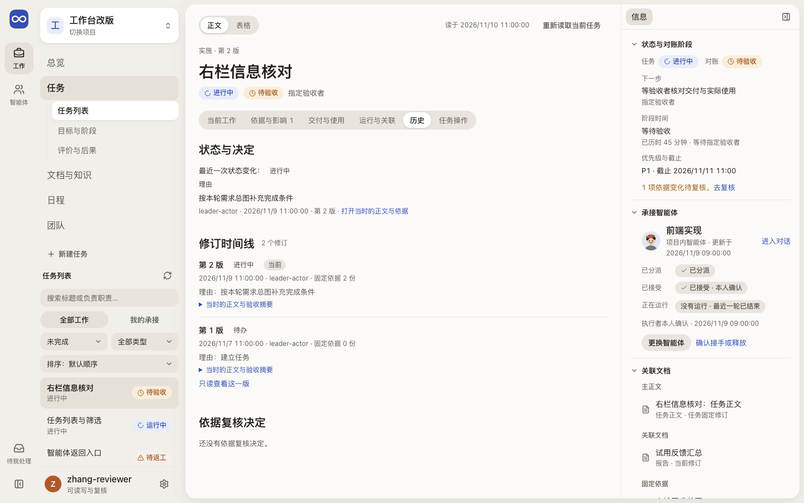

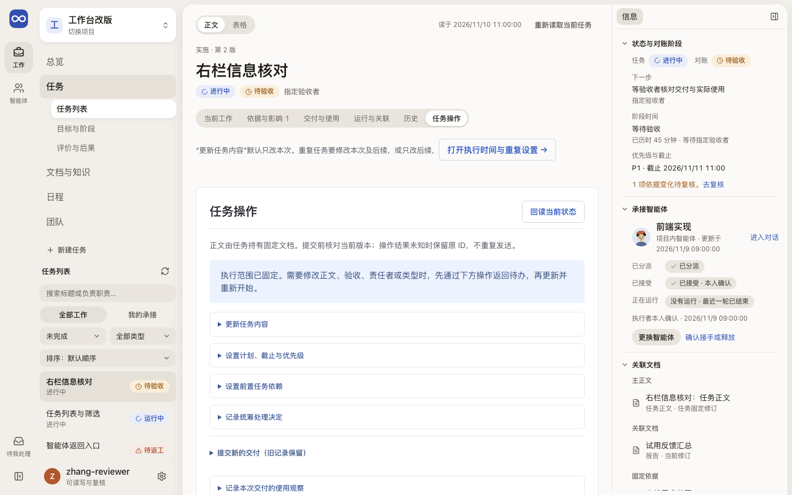

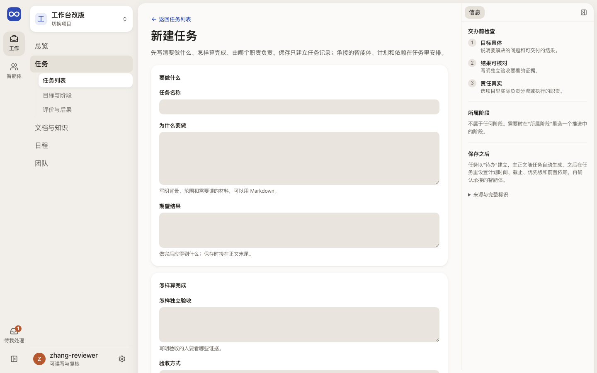

新建任务的其他宽度：[390](../../assets/frontend-pages/task-new-390.png)。

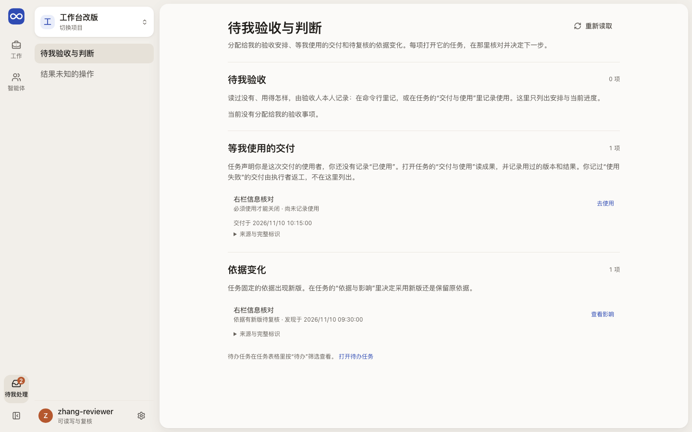

## 代码与测试

源码在 `apps/workbench/src/features/workflow/`，测试在 `apps/workbench/test/`。

| 部分 | 主要源码 | 相关测试 |
| --- | --- | --- |
| 页面组合与左栏列表 | `TaskWorkspace.tsx`、`TaskRail.tsx`、`useTaskList.ts`、`taskListModel.ts`、`taskExperience.ts`、`apps/workbench/src/shared/taskStatus.ts` | `task-list-model.test.ts`、`task-experience.test.ts`、`task-workspace-browser.test.ts`、`shell-browser.test.ts`（空间切换后保留筛选、手机紧凑列表）、`work-filter-pagination-browser.test.ts`、`work-status-recovery-browser.test.ts`、`work-status-retry-pagination-browser.test.ts` |
| 表格视图与对账 | `TaskTable.tsx`、`TaskReconciliation.tsx`、`taskWorkspacePresentation.ts`、`apps/workbench/src/shared/workStatusPresentation.ts`、`apps/workbench/src/shared/leaderWorkLoad.ts` | `task-workspace-presentation.test.ts`、`work-status.test.ts`、`leader-work-load.test.ts`、`leader-work-overview-browser.test.ts`、`task-list-owner-browser.test.ts` |
| 右栏 | `TaskFacts.tsx`、`TaskAgentBlock.tsx`、`taskFactsPresentation.ts`、`apps/workbench/src/shared/revisionPresentation.ts`、`apps/workbench/src/shared/useRevisionOrigin.ts`（版本行的作者与理由）、`TaskDocumentPeek.tsx`、`apps/workbench/src/shared/workPresentation.ts`（下一步、责任、验收接力用语）、`apps/workbench/src/shared/ui/RecordName.tsx`（智能体名称读 `apps/workbench/src/shared/agentRead.ts`，叫法同 `apps/workbench/src/shared/agentNamePresentation.ts`） | `agent-name-task-side-browser.test.ts`（外部智能体在任务侧和智能体侧同名、正文没有短标识）、`revision-presentation.test.ts`、`task-wording-browser.test.ts`（`EVOLOOP_TASK_WORDING_SCREENSHOT_DIR`）、`task-list-model.test.ts`、`task-work-wording.test.ts`、`task-workspace-browser.test.ts`、`task-preview-current-responsibility-browser.test.ts` |
| 跨空间返回 | `taskOrigin.ts`（链接从哪个页签或表格行出发）、`apps/workbench/src/shared/returnLink.ts`（哪些页面可返回、怎样称呼）、`apps/workbench/src/shared/ui/ReturnLink.tsx`、`apps/workbench/src/shared/taskNavigation.ts` | `return-link.test.ts`、`cross-space-return-browser.test.ts`（`EVOLOOP_RETURNS_SCREENSHOT_DIR` 存三个宽度的截图）、`task-session-return-browser.test.ts` |
| 任务正文与进展 | `TaskPage.tsx`、`TaskArrangement.tsx`（当前关注、阶段区间与计划）、`TaskOwner.tsx`、`taskOwnerPresentation.ts`、`apps/workbench/src/features/discussions/TaskCollaborationThread.tsx`、`apps/workbench/src/shared/ui/MarkdownBody.tsx`（标题层级在 `apps/workbench/src/shared/ui/markdownContent.ts`） | `markdown-content.test.ts`、`task-workspace-presentation.test.ts`、`legacy-bits-browser.test.ts`、`task-edit-role-recovery.test.ts`、`task-owner-browser.test.ts`、`task-list-owner-browser.test.ts`、`task-session-return-browser.test.ts`、`discovery-browser.test.ts` |
| 五个页签 | `TaskBasisTab.tsx`（两版对照里的非 Markdown 原件用 `apps/workbench/src/shared/ui/OriginalDocumentReader.tsx`）、`TaskDeliveryTab.tsx`、`TaskRuntimeTab.tsx`、`ResidentQueuePanel.tsx`（团队的分工与运行也用）、`apps/workbench/src/features/orchestration/`（自动循环）、`apps/workbench/src/features/references/`（Git 与外部来源登记，仓库规范也用；写入在 `referenceCommands.ts`）、`TaskHistoryTab.tsx`、`TaskActionsTab.tsx`、`EvidenceText.tsx` | `task-tabs-browser.test.ts`、`task-evidence-reading.test.ts`、`reference-commands.test.ts`、`legacy-bits-browser.test.ts`、`task-owner-presentation.test.ts`、`task-loop-browser.test.ts`、`schedule-run-session-path-browser.test.ts`、`document-original-reading-browser.test.ts` |
| 写入 | `apps/workbench/src/shared/command/`（唯一的提交表单：基线、回执与表单）、`TaskForms.tsx`（页签部件与读取状态）、`taskCommands.ts`（各命令） | `use-command.test.ts`、`task-commands.test.ts`、`task-list-model.test.ts` |
| 收件页与计数 | `InboxIndex.tsx`、`inboxModel.ts`（等我使用的判断、计数、带返回参数的链接）、`inboxReads.ts`（三项读取，外壳计数共用）、`inboxDeliveries.ts`（逐页读工作索引） | `inbox-model.test.ts`、`inbox-browser.test.ts`、`leader-work-overview-browser.test.ts`、`legacy-bits-browser.test.ts` |
| 执行时间与重复 | `TaskScheduleSection.tsx`、`taskTimingPresentation.ts`、`apps/workbench/src/shared/zonedTime.ts`、`apps/workbench/src/shared/ui/LocalTimeInput.ts` | `task-timing-ui.test.ts`、`task-commands.test.ts`、`zoned-time.test.ts`、`task-tabs-browser.test.ts` |
| 新建任务 | `CreateTaskPage.tsx`、`taskCreate.ts` | `task-create.test.ts`、`journey-browser.test.ts`、`work-status-recovery-browser.test.ts` |
| 按成员选验收身份（任务操作、新建任务，日程同用） | `apps/workbench/src/shared/ui/MemberChoice.tsx`、`apps/workbench/src/shared/memberPresentation.ts`、`apps/workbench/src/shared/projectConfiguration.ts` | `member-presentation.test.ts`（与手填时请求体相同）、`member-choice-browser.test.ts`（`EVOLOOP_MEMBERS_SCREENSHOT_DIR`） |

## 相关

- 产品：[任务与过程文档](../../product/tasks-and-documents.md)（四态、验收、改版）、[提议怎样变成任务](../../product/daily-loop.md#一条提议怎样变成可做的任务)
- 合同：[Leader 工作投影与处理决定](../../architecture/contracts.md#5-coordinator派发交接与恢复)、[具体承接与职责分开](../../architecture/contracts.md#具体承接与职责分开)
- 开发：[定时任务的编辑与历史](../../references/task-timing-copy-design.md#时间编辑与历史)、[验收安排的 CLI](../../development/agent-cli.md#观察会话具体接手与普通消息)
- 前端：[布局](../layout.md)、[设计原则](../principles.md)、[实景旅程](../journeys/current-work.md#1-在列表横向查看任务同时保留右侧摘要)
