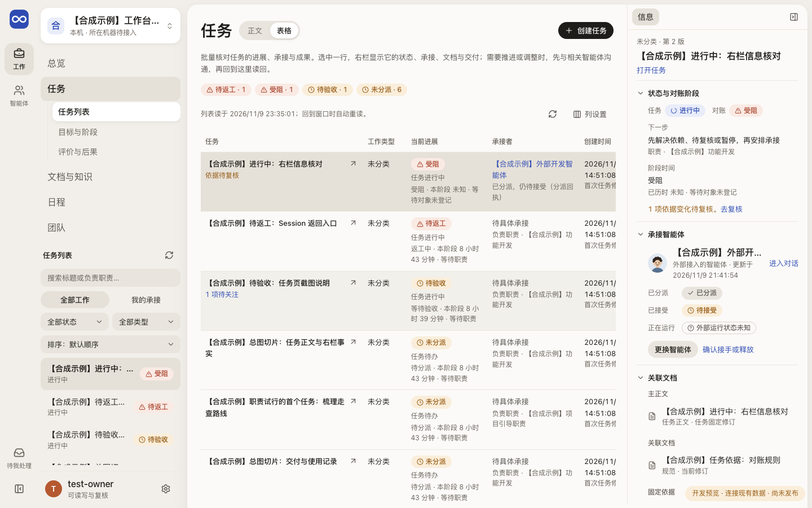
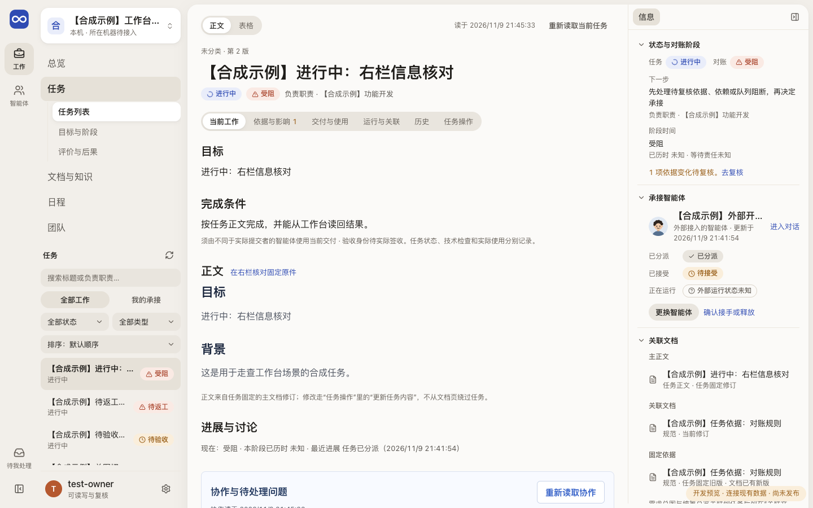
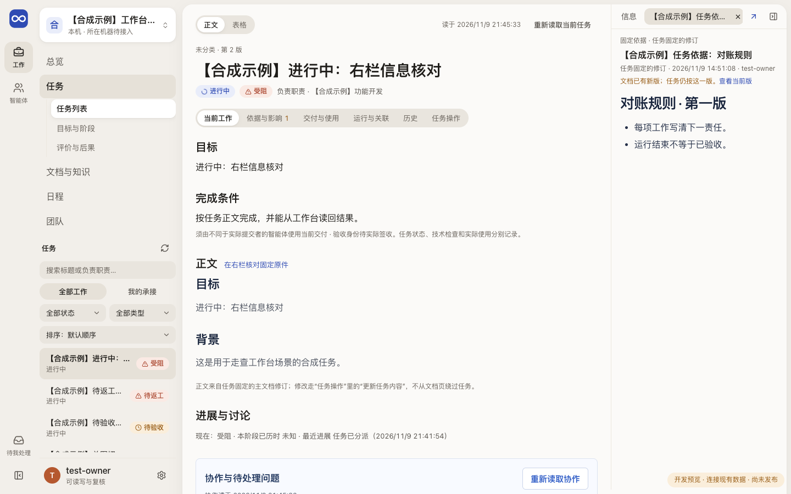
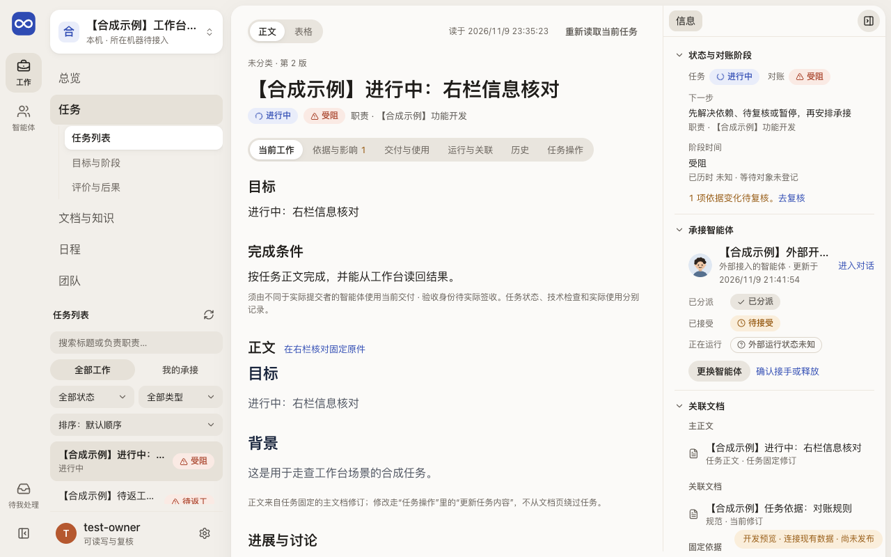
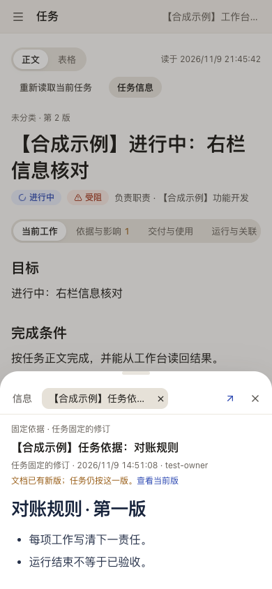

# 任务：找到工作，读懂约定，核对承接与结果

这一页帮人找到要看的那项工作，读懂它要做什么、做到哪里、谁在接、交出了什么。

## 这一页回答什么

- 哪些工作和我有关，现在该看哪一项？
- 这项工作要做什么，怎样算完成？
- 谁具体接住了它，现在是否在运行？
- 交出了什么，有没有人实际用过？

## 布局

| 位置 | 放什么（目标） |
| --- | --- |
| 左栏 | 紧凑任务列表，每行一个标题和状态；上方是范围（全部工作 / 我的承接）、搜索、状态与类型筛选，以及排序（优先级、截止时间、最近进展、创建时间、对账阶段） |
| 中间 | 选中任务的正文：目标 → 完成条件 → 正文 → 进展与讨论时间线。可切换到“表格视图”，用六列表格给 Leader 对账、批量扫读 |
| 右栏 | 状态与对账阶段；承接 Session（显示并可设置绑定）；关联文档（主正文、需求总图、Leader 编排总览、固定依据、交付物）；交付与使用；版本；可收起 |

现状（#229 PR7）：三处已按上表实现。`/work` 是表格视图，`/tasks/{ID}` 读一项任务；筛选与排序写在地址里。依据与影响、交付与使用、运行与关联、历史、任务操作五个页签仍是旧样式。需求总图和统筹总览没有单独标记，作为关联文档列出。1440px 以下右栏默认收起，窄屏用“任务信息”打开。

## 内容与状态

共同规则见[设计原则](../principles.md)。本页要分清的事实：

| 要分清的 | 页面怎样显示 |
| --- | --- |
| 已分派 ≠ 已接受 ≠ 正在运行 | 三者分开写，不合成“已认领” |
| Run completed ≠ 已验收 | “运行中”“已发布”“已验收”各是一项事实 |
| 固定成果、技术检查、实际使用 | 分三项显示；没有本次交付的使用观察就写没有，旧记录不沿用 |
| 验收接力 | 逐项显示接收者、消息投递、运行处理、本人读取和使用观察；安排已保存或消息已排队时仍是“尚未使用”；旧交付被替代后，旧安排保留历史状态 |
| 当前承接与历史承接 | 已完成或已取消的任务显示“历史承接”；Session 现在忙碌不说明这项任务仍在运行 |
| 固定依据与新版 | 任务保留开始时固定的版本，有新版时标“待复核” |
| 读取中、读取失败与未登记 | 读取中写“正在读取”，失败写“无法判断”并可重新读取；只有读到回答才写“未分派”“没有运行”“未登记”。绑定按钮在分派读回前不可用 |
| 下一步与下一责任 | 按阶段用工作台自己的话写下一步，责任写类型和名称（如“职责 · 开发职责”）；名称未读回写“（名称待读取）”，服务端写给智能体的文字和原始 ID 只在“完整标识”里 |

**列表**

- 排序：列表接口目前只支持分页、不支持排序；在服务端支持前，排序作用于已载入的全部页，并在列表上注明范围。

- “我的承接”只按登录身份和分派的确切接收者判断，不从 Role 名称或当前聊天推断。
- “创建时间”取任务首个修订；“最近进展”取能归到这项任务的真实业务事件，没有就写“未记录”。
- 进度读不到的任务照常列出，标“待核对”。还有未读的后续页时，只说“已载入范围内没有匹配”。

**表格视图（Leader 对账）**

- 默认六列：任务、工作类型、当前进展、承接者、创建时间、最近进展。负责职责、下一动作、固定成果、任务版本从“列设置”加入；表格在自己的区域横向滚动。
- 对账摘要按阶段计数（待返工、受阻、待交付、待验收、待接手、可开始、运行中、未分派）并给下一责任。Leader 对确切任务版本记“已核对”或“暂缓”；相关事实变化后，旧决定退出摘要。
- “阶段与验收容量”列出各 Session 的持久占用、临时或常驻、能力缺项。空闲的 Session 不等于可接验收。

**正文与右栏**

- 首屏读到目标、完成条件和正文开头；运行、来源和低频操作按需展开。
- Role 是持续职责，具体承接看分派和接受回执；同 Role 的其他实例收在次级。
- 查看固定历史修订时，只给“返回当前任务”，不放跳到当前交付的快捷按钮。
- 修改、取消、重开等写入放在“任务操作”层。
- 表单打开时记下所见的版本与分派；提交前这些已变，或服务端答复版本已变，就拒绝提交，请先看最新内容。

**重开与重复**

- 重新打开的任务不沿用旧交付的通过或使用记录。
- 每日重复产生独立的任务 A、B、C，各有自己的结果。编辑默认只改本次，“本次及后续”另选；停止系列和取消某一次分开。

**收件页**

- 现状：“待判断与复核”列出分配给我的验收安排和依据变化，每项链到固定任务。
- 目标：按权限内待接、跨域或重大取舍、补证、外部编辑冲突、过期基线分组；每项能回到来源，权限不足时写明交给谁、何时再看。

## 截图

2026-11-09，PR7 分支，测试实例合成数据，1440×900。看点：选中一行，右栏换成这一行的事实，中间不动。

看点：任务和对账阶段两个标签并列；已分派、已接受、正在运行分开写；依据按任务固定的那一版打开。

## 代码与测试

源码在 `apps/workbench/src/features/workflow/`，测试在 `apps/workbench/test/`。

| 部分 | 主要源码 | 相关测试 |
| --- | --- | --- |
| 页面组合与左栏列表 | `TaskWorkspace.tsx`、`TaskRail.tsx`、`useTaskList.ts`、`taskListModel.ts`、`taskExperience.ts`、`apps/workbench/src/shared/taskStatus.ts` | `task-list-model.test.ts`、`task-experience.test.ts`、`task-workspace-browser.test.ts`、`work-filter-pagination-browser.test.ts`、`work-status-recovery-browser.test.ts`、`work-status-retry-pagination-browser.test.ts` |
| 表格视图与对账 | `TaskTable.tsx`、`TaskReconciliation.tsx`、`taskWorkspacePresentation.ts`、`apps/workbench/src/shared/workStatusPresentation.ts`、`apps/workbench/src/shared/leaderWorkLoad.ts` | `task-workspace-presentation.test.ts`、`work-status.test.ts`、`leader-work-load.test.ts`、`leader-work-overview-browser.test.ts`、`task-list-owner-browser.test.ts` |
| 右栏 | `TaskFacts.tsx`、`TaskAgentBlock.tsx`、`taskFactsPresentation.ts`、`TaskDocumentPeek.tsx`、`useCommand.ts`、`apps/workbench/src/shared/workPresentation.ts`（下一步、责任、验收接力用语）、`apps/workbench/src/shared/ui/RecordName.tsx` | `task-list-model.test.ts`、`relay-presentation.test.ts`、`task-workspace-browser.test.ts`、`task-preview-current-responsibility-browser.test.ts` |
| 任务正文与各层 | `TaskPage.tsx`、`TaskWorkflow.tsx`、`DeliveryPanel.tsx`、`LeaderTaskFacts.tsx`、`TaskOwner.tsx`、`apps/workbench/src/shared/taskTiming.tsx`（阶段时间，智能体页也用）、`features/sessions/TaskAssignmentPanel.tsx`（确认接手与释放）、`features/queues/ResidentQueuePanel.tsx`（经 `features/runtime/RuntimePanel.tsx` 显示队列） | `delivery-presentation.test.ts`、`task-evidence-reading.test.ts`、`task-edit-role-recovery.test.ts`、`task-owner-browser.test.ts`、`task-session-return-browser.test.ts`、`task-loop-browser.test.ts`、`discovery-browser.test.ts` |
| 收件页（未改版） | `InboxIndex.tsx`、`AcceptanceOverviewPanels.tsx` | `leader-work-overview-browser.test.ts` |
| 执行时间与重复 | `TaskSchedulePanel.tsx`、`taskTimingPresentation.ts` | `task-timing-ui.test.ts` |

## 相关

- 产品：[任务与过程文档](../../product/tasks-and-documents.md)（四态、验收、改版）、[提议怎样变成任务](../../product/daily-loop.md#一条提议怎样变成可做的任务)
- 合同：[Leader 工作投影与处理决定](../../architecture/contracts.md#5-coordinator派发交接与恢复)、[具体承接与职责分开](../../architecture/contracts.md#具体承接与职责分开)
- 开发：[定时任务的编辑与历史](../../references/task-timing-copy-design.md#时间编辑与历史)、[验收安排的 CLI](../../development/agent-cli.md#观察会话具体接手与普通消息)
- 前端：[布局](../layout.md)、[设计原则](../principles.md)、[实景旅程](../journeys/current-work.md#1-在列表横向查看任务同时保留右侧摘要)
