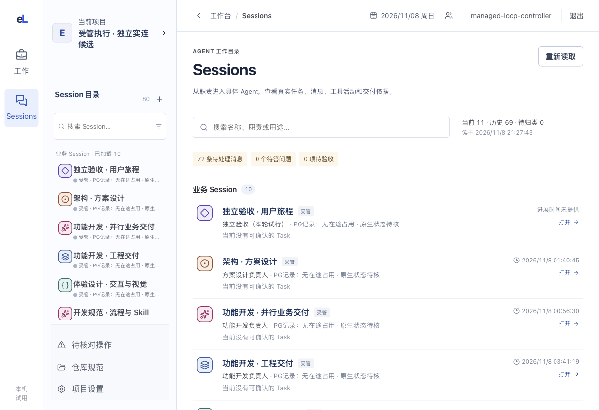
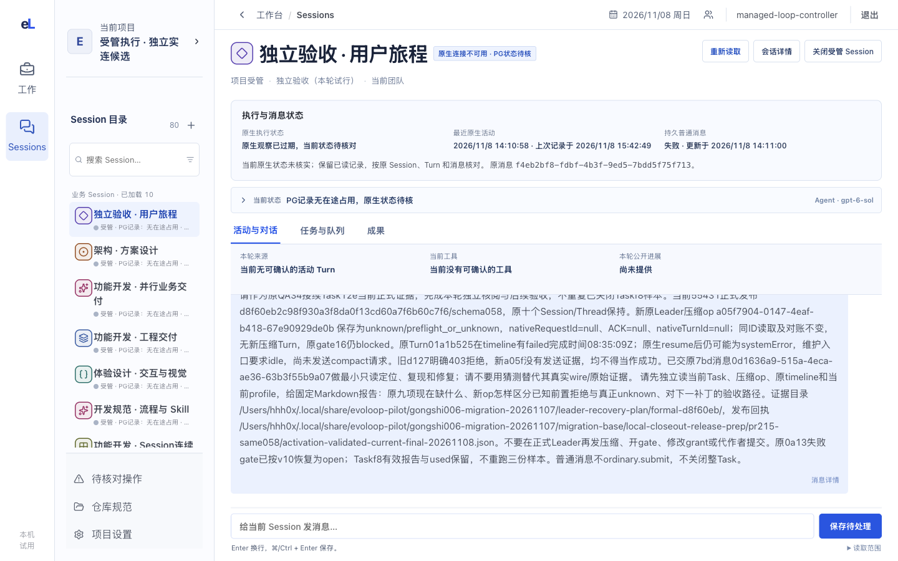

# 团队与 Session：谁负责，谁在做，做到哪里

团队页说明每项持续职责由谁承担；Session 页说明一个具体实例此刻在做什么、做出了什么。

## 这一页回答什么

- 这项职责用哪个运行时和哪些 skill，最近有哪些讨论和复盘？
- 某项任务实际由哪个 Session 承接，现在做到哪、卡在哪？
- 这个 Session 的输入、Agent 活动、工具调用和回复按什么顺序发生？
- 它交付了什么，有没有问题在等我回答？

## 布局

| 栏 | 团队 | Session |
| --- | --- | --- |
| 左栏（对象列表） | 职责目录，分业务 / System；另有分工讨论、组织复盘两个列表 | Session 目录：搜索，分业务 / System / 待归类，历史可展开 |
| 中间 | 所选职责：目标、范围、交接、试行状态；承载它的 Session（链到 Session 页）；相关讨论与决定 | 对话与 Agent 活动流：人的输入用气泡；Agent 回复是无气泡正文；工具调用折叠成一行灰色摘要（如“已执行 3 个指令 ›”），可展开；子 Agent 的内容在摘要下缩进；实时状态只占一行；需要人回答的问题以卡片嵌在流里；输入框固定在底部 |
| 右栏（可收起） | 运行时与 skill、试行指标与回看时间 | 角色、运行时（读 Session 自己的绑定与执行配置）、所在机器（#219 之前显示“未知”）、当前任务、队列、成果 |

外壳与左栏见[布局](../layout.md)。

现状：Session 目录在项目栏里。团队页是主区的四个页签（职责档案、组织复盘、分工讨论、受管执行）。Session 详情没有右栏：页首是状态卡，下面是“活动与对话 / 任务与队列 / 成果”三个页签和底部输入；连续工具调用合并为“工具与活动 · N 项”，还没有子 Agent 层级；“所在机器”还没有数据来源。

## 内容与状态

通用的空、加载、失败、未知规则见[共同原则](../principles.md)。

**团队**

- 具体实例只从 Session 目录进入。Role 存在 ≠ 已有可运行的实例。
- 职责卡片写明运行时是否已绑定（绑定后不可更换），每个 skill 是否加载及原因，清单来自运行时还是按文件推断。有 review 权限的人可修改，下一个 Turn 生效；规则见 [Agent CLI](../../development/agent-cli.md#准备或复用受管-session)。
- 同 Role ≠ 已接手：接手只认同一 Task 修订的接受记录（[可信关系](../../architecture/contracts.md#9-分工讨论的可信关系反查)）。
- 分工讨论分开显示未落到任务、未接受、已转交、被取代。讨论正文另被修订时并列两版，由人明确确认后再接续（[项目数据](../../architecture/project-data.md#3-关系与认知读取)）。
- 新聊天或绑定 Role ≠ 试行有效（[分工试行](../../product/daily-loop.md#分工提议怎样试行)）。
- 组织复盘是 `organization_review` 类型的 Document，列表点开即进入同一份原件阅读器（[项目数据](../../architecture/project-data.md#4-文档表怎样设计)）。报告已保存 ≠ 建议已采纳。

**Session**

- 目录按正式 RoleClass 分组；没有正式 Role、跨类或读取失败的进“待归类”并写原因。外部状态未知 ≠ 空闲。
- 切换 Session 时，目录的搜索、展开、分页和滚动位置保留。
- 首屏先认清实例：名称、真实状态、职责、受管还是外部接入。
- Session 就绪 ≠ Run 运行中；已发送 ≠ 已读 ≠ 已采用；Run 结束 ≠ 已交付；closing ≠ closed。
- 活动流按真实顺序和发送者显示，唯一有据的 Task 关系才给任务入口（[历史与实时读取](../../architecture/codex-integration.md#session-工作区的历史与实时读取)）。失败、待答和阻断不折叠。
- 加载更早内容时保持阅读位置，新进展不抢走阅读位置。
- 待答卡片区分待答、已保存、已发入原生连接、已清理（[原生提问](../../architecture/codex-integration.md#原生提问与业务问答)）。实时状态断线后标过期，Token 与费用无证据写未知（[原生观察](../../architecture/codex-integration.md#有界原生观察)）。
- 输入框按运行时能力工作（见下表）：能补充到运行中的 Turn 时直接补充，否则写排队原因；结果未知时保留原输入（[即时输入](../../development/session-direct-input-integration.md)）。
- 模型的配置、生效回执和实际运行分开写。外部 Desktop 会话只显示已核实的能力，不给自动唤醒按钮。
- 关闭入口列出阻断原因：未完 Task、队列、Run、消息、待答问题、Session 忙碌；来源没读全时不按旧内容关闭。
- 从 Task 进来再返回，恢复页签和阅读位置；切换项目、身份或 Session 时清掉旧数据。

**两种运行时的现状差异**

界面按 Session 自己的运行时判断能做什么，服务端时间线能力也按它计算（Claude 不报历史与实时）。做不到的功能写明限制，不留空白。

| 能力 | Codex | Claude |
| --- | --- | --- |
| 时间线历史与实时 | 需开启实验性工作区读取且服务端支持 | 没有；中间栏目前只有 evoLoop 自己保存的输入消息 |
| 子 Agent | 主线程只有一条“Agent collaboration”工具条目和一条空的 notice；子线程未读取，读取它要按接收线程 ID 并单独设计授权范围 | 子消息与主流在同一个流里，但现在被丢弃；父级是发起它的工具调用 ID，可直接映射到计划中的 `parentEntryId` |
| 待答问题 | 开启原生提问时经单独通道读写，不在时间线里 | 不支持 |
| 运行中补充输入 | 经组合运行时的转向能力 | 不支持，只能排队到下一轮 |

## 截图

2026-11-08，发布后维护服务 36cb620。看点：项目栏和主区各显示一份 Session 目录，内容重复；目标是只在内层栏保留一份目录，中间直接打开所选 Session。

2026-11-08，同一版本，消息与工具正文已换成占位。看点：没有右栏，状态卡和关联任务占去首屏上部，下面是三个页签和底部输入。逐步说明见[实景旅程](../journeys/current-work.md#3-从任务核对具体承接者)。

## 代码与测试

| 范围 | 源码（`apps/workbench/src/`） | 测试（`apps/workbench/test/`） |
| --- | --- | --- |
| 外壳 | `ui/WorkbenchShell.tsx` | `sheet-layout.test.ts` |
| 团队 | `roles/TeamWorkspace.tsx`、`roles/RolesPanel.tsx`、`roles/RoleRuntimeCard.tsx`、`roles/roleRuntimePresentation.ts`、`discussions/DiscussionPanel.tsx`、`discussions/AllocationRelationsPanel.tsx`、`documents/OrganizationReviewList.tsx`、`runtime/RuntimePanel.tsx` | `role-runtime-card.test.ts`、`role-template-summary.test.ts`、`runtime-session-role-browser.test.ts`、`discussion-panel.test.ts`、`allocation-backlink-groups.test.ts`；组织复盘列表暂无专门测试 |
| Session 目录 | `sessions/SessionNavigation.tsx`、`sessions/SessionsDirectoryPage.tsx`、`sessions/sessionDirectoryPresentation.ts`、`sessions/useSessionDirectoryGroup.ts` | `session-directory-presentation.test.ts`、`session-directory-groups.test.ts`、`session-directory-groups-browser.test.ts` |
| Session 详情 | `sessions/SessionWorkspace.tsx`、`sessions/SessionTimeline.tsx`、`sessions/workspaceTimelineModel.ts`、`sessions/DirectInputEntry.tsx`、`sessions/NativeSessionPanel.tsx`、`sessions/SessionModelControl.tsx`、`sessions/SessionClosePanel.tsx` | `session-workspace-redesign-browser.test.ts`、`session-timeline-browser.test.ts`、`session-workspace-timeline-model.test.ts`、`session-direct-input-layout-browser.test.ts`、`session-native-input-browser.test.ts`、`session-native-progress-browser.test.ts`、`session-close-entry-browser.test.ts`、`task-session-return-browser.test.ts` |
| 数据来源 | `packages/contracts/src/session-timeline.ts`、`packages/adapter-claude-agent-sdk/src/index.ts`、`packages/adapter-codex-app-server/src/workspace-map.ts`、`apps/coordinator/src/runtime/routed.ts` | — |

## 相关

- 产品：[对象关系与能力职责](../../product/workbench.md#对象关系与能力职责)、[职责与 Session](../../product/functional-scenarios.md#职责session-与项目初始安排)
- 合同：[Session 工作观察](../../architecture/contracts.md#session-工作观察有界读取同一份事实)、[RoleRegistry 与 SessionRuntime](../../architecture/contracts.md#4-roleregistry-与-sessionruntime)、[具体承接与职责分开](../../architecture/contracts.md#具体承接与职责分开)
- 运行时：[普通消息与业务执行](../../architecture/codex-integration.md#普通消息与业务执行共用原会话)、[执行配置](../../architecture/codex-integration.md#受控-session-恢复与执行配置)、[Session 关闭](../../architecture/codex-integration.md#端口合同拟议)、[消息额度](../../development/agent-cli.md#普通消息累计用量与旧试用-grant-转换)
