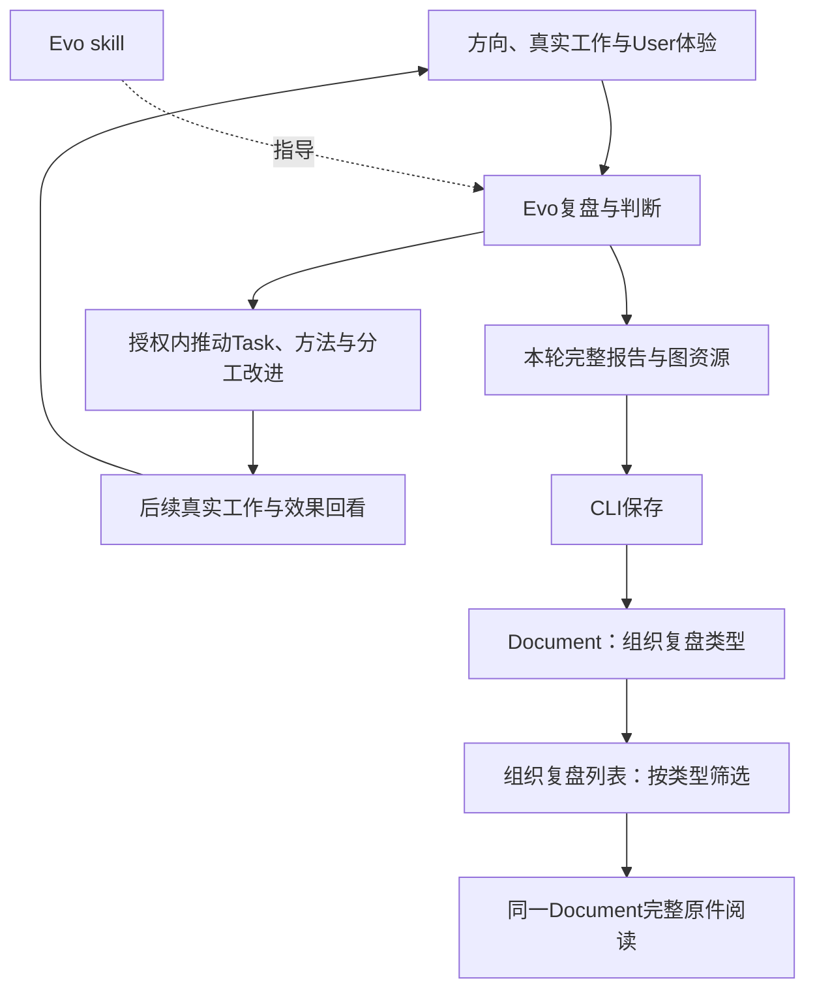

# 团队与具体 Session：职责、承接和实际执行

2026-10-30 · 页面目标与阅读合同。人在团队页辨清谁持续负责，再进入真正承接某项工作的实例，追到成果与实际使用。

本页承接Leader组织承接、业务执行和独立使用，以及方法/容量/职责试行和回看，产品理由及整段验收仍见[工作台产品目标](../../product/workbench.md)。实现能力和实际使用范围分别沿[阶段路线](../../roadmap.md#当前基线)核对；方案、源码、候选体验和已部署不互相代替。共用导航、状态、权限缺项及响应方式见[体验架构](../experience.md)与[设计系统](../design-system.md)。

## 团队首屏与具体实例

先列当前团队的职责、实际承载的owned Session或外部HostLink、当前工作/队列负担及可核下一步。历史和待归类可搜索展开；Role存在不代表已有可运行实例，外部状态未知不显示为空闲。窄屏按“职责 → 实例 → 当前工作/下一步”纵向阅读。

Session详情先标具体实例、职责与已核能力，再呈本实例确切分派/接受的Task、当前Run、队列占用/下一顺位、待答与恢复缺口。同Role关系只写相关任务，不当成接受或执行证据。任务已关闭的关联明确历史，消息/Run认领与assignment回执分别写。

## 当前工作与阅读区

这轮常驻协作应从现有工作、Role/Session、Task 详情逐层读到：当前领域与正式责任、owned 或外部人工承载及其已核能力；Lead 采纳的顺序和依赖理由；当前队列条目是待领取、已领取、held 还是已释放，卡在哪项输入、授权、未知 Run 或验收；本次 Run 固定输入、同一 Thread 的历史尝试、问题与答复、动作请求和实际执行者；当前交付及消费者使用。页面让人知道下一责任与可执行的承接入口，不把“已发消息”“ready”“Run completed”合并成“已接受/已完成”。外部 Desktop link 仅展示已验证的 open/read/manual-claim，未核能力标未知，不能出现自动唤醒按钮。沿已有页面加关联与状态即可，不另造一个覆盖全产品的大总览。

Session 详情以身份和配置事实、当前工作、活动与对话／任务与队列／成果三个阅读区组织；顶部会话信息按需展开原聊天入口、职责、资源、原生进度和正常恢复记录；待答与当前异常就近显示。活动按确切来源聚合，只有唯一有据的 Task 关系才显示任务入口，相关任务进展须与本 Session 的动作区分；Run 轨迹和消息正文按授权及有界分页读取；轨迹先列有界工作项，工具输出与原始输入再逐项展开，运行中来源可手动重读并标出读取时间，缺失、拒绝与截断都明确说明。进入原 Task 详情后，返回来源 Session 应恢复原页签、筛选、展开项和阅读位置；切换项目、身份或 Session 不沿用其他范围的缓存。任务进度、会话状态、技术交付与消费者实际使用仍分别表达。本段是产品阅读合同；具体版本的实现、独立验收和原入口亲用以对应 PR、构建与 Delivery 证据为准。

## 分工讨论与试行

用户查看一个职责或具体会话时，应能追到相关分工讨论、当时的决定和正式链接的任务。具体接手者只由同一 Task 固定修订的接受记录证明；同职责成员、仅登记分派或接受其他修订不能算已接手。讨论尚未落实到任务、尚未接受、已经转交和决定被取代要可区分，旧路径与 Lead 代为观察的署名仍保留。未决探索从分工讨论列表进入，不需要为显示它先建假角色；关联、接受与试行有效分别核对。路径未读全时不显示“没有后续”，读取失败也不显示成正常空态。读取与[可信关系合同](../../architecture/contracts.md#9-分工讨论的可信关系反查)对应；本段不将源码检查视为页面已部署或实际使用验收。

讨论正文若被独立修订，页面应同时显示讨论登记版与文档当前版，允许核对完整原文及哈希。继续登记决定前，须明确确认采用当前正文接续并写明理由；界面不预选确认。恢复会追加可追溯记录，旧决定、旧正文与先前执行依据仍可回查；版本已变时重新读取并判断。

进入分工研究先看持续负担、返工和User Session体验，比较改方法、补同职责容量、临时专项和新持续职责。试行给首项工作、指标、成本、回看和退出，改进仍使用同一Task/Document。撤回须看未完工作接续；新聊天、绑定Role或内部自评不自动算试行有效。

## 组织复盘：同一类Document的阅读入口

团队Session列表回答现在谁负责什么；组织复盘列表回答各轮有哪些完整复盘可读。Evo依据方向、Leader与业务轨迹、独立User体验完成判断和改进工作，再把报告及图资源经CLI保存为 `organization_review` Document。报告按事实自由组织，图工具不固定。

页面仅按Document类型列出标题、观察期间和提交／修订时间；点击后进入同一份Document的普通完整原件阅读器，并能返回列表。文档库也能找到该documentId；无需右侧摘要、固定报告栏目或另一份复盘正文。

观察期间与提交时刻分别呈现。下一轮默认接上轮观察截止点；首轮或专项明确选择范围。旧正文和观察元数据随固定修订保留，之后事实由下一轮承接。提交、读到和改进有效分别核对；报告保存不会自动采纳建议或创建任务。

## 运行、消息与观察的阅读边界

普通消息与业务 Run 共用同一 Session、Thread、adapter 和 full/never/联网执行配置；消息不切换专用进程、工具集或只读资格门。共享 Session 忙碌时，展示原消息仍在排队及具体原因；sender/receiver grant 与 `maxTurns` 预算继续说明身份和成本。`ordinaryExecution` 在原生 Thread start/resume 明确回执 full/never 前保持 `unverified`／`unknown`；`thread/read` 没有权限字段不能推断已 active 或回执丢失。消息回复、处理结果和业务对象权限分别表达。GUI 阅读桥仍按 Run 的 reader、路由和证据范围限制业务对象访问；OS full access 不移除 Task/Document 授权边界，也不改变 Document iframe sandbox。后台控制原语完成不自动代表当前服务已启用，当前执行能力沿 Session snapshot 的实际回执读取。

原生运行中的文字／选项提问单独显示在对应 Session，带准确的运行或消息来源、待答／已保存／原生已清理／不可用状态和真实回复者。它不改变 Task 状态，也不要求新建验收任务。允许的发起者或项目复核者可回复当前仍有效的问题；保存回复、发入原生连接、原生清理和答案实际采用分别表达。已失效问题提供原因，不让用户在新连接补答旧请求。不支持的表单、认证和敏感问题诚实显示能力边界。具体桥接合同及运行模式限制见[原生提问](../../architecture/codex-integration.md#原生提问与业务问答)；工程接线通过不代替当前环境的真实可达性与亲用验收。

原生进度面板须帮助人理解当前发生了什么：状态、精确 Turn 及运行或消息来源、工具、计划和变更预览都有观察时间和范围。旧连接保留最后内容并显示过期；预览不代表完整历史，原生 Turn 结束也不代替交付或验收。Token 须展示 Thread 累计与原生提供的范围，缓存和推理不重复计数，货币费用没有证据时保留未知。来源未绑定和数据缺失明确显示，详细合同见[有界原生观察](../../architecture/codex-integration.md#有界原生观察)。

## 关闭、配置与返回

模型和执行配置来自真实可用目录及所选授权；显示配置、原生生效回执和实际运行证据各自范围，不能用配置名宣称模型已经运行。已合入的新模型选择与关闭能力不因本次阅读改造退回；当前运行状态和限制按实际API读取，版本与使用证据沿[路线](../../roadmap.md#当前基线)核对。

关闭入口保留未完Task、队列、Run、消息、原生线程和既有关闭意图的阻断原因。忙碌状态、阻断中的原生提问、分派/队列或消息尚未完整读回，同样会阻止提交；来源未读全或当前状态未核实也不能据旧内容关闭。closing是请求登记，closed是原生归档核实；停止日程、取消Task与关闭Session各自处理。低频配置、关闭和诊断按需展开，当前异常与待答不被折叠隐藏。

从Task进入后，可沿Session → 队列项 → Task → 固定交付 → 来源Run返回原Session，恢复页签、展开和位置。切项目、身份或Session清除错范围数据；请求迟到不覆盖新的读取。

## 怎样验证

给另一位使用者一项Task，让其从团队找到真实签收的实例、区分同Role其他Session，再到Task/固定成果并返回。覆盖外部已签收但运行未知、受管Session ready而Run在途、历史已关闭Task、不同模型真实配置与正常关闭/受阻。作者自测不代消费者，技术、实例归档和职责试行收益分别验。
