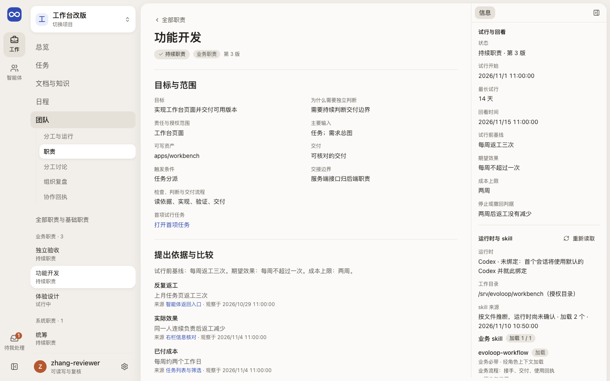
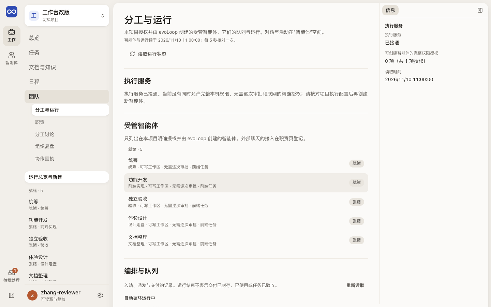
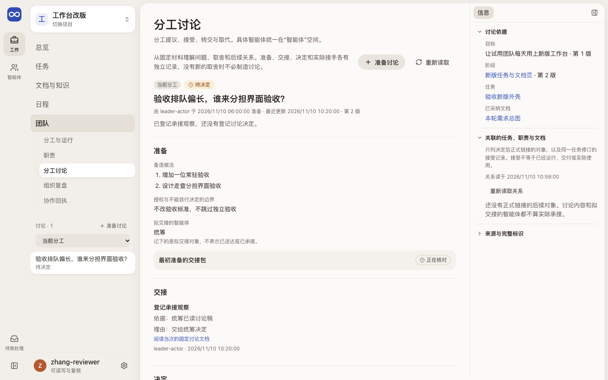
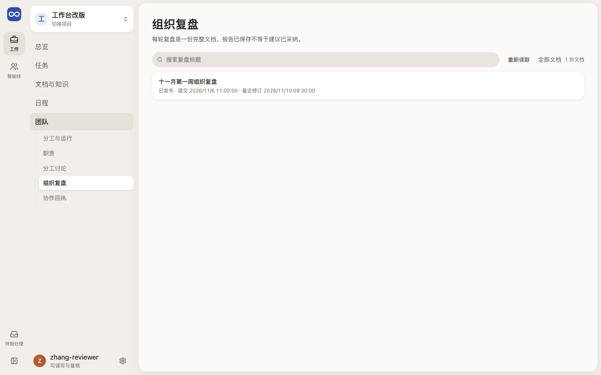
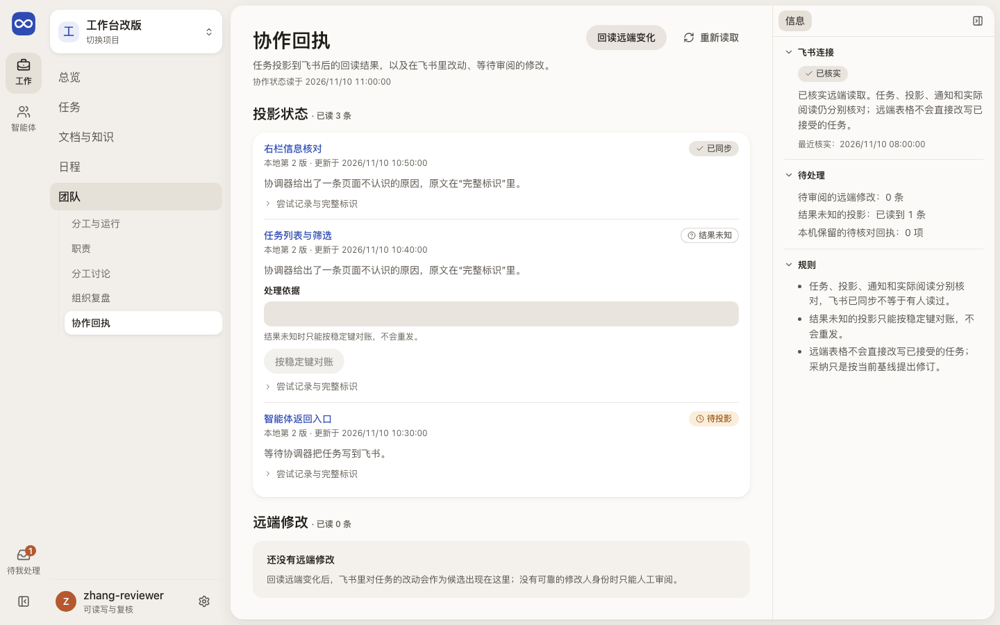

# 团队：每项职责由谁承担

团队页说明每项持续职责的目标、承载它的智能体、运行时与 skill，以及分工讨论与组织复盘。具体实例的对话与活动在 [Sessions](sessions.md)。

## 这一页回答什么

- 项目有哪些持续职责，哪些已建立、在试行或未建立？
- 这项职责用哪个运行时和哪些 skill，由哪些智能体承载？
- 受管智能体能不能关闭，挡住它的是什么？
- 最近有哪些分工讨论和组织复盘，结论落到了哪里？

## 布局

| 栏 | 职责（`/roles?role=`） | 分工与运行（`/runtime?session=`） | 分工讨论（`/discussions?discussion=`） |
| --- | --- | --- | --- |
| 内层栏 | 职责目录：业务、系统、提议与已关闭 | 受管智能体：就绪、准备中、需要核对、已关闭 | 讨论列表：当前分工 / 下一阶段 / 全部 |
| 中间 | 所选职责：目标与范围、提出依据、承载与业务领域、按状态给出的下一步、修订与交接历史、相关讨论；未选时为基础职责、全部职责和提出试行 | 所选智能体：身份与权限、队列、它的运行、关闭条件、线程历史；未选时为执行服务、全部智能体、新建、编排与队列、运行记录 | 所选讨论：准备 → 交接 → 决定；`?new=1` 打开准备表单 |
| 去智能体页 | 承载里的“在智能体空间打开”带返回，智能体页首写“返回职责” | “在智能体空间打开”、运行的智能体链接写“返回分工与运行” | 关系里的智能体链接写“返回分工讨论”（`shared/returnLink.ts`） |
| 右栏 | 试行与回看、运行时与 skill | 所选智能体的事实、执行服务 | 讨论依据、关联的任务 / 职责 / 文档、来源与完整标识 |

外壳与左栏见[布局](../layout.md)。视图由外壳“团队”导航切换（分工与运行、职责、分工讨论、组织复盘、协作回执），App 把所属分区传给页面，懒加载的页面不再从地址推断。旧地址 `/runtime?view=roles` 跳到 `/roles`，`/runtime?session=owned:…` 跳到智能体空间；`/runtime?session={ID}` 就是分工与运行里选中该智能体。分工讨论的四种写入（准备、登记承接、登记或纠正决定、链接后续对象）都在中间。协作回执是单栏页，右栏放飞书连接与待处理。组织复盘列表点开即进入原件阅读器。

## 内容与状态

通用的空、加载、失败、未知规则见[设计原则](../principles.md)。

- 职责存在 ≠ 已有可运行的实例。链接里的职责逐页查找：读取中写“正在定位”，读取失败写“无法定位”，读完仍没有才说没有；完整 ID 只在“完整标识”里。加载更多只读下一页，失败时保留已显示的职责。
- 智能体、职责写登记的名称，没读到写“（名称待读取）”，读取失败写“（名称暂不可读）”，读完没有写“（未找到）”，不用标识的前几位；运行记录按任务名和承接的智能体命名。提出依据和回看来源里的任务写任务名并可点开。
- 各视图的报错写成中文，服务端原文收在可展开的“诊断信息”里。
- 提出试行只需写权限；决定、回看、交接、绑定和撤回需要审阅权限。
- 运行时写明是否已绑定（绑定后不可更换）、每个 skill 是否加载及原因、清单来自运行时还是按文件推断。保存后所选职责不变，下一轮生效；规则见 [Agent CLI](../../development/agent-cli.md#准备或复用受管-session)。
- 承载列表只有在最近一次读取成功时才给出打开、复制后的入口和路由核对；重读失败时保留旧内容并标明。
- 关闭只在没有阻断时提供。阻断逐条写明：状态不是就绪、原生线程未绑定、在途或结果未知的运行、队列占用，以及运行或队列没读回。消息与分派的完整核对在智能体空间的关闭面板。
- 同职责 ≠ 已接手：接手只认同一任务修订的接受记录（[可信关系](../../architecture/contracts.md#9-分工讨论的可信关系反查)）。新聊天或绑定职责 ≠ 试行有效（[分工试行](../../product/daily-loop.md#分工提议怎样试行)）。
- 分工讨论分开显示未落到任务、未接受、已转交、被取代。讨论正文另被修订时并列两版，由人明确确认后再接续（[项目数据](../../architecture/project-data.md#3-关系与认知读取)）。交接包原文和文档当前版都核对通过才能登记，读取失败时写“无法判断”；“来源与完整标识”里的文档当前版不是这一版讨论新读到的，就标“上次读回”。填写中讨论、文档当前版或所选对象的修订变了，或服务端答复所见已过期（先自动重读），都保留输入但拒绝提交，写明变了哪部分，由人选保留修改或重填；恢复确认要重新勾选。结果未知的写入按原操作核对为已应用后，草稿自动清除。
- 分工讨论列表和协作回执的“加载更多”只读下一页，游标没有前进时写“列表可能不完整”。协作回执后面的行随项目重读，失败时标“上次读回”，重读完成前不能对账、采纳或拒绝。“连接诊断”显示原文。
- 协作回执：结果未知的投影只按稳定键对账，不重发；只有身份已核实、只改标题的远端修改能采纳，采纳和拒绝都先确认。写入结果丢失时只留项目、对象与操作 ID，按原 ID 读回。
- 组织复盘是 `organization_review` 类型的文档；报告已保存 ≠ 建议已采纳。

## 截图

由 `npm run docs:screenshots` 用合成夹具生成，怎样重新生成见[页面截图](../architecture.md#页面截图)。

职责的其他宽度：[1024 右栏抽屉](../../assets/frontend-pages/team-roles-1024.png)、[390](../../assets/frontend-pages/team-roles-390.png)。

分工与运行的其他宽度：[1024 右栏抽屉](../../assets/frontend-pages/team-runtime-1024.png)、[390](../../assets/frontend-pages/team-runtime-390.png)。

分工讨论的其他宽度：[1024 右栏抽屉](../../assets/frontend-pages/team-discussions-1024.png)、[390](../../assets/frontend-pages/team-discussions-390.png)。

组织复盘的其他宽度：[390](../../assets/frontend-pages/team-reviews-390.png)。

协作回执的其他宽度：[390](../../assets/frontend-pages/team-collaboration-390.png)。

## 代码与测试

| 范围 | 源码（`apps/workbench/src/`） | 测试（`apps/workbench/test/`） |
| --- | --- | --- |
| 外壳与组织复盘 | `features/team/TeamWorkspace.tsx`、`features/team/OrganizationReviewList.tsx`、`shared/routes.ts` | `team-browser.test.ts`、`team-presentation.test.ts` |
| 职责 | `features/roles/RolesView.tsx`、`features/roles/RoleDetail.tsx`、`features/roles/RolePresence.tsx`、`features/roles/RoleRuntime.tsx`、`features/roles/RoleTemplates.tsx`、`features/roles/SourceRef.tsx`、`features/roles/rolePresentation.ts` | `role-presentation.test.ts`、`role-runtime-card.test.ts`、`role-template-summary-browser.test.ts`、`role-card-keep-open-browser.test.ts`、`resident-observation-browser.test.ts`、`team-roles-browser.test.ts` |
| 分工与运行 | `features/runtime/ExecutionView.tsx`、`features/runtime/ManagedSessionDetail.tsx`、`features/runtime/ManagedSessionCreate.tsx`、`features/runtime/RunList.tsx`、`features/runtime/AgentName.tsx`、`features/runtime/executionPresentation.ts`、`features/orchestration/OrchestrationPanel.tsx`（编排）、`features/orchestration/presentation.ts` | `execution-presentation.test.ts`、`orchestration-observation.test.ts`、`task-loop-browser.test.ts`、`legacy-bits-browser.test.ts`、`runtime-session-role-browser.test.ts`、`runtime-model-selection-browser.test.ts`、`runtime-reconcile-browser.test.ts` |
| 分工讨论 | `features/discussions/DiscussionPanel.tsx`、`features/discussions/DiscussionDetail.tsx`、`features/discussions/DiscussionForms.tsx`、`features/discussions/formParts.tsx`、`shared/command/CommandForm.tsx`、`features/discussions/discussionClient.ts`、`features/discussions/discussionBaseline.ts`、`features/discussions/discussionPresentation.ts`、`features/discussions/commands.ts`、`features/discussions/AllocationRelationsPanel.tsx`、`features/discussions/AllocationBacklinks.tsx`、`features/discussions/useAllocationTraces.ts` | `team-discussions-browser.test.ts`（`EVOLOOP_DISCUSSIONS_SCREENSHOT_DIR`）、`discussion-presentation.test.ts`、`discussion-panel.test.ts`、`allocation-backlink-groups.test.ts`、`allocation-names.test.ts` |
| 协作回执 | `features/collaboration/CollaborationPanel.tsx`、`features/collaboration/collaborationPresentation.ts`、`features/collaboration/client.ts` | `team-collaboration-browser.test.ts`、`team-collaboration-paging-browser.test.ts`（都用 `EVOLOOP_COLLABORATION_SCREENSHOT_DIR`）、`collaboration-presentation.test.ts` |

## 相关

- 产品：[对象关系与能力职责](../../product/workbench.md#对象关系与能力职责)、[分工专题](../../product/functional-scenarios.md#分工专题从实际负担选择方法容量或职责)
- 合同：[RoleRegistry 与 SessionRuntime](../../architecture/contracts.md#4-roleregistry-与-sessionruntime)、[具体承接与职责分开](../../architecture/contracts.md#具体承接与职责分开)
