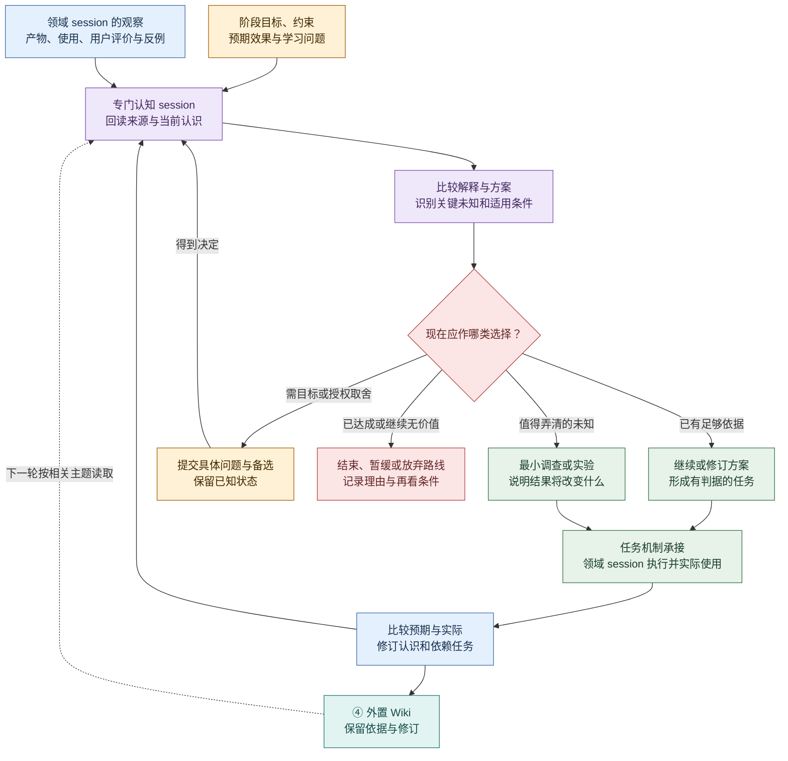
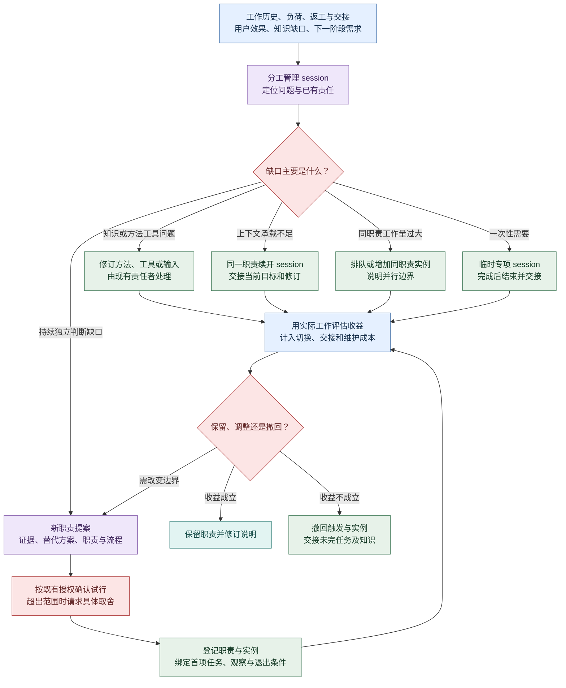
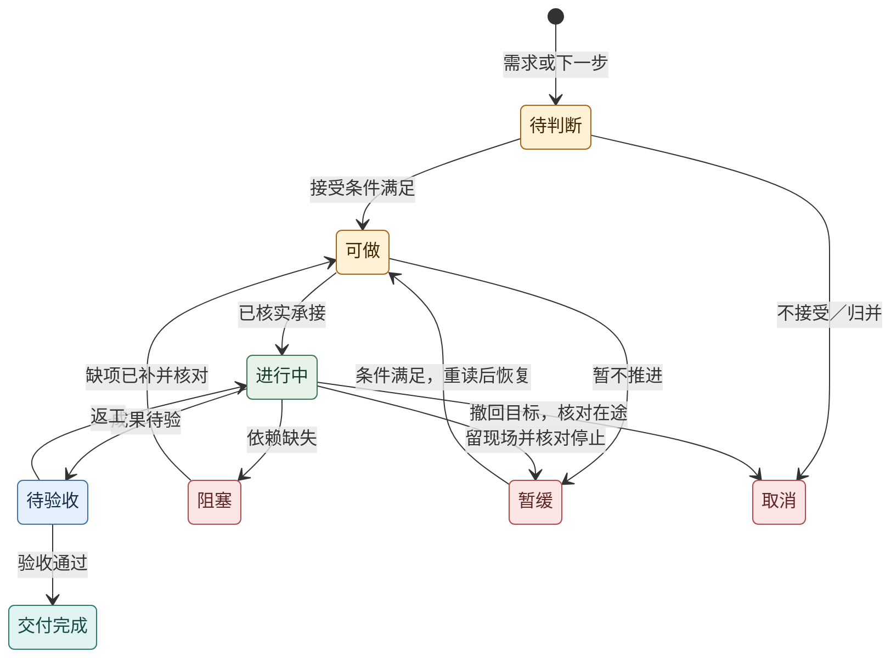

# Agent loop：从认识到下一步

2026-10-20 · 产品行为设计，尚未部署。本文展开[产品定义](definition.md)的四部分如何协作：认知循环、动态多 session、任务与状态机、LLM Wiki 与评价。两个贯穿维度是**认知演进**与**协作执行**；四部分的整体关系见[架构图](../architecture/overview.md#2-分层与依赖)，主数据边界见[项目数据](../architecture/project-data.md)。

## 一轮循环应留下什么

一次有效循环要能连接“当时希望什么 → 观察到什么 → 判断怎样变化 → 为什么选择下一动作 → 谁承接并做出了什么 → 实际使用后怎样”。认识可以支持继续，也可以要求补证、改方向或停止。

| 交接处 | 最少能回答的问题 | 可观察产物 |
| --- | --- | --- |
| 目标到认知 | 成功取决于什么，当前差距与未知是什么？ | 阶段目标、效果判据、相关知识修订与待检验假设 |
| 认知到行动 | 为什么选择这一动作，什么结果会改变判断？ | 有依据的下一步选择，或有理由的等待/结束决定 |
| 行动到 session | 谁对成果负责，需要哪些输入、权限和接续条件？ | 任务、职责说明、实际运行实例与交接记录 |
| 交付到使用 | 实现通过了哪些检查，目标使用者能否完成实际任务？ | 具体成果修订、技术检查、独立使用及用户反馈 |
| 使用到新认识 | 预期与实际差在哪里，影响哪些旧结论和下一任务？ | 知识修订、反例、仍未知项与下一次选择的依据 |

首次引入时先由现有 session 承担必要职责，按证据决定是否拆分。运行机制负责发现触发、派发与回收，认知判断由有任务上下文的 session 完成；定时运行本身不会产生有价值的认识。

## ① 认知循环：持续决定下一步为何值得做

领域 session 在工作中形成局部认识，专门认知 session 汇集项目目标、各领域判断与真实反馈，比较它们的关系。它既维护知识，也推动经授权的下一动作；业务 session 继续保有自己的判断、修复和验证责任。

图例：黄＝目标与人类取舍；紫＝认知判断；蓝＝现实证据；绿＝行动；红＝选择与停止条件；青＝持久知识。图是待实现的工作规则，不代表已经有自动调度服务。

**触发条件：** 阶段交付或实际使用结束、用户纠正、来源/环境变化、执行前提被推翻、交接反复失败，以及约定的阶段回看。可配置周期检查用来发现遗漏；没有新证据时允许保留原判断，不要求每次检查制造新任务。

**下一步选择的说明：** 关联目标、来源与知识修订；写明观察和解释、备选方案、选中理由、预期效果、反证/停止条件、责任者、验收及资源范围。调查任务还需说明“查明不同结果后会怎样选择”，避免调研无限扩张。

**自动推进边界：** 既有授权内的常规工作可以登记、承接和执行，无需用户逐步传话。改变目标、超出权限或资源约定时，呈现具体取舍；阻塞时记录缺项和恢复条件。总体目标不因任务全部完成而自动达成，也不因出现新想法就无限扩大。

## ② 动态多 session：先诊断，再改变分工

分工管理 session 综合完整工作过程、任务积压、上下文切换、返工、交接等待、代码/运行结果、用户体验和下一阶段需求。任何 session 都可以提交分工建议，专门认知 session 也能提供跨领域依据。管理者负责比较替代方案与回看效果，不替各领域审批全部工作。

图例沿用认知循环。分支表示不同诊断，不能把“换会话窗口”“增加同职责实例”和“新增角色维度”统计成同一件事。一次性专项可以解决独立问题，是否成为常设职责仍由持续需求决定。

**每个新增 session 都要有工作说明。** 它至少绑定一个职责或临时任务，说明为什么现在需要、承担的目标、输入及当前修订、可操作范围、首项任务、输出与验收、触发/工作/交接流程、完成或停止条件。沿用既有 Role 时引用其当前说明并补实例差异；新增 Role 时还必须提供以下依据：

| 提案要素 | 必须说明 |
| --- | --- |
| 具体缺口 | 哪些工作/反馈显示责任没有被持续承担，为什么不是知识、工具或容量问题 |
| 替代办法 | 改现有方法、续开会话、补实例、临时专项能否解决，各自成本如何 |
| 职责边界 | 独立目标、观察范围、输入输出、可写资产、与现有责任重叠时怎样处理 |
| 工作流程 | 何时检查或接任务、读取哪些材料、怎样判断与修复、向谁交付、怎样确认被使用 |
| 试行与退出 | 首批任务、原有基线、回看时点/触发、收益判据、成本限制及撤回后的交接 |

例如，开发 session 偶尔遇到一次部署失败，可以先修复并补运行说明。若版本发布、告警响应、恢复演练持续挤占产品开发，且有独立目标和观察面，再提出运维职责试行。依据是实际工作负担、失效模式与未来需求，不能只因为项目“变大”就自动增岗。

## ③ Task 与状态机：让选择可靠地变成工作

evoLoop 是任务与日程的事实源，以 PostgreSQL 保存身份、状态和修订；飞书多维表格是任务投影与受控协作入口。统一任务机制承接需求、缺陷、调查、实现、知识维护和职责试行；认知 session 与领域 session 都可提出任务。原生需求文档独立保存目标、范围与验收的版本，任务引用接受时的需求基线。候选任务需满足接受条件才进入执行，重复提议归并时保留各自依据与验收。

图例：黄＝待判断/待执行；绿＝执行；蓝＝验收；青＝完成；红＝阻塞、暂缓或取消。这是 evoLoop 任务业务状态的主要转换，飞书列与具体按钮需在真实协作入口上确认。任何尚未结束任务都可按目标决定暂缓或取消；图省略其余同类边，变更仍须记录原因、保留责任并核对在途动作。

**三类状态分别记录，互相核对：**

| 状态 | 回答什么 | 示例 |
| --- | --- | --- |
| 业务任务 | 接受做什么，谁负责，交付是否符合该任务判据 | 文档修复已交付完成 |
| 运行操作 | 派发/停止/写入是否真实发生，是否需要对账 | 派发超时，是否创建 session 暂未知；不能盲目重发 |
| 效果验证 | 在目标使用场景是否达到预期 | 文档已修复，但新用户接入体验仍未验证 |

任务的验收包含实际使用时，没有使用证据就不能关闭该任务；纯实现子任务可以完成，关联的阶段效果仍保持待验证。这样既允许细分工作，又不把“实现任务完成”升级为“产品目标已达成”。

**平台接入与可靠接续：** evoLoop 保存任务和日程主记录，飞书 connector 映射协作视图与身份。外部编辑作为核心命令提交，经权限和所见基线校验；冲突保留待处理提议，不静默覆盖主记录。协调层根据当前任务与职责约定派发，运行适配器查询真实会话和成果。状态变化事件提示重新读取，还需对账补漏；飞书断线不抹掉核心任务，同步成功不等于任务完成。具体语义由[项目数据边界](../architecture/project-data.md)与[接口合同](../architecture/contracts.md)维护。

**完成之后：** 交付关联任务和成果修订，协调机制核对接续责任者是否已经处理。即使执行 session 忘记发通知，也应能从任务、运行记录和成果检查中发现待接续工作。通知已请求、平台接受、接收者处理、成果实际采用分别记录；新知识的采用还需看后续产物。

**中断与取消：** 阻塞写明缺项、责任者和解阻条件；暂缓写明恢复条件；取消表示不再追求该任务。三者都保留历史与在途副作用。停止请求已接受不等于实际停止，取消也不能抹掉结果未知。恢复前重读目标、权限和相关知识修订。

真实使用中提出 dogfood issue、新需求判断、负责人日常两类讨论与定时工作的具体行为见[日常工作闭环](daily-loop.md)。它们进入同一任务和认知循环；调度与运行时接入见[Codex 接入架构](../architecture/codex-integration.md)。

## ④ LLM Wiki 与 evaluator：让认识可积累、可质疑、可检验

Wiki 保存有依据、适用条件与修订关系的认识，供各 session 按当前任务读取；它也保存失败、反例与尚未裁决的解释。专门认知 session 负责综合判断和初期维护，底层系统提供持久化、检索和版本等能力。Wiki 正文仍由开发仓库外的 KnowledgeRepository 持有，evoLoop 可保存知识引用及消费记录，不复制第二份 Wiki；任务状态由 evoLoop 持有。需求文档、任务和 Wiki 认识以有类型、带修订的关系连接。

evaluator 是一组评价工作和可复核方法，可由独立 session、确定性检查与人类实际使用共同完成，初期无需再设一个常设角色。它要分别回答来源是否忠实、认识是否正确、纠正是否传到旧页与依赖任务、消费者是否采用、真实成果是否改善，以及收益是否抵消总成本。

第四部分的完整建设流程图、对照设计和案例见[Wiki 构建与有效性评价](wiki-evaluation.md)。评价发现的问题回到对应维护/修复任务，并影响下一轮认知选择；通过检索测试并不等于阶段产品效果通过。

## 用一个连续场景验收四部分

以下是拟议验收，尚未运行。目标是“新 session 能按正式文档独立完成一次项目接入”，同时减少人类重复解释：

1. **看到差距。** 首次实际使用暴露误解，领域 session 保留具体步骤、产物与用户评价。
2. **形成选择。** 认知 session 比较改需求文档、补工具或试行新职责，选择能检验关键解释的最小行动，关联需求基线、知识修订与 evoLoop 任务。
3. **可靠执行。** 演练派发回包丢失，先确认已有实例，避免重复执行；执行中续开同职责 session，Role 数不增加。
4. **检查实际效果。** 新消费者使用修订文档完成真实接入。Wiki evaluator 核对认识和来源是否被采用，阶段评价检查接入结果与人类反馈。
5. **调整分工与认识。** 若多次出现持续独立责任缺口，试行新职责并交付说明/流程；收益不成立就撤回，交接未完任务和知识。
6. **接续或结束。** 根据实际效果安排下一动作、补证或停止，并让下一 session 采用最新判断，形成第二次可追溯循环。

记录约束遗漏、返工、重复提醒、交接等待、未知结果恢复、知识修订采用、实际使用效果与总成本。是否有效由这些变化决定，具体基线和判断标准在试点前约定；当前没有达标统计。
