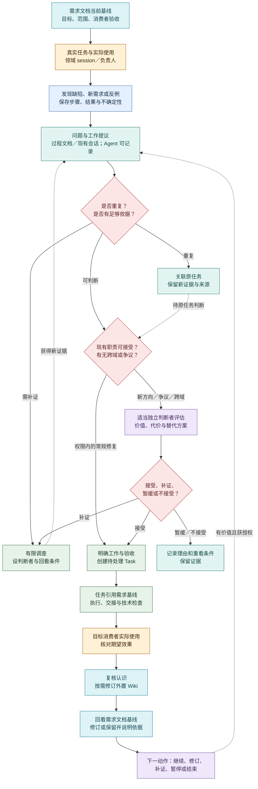

# 日常工作闭环：从真实使用到下一步

2026-10-21 · 产品行为与本机试用边界。先读[产品定义中的首次旅程](definition.md#从一个目标走到第一次有效交付)；本页回答**人怎样观察和沟通、Agent 怎样经业务 skill＋CLI 接住工作、双方怎样核对结果并继续**。已有本机 API、CLI、业务 skill、工作台及受限运行/知识路径，完整目标行为、真人使用和生产部署仍须分别验证，实际状态见[阶段路线](../roadmap.md#当前基线)。机制见[Agent loop](agent-loop.md)，人的阅读入口见[项目工作台](workbench.md)，命令使用见[业务技能与 CLI](../development/agent-cli.md)。

## 人和 Agent 怎样在两类入口间接力

以“负责人发现交付已完成，但消费者仍卡住”为例，这是一段目标使用经历，不是新增运行证据：

1. **人看见差距并沟通。** 在工作台读交付、固定需求、使用观察和责任，带着对象链接与问题到既有 Agent 会话说明。沟通明确期望与授权，不要求人把所有历史重贴一遍，也不表示已经接受一项新任务。
2. **Agent 取得工作上下文。** 按项目业务 skill，从 CLI 发现可用能力，读取实际身份/权限、Task 当前状态及开始时固定的正文与依据。所读版本与新版不同就保留差异；必需原件不完整时说明缺项，不能换成“最新版本”猜着做。判断应复现修复、复核需求还是有限补证；已获授权的常规动作直接推进，目标或资源越界才请求具体取舍。
3. **Agent 执行并回读。** 经共同服务提交有基线的业务变更，核命令回执和对象结果；已在进行中的任务不重复创建或开始。冲突就重读并重判；回包丢失先按原操作核对，保留未知，不换 ID 盲重发。skill 指导判断和流程，CLI 承载调用，最终权限和状态仍由服务端校验。
4. **人和消费者核结果。** 人在工作台追到同一任务的修订、决定、交付和失败历史；消费者沿实际路径使用并反馈，由相应责任者记录真实观察、回看阶段。技术通过、Agent 的查询/写入成功和真人实际用过分开；新证据再进入下一动作，或有理由结束。

这是默认分工，不要求所有工作都先等人发起：既有目标和授权内的领域修复、定时检查与接续可以由 Agent 自行推进。人工直接操作保留给需要它的场景。现有会话调用 CLI 与协调服务另起受管 Runtime 是两条接入路径；使用业务入口不自动要求新增会话或角色，也不证明 Desktop 已收到交接。

**共同事实不等于共同本地回执。** 人和 Agent 经相同业务规则读取已持久化对象；CLI 的私有意图回执与工作台浏览器内的恢复线索分别保存。请求若尚未被服务确认，工作台没看到变化不能证明未执行；Agent 需在自己的入口核对原操作，并向人说明已确认、冲突或仍未知的部分，不把本机回执当作已同步到页面的业务事实。两端仍各按自己的身份和权限读取；人能查看任务变更，不等于能读取另一个身份的操作回执或 Agent 的私有文件。

## 首次工作怎样开始

首次进入不要求已有 Wiki、飞书表或完整项目材料；已有软件项目与零材料目标都可开始。按[首次旅程 J1—J4](definition.md#从一个目标走到第一次有效交付)执行，以下只列日常接手时要落下的动作：

1. **收输入。** 记录目标、边界和资源/权限约束、已有材料、谁会实际使用成果，以及希望怎样看见成功。缺材料或消费者尚未明确时标为未知，指出最小补证来源与责任者，不把猜测填成事实。
2. **提出可比较的首步。** 由现有责任 session 结合可用证据给出阶段交付、这一轮要学会的问题和首个有界动作；说明做完会看到什么、什么结果会改变选择。证据足够就推进；关键未知先做有限调查。改变目标或超出授权时把具体备选和影响交有权者取舍。
3. **形成有界工作再执行。** 未决定的问题可留在 issue/spec 或讨论，明确且授权内的工作直接创建待处理 Task；主正文一次保存到 Document，验收独立填写。开始时固定采用的正文和材料，责任与范围清楚后执行或交接。已有任务记录不扩大权限，运行触发也不等于任务完成。
4. **交付给目标消费者亲用。** 执行者先核技术结果，再由目标消费者沿实际路径完成任务并反馈；把交付、采用和效果分开记录。未达到预期时进入下文的[纠正](#需求纠正怎样处理)与[阶段回看](#阶段交付后怎样选择下一步)，据证据继续、补证或结束。

本机业务入口已能承接部分真实任务，已验证范围见[Agent 入口 C1—C4](../roadmap.md#agent-业务入口-c1c4实施里程碑)。尚未接入业务服务的仓库开发或隔离工作仍可由当前任务/PR 承接；不能把开发记录当作业务 Task，也不要求为每项修复先接齐全部平台。

### 以产品文档维护开始一项业务工作

负责人提出“审核并提升当前产品文档，并由这个职责继续维护”。以下是使用现有合同组织首次工作的方式，不是这项业务已经执行或通过的报告：

1. **把首项工作写成 Task。** 明确要审阅的仓库文档与版本、读者遇到的问题、允许修改的范围、交付与验收。例如，检查读者能否解释人类工作台、Agent 入口及一次交付过程，修正有证据的歧义和失效链接，交付文档差异、检查及未决问题。首 Task 可先由已有合法负责人承接，不为提出新职责伪造一个已存在的负责人。
2. **明确职责及执行授权。** 有必要新设持续职责时，沿既有提案和接受规则登记限期试行、首项工作、边界、回看与退出条件，再把 Task 正式交接给它。Role 登记本身不授予运行权限；还须落实可执行身份、仓库工作目录和资源范围。已有合适职责时直接沿用，无需再设一个 Role。
3. **通过 evoLoop 建立受管执行。** 由业务 CLI 经协调服务创建实例，确认就绪后绑定到该 Role，并针对已固定依据的 Task 发起 Run。讨论用的 Desktop 聊天保留原用途；另开一个聊天或发出通知不能充当上述登记、绑定或实际执行。
4. **按真实产物登记交付。** 普通受管 Run 只记录执行过程和终态，不自动提供执行者的业务 CLI 身份，也不自动生成 Delivery。可先由控制者亲自核对文档差异、检查和原 Run，再以自己的身份登记交付。由自动派发提供受限 CLI 的 worker 则按其合同亲自提交，不能由控制者代签。正式产品文档仍在仓库 `docs/` 审阅、合入，Task 正文和交付引用固定来源，不复制另一套正式正文。
5. **在原任务内验收并决定后续。** 按原验收检查；若明确要求消费者亲用，则由实际消费者阅读或使用后反馈。Run 完成、Delivery 登记、PR 合入、消费者使用和 Task 关闭分别核对。下一项任务仍归同一职责，承载可按当前授权手工复用或更换；现有自动 Loop 每次派发新建实例，不承诺自动复用。试行回看另据真实效果和总成本决定保留、调整或撤回。

这条首次工作路径不要求先建新调度引擎、会话池或 Desktop 桥接。若需要执行者自己通过受限 CLI 完整提交，须核实派工路径确实提供了相应身份，不能从普通 Run 推定。命令与授权条件见[业务技能与 CLI](../development/agent-cli.md)，实例归属及接续见[Codex 接入合同](../architecture/codex-integration.md)。

## 从发现到实际使用

首次工作之后，真实工作成为持续入口。任何领域 session 在完成自己职责、使用产物或检查接续时，都能提出问题和新需求。**Dogfood** 表示真实工作或真实使用暴露了 evoLoop 产品、运行机制或协作能力的差距；它可以形成缺陷，也可以形成新功能需求。单次提示词措辞调整、未经使用的想法或仅因定时器响起而生成的条目，不自动算作 dogfood。非 dogfood 来源也能进入同一任务表。

按眼前动作阅读：[首次接手](#首次工作怎样开始) · [发现提议与接受](#一条提议怎样变成可做的任务) · [需求纠正](#需求纠正怎样处理) · [阶段回看与日常讨论](#两种日常讨论) · [分工提议](#分工提议怎样试行) · [定时工作](#定时工作怎样参与闭环)。这些动作共享下图的持续工作路径，具体输入和停止条件见各节。

图例：黄＝真实使用；蓝＝观察证据；青＝需求、任务与知识；红＝判断；紫＝认知；绿＝行动。箭头是产品期望，不表示这些自动化已运行。复核认识可直接引用本次材料；需要跨 session 或跨任务持续复用的判断才按需沉淀到外置 Wiki，不以建库或发布为继续工作的前置条件。Task 进度、运行操作与效果验证分别记录，沿用[Agent loop 的任务状态](agent-loop.md)。

## 一条提议怎样变成可做的任务

### 发现提议与接受

evoLoop 的工作可以来自缺陷、新需求、调查、实现、知识维护或职责试行。未决定的问题可留在 issue/spec、过程文档或既有讨论；决定处理后才创建待处理 Task，正文与主 Document 原子保存。Agent 默认通过业务 skill＋CLI 操作，人从工作台读回或按需直接提交；飞书只是可选投影与受控编辑入口，真实租户实连延后。工作说明须让责任者知道受影响系统和项目、观察及来源、希望产生的效果、验收、责任和停止条件；可补复现步骤、消费者检验方法、已有任务与固定材料。来源、轻量任务类型与四态进度分别记录：来自真实使用的缺陷也不能因此自动开始执行；未知保留为未知。

Task 正文、负责人和验收清楚即可开始这一条工作路径。系统同时创建主 Document，不强制独立 issue/spec、阶段、消费者亲用或新 Role。正文里按需引用其他材料，开始时固定实际使用的修订。详情见[任务与过程文档](tasks-and-documents.md)。

普通授权内修复可由领域责任者推进。交付和检查仍在原任务内，未验完保持进行中；只有任务明确要求的消费者使用才作为完成条件。失败、等待、取消和重开保留原因与旧结果，不无限衍生调查、修复和复盘任务。类型只便于筛选，不改变四态流程。

## 需求纠正怎样处理

用户纠正或技术讨论形成新需求时，责任者先保留原文、来源和旧需求基线，判断哪些结论已获采纳、哪些仍有争议。对每个引用旧版的未完任务，记录“改用新版并调整验收”“旧版仍适用及理由”或“待补证”的决定；相关 Wiki 认识和旧阅读入口也须回看。领域内、已授权的明确修复可直接推进，目标变化、争议或跨域影响则交有权判断者作具体取舍。

**先按任务和运行状态分流。** 对待处理 Task，可在权限与版本校验后更新正文、验收或来源，开始时固定主正文和实际采用的材料；省略来源变更表示继承既有固定来源，显式清空须明确提出。进行中或已有 Run/交付时，先核在途状态、固定依据、产物及授权；若须改变正文或验收，先处理在途 Run，再有理由地重开、修订、重新开始。旧 Run 和旧交付的依据不被改写，新候选正文也不自动覆盖已采用版。影响判断不等于已完成换版；无法安全接续时保留待处理项、责任者和核对条件。规则及历史边界见[任务与过程文档](tasks-and-documents.md)，实测范围见[当前基线](../roadmap.md#当前基线)。

纠正完成要由另一消费者按选定基线做事，核对新版是否被实际采用；通知或知识页发布仅说明动作发生。过程文档保留原件与修订，长期成立的结论按[工作文档到正式文档](../architecture/project-data.md#6-工作文档怎样沉淀为仓库正式文档)择要纳入 repo `docs/`，不随任务完成自动发布。两个旧基线任务及外部编辑冲突的完整产品验收见[定义 P11](definition.md#p11--工作文档驱动任务并把成立结论沉淀为正式文档)。

## 两种日常讨论

### 阶段交付后怎样选择下一步

阶段回看从原目标和需求基线、交付与技术检查、目标消费者实际使用、用户反馈及 Wiki 当前修订出发。认知责任者比较预期与现实、相反解释和仍缺的证据，提出一个有边界的下一动作：继续、修订、有限补证、暂缓或结束；写明责任、资源范围、验收及改变判断的条件。任务完成不能自动证明阶段目标达成，下一轮也不能只为维持循环而造任务。常规领域修复按已授权责任继续，只有目标、资源或争议超出边界时才请求负责人取舍。

负责人希望每天能与**分工管理 session**讨论“现有责任是否合适”，与**专门认知 session**讨论“下一项功能或实现方向”。这是两种对话目标，可由已承担相应职责的 session 准备；不是要求每天人工出席，也不因此增加两个新岗位。[项目工作台](workbench.md)把证据、备选和待取舍点放在讨论入口，并在讨论后显示决定的实际后果。常规领域修复、进行中的任务和必要接续在授权内继续运行。没有重要变化时，准备简短的“暂无新取舍”，不制造讨论议题。

| 讨论 | 事前带来的材料与选择 | 结束后留下的结果 |
| --- | --- | --- |
| 当前分工 | 职责覆盖、积压、返工、交接等待、消费者效果；比较改方法、续开同职责实例、临时专项或新职责试行 | 维持、调整、试行或撤回责任的理由；必要的任务和职责说明，试行有回看与退出条件 |
| 下一步方向 | 当前目标与需求基线、阶段预算、真实使用反馈、候选需求、冲突解释、未知；比较几项功能/实现路线及反证 | 继续、补证、修订、暂缓或停止的决定；原生需求文档、外置 Wiki 的认识修订与 evoLoop 任务，未决项有责任者和再看条件 |

讨论中的判断与用户反馈进入外置 Wiki 的有来源修订；目标与验收变化进入 evoLoop 原生需求文档，可执行工作进入 evoLoop 任务并可投影到飞书，职责变化进入相应职责说明。[知识空间](workbench.md#知识空间是完整的阅读入口)同时允许人不经每日讨论，按专题浏览认识、追源并提交新观点或纠正；是否形成任务仍须核当前授权与创建、开始条件。仓库只维护正式产品、架构与开发规范，不复制 Wiki 正文或任务状态。通知发出只是交接线索，后续 session 是否采用决定，须从其任务和实际产物核对。负责人不承担在会话间转告常规结果的工作。

### 分工提议怎样试行

任何 session 可用持续积压、返工、交接等待和实际效果提出分工问题。分工管理者先区分知识/方法缺口、同职责容量不足、一次性专项和持续独立责任；比较修订方法、续开或增加同职责实例、临时专项后，才提出新职责试行。试行写清边界、首项工作、交接、成本、回看时点与退出条件；收益不成立时撤回并交接未完任务和知识。新聊天本身不构成新角色。完整诊断与工作说明见[Agent loop 的动态分工](agent-loop.md#②-动态多-session先诊断再改变分工)。

## 定时工作怎样参与闭环

evoLoop 持有一次性和周期性日程。每项安排都需要**责任者、目标/检查问题、时区、触发规则、错过时机的处理、重叠运行的处理、暂停与停止条件**。周期安排可用于阶段回看、待办对账或两种讨论的材料准备；不预设几点运行。日程说明“何时检查/唤醒”，任务说明“约定做什么工作”，一次 session 运行说明“实际做了什么”。三者身份和状态分开，触发成功不等于任务已开始，更不等于消费者效果达成。

触发时重新读取目标、权限、任务和知识当前修订，按正常接受规则判断是否需要工作。错过时机应按该安排的约定补做、跳过或汇总，记录理由；重叠触发应合并、排队或明确允许并发，避免重复执行。暂停后保留恢复条件；停止后不再触发，未完任务仍由其责任者处理。无新证据、无有效待办的周期检查可以只记录“已检查、无需动作”，不创建空任务。运行结果未知时先对账再重试，不能凭定时器再响就推断前次失败。

进一步的组合验收可选一条真实 dogfood 问题、一条需要独立判断的新需求和一条错过或重叠的安排，贯穿“需求基线 → 提出 → 判断 → 执行 → 目标消费者使用 → Wiki/需求修订/下一动作”。另演练一次飞书旧版本编辑冲突与断线，确认核心任务仍可追溯、冲突不静默覆盖。自动检查、独立 Agent 消费和真人体验各自记录结果；本机已有的局部闭环及日程记录见[当前基线](../roadmap.md#当前基线)，不据此宣布本段所有组合条件已验。
