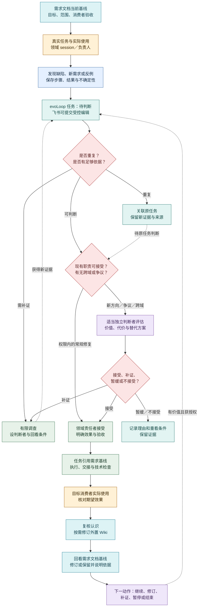

# 日常工作闭环：从真实使用到下一步

2026-10-20 · 产品行为设计，尚未部署。先读[产品定义中的首次旅程](definition.md#从一个目标走到第一次有效交付)以理解目标如何走到第一次有效交付；本页回答**负责人和领域 session 每天怎样开始、发现、接受、纠正与回看工作**。机制为何成立见[Agent loop](agent-loop.md)，具体页面入口见[项目工作台](workbench.md)。运行 harness、生产 PostgreSQL、飞书 connector、生产 Wiki 和调度服务均未上线；下述流程是待验证的期望行为。跨系统边界见[项目数据](../architecture/project-data.md)、[包边界](../architecture/packages.md)与[Codex 接入](../architecture/codex-integration.md)。

## 首次工作怎样开始

首次进入不要求已有 Wiki、飞书表或完整项目材料；已有软件项目与零材料目标都可开始。按[首次旅程 J1—J4](definition.md#从一个目标走到第一次有效交付)执行，以下只列日常接手时要落下的动作：

1. **收输入。** 记录目标、边界和资源/权限约束、已有材料、谁会实际使用成果，以及希望怎样看见成功。缺材料或消费者尚未明确时标为未知，指出最小补证来源与责任者，不把猜测填成事实。
2. **提出可比较的首步。** 由现有责任 session 结合可用证据给出阶段交付、这一轮要学会的问题和首个有界动作；说明做完会看到什么、什么结果会改变选择。证据足够就推进；关键未知先做有限调查。改变目标或超出授权时把具体备选和影响交有权者取舍。
3. **先留提议，再接受和执行。** 具体工作提议进入同一任务集合的“待判断”；接受时固定目标/需求基线、责任者、范围、可用输入、权限、停止与验收条件，再转可做并执行或交接。阶段想法不是执行任务，已有任务记录不代表已接受，运行触发也不等于任务完成。
4. **交付给目标消费者亲用。** 执行者先核技术结果，再由目标消费者沿实际路径完成任务并反馈；把交付、采用和效果分开记录。未达到预期时进入下文的[纠正](#需求纠正怎样处理)与[阶段回看](#阶段交付后怎样选择下一步)，据证据继续、补证或结束。

当前项目尚未接通这些生产入口。当下研究或开发可由现有任务/PR 承接并记录检查；这只证明该项工作如何推进，不能代替未来用户在目标产品中的首次使用验收。

## 从发现到实际使用

首次工作之后，真实工作成为持续入口。任何领域 session 在完成自己职责、使用产物或检查接续时，都能提出问题和新需求。**Dogfood** 表示真实工作或真实使用暴露了 evoLoop 产品、运行机制或协作能力的差距；它可以形成缺陷，也可以形成新功能需求。单次提示词措辞调整、未经使用的想法或仅因定时器响起而生成的条目，不自动算作 dogfood。非 dogfood 来源也能进入同一任务表。

按眼前动作阅读：[首次接手](#首次工作怎样开始) · [发现提议与接受](#一条提议怎样变成可做的任务) · [需求纠正](#需求纠正怎样处理) · [阶段回看与日常讨论](#两种日常讨论) · [分工提议](#分工提议怎样试行) · [定时工作](#定时工作怎样参与闭环)。这些动作共享下图的持续工作路径，具体输入和停止条件见各节。

图例：黄＝真实使用；蓝＝观察证据；青＝需求、任务与知识；红＝判断；紫＝认知；绿＝行动。箭头是产品期望，不表示这些自动化已运行。复核认识可直接引用本次材料；只有跨任务仍需复用的判断才按需沉淀到外置 Wiki，不以建库或发布为继续工作的前置条件。任务接受与运行操作、效果验证分别记录，沿用[Agent loop 的任务状态](agent-loop.md)。

## 一条提议怎样变成可做的任务

### 发现提议与接受

evoLoop 同一任务集合承接缺陷、新需求、调查、实现、知识修订与职责试行；飞书任务表显示其投影并提供受控编辑入口。每条提议至少说明：受影响的**系统和项目**、报告者、判断责任者、实际观察及来源、复现步骤或“尚未复现”的不确定性、希望产生的效果、目标消费者如何检验，以及已有任务、需求文档基线或知识修订的关联。来源、任务类型、接受状态是三个独立字段：例如“dogfood 来源 × 新功能需求 × 待判断”，也可以是“dogfood 来源 × 缺陷 × 已接受”。不能因来源真实就自动接受需求。

提议进入待判断后，先查重复。归并相同目标时保留新增观察、复现条件与来源，不能覆盖原证据。证据不足时约定有限调查和判断时点；无法立即找到合适的独立判断者，由当前领域负责人或阶段负责人负责指派、补位或提出具体取舍，并标出最迟回看条件，避免无人负责的无限队列。

已接受目标内、现有职责、权限和资源内的常规修复或小功能可由领域责任者判断并接受，随后自修或委派。新增方向、目标变化、显著资源投入、有争议或需要跨领域取舍的事项，要由了解目标但不只依赖提议者叙述的合适 session 判断价值、替代方案、代价和消费者验收；必要时请负责人作目标或授权取舍。独立判断是针对事项的职责，不预设常驻“产品审批角色”，也不把所有需求串行送给专门认知 session。

接受后仍需限定工作量：关联当前需求文档版本、阶段优先级和资源预算，写出这轮交付范围、停止/重看条件。由系统自己发现、自己提出的任务尤其要有价值依据和预算上限；一次使用失败不应无限派生调查、修复和复盘任务。未接受的条目保留理由；新证据出现时可以重开判断。完成实现和技术检查之后，由目标消费者沿真实路径使用，记录预期与结果。效果不成立则复核任务、需求与认识，不能靠更多任务数量宣称成长。

任务接受时固定实际需求基线；之后的需求修订不会自动改写任务或相关 Wiki 认识。飞书入口的旧版编辑须保留原提议、进入冲突处理，不能按到达顺序覆盖核心任务。Document Table、repo `docs/` 和外置 Wiki 的权威及修订关系见[项目数据](../architecture/project-data.md)；受控编辑、投影和冲突语义见[接口合同](../architecture/contracts.md)。若目标明确要求在飞书协作，验收须单独核对飞书入口；同步成功不等于任务完成。

### 需求纠正怎样处理

用户纠正或技术讨论形成新需求时，责任者先保留原文、来源和旧需求基线，判断哪些结论已获采纳、哪些仍有争议。对每个引用旧版的未完任务，记录“改用新版并调整验收”“旧版仍适用及理由”或“待补证”的决定；相关 Wiki 认识和旧阅读入口也须回看。领域内、已授权的明确修复可直接推进，目标变化、争议或跨域影响则交有权判断者作具体取舍。

纠正完成要由另一消费者按选定基线做事，核对新版是否被实际采用；通知或知识页发布仅说明动作发生。过程文档保留原件与修订，长期成立的结论按[工作文档到正式文档](../architecture/project-data.md#6-工作文档怎样沉淀为仓库正式文档)择要纳入 repo `docs/`，不随任务完成自动发布。两个旧基线任务及外部编辑冲突的完整产品验收见[定义 P11](definition.md#p11--工作文档驱动任务并把成立结论沉淀为正式文档)。

## 两种日常讨论

### 阶段交付后怎样选择下一步

阶段回看从原目标和需求基线、交付与技术检查、目标消费者实际使用、用户反馈及 Wiki 当前修订出发。认知责任者比较预期与现实、相反解释和仍缺的证据，提出一个有边界的下一动作：继续、修订、有限补证、暂缓或结束；写明责任、资源范围、验收及改变判断的条件。任务完成不能自动证明阶段目标达成，下一轮也不能只为维持循环而造任务。常规领域修复按已授权责任继续，只有目标、资源或争议超出边界时才请求负责人取舍。

负责人希望每天能与**分工管理 session**讨论“现有责任是否合适”，与**专门认知 session**讨论“下一项功能或实现方向”。这是两种对话目标，可由已承担相应职责的 session 准备；不是要求每天人工出席，也不因此增加两个新岗位。[项目工作台](workbench.md)把证据、备选和待取舍点放在讨论入口，并在讨论后显示决定的实际后果。常规领域修复、已接受任务和必要接续在授权内继续运行。没有重要变化时，准备简短的“暂无新取舍”，不制造讨论议题。

| 讨论 | 事前带来的材料与选择 | 结束后留下的结果 |
| --- | --- | --- |
| 当前分工 | 职责覆盖、积压、返工、交接等待、消费者效果；比较改方法、续开同职责实例、临时专项或新职责试行 | 维持、调整、试行或撤回责任的理由；必要的任务和职责说明，试行有回看与退出条件 |
| 下一步方向 | 当前目标与需求基线、阶段预算、真实使用反馈、候选需求、冲突解释、未知；比较几项功能/实现路线及反证 | 继续、补证、修订、暂缓或停止的决定；原生需求文档、外置 Wiki 的认识修订与 evoLoop 任务，未决项有责任者和再看条件 |

讨论中的判断与用户反馈进入外置 Wiki 的有来源修订；目标与验收变化进入 evoLoop 原生需求文档，可执行工作进入 evoLoop 任务并可投影到飞书，职责变化进入相应职责说明。[知识空间](workbench.md#知识空间是完整的阅读入口)同时允许人不经每日讨论，按专题浏览认识、追源并提交新观点或纠正；是否形成任务仍按接受条件判断。仓库只维护正式产品、架构与开发规范，不复制 Wiki 正文或任务状态。通知发出只是交接线索，后续 session 是否采用决定，须从其任务和实际产物核对。负责人不承担在会话间转告常规结果的工作。

### 分工提议怎样试行

任何 session 可用持续积压、返工、交接等待和实际效果提出分工问题。分工管理者先区分知识/方法缺口、同职责容量不足、一次性专项和持续独立责任；比较修订方法、续开或增加同职责实例、临时专项后，才提出新职责试行。试行写清边界、首项工作、交接、成本、回看时点与退出条件；收益不成立时撤回并交接未完任务和知识。新聊天本身不构成新角色。完整诊断与工作说明见[Agent loop 的动态分工](agent-loop.md#②-动态多-session先诊断再改变分工)。

## 定时工作怎样参与闭环

evoLoop 持有一次性和周期性日程。每项安排都需要**责任者、目标/检查问题、时区、触发规则、错过时机的处理、重叠运行的处理、暂停与停止条件**。周期安排可用于阶段回看、待办对账或两种讨论的材料准备；不预设几点运行。日程说明“何时检查/唤醒”，任务说明“接受了什么工作”，一次 session 运行说明“实际做了什么”。三者身份和状态分开，触发成功不等于任务已接受，更不等于消费者效果达成。

触发时重新读取目标、权限、任务和知识当前修订，按正常接受规则判断是否需要工作。错过时机应按该安排的约定补做、跳过或汇总，记录理由；重叠触发应合并、排队或明确允许并发，避免重复执行。暂停后保留恢复条件；停止后不再触发，未完任务仍由其责任者处理。无新证据、无有效待办的周期检查可以只记录“已检查、无需动作”，不创建空任务。运行结果未知时先对账再重试，不能凭定时器再响就推断前次失败。

首个验收可选一条真实 dogfood 问题、一条需要独立判断的新需求和一条错过或重叠的安排，贯穿“需求基线 → 提出 → 判断 → 执行 → 目标消费者使用 → Wiki/需求修订/下一动作”。另演练一次飞书旧版本编辑冲突与断线，确认核心任务仍可追溯、冲突不静默覆盖。自动检查与消费者体验各自记录结果；目前尚无这组运行证据。
