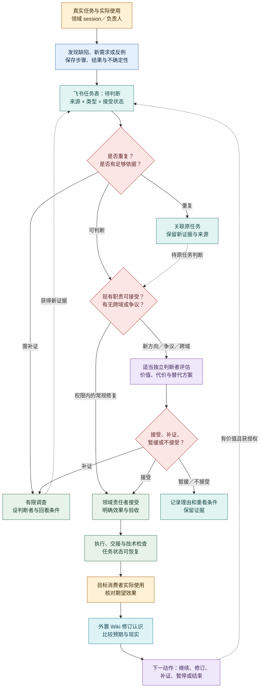

# 日常工作闭环：从真实使用到下一步

2026-10-19 · 产品行为设计，尚未部署。本文细化[产品定义](definition.md)的 P02、P07、P09、P10，并沿用[Agent loop](agent-loop.md)的两维度、四部分。飞书正式适配器、运行 harness、生产 Wiki 和调度服务均未上线；下述流程是待验证的期望行为。跨系统边界见[架构总览](../architecture/overview.md)、[包边界](../architecture/packages.md)与[Codex 接入](../architecture/codex-integration.md)。

## 从发现到实际使用

真实工作是主要入口。任何领域 session 在完成自己职责、使用产物或检查接续时，都能提出问题和新需求。**Dogfood** 表示真实工作或真实使用暴露了 evoLoop 产品、运行机制或协作能力的差距；它可以形成缺陷，也可以形成新功能需求。单次提示词措辞调整、未经使用的想法或仅因定时器响起而生成的条目，不自动算作 dogfood。非 dogfood 来源也能进入同一任务表。

图例：黄＝真实使用；蓝＝观察证据；青＝任务与知识；红＝判断；紫＝认知；绿＝行动。箭头是产品期望，不表示这些自动化已运行。任务接受与运行操作、效果验证分别记录，沿用[Agent loop 的任务状态](agent-loop.md)。

## 一条提议怎样变成可做的任务

同一飞书任务表承接缺陷、新需求、调查、实现、知识修订与职责试行。每条提议至少说明：受影响的**系统和项目**、报告者、判断责任者、实际观察及来源、复现步骤或“尚未复现”的不确定性、希望产生的效果、目标消费者如何检验，以及已有任务或知识修订的关联。来源、任务类型、接受状态是三个独立字段：例如“dogfood 来源 × 新功能需求 × 待判断”，也可以是“dogfood 来源 × 缺陷 × 已接受”。不能因来源真实就自动接受需求。

提议进入待判断后，先查重复。归并相同目标时保留新增观察、复现条件与来源，不能覆盖原证据。证据不足时约定有限调查和判断时点；无法立即找到合适的独立判断者，由当前领域负责人或阶段负责人负责指派、补位或提出具体取舍，并标出最迟回看条件，避免无人负责的无限队列。

已接受目标内、现有职责、权限和资源内的常规修复或小功能可由领域责任者判断并接受，随后自修或委派。新增方向、目标变化、显著资源投入、有争议或需要跨领域取舍的事项，要由了解目标但不只依赖提议者叙述的合适 session 判断价值、替代方案、代价和消费者验收；必要时请负责人作目标或授权取舍。独立判断是针对事项的职责，不预设常驻“产品审批角色”，也不把所有需求串行送给专门认知 session。

接受后仍需限定工作量：关联当前阶段优先级和资源预算，写出这轮交付范围、停止/重看条件。由系统自己发现、自己提出的任务尤其要有价值依据和预算上限；一次使用失败不应无限派生调查、修复和复盘任务。未接受的条目保留理由；新证据出现时可以重开判断。完成实现和技术检查之后，由目标消费者沿真实路径使用，记录预期与结果。效果不成立则复核任务与认识，不能靠更多任务数量宣称成长。

## 两种日常讨论

负责人希望每天能与**分工管理 session**讨论“现有责任是否合适”，与**专门认知 session**讨论“下一项功能或实现方向”。这是两种对话目标，可由已承担相应职责的 session 准备；不是要求每天人工出席，也不因此增加两个新岗位。常规领域修复、已接受任务和必要接续在授权内继续运行。没有重要变化时，准备简短的“暂无新取舍”，不制造讨论议题。

| 讨论 | 事前带来的材料与选择 | 结束后留下的结果 |
| --- | --- | --- |
| 当前分工 | 职责覆盖、积压、返工、交接等待、消费者效果；比较改方法、续开同职责实例、临时专项或新职责试行 | 维持、调整、试行或撤回责任的理由；必要的任务和职责说明，试行有回看与退出条件 |
| 下一步方向 | 当前目标与阶段预算、真实使用反馈、候选需求、冲突解释、未知；比较几项功能/实现路线及反证 | 继续、补证、修订、暂缓或停止的决定；外置 Wiki 的认识修订与飞书任务，未决项有责任者和再看条件 |

讨论中的判断与用户反馈进入外置 Wiki 的有来源修订；可执行工作进入飞书，职责变化进入相应职责说明。仓库只维护正式产品、架构与开发规范，不复制 Wiki 正文或飞书状态。通知发出只是交接线索，后续 session 是否采用决定，须从其任务和实际产物核对。负责人不承担在会话间转告常规结果的工作。

## 定时工作怎样参与闭环

一次性和周期性安排都需要**责任者、目标/检查问题、时区、触发规则、错过时机的处理、重叠运行的处理、暂停与停止条件**。周期安排可用于阶段回看、待办对账或两种讨论的材料准备；不预设几点运行。调度记录说明“何时检查/唤醒”，任务说明“接受了什么工作”，一次 session 运行说明“实际做了什么”。三者身份和状态分开，触发成功不等于任务已接受，更不等于消费者效果达成。

触发时重新读取目标、权限、任务和知识当前修订，按正常接受规则判断是否需要工作。错过时机应按该安排的约定补做、跳过或汇总，记录理由；重叠触发应合并、排队或明确允许并发，避免重复执行。暂停后保留恢复条件；停止后不再触发，未完任务仍由其责任者处理。无新证据、无有效待办的周期检查可以只记录“已检查、无需动作”，不创建空任务。运行结果未知时先对账再重试，不能凭定时器再响就推断前次失败。

首个验收可选一条真实 dogfood 问题、一条需要独立判断的新需求和一条错过或重叠的安排，贯穿“提出 → 判断 → 执行 → 目标消费者使用 → Wiki/下一动作”。同时记录自动检查与消费者体验各自的结果；目前尚无这组运行证据。
