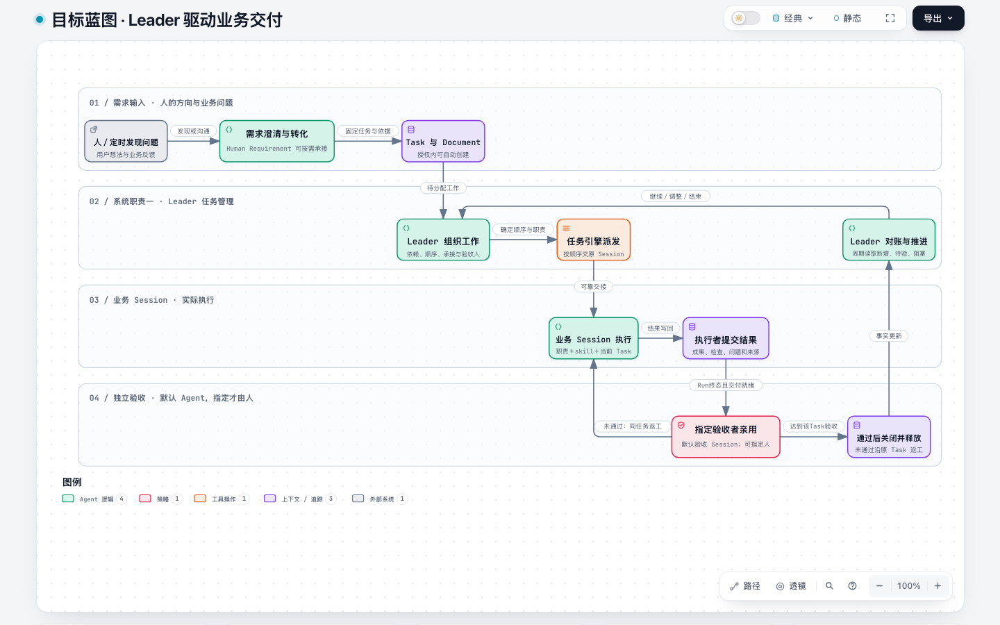
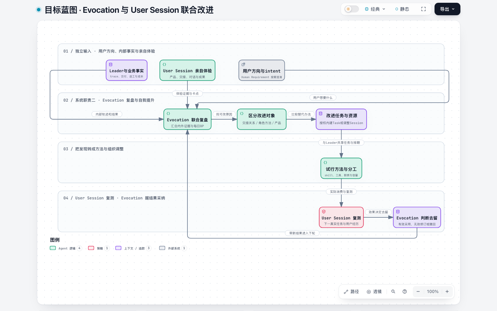

# evoLoop 产品定义

2026-10-29 · 以用户确认的两张卫星图建立整体模型，再看价值理由、首次经历、支撑机制和验收索引。本文描述目标产品；本机有界使用与未验范围以[阶段路线](../roadmap.md#当前基线)为准，图上的责任箭头不表示全部自动接通。原有双入口、任务和协作决定保留其历史适用范围，变化见[决定记录](../decisions.md)。

## 一句话定义

**evoLoop 帮助一个人与多个 Agent 持续推进项目：把目标变成有依据的工作，让交付经过实际使用，再用结果修正理解、下一步和协作分工。**

希望减少的是人反复补背景、传话、催促和补救遗漏的负担。人仍负责目标、价值取舍与关键体验反馈；Agent 会话在授权内负责判断、执行、验证和接续。第一阶段聚焦软件产品开发，其他探索型项目是后续适用方向。

## 两张产品卫星图：经营交付与组织改进

**经营与交付循环**回答“现在值得做什么、谁承接、结果是否有效”。用户反馈或有依据的发现经必要澄清，成为共用的 Task 与过程 Document；Leader 组织依赖、顺序、承接和验收安排，业务 Session 在职责内判断并执行。执行者提交结果，原 Run 终态核实后形成固定交付；声明的消费者沿真实路径使用，失败回原 Task 返工，通过后由有权者关闭，Leader 据新事实继续、调整或结束。

[打开经营与交付完整交互图](../assets/company-delivery-loop.html)。图的节点和四层位置保留用户确认的原版；正文先给出顺序，细节在[完整场景的双循环总览](functional-scenarios.md#两条循环怎样组成完整场景)与[任务对象](tasks-and-documents.md)下钻。

**组织与方法改进循环**回答“为什么返工、交接慢或方法失效，以及改变后是否更好”。User Session 先按用户目标独立体验产品、对话与成果，留下实际卡点；Evocation 再结合用户方向、Leader 与业务 Session 的 trace、交付、返工和成本，比较产品、交接、方法、容量或职责的原因。在授权内与 Leader 共用 Task 和排期试行最小改进，User Session 用下一次真实经历复测，Evocation 据效果保留、修订或撤回。

[打开组织与方法改进完整交互图](../assets/company-evocation-loop.html)。两条循环**共用同一组 Task、Document、Run、Delivery 与使用观察**；改进任务也走经营与交付的授权、执行和验收，不另建一套排程。每个 Agent 保有本职责内的理解与判断能力；Evocation 不是所有业务的先行审批者。User Session 是独立体验／评价职责，也可按 Task 承担指定消费者验收；其代理体验不冒充真人满意。两图是目标责任图，完整双循环与已验边界见[功能场景](functional-scenarios.md)和[阶段路线](../roadmap.md#当前基线)。

## 为什么要做

觉察项目与后续工作台讨论暴露了几类持续问题。以下是需求来源和观察方向，不是本轮重新进行的完整历史审计；来源范围见[来源与演进](../references/lineage.md)。

| 工作中出现的现象 | 我们需要的变化 |
| --- | --- |
| 人类反复说明目标、提醒继续、在会话间转告完成 | 任务有持续身份、责任和可恢复交接，人可以看到接续结果 |
| Agent 写出了报告，却没有使用产品或吸收用户评价 | 阶段目标包含学习问题，完成后沿真实路径使用产物并修订判断 |
| 多轮纠正散落在历史里，新会话仍按旧理解行动 | 当前认识能追到依据和修订，后续任务能发现相关纠正与反例 |
| 一个 session 包含越来越多职责，频繁切换上下文 | 根据观察面、持续责任和协作成本试行新的分工 |
| 产品、架构、规范越写越多，实际工作仍重复出错 | 文档和方法依据使用效果维护，规则可以修订或撤回 |

目标是形成可持续的工作能力。减少人类重复提醒、返工和交接遗漏，是判断这种能力是否发生的主要信号；具体数值基线仍需在真实试点中建立。

## 为什么选择这套办法，何时简单办法已足够

如果一个人和一个 Agent 能直接读几份材料、完成一次修复并核对结果，现有聊天、仓库与任务说明就可能足够。evoLoop 重点处理的是**工作跨会话、跨轮次持续发生后，判断、责任与结果容易断开的部分**。下面解释既有选择如何回应这些问题；这些因果预期仍要用真实工作验证，不因机制实现就视为收益成立。

**把工作身份与聊天分开，是为了换会话后还能接续。** Task 保存这次承诺，过程 Document 保存说明和证据的修订，Run 保存一次执行。固定依据让接手者知道“这次究竟按哪一版做”，也能在纠正后找到受影响工作。代价是维护修订和交接；若每轮仍要人重贴背景、手工查出遗漏，记录齐全也没有解决原问题。Git 正式规范与外置 Wiki 保持各自权威，避免多处正文分别改成不同答案（DEC-018/023/031）。

**把交付与使用分开，是为了让下一步由现实结果决定。** 测试通过能说明实现符合所测条件，消费者实际完成工作才回答目标是否达成。使用失败可能指向代码、需求、材料或交接，不能一律再写报告或增加功能。保留失败步骤及所用修订，才能选择有针对性的修复、补证或停止；观察不到的效果保留未知（DEC-008）。

**分工与 Wiki 只在持续需要时增加。** Role 将长期责任与一次任务、一个窗口分开；分工研究先区分方法、容量与独立判断缺口。Wiki 把多轮纠正、来源和反例整理为后续可用的认识。它们都要付出维护、读取和协作成本：一次性专项不必成为常设岗位，少量原件直接可读时不必先建知识页；新安排若没有减少遗漏或改善后续工作，应调整或撤回。既有决定确认了这些能力方向，没有证明所有项目都需要同样的分工与知识投入（DEC-001/002/006）。

**工作台与 Agent 入口分工，是为了减少人的操作和传话负担。** 人需要看清当前差距、依据和待取舍点；Agent 需要按权限读取固定材料、执行和回读。因此工作台侧重观察与反馈，业务 skill＋CLI 侧重可核对的执行，共用任务事实与业务规则。自动化只有在授权、可用承载和恢复路径成立时才有意义；没有自动接续入口时须如实保留待承接（DEC-029/030）。

这些选择是否值得继续，要观察下一次真实工作是否采用了上次纠正、交接是否少了遗漏、消费者能否完成目标，以及总维护成本是否值得。具体比较方法见[Wiki 与评价](wiki-evaluation.md)，实际证据范围见[阶段路线](../roadmap.md)。这也给出改变方案的条件：若简单材料与现有会话已足够，就保留简单路径；若瓶颈来自权限、数据或运行环境，先修对应前提，不把它包装成新增角色或知识机制的理由。

## 用户与实际入口

**主要使用者是项目负责人及与其共同工作的领域责任者。** 负责人想知道项目现在为何做这一步、需要自己取舍什么、已交付的东西是否真正有效；领域责任者想准确理解依据、完成本领域工作并让结果接得下去。实际使用成果的消费者可以是负责人、业务用户或另一个 Agent，须按任务明确，不能以作者自己满意代替。

**Role 表达持续职责，session 承载这项职责或临时工作，Run 记录一次具体执行。** 常驻产品维护职责可以经历多项 Task、更换会话或暂时没有运行；它不要求模型全天空转，也不等同于某个聊天窗口。这里先理解人和 Agent 怎样共同完成工作，具体认知、分工职责在后文解释。

**同一个产品有两类主要使用入口。** 人类负责人通过工作台观察、阅读、追溯和反馈；承担领域职责的 Agent 通过项目业务 skill＋CLI 工作。两端连接同一项目事实，区别在于如何使用这些事实，而不是维护两套任务、权限或完成标准。

| 使用者 | 主要入口 | 要完成的工作 |
| --- | --- | --- |
| 人类负责人和参与者 | 工作台＋既有 Agent 会话 | 看进展、变化、固定依据、责任和结果；与 Agent 沟通目标、纠正或关键取舍，必要时直接操作并亲用反馈。 |
| 执行业务工作的 Agent | 项目内 `evoloop-workflow` 业务 skill＋CLI | 理解工作约定，发现当前可用能力，读取固定依据，按真实授权和对象状态查询、修改、交付并核对结果。 |

默认经历是：人从工作台看发生了什么，在现有 Agent 会话中沟通；Agent 经 skill＋CLI 执行并回读，人再从共同查询看变化和结果。已有授权内的工作可自行接续，不要求人每步发话或确认。直接人工操作按需要保留，不要求 Agent 点击 GUI。业务 skill 说明怎样工作，CLI 提供机器可读的查询、命令与恢复；二者都不能扩大权限，服务端统一校验身份、版本和状态。用于开发界面的技能与这里的业务 skill 用途不同。

现有 Codex 聊天继续承载讨论；使用 CLI 不等于新建受管运行，也不表示工作台能自动投递或接管 Desktop 聊天。飞书是可选受控协作入口，正式规范从项目仓库阅读，知识从独立知识空间读取。完整接力见[日常协作](daily-loop.md#人和-agent-怎样在两类入口间接力)，命令和当前能力见[业务技能与 CLI](../development/agent-cli.md)，已运行与待验范围以[当前基线](../roadmap.md#当前基线)为准。

当负责人要求由 evoLoop 建立职责并派工时，应能从共同业务记录追到 Role、首项 Task、受管 session 和 Run；另建 Desktop 聊天只说明多了一个讨论窗口。首次可以先执行一项有界业务任务，再按真实交付、使用和成本回看职责是否值得保留，例子见[产品文档维护的首次派工](daily-loop.md#以产品文档维护开始一项业务工作)。

## 从一个目标走到第一次有效交付

J1—J6 是**目标产品的一次价值经历**，并非六个必须创建的 Task、Session 或页面。假设运营拿到 CSV 后仍不能独立完成月报，负责人希望“独立完成一次可核对的月报”。下表只给出每个交接点的结果；跨 Session 的角色、失败分支与受限实测集中在[功能场景](functional-scenarios.md)，日常操作见[日常工作](daily-loop.md)，当前能力见[阶段路线](../roadmap.md#当前基线)。

### J1 — 带着目标进入

明确月报结果、实际消费者、约束、可用材料和承接责任；未知与缺失权限保留为待处理项。无需先导入全部历史、连接飞书、建立 Wiki 或新设长期角色。

### J2 — 形成首阶段和首项工作

对照反馈提出阶段交付与学习问题。证据不足时先核一条路径；已有明确且授权内的缺陷可直接形成有正文、责任、验收和停止条件的有界工作。

### J3 — 接受并推进工作

Task 关联主 Document 正文；开始时固定实际采用的来源修订和责任。执行者按授权读取、澄清、实施并核对，结果未知先按原操作回读。分配、受管派发、实际读取和执行分别留证。

### J4 — 交付成为实际使用

技术检查后，声明的消费者沿原路径做月报并记录所用版本、结果和失败点。本人提交、固定 Delivery、独立使用和有权者关闭各有自己的证据；一次调查 Task 通过不等于月报已做成。

### J5 — 从结果修订认识

领域责任者比较原解释与使用结果，必要时复核需求、知识和受影响任务。新修订不改写旧 Run；短小材料直接可读时不必先建 Wiki。

### J6 — 回到下一步或结束

根据实际结果选择继续、补证、调整或停止，保留理由、下一责任与可回查依据。持续负担出现后再比较方法、容量、临时专项和新职责试行；第二次相连行动及真实使用才能检验持续接续。

**首次价值发生在 J4 的目标工作变得可完成，并由 J5/J6 改善下一步判断。** 登记项目、创建文档或启动会话只是支持动作。完整旅程与目标/已验边界只在[功能场景规划](functional-scenarios.md)展开；本页维护价值与成功判据。

## 核心对象怎样连接

理解旅程只需先分清下列概念；这是使用层的关系，不是要求读者先掌握数据库模型。

| 概念 | 用户为什么需要它 | 与其他对象的关系 |
| --- | --- | --- |
| 项目与阶段 | 知道希望发生什么变化、现在验证哪一段 | 阶段同时有交付和学习问题，决定任务的价值及验收范围。 |
| 过程文档 | 保存任务说明、issue、spec、discussion 和 report 的完整历史及图/附件 | 一 Task 有一主正文，其他材料可先独立存在并与 Task 多对多 link；执行采用固定修订。 |
| 任务 | 知道谁做什么、到哪一步、如何验收 | 主正文 content 唯一保存于 Document，Task 保留独立 acceptance；四态推进，交付和实际使用分开留证。 |
| 交付与使用证据 | 区分“做出来”和“真正帮助完成工作” | 关联产物修订、技术检查、消费者行为/反馈，进入阶段回看。 |
| 认识与外置 Wiki | 说明为什么这样判断，何时该改变 | 保存来源、解释、反例、适用条件与修订；供后续任务按需读取，不持有另一份任务状态。 |
| 仓库正式文档 | 表达项目当前采用的产品、架构和规范 | 各 repo 的 `docs/` 独立维护，不是 Document Table 行；采纳的过程结论可经审阅纳入，原件保留，引用固定 commit。 |
| 职责与 session | 区分持续负责什么和现在由哪个会话承载 | 同职责续开会话不等于新增岗位；委派仍须有最终责任和结果回收。 |
| 日程 | 按约定时机检查是否需要工作 | 触发可提出工作，但须核当前授权和 Task 状态；日程暂停与在途任务停止分别核对。 |

因此，一条可追溯工作关系是：**目标/阶段 → 采用需求及认识的任务 → 交付与亲用 → 新证据和认识变化 → 需求修订或下一任务**。evoLoop/PostgreSQL 持 Task、过程 Document、日程与跨对象关系；飞书作为 connector 提供投影与受控编辑；Git 正式正文及外置 Wiki 正文各有独立权威。字段和版本细节见[项目数据](../architecture/project-data.md)。

具体正文归属、轻量类型、四态和验收安排见[任务与过程文档](tasks-and-documents.md)。

## 核心闭环

经营与交付沿**目标与约束 → 有依据的 Task → 执行与固定交付 → 独立使用 → 返工或继续**推进；组织与方法改进再用这条循环的 trace 与使用结果，结合独立体验，试行并评价工作方式。两条循环互相提供事实，仍只用一套 Task 与验收规则。

每个阶段同时约定交付目标与学习目标。例如，阶段目标可以是“让一个领域 session 发现文档问题、完成修复，并由另一会话使用修复后的文档接续工作”；学习问题则是“现有任务、文档和交接机制是否足以让用户不再传话”。

阶段结束要留下使用记录、目标差距、认识变化和下一动作。一个局部阶段可以以“假设被推翻、应改变方向”结束，只要证据和后续决定明确。不能用所有子任务标为完成来自动判定整体目标达成。

**自动推进的产品目标**是：在已有目标、权限与资源范围内，系统能发现该回看什么、生成或修订有理由的任务、接续执行、使用成果，并把结果带回下一轮；减少用户反复补上这些连接。观察不足时安排有价值的调查，超出目标或授权时请求具体取舍，阶段目标达成或继续投入无价值时允许结束。循环次数、任务数量和持续运行时间不作为成长指标。

## 这里怎样定义认知

在本产品中，**认知工作是围绕目标持续建立和修正对当前处境的理解，使行动有理由、可检验，并能随新证据改变。** 这是服务产品设计的工作定义，不宣称提供完整的认知科学理论。

一份可供下一步使用的认识应能回答：

1. 我们想达成什么，哪些条件决定成败？
2. 目前实际发生了什么，依据来自哪里，什么尚未确认？
3. 哪些解释或方案可能成立，各自的适用条件、代价与反例是什么？
4. 下一步为什么选择这个动作，预期观察到什么？
5. 什么结果会使我们保留、修订或撤回判断？

认识通过阅读材料、操作真实产品、观察结果、比较解释和接受反馈形成。材料包括会话过程，也包括代码、产物、任务、运行状态和用户使用评价。记录时应保留“目标 → 行动 → 产物 → 使用与评价 → 下一步变化”的连续关系。

一项认识的关键价值，是改变行动的选择或成立条件。例如，观察到“新会话没有采用用户纠正”后，要比较究竟是未收到交接、没有读到当前修订，还是读到了却理解错误；不同解释对应不同修复和检验。只有“沟通需要加强”的总结不足以指导下一步，需说明可区分解释的观察及其结果会怎样改变方案。

## 两个维度，四个组成部分

原有两个维度仍用于分析能力：**认知演进**回答“我们如何理解目标与现实，下一步为什么值得做”；**协作执行**回答“由谁承担，怎样接续与验证，失败后如何恢复”。下面四部分支撑上面的两条产品循环，不替代卫星图的演员、交接与共同 Task 事实。

| 产品组成 | 要持续回答的问题 | 必须产生的变化 |
| --- | --- | --- |
| **① 认知循环** | 根据实际工作与用户评价，目标取决于什么？判断怎样变化？现在最值得推进或弄清什么？ | 有依据的阶段选择、学习问题、任务或停止/转向决定，并在授权内推动下一步 |
| **② 动态多 session** | 现有职责为何接不住目标？需要改善方法、补容量，还是拆出持续独立责任？ | 有说明、有工作流程和回看条件的 session/职责安排；效果不好可调整、合并或撤回 |
| **③ Task 与状态机** | 工作由谁负责，走到哪，缺什么，谁接续，何时算完成？ | evoLoop 中的任务状态与真实成果一致；飞书协作视图可对账，执行、交接和未知结果能被核对与恢复 |
| **④ LLM Wiki 与 evaluator** | 认识如何形成可追溯的当前版本？后续 session 用它是否真的改善行动？ | 外置知识持续修订，独立消费和实际效果有证据，评价能反过来改变知识与工作方法 |

认知循环主要体现第一个维度；多 session 与任务机制主要体现第二个维度；Wiki 与评价连接两者。四部分是能力边界，不要求建立四个独立进程或四个固定会话，更不要求所有 Task 先经同一个认知会话。分层关系见[四部分架构图](../architecture/overview.md#2-四部分如何组成系统)，机制见[Agent loop](agent-loop.md)，日常入口见[日常工作闭环](daily-loop.md)，人机界面见[项目工作台](workbench.md)，Wiki 的构建与评价见[Wiki 有效性约定](wiki-evaluation.md)。

## 谁负责把循环接起来

领域 session 在本领域形成认识、提出任务、执行或委派修复并验证结果。产品、架构、开发、体验和运维是可能出现的观察面，不是第一天必须建立的岗位清单。

Leader 负责跨 Task 的组合、依赖、顺序、承接者、阻塞和验收安排，接住已有工作事实；不代替业务 Session 作每项专业判断。Human Requirement 可按需与用户澄清方向、需求及取舍，形成有来源的 intent、Document 和 Task。各业务 Session 在自己的授权内提出问题、判断、执行、修复和验证。

Evocation 汇合内部事实与 User Session 独立亲用，诊断协作、单个角色方法及产品问题，在授权内提出并试行改进；新 Role 仍须有持续独立责任缺口、首项工作、回看和退出条件。User Session 先保留不受内部解释污染的体验证据，之后复测改变；Evocation 的自述和晨报也要经使用与回看。三种系统职责和 User Session 的逻辑分工不表示四个常驻窗口已配置，更不要求每项业务经 Evocation 审核。具体接力见[完整功能场景](functional-scenarios.md)。

## 第一期范围

| 能力 | 第一期边界 |
| --- | --- |
| 项目主数据与协作入口 | evoLoop 在 PostgreSQL 保存任务、日程和原生需求文档及其修订；飞书多维表格提供任务投影与受控编辑入口，外部写入经权限和基线校验 |
| 项目工作台 | 先让人看见待判断、任务和需求版本、依据与异常并完成关键取舍；Codex 聊天、Git 正文与 Wiki 仍由各自权威承载，按[工作台设计](workbench.md)分期验证 |
| Agent 业务入口 | 项目业务 skill 指导工作，CLI 发现能力、读取固定依据、提交业务变更并核对未知结果；与工作台共享权限、修订和状态规则，不以 GUI 自动化作为正常执行方式 |
| 会话协作 | 既有会话可调用 CLI 继续工作；另行接入受管运行时，明确读取、派发、唤醒、确认范围，不把两类会话混为同一入口 |
| 判断与知识维护 | 每个 Agent 在职责内判断并贡献有来源认识；Evocation 在组织/方法改进中跨来源复盘，Wiki 外置并按实际采用评价 |
| 动态分工 | Evocation 与 Leader 基于真实负担、体验和成本试行方法、容量或职责变化；不为所有项目一次创建全部角色 |
| 正式文档 | 产品、架构、规范和决定记录存仓库，可重建 HTML；可发布内容默认公开 |
| 运行可靠性 | 先限制并发与运行范围，验证重复、未知结果和重启恢复，再扩大能力 |

自动购买资源、无边界扩张 Agent 数量、复制一套独立 Wiki 正文、自研通用知识数据库以及未经验证的多机高可用，不进入首个闭环。后续范围依真实瓶颈决定。

evoLoop 仓库拥有协作支撑代码与自己的正式文档。受管项目的业务代码和正式产品文档仍在各自仓库；项目之间共享方法和接口，不混合任务身份、知识空间或权限。

## 如何判断产品有效

先记录一组可比较工作的基线，再观察引入机制后的变化。下表是评估设计，尚无达标统计。

| 观察对象 | 记录什么 | 防止误判 |
| --- | --- | --- |
| 人类介入 | 重复解释、传话、提醒继续、补救遗漏的次数与原因 | 保留必要的目标决定和体验反馈，不以“人越少越好”评价 |
| 交接 | 交付到接续的等待、遗漏、重复执行、未知结果恢复 | 工具返回成功不能单独证明对方已处理 |
| 认识使用 | 新会话的约束遗漏、错误引用、纠正采用、实际动作变化 | 页数和检索命中不等于有效使用 |
| 产品效果 | 阶段真实操作的完成情况、用户反馈与返工 | 工程自检与用户体验分开验收 |
| 分工收益 | 持续责任是否补齐，切换、协作、维护和模型成本怎样变化 | 角色增加本身不计成功，收益不成立可以撤回 |
| 自动推进质量 | 下一动作的证据、价值与授权是否明确；减少了哪些重复提醒；是否在应停时停止 | 自动创建任务、持续调用模型或扩大分工不等于项目成长 |

知识底座的首轮小样本验证已暴露维护和并发缺口，且未证明优于直接阅读少量材料。见[验证摘要](../references/validation-summary.md)。因此本产品仍需验证长期材料增长、跨阶段修订与实际协作带来的收益。

## 场景索引怎样使用

前面的旅程帮助理解产品；下面 P01—P12 保留需求身份、详细结果和验收，便于设计与实现追溯。**编号不是页面顺序、独立模块或相同优先级。** 按要理解的层次选择：

| 层次 | 对应场景 | 阅读目的 |
| --- | --- | --- |
| 项目推进主线 | P01、P02、P07、P09 | 从目标到领域工作、实际使用与下一动作，对应 J1—J6。 |
| 认识和分工怎样改变 | P04、P05、P08 | 纠正是否影响行动，评价是否可靠，职责调整是否值得。 |
| 体验与支持能力 | P10、P11、P12 | 日程、过程文档和工作台如何支撑主线，而非各自构成项目成功。 |
| 横贯各步骤的质量约束 | P03、P06 | 中断恢复、正式方案一致和可读可用，适用于整段旅程。 |

## 必须支持的场景

### P01 — 从目标形成可推进的阶段

负责人提出目标，责任 session 将目标拆成有交付、有学习问题的阶段，登记依据、限制和验收方式。未知条件进入调查或实验；允许在证据变化后重新选择阶段。

**验收**：新加入的 session 能解释当前阶段为何值得做、完成后怎样使用，以及什么结果会改变下一步；无需靠负责人重新讲完整背景。

### P02 — 领域发现问题并负责解决

架构、产品、体验或开发 session 在实际工作中发现缺陷、新需求或方法问题，进入 evoLoop 同一任务集合，并可在飞书任务表协作。负责人可以自己修复或委派有明确边界的工作，最后回收交付并验证效果。

**验收**：从发现依据能追到任务、责任者、交付和验证；委派后责任不消失，合并代码与产品效果分别可查。

### P03 — 交接可以恢复

执行者提交成果后，接续方能发现并确认所需动作。通知丢失、会话中断、请求超时或运行时暂不支持自动唤醒时，系统保留实际状态和恢复路径。

**验收**：模拟一次中断或丢通知后，重新检查能恢复待处理交付；既不静默遗漏，也不因盲重发造成重复执行。尚无法确定结果时明确显示“未知”。

### P04 — 纠正能改变之后的工作

用户纠正、实际反例或环境变化进入知识维护过程。维护者定位依赖旧认识的页面和未完成任务，修订当前判断、保留来源和适用范围；存在分歧时记录各方依据。

**验收**：一个未参与整理的新 session 能采用纠正后的约束完成具体任务，并能追溯其依据；旧内容不再无说明地成为当前结论。

### P05 — 工作证据推动职责演进

任何 Session 都可以提出职责调整。Evocation 结合 Leader 的任务事实、User Session 亲用、历史、负荷、返工、运行结果和下一阶段需求，区分知识或工具问题、容量不足和独立职责缺口；Leader 组织试行任务与承接。

**验收**：每项角色试行有问题依据、替代办法、职责边界、交接、观察指标及退出条件。它可以产生新角色，也可以选择改工具、增加同职责实例、临时专项、合并或撤回。

### P06 — 人和 Agent 读到一致的正式方案

产品、架构和规范各有明确正文归属；Git 中的源文件生成 HTML。人能看清目标、状态和关键取舍，Agent 能按当前任务定位相关章节、接口及判据。

**验收**：正式文档可在新 checkout 重建；阅读入口没有依赖本机目录的断链；变化与所描述行为一致。阶段结束实际让使用者或新 session 按文档操作，记录误解和阻塞。

### P07 — 认识能够自主接续下一步

一个阶段交付或出现用户反馈后，业务责任者和 Leader 对照原需求、固定交付与使用结果选择继续、修订、补证、停止或请求取舍；Evocation 与 User Session 对跨任务的交接、方法和组织效果另行复盘。在已有授权内，新工作进入同一 evoLoop Task 集合并被可用 Session 承接；需求或认识变化时，引用旧基线的未完任务也得到复核。

**验收**：至少观察到两次相连的“行动 → 实际使用 → 认识变化 → 下一动作”，第二次动作能指向前一次的具体证据；不依赖人类再次粘贴背景、提醒完成后通知或替 Agent 决定每个常规步骤。若触发停止条件，系统能够给出依据并结束，而非为保持循环继续造任务。本机已有两次相连交付、独立 Agent 消费及阶段回看的受限证据；真人体验、知识增益和持续收益仍按[阶段路线](../roadmap.md#当前基线)核验，不由局部记录推定。

### P08 — Wiki 的贡献可被检验

独立 session 在相同任务与约束下使用 Wiki，评价其能否采用当前认识、追溯来源并完成有用成果；与直接阅读材料等可比入口比较效果及总成本。失效案例进入知识修订或方法改进任务。

**验收**：能够区分来源是否可靠、认识是否正确、消费者是否采用、实际产品是否改善；不把检索命中或模型自评分当作全部收益。实验约定与案例见[Wiki 构建与有效性评价](wiki-evaluation.md)。

### P09 — 真实使用驱动产品成长

各领域 session 在完成真实任务或使用 evoLoop 时，能把遇到的产品或协作机制缺陷、以及新需求提交到 evoLoop 同一任务集合；Agent 通过业务入口登记与处理，工作台供人观察和按需操作；飞书任务表是可选投影入口，真实租户实连仍延后。记录区分来源是否为 dogfood、任务属于缺陷还是需求、未决定的问题是否已形成待处理 Task；dogfood 指真实工作或使用暴露能力差距，并不等同于每次提示词调整。常规且在现有职责授权内的修复可由责任者创建并开始；新方向、争议或跨领域影响交给合适的独立判断者，不让所有事项排队等待同一中心批准。

**验收**：至少一项真实使用暴露的问题保留复现步骤或标明不确定的观察、期望效果、受影响系统/项目、报告者与判断责任者；重复提议归并而新证据仍可追溯。它经判断、创建、执行和目标消费者实际使用后，能解释产品判断或下一动作怎样变化；缺少判断者时仍有明确的补位责任与回看条件。见[日常工作闭环](daily-loop.md)。

### P10 — 约定时间的工作可接续且可停止

负责人或已获授权的 session 可为一次性或周期性工作约定触发时间；触发只提出或检查工作，后续仍须核对当前授权与 Task 状态，不自动认定任务值得做。计划需要时区、错过时机、重叠运行、暂停、停止及责任者的可见语义。

**验收**：一次错过触发与一次重叠触发都能恢复或按约定跳过，并保留理由；暂停只禁止后续触发，停止在途工作需另有请求和核对结果。没有新证据或有效待办时，周期检查不制造空任务；执行结果仍经过原任务的消费者验收。本机已有触发、暂停/停止和恢复的受限记录；错过、重叠及持续使用等判据按实际覆盖核验，生产调度与长期效果不由此推定。

### P11 — 工作文档驱动任务，并把成立结论沉淀为正式文档

**场景**：需求、任务详述或技术讨论形成有身份和修订的过程文档，Document 与 Task 可直接多对多关联，任务采用固定需求基线；新需求被采纳后，责任者逐项复核旧基线任务及支持或挑战它的 Wiki 认识。长期成立的结论可经仓库审阅纳入正式文档，原讨论及未采纳意见可回查。

**用户结果**：过程文档在 Document Table 中打开全文；repo `docs/` 从独立入口读取，Wiki 保存在仓库外。修订和整理不会把三者变成同一份正文。任务或知识引用正式文档时使用仓库路径和固定 commit。Task 的主正文与验收分别保存，其他过程文档只作为固定材料或普通关联。

**验收**：用一次真实需求改版核对两个引用旧基线的任务：一项保留原基线记录并按新版调整验收，另一项记录旧版仍适用的理由；相关 Wiki 认识进入回看。新消费者按选定基线完成工作，交付、亲用、认识变化及下一动作可追溯。飞书旧版编辑与新基线冲突时，保留原提议，标为待处理且不静默覆盖；最终采纳决定及接受者可追溯。一次多来源到多目标的正式文档整理，能从固定过程来源追到采纳范围、目标段落和合入 commit，并从正式文档回查依据；原件、未采纳意见和旧任务基线仍在。任务完成、PR 合入、报告构建与使用效果分别核对。本机已覆盖部分固定基线复核、原件与消费者使用路径；飞书真实编辑冲突和多来源正式文档整理等整段验收不能由这些局部证据替代，具体范围见[当前基线](../roadmap.md#当前基线)。

**详见**：[工作台的全文阅读](workbench.md#从表格打开完整过程文档)保留 Markdown/HTML 原件、资源、版本与返回列表的产品判据；[过程文档和仓库正式文档](workbench.md#过程文档和仓库正式文档的关系)说明用户如何选择性沉淀；[项目数据](../architecture/project-data.md#6-工作文档怎样沉淀为仓库正式文档)与[接口合同](../architecture/contracts.md)维护关系、旧版编辑冲突和整理流程。

### P12 — 工作台让人看见依据、取舍和后果

负责人主要从项目首页观察分工与下一阶段的变化、依据和待取舍点；与现有 Agent 会话沟通后，Agent 通过[业务技能与 CLI](../development/agent-cli.md)承接常规工作、读取固定原件、修改状态并恢复未知结果。人回到工作台追看发生了什么，必要时直接操作或提交亲用反馈。知识空间可按专题浏览知识点卡片、阅读外置 Wiki 完整修订、追溯来源与相关认识并提交纠正。需求文档、Git 正式规范引用、Session 职责、交付与亲用结果也有可追溯入口；任务、运行、同步、知识和实际效果各自显示状态。现有 Codex 聊天仍由 Codex 承载，工作台提供概要、跳转和受控工作入口。

**验收**：一名不掌握历史聊天的新使用者能从首页找到当前目标、一个待取舍问题的相反依据及责任者；与 Agent 沟通后，独立 Agent 从业务技能和 CLI 读固定依据、在授权内执行并读回结果，人再从工作台看见对应修订、执行与消费者结果，不需重新粘贴背景或替 Agent 点击每一步。另一个使用者能从任务反查固定基线并识别飞书同步冲突。第三名使用者不经讨论也能从专题进入完整知识页，核对来源、反例和版本，提交纠正并看到正文是否实际更新。桌面和手机都能读到关键状态与反例。页面、动作和分期见[项目工作台](workbench.md)；待判断、日程/异常与知识效果评价也须有明确入口。参考 nashsu 的代码复用不改变这些产品判据，具体实现见[Wiki 集成方案](../architecture/wiki-integration.md)。独立 CLI 使用与人的观察需联合核对；这仍不代替真人长期效果验收。

## 产品文档如何继续演进

需求或体验变化先更新本文相应场景与验收，涉及边界或交接时联动[架构](../architecture/overview.md)，涉及执行方法时联动[开发规范](../development/standards.md)。关键方向记录在决定登记中；认识形成的过程与原始材料继续留在独立知识空间。

正式产品文档表达当前采用的目标和方案。产品维护者需要用实际阅读、执行和使用反馈验证表达效果，并把重复出现的理解问题转成改进任务。
