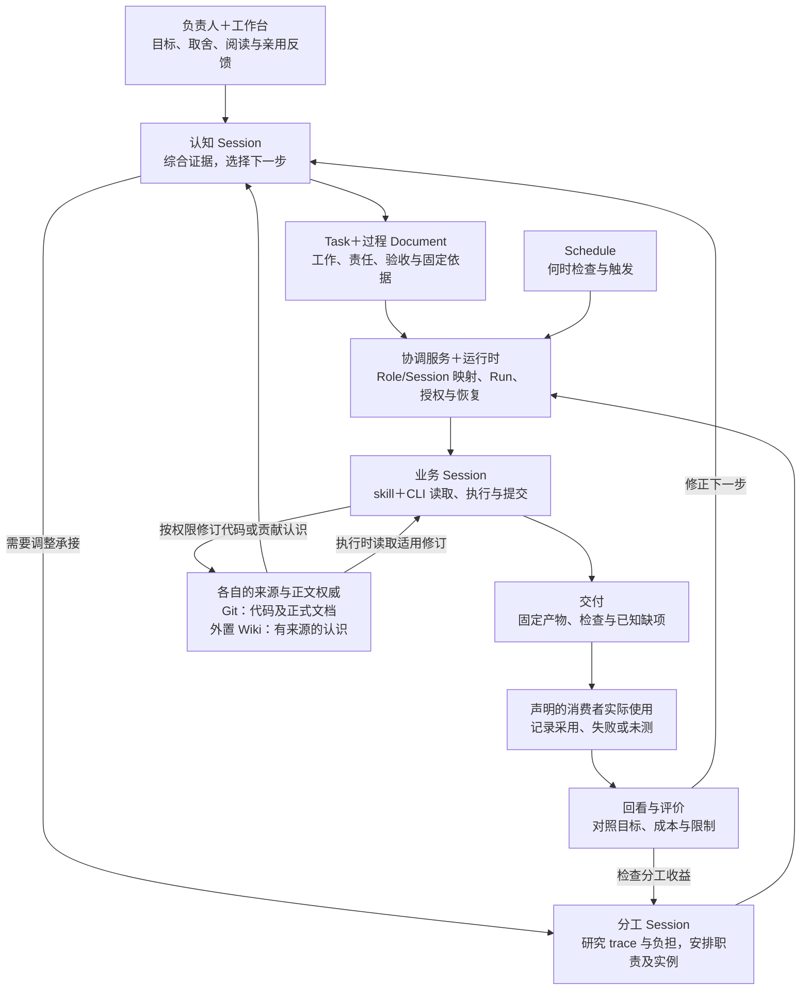
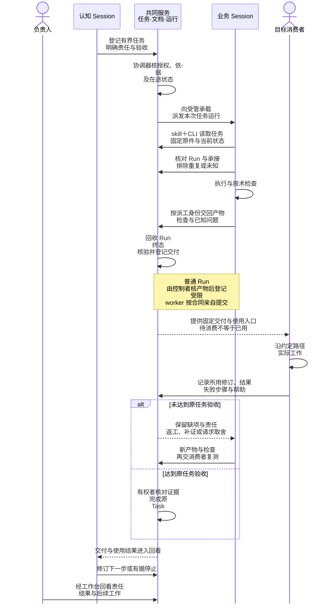
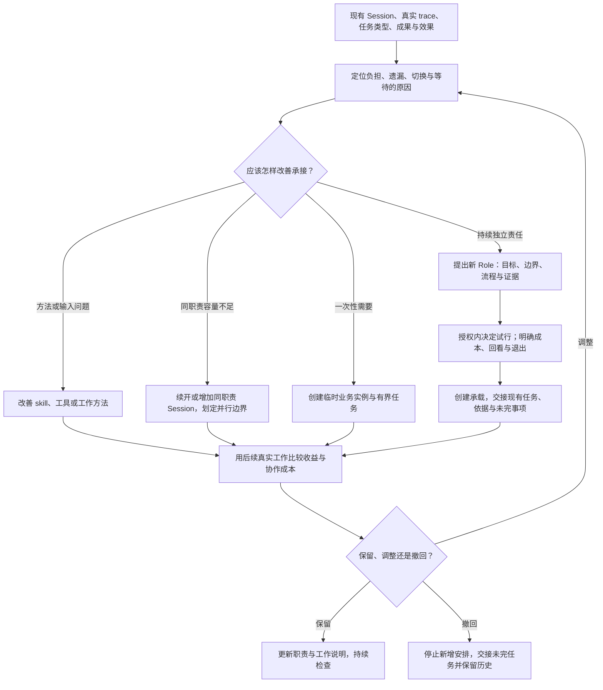

# 功能场景规划：把项目判断、协作执行与实际效果串起来

2026-10-24 · 产品场景规划 v0.3，明确交付后的消费、失败接续与结束边界。依据本轮用户明确的认知、分工、业务 Session 与定时工作要求，结合现有[产品定义](definition.md)、[Agent loop](agent-loop.md)、[日常工作闭环](daily-loop.md)、[任务与过程文档](tasks-and-documents.md)及[Codex 接入](../architecture/codex-integration.md)整理。**这是目标行为与待验证机制的规划，不是完整运行验收报告。**

## 这篇文档要回答什么

evoLoop 希望帮助一个人与多个 Agent 持续推进项目：减少人反复补背景、传话、催促和补救遗漏，让交付经过实际使用，再用结果修正理解、下一步和分工。功能存在的理由，应当能从这些问题一直追到使用效果。

本文用完整场景把各模块连接起来：**谁遇到什么问题 → 人与 Agent 怎样判断 → 信息、任务与责任怎样交接 → 系统怎样执行和恢复 → 用户在哪里看到结果 → 什么证据说明问题得到解决。** 它是产品定义与模块细则之间的连接层，不另外定义数据库字段或复制接口合同。

| 最初要解决的问题 | 场景中必须连上的机制 | 怎样判断有所改善 |
| --- | --- | --- |
| 人重复讲背景、在会话之间转告和催促 | 固定任务依据、明确承接、可靠唤醒与接续回查 | 新承接者能自行取得所需依据；授权内工作无需人反复转述 |
| Agent 写了报告，却没有真正使用和改善产品 | 技术交付、独立使用、问题回流、修复与复测 | 消费者沿原路径完成工作；失败有后续责任，而非停在“报告完成” |
| 纠正散落在聊天里，下一会话仍按旧理解做 | 有来源的知识修订、任务影响复核、实际采用 | 下游任务和产物能证明采用了适用的纠正 |
| 一个会话任务越来越杂、切换和交接越来越重 | 研究真实 Session trace、任务结构与负担，试行职责拆分 | 原负担下降，结果和交接更好；计入新职责的维护成本 |
| 文档、角色和任务增多，价值却不清楚 | 阶段回看与有条件的效果评价 | 下一步因此改变，或有依据地停止、撤回无收益的安排 |

前两项的用户结果不能只由任务数、消息数、Wiki 页数、Run 完成或代码合入推定。真实体验、Agent 代用、技术检查与长期收益分别留证。

## 总体场景地图与本轮范围

按使用目的，先组织为下面六条主旅程。**本轮优先细化并逐条确认前三条；后三条暂作关联索引，分类与边界仍待继续讨论。** 产品定义的 J1—J6 是一次工作循环中的阶段，不是这里六条独立旅程，也不对应六个固定页面或岗位。

| 主旅程 | 起点与终点 | 本文展开范围 |
| --- | --- | --- |
| 1. 认知规划与需求纠正 | 项目目标、实际结果与新证据 → 有依据且被接续的下一动作，或停止决定 | 认知 Session 的输入、推导、任务形成、分配与效果回看 |
| 2. 任务承接、执行与反馈 | 一项有界工作 → 被承接、执行、验证，问题进入修复与复测 | 唤醒、固定依据、成果提交、一次性与周期性实例、结束收束 |
| 3. 分工研究与职责演进 | 现有工作暴露持续负担 → 有证据的分工试行、保留、调整或撤回 | 研究运行中 Session、区分容量和职责、创建承载者与交接 |
| 4. 知识形成、纠正与消费 | 工作发现及来源 → 后续使用并检验认识 | 连接前三条；独立旅程继续结合 [Wiki 与评价](wiki-evaluation.md)确认 |
| 5. 定时检查与无人值守接续 | 日程到期 → 无需动作或有责任的工作 → 结果与下一次检查 | 本文先展开日常巡检变体；日程细则见[日常工作](daily-loop.md#定时工作怎样参与闭环) |
| 6. 评价并改变下一轮 | 对知识、方法或安排的效果有疑问 → 真实比较 → 保留、调整或停止 | 本文给出验证连接；比较方法见 [Wiki 有效性约定](wiki-evaluation.md) |

下面是**目标协作关系**。箭头表示需要发生的读取、提交或接力，不表示自动桥接都已实现；具体边界在文末列明。

人也可以直接到既有 Agent 会话讨论；图中的工作台到 Session 是用户带着项目问题进行沟通，**不是已实现的聊天自动投递**。各领域 Session 在既有授权内可以主动工作、修复与交接；认知和分工责任不成为所有局部动作的逐项审批中心。

## 共同前提：谁负责、信息在哪里

### 两类 Session 与项目初始安排

用户本轮明确区分两类 Session：

| 类别 | 项目初始职责 | 主要工作 |
| --- | --- | --- |
| **System Session** | 认知、分工 | 认知综合项目事实并规划下一步；分工研究现有工作和承载负担，安排与演进职责 |
| **业务 Session** | 架构、产品、开发流程与规范、具体功能开发；按任务增设临时体验等实例 | 在各自范围内判断、执行、修复、验证，并形成有来源的认识 |

这是本项目的初始职责安排，不是给所有项目预置完整岗位，也不是声称当前代码已有对应分类枚举或自动创建流程。后续随真实工作调整。架构、产品与流程规范属于业务 Session，拥有持续责任也不改变其分类。

**职责类别、持续时间和触发方式分别配置。** System Session 可按事件或定时回看；业务 Session 可为一次性任务创建，也可长期承载某职责、每天被唤醒检查。持续职责无需让模型全天空转，具体会话可以恢复或换实例接续。

认知与分工 Session 在实际授权范围内都可以请求创建业务承载实例。已有合适职责时，认知 Session 可以直接安排任务；缺少合适职责时，将缺口和待办交给分工 Session 研究。新增持续 Role 仍须有实际缺口、工作说明、试行与退出条件；一次性体验工作可以仅有临时实例和任务。

### 对象之间的关系

- **Role** 表达持续职责；**Session** 是承载职责或临时任务的实例。换会话或增加同职责容量，不自动新增 Role。
- **Task** 表达要完成的业务工作、当前责任与验收；其主正文统一保存于 **Document** 的修订，开始工作时固定所采用的正文与依据。
- **Run** 是某个 Session 对某个固定 Task 修订与依据的一次执行。一个任务可以续做、返工或换承载，留下多个 Run；运行终态不自动完成任务验收。
- **Schedule** 表达何时检查、错过和重叠怎样处理。一次性和周期性是安排方式；到期后需要执行的工作进入普通任务流程，不把一个永不结束的 Task 当作全部周期历史。
- **Delivery / Observation** 分别记录产物与检查、消费者行为与效果。交付、收到、阅读、采用与有效，各自需要证据。

Task/Schedule、过程 Document 修订和跨对象关系由 evoLoop/PostgreSQL 管理；Git 持代码和正式产品、架构、规范；外置 Wiki 持各 Session 的有来源认识。认知 Session 同时查这些权威，不以 Wiki 摘要替代必要原件。过程研究报告可以进入 Document，长期认识进入 Wiki，正式结论经审阅进入 Git；不是要求每项工作都复制三份正文。详细规则分别沿[项目数据](../architecture/project-data.md)和[任务与过程文档](tasks-and-documents.md)维护。

## 场景 1：认知 Session 怎样选择并推动下一步

### 问题与触发

负责人想知道项目现在做到哪里、还有什么阻塞、下一步为什么值得做。触发可以是负责人提问、阶段交付、新使用反馈、重要需求变化，或约定的认知回看日程。

例如：功能开发任务已完成，但产品体验发现用户仍无法顺利完成工作。认知 Session 必须解释“任务完成”和“目标未达成”之间的差距，再选择继续修复、调整需求、有限补证或停止。

### 输入、判断与接续

1. **读取共同项目事实。** 按当前判断问题、阶段与变更水位，查相关目标、Task Table 的未完与已交付工作、Document Table 的需求/讨论/报告，以及对应 Git 仓库的代码、正式产品/架构/规范和必要检查结果。覆盖相关来源种类不等于每轮重读所有表格、整仓库和全部 Wiki；保留实际读取范围、固定修订与缺项，必要时再追原件。
2. **读取领域认识与实际反馈。** 查各执行 Session 贡献到外置 Wiki 的解释、来源、反例与未知；按需追到真实 Session trace、产物和消费者反馈。观察不到的成本或效果保持未知。
3. **形成可反驳的判断。** 对照目标解释差距，比较候选动作、代价与相反证据。下一任务可以是功能、调查、架构演变、规范改善或产品体验；不限定为开发 issue。
4. **保存判断并形成有界工作。** 推导报告、方案或未决问题进入过程 Document；明确且授权内的工作创建 Task，写清负责人、正文、验收、必要依据与停止条件。影响目标或资源的取舍交有权者决定。
5. **寻找承接者。** 有合适职责和可用 Session 就安排；缺容量可申请同职责实例；缺合适职责则请求分工 Session 研究。请求与任务都保留责任，不能停在“已发消息”。
6. **核对实际接续。** 看接收方是否读取适用修订、开始执行并提交结果；需求改变则按[需求纠正](daily-loop.md#需求纠正怎样处理)复核受影响任务及在途 Run，不静默替换基线。
7. **用结果修正下一步。** 核交付、实际使用、issue、认识变化与效果限制；决定继续、修订、补证、等待或结束。长期成立的认识按知识维护流程发布，不能只按报告篇数判定成长。

### 人在前端应该看到什么

工作台应能从一个下一步建议追到：原目标差距、关键来源与版本、备选及理由、决定者、形成的任务、当前承接责任与运行结果。下一次回看能看到采用情况和实际效果，尚未承接或待补证的项不能显示为已经解决。

**闭环判据：** 有依据的决定被下游工作采用，或留下有理由的停止；阶段收益仍以消费者使用检验。输入不可达时明确缺项和补证责任；暂时无有价值动作时允许等待。

## 场景 2：业务 Session 怎样接任务、提交结果并带回问题

### 分配、唤醒与执行是三步

任务分配改变谁负责；唤醒让承接者获得运行机会；执行者读任务并实际行动。三者需要分别可查，不能用“owner 已填”或“通知发出”代替接续完成。

以下是**目标时序**；受管派发已有有限实测，持续唤醒与结束收束的边界见[机制边界](#机制边界现有什么还需要验证什么)。

图为便于顺序阅读合并展示共同服务中的任务/文档模块和协调运行模块，外置 Wiki 仍有独立权威。图中的消费者按 Task 声明，可以是人或独立 Agent；执行者的技术自检不能代替要求的独立消费。这条路径以“验收要求实际使用”的任务为例，未取得观察时停在待消费，仍由任务责任者跟进；不强制所有任务都等待真人。图中的提供入口、回看提醒与返工接续是目标责任关系，不表示服务已具备通用通知通道。若已有 Desktop 会话被选为承接者，必须标明它当前怎样取得任务；没有自动入口时保留待承接，不能套用受管派发箭头宣称已唤醒。

### 执行者需要取得的交接内容

接收方至少能查到目标/任务 ID、当前责任、任务状态、固定正文与来源修订、已有成果及检查、发现的问题、在途或未知 Run、授权范围、验收与下一步。发送短消息可指向这些共同记录，不让另一段聊天摘要成为新的任务权威。

同一 Task 换承接者时，原运行先核清，再按任务规则调整责任与版本、确认交接并接续；不要重复创建同一工作。拆出独立子任务时，则分别明确交付、验收、依赖和结果回收责任。现有 Role handoff 的登记与确认不自动变更 Task owner，也不自动发消息，细则见[协作合同](../architecture/contracts.md)。

### 交付之后，谁接住未完成的工作

**声明消费者解决“谁来用”，任务责任者解决“谁确保有下一步”。** 消费者应记录自己实际使用的修订、做了什么、是否需要帮助及失败位置；执行者提供可用产物、检查和入口。普通静态 Run 没有业务身份时，由控制者核产物后以本人身份登记关联原 Run 的 Delivery；受限 worker 不能由控制者代签。收到或阅读不自动成为采用，代用 Agent 也不能署名为真人亲用。具体路径见[首次业务派工](daily-loop.md#以产品文档维护开始一项业务工作)。

| 当前观察 | 谁接下一步，依据什么 | 何时可以结束 |
| --- | --- | --- |
| 交付有了，尚无约定消费 | 任务责任者提供固定版本与可用入口，落实消费者及待用原因；缺材料/权限先补对应前提 | 使用是验收条件时，原 Task 继续进行；等待不写成通过 |
| 消费失败，原目标仍有效 | 领域责任者按失败步骤判断实现、表达、输入或交接问题；授权内修复后用新交付复测原路径 | 通过当前验收才完成，旧 failed 保留；不能换成较容易的检查追认成功 |
| 消费暴露需求或目标需要改变 | 有权者比较原要求与新证据，决定保留、调整、取消或有限补证；在途 Run 先核清，任务依据按规则修订 | 有理由的取消可以结束投入，但不等于原目标达成；改版后的新一轮另验 |
| 消费达到本任务标准 | 验收责任者核固定交付、观察与判据；认知责任者按需回看阶段差距及后续选择 | Task 可完成；阶段效果、长期收益与持续职责是否保留分别判断 |

若调查报告本身是交付，消费者能用它作出有依据的判断，可以满足该调查 Task；它不证明报告建议的功能已经实现。没有材料、入口或权限的失败也不能直接归因于产品方案或文档表达。更完整的归因需下一次有区分力的观察，而不是把失败一律转成新功能。

### 阻塞解除后怎样回到原业务工作

业务交付或失败已进入认知回看，而认知因缺材料、权限或其他前提签了 waiting 时，先由相应责任者解除真实缺项。原任务需要新增输入，就由有权者通过正常修订显式选入固定依据；材料已经补齐不代表原链会自行再跑。

控制者可针对这份 waiting 决定登记一次新的回看意图，固定原业务结果、返工 Task 的当前版本与依据。暂停中的 Loop 可先登记，待明确恢复后才启动；新认知检查当前授权和原任务，再决定返工、补证或有据停止。旧失败、原交付及拒绝记录保留，不复制 Task 或重用旧 Run 来追认成功。每个新派发仍消耗原剩余额度；若返工与独立反馈需要更多运行，先作明确的范围与成本决定，不重置历史计数。经明确批准的有限增额也必须在原 Loop 内记录旧上限、新上限、理由与责任者，保持已用计数；它不是失败后的默认动作。具体命令见[业务 CLI](../development/agent-cli.md)，因果与恢复围栏见[协调合同](../architecture/contracts.md#5-coordinator派发交接与恢复)。这条恢复入口的实现与隔离检查不代替原失败路径上的实际使用复测。

### 完整例子：一次性产品体验带回 issue

1. 认知 Session 从目标和交付状态提出一次真实体验任务，明确用户路径、预期、材料和可操作范围。
2. 查已有职责与可用实例；合适就分配，缺承载则请求创建临时业务 Session，缺持续职责才进入分工研究。
3. 运行协调器按实际授权创建或选择承载、派发 Run；体验 Session 回读任务和固定依据，不只读派发摘要。
4. 体验者沿用户实际路径操作。每个 issue 保留复现前提、步骤、预期与实际、影响、产物/需求版本、证据、已排除解释及未知项。
5. 提交完整体验报告到过程 Document，并在任务中关联交付、使用观察和问题；有新的认识时贡献到 Wiki，否则说明未产生需要更新的认识。
6. 协调机制核运行与提交情况，保留认知回看待办。临时实例完成后进入收束；没有交付、失败或结果未知时留下责任与恢复条件。
7. 认知 Session 综合本次体验批次的 issue，去重、判断优先级，形成明确修复 Task，分配给功能开发或合适的专业 Session。未决定的问题保留为有责任的问题材料。领域责任者对已授权修复可以直接推进并让结果进入共同记录；不要求所有 issue 都排队等待认知 Session 批准。
8. 修复者提交产物与技术检查，原体验者或适合的消费者按新产物和原路径复测；原实例已结束时，新的实例可读取固定交接继续验证。
9. 复测通过后核任务约定与阶段目标；仍失败就返工、复核需求或补证。认知 Session 记录认识变化和下一步，用户在工作台看到从发现到修复、复测的完整关联。

GUI 体验以实际可见页面为依据：从普通入口沿已观察的导航找到对象，必要时展开只读证据并分段阅读长材料。隐藏的缓存页面、折叠正文、未读完的分页或只取得 URL，都不能当作已完整体验。Agent 使用独立只读浏览器身份，报告区分它与签署交付的 worker 身份；任一必需页面被拒或工具能力不足时，记录实际边界和解除条件。负责人代查不替体验者的亲自操作，技术探测也不替三场景的真实导航、DOM、截图和交付证据。受限入口见[Codex 接入](../architecture/codex-integration.md#业务-worker-的受限工作台阅读)。

任务列表、工作状态和阶段关联须以同次真实列表响应为依据，文档选择列表也须沿实际分页读取，不能预填少量已知任务 ID 或只读第一页后把降级页面算完整体验。浏览器的有界读取到页数或对象数上限时，报告保留未读范围；列表中看见一个对象，也不自动授予它的所有页面、历史或原件读取权。持续新增对象的分页结果不等于项目冻结快照。

**闭环判据：** 用户路径是否改善有实际证据，issue 有明确处置且能追到修复和复测。体验任务“已提交报告”与其发现的所有问题“已解决”分别呈现；不把体验 Agent 的操作当作真人亲用。

### 周期性变体：架构、产品与流程规范巡检

项目初期可以为架构、产品、开发流程与规范职责分别配置每日一次的检查安排；这是用户提出的工作方式，具体时刻、时区、预算与权限须写进安排，本文不擅自生成实际日程。

每次到期读取上次检查锚点、当前仓库与正式文档、相关 Task/Document、Wiki 认识和新 trace，判断有没有新问题。已授权且属于职责范围的局部问题可以自己修复并验证；跨职责、目标变化或影响较大的争议回到适当判断者。无需动作时保存检查结果，不制造空修复任务。需要工作的本轮有独立任务/运行身份，能够追到当次输入与结果。

长期职责也可以仅在 Lead 明确安排新任务时工作，不必配置周期检查。首项 Task 完成不自动撤回 Role 或归档其常驻 Session；一次性实例是否收束按该实例约定核对，撤回职责还须交接未完事项。

暂停日程阻止后续触发；取消 Task、停止在途 Run 与收束 Session 分别处理。上次仍在运行时按约定排队、合并或允许有界并发；结果未知先对账，不能因为第二天到期就重复执行。

## 场景 3：分工 Session 怎样研究现有工作并拆出新职责

### 研究对象与触发

**分工 Session 研究项目中现有 Session 在选定观察期内的真实工作。** 既包括当前运行，也包括期间已结束、暂停或换承载的任务与历史；研究对象不必在检查瞬间都处于 active。它对照现有职责、任务类型、认知/规划任务、Session trace、交付、返工、积压、交接等待、消费者效果和下一阶段需求，判断哪些工作过重、反复切换或无人持续承担。触发可以是定期分工回看、明显负担变化或任意 Session 的分工请求。

例如，一个功能开发 Session 反复在开发、架构审查和流程修补之间切换。研究需要指出哪些真实任务、哪些 trace 片段和结果支持拆分，不能只凭会话长度或抽象“项目大了”新增岗位。trace 读取限本项目实际授权，原始私有会话不进入公开文档。

授权还不等于技术上已经可读。当前可利用已创建/登记的受管运行记录，以及经授权提供的既有会话材料；任意 Desktop 会话历史尚未自动接入。研究报告须说明实际覆盖了哪些 Session、时间与任务，哪些材料不可达；取证不足时先补输入，不能把未观察到的问题判断为不存在。接入范围见 [Codex 宿主边界](../architecture/codex-integration.md#状态与恢复规则)。

### 从研究到可用承接者

1. 取得当前 Session、职责和任务分布，读取有区分力的真实工作片段，记录负担及结果基线。
2. 形成诊断：哪些任务类型需要拆分、为何会持续出现、预期怎样改善，比较改方法、补同职责容量、临时专项与新增持续职责。
3. 保存分工研究报告与来源，提出具体工作说明：目标、输入、可写范围、与认知/其它业务 Session 的关系、触发、执行、交接、验收、成本和退出条件。
4. 在授权内试行，超出目标或资源范围才请求负责人取舍。认知 Session 提供未来任务需求，分工 Session 对承载安排和拆分理由负责。
5. 把“提案获准”“创建 Session”“绑定 Role”“变更任务责任”“接收方确认”“派发 Run”作为可分别核对的动作；某一步失败时保留已发生的结果与未完成责任，不用“分工完成”掩盖。
6. 新承接者读取真实交接并完成首批工作。回看原 Session 的负担、返工、交付与使用效果，以及新增交接/维护成本，再保留、调整、合并或撤回。

**闭环判据：** 研究、试行、首批实际工作、回看与必要交接均有可核对依据。保留新职责需要支持收益与成本值得的证据；实际试行后发现无收益并有据撤回，也可以证明该分工流程正确闭合。流程通过与产品收益成立分别判断，未知收益保持未知。只新增角色名称或创建一个空会话不算通过。若撤回，未完任务、知识和消费者承诺必须有人接走。

### 用户怎样参与并回看

工作台应呈现现有分工、负担证据、建议及替代办法、试行范围、当前承接与回看时间。负责人可以与分工 Session 讨论，不承担日常任务搬运。试行结束能追到首批任务与实际效果；未知收益、待承接和撤回后的遗留项应可见。

## 机制边界：现有什么，还需要验证什么

本节以现有源码与[Codex 接入](../architecture/codex-integration.md)、[业务 CLI](../development/agent-cli.md)、[本机运行](../development/local-run.md)的边界为依据。它不新增接口承诺，也不代替[阶段路线](../roadmap.md#当前基线)的实际验收记录。

| 环节 | 当前基础与限制 | 本轮场景需要验证的连接 |
| --- | --- | --- |
| skill＋CLI 业务操作 | 已有共同 API/core、权限、任务/文档修订及回执恢复 | 补齐从分配到承接、创建承载与派发的业务指引，不能猜测不存在的命令 |
| 受管 Session 与 Run | 已有创建/绑定、固定依据与终态对账；Loop 派发另有受限 worker 身份和署名提交，普通静态 Run 的产物须核验并另行登记交付。首条有限认知闭环、恢复后 issue→代码修复→独立使用→反馈关闭原 Task，以及两期周期报告的使用反馈与正常收束均已有界验过 | 首次独立业务工作按[文档维护派工](daily-loop.md#以产品文档维护开始一项业务工作)区分执行、交付和验收；继续验证更多职责的承载、容量不足、失败恢复及连续收益，不由一次有界通过推断长期自动接续 |
| 持续协调与定时 | 日程接续桥已合入；两个有限窗口实际生成 Task 并接上认知、业务 Run、负责人代理使用及反馈关闭原任务，真实在途重叠跳过、日程暂停后原 Run 完成已有观察；最终 Schedule、Loop 停止，9 个 Run 与各自 Session 收束 | 本轮使用状态与消费负担见[有界使用核对](../roadmap.md#2026-10-24-有界使用核对)；忙碌排队、断线重启、全天可靠性和长期净收益须各有证据，不由有限窗口推定 |
| 既有 Desktop 会话 | 讨论和 CLI 可用；项目 Role 绑定不接受任意 Desktop 聊天，独立协调器的自动唤醒、状态监听与桥接尚未验证 | 区分受管后台承载与桌面讨论；仅有桌面承载且无自动入口时保持待承接，不能用另建聊天代替业务登记和派发 |
| 跨 Session 通信 | 共同对象与交接记录可查；无通用 Session 间消息通道 | 接收者如何发现入站工作、确认并继续；不能让用户承担默认转告 |
| Role 交接 | 通用准备与确认登记不自动转 Task owner，也不自动通知。受管分工已有显式模板、原意图消费与有限试行创建：先预留，再经正式 Task 修订转交，接收方以自己的已绑定运行签收；父任务关闭核这条真实事实链 | 本轮选择改方法，原职责下的首项业务工作已真实运行并形成 Delivery，未创建新 Role；消费者签署 failed，返工缺固定原件而等待，原 Loop 暂停于 9/12，本轮未通过，见[路线图记录](../roadmap.md#2026-10-24-第三次分工研究接续)。确认收到、成果交付与实际有效分别核对；M3 可改方法或有据停止 |
| 有界工作轨迹与研究依据 | 已有本项目受当前授权约束的 trace 读取与固定 Run 输入引用；输入摘要不是原生轨迹全文的哈希。组合源码支持先暂停登记 Loop、声明精确固定材料，再激活，让首个自动认知任务固定所声明项；后续复制、派发与读取仍核当前权限。PR65 诊断修复已进入新运行实例，但不能据此追认历史根因已查明 | 研究接续与输入重选缺口见[路线图记录](../roadmap.md#2026-10-24-第三次分工研究接续)。先以固定报告与事件回答问题，必要时再读授权片段；声明已读不能证明采用。C8 有界实用不代表价值已证；负责人代理已补前端读回，业务 Session 的 GUI 仍缺可用的限定接入，人类授权已答；总览 F4 后置，飞书实连延期 |
| 一次性 Session 收束 | `runtime.session.close` 已开放：空闲且已绑定的 Session 先记录关闭意图并进入 `closing`，原生归档身份经回读核实后才是 `closed`；owner 关闭路径的授权绑定缺口已由 PR59 修复，负责人代理沿原 Session 完成归档核验，原身份与历史保留 | 每条新路径仍须核交付、未完事项与知识交接；命令回执或服务进程 shutdown 都不能冒充完成收束，关闭权不隐含新执行权 |
| Stop hook 与提交检查 | 项目尚未接入对应完成检查 hook；官方支持的 hook 需按宿主与固定版本验证 | 缺交付的提醒或有界续做、有效暂停、异常退出兜底与防止无限续做 |

### 建议怎样分配软件与 Agent 的责任

**目标分工，按实际路径分别验收：**认知/分工 Session 作业务判断，业务 Session 经 skill＋CLI 读取与提交；协调服务持久记录待接工作、选择可用承载、派发、回收事件并定期对账。其中受管 Loop 和日程的有限接续已有实测，分工试行、全天日程可靠性、持续收益和 Desktop 自动桥接仍待独立验证。MCP 可以提供另一种工具入口，但不会自行让休眠中的会话开始工作。

受管 Codex 可由运行时适配器创建或恢复 Thread，再发起 Turn，并订阅运行终态；对应外部能力见 [OpenAI App Server 文档](https://learn.chatgpt.com/docs/app-server)。已有桌面聊天的自动控制须独立验证，不据此推定可用。

Stop hook 可在模型准备结束一轮时检查任务要求的交付是否登记，必要时提醒补齐；其作用点、续做行为见 [OpenAI Hooks 文档](https://learn.chatgpt.com/docs/hooks)。应识别“交付完成”“合法等待/受阻并有接续记录”等有效退出，不强迫每次暂停都完成整项任务或强写 Wiki。崩溃、进程退出、断线或 hook 未执行仍由运行回收与对账发现；不能只依赖最后一次提醒。

**任务完成、Turn 结束、日程停止与 Session 关闭是四个不同事实。** 消息或 hook 只承担其中的提示/检查环节，验收与实际效果仍由共同业务记录和证据判断。

## 怎样检验这篇规划与实际产品

先让读者沿三个场景解释输入、责任、依据、唤醒、交付、失败与前端结果；不能回答的连接应补设计或显露未知。之后再做受控运行，产品收益另由真实使用检验。

| 验证场景 | 应观察到什么 | 什么情况仍不算闭环 |
| --- | --- | --- |
| 认知提出一次体验工作 → 临时承载 → issue → 修复 → 复测 | 每次任务/运行与固定依据可查；问题完整回流，有修复与原路径复测；负责人能直接回看 | 只产出体验报告，或提醒用户手工转发后续每一步 |
| 每日架构/产品/流程规范检查 | 到期判断、无动作或有界修复；读当次仓库；重叠、暂停与在途运行分别处理 | 重复执行同一工作，或把日程暂停当作在途已停止 |
| 研究现有 Session 后试行拆分 | 有真实 trace/任务/结果基线、替代方案、首批任务、回看和退出，能说明收益及代价 | 只因任务多就创建角色，或只验证新 Session 能启动 |
| 派发后断线或执行者缺少提交就结束 | 用原操作和原运行核对，不盲目重复；缺项有责任与恢复路径 | hook 没触发后工作无声消失，或把 unknown 当失败重派 |

本文仍是跨模块规划及其阅读入口。已有的受管试用证据须按各自版本核对；**修订本页本身不代表配置每日任务、接入 hook 或完成全部场景验收**。后续逐场景确认时，在所属章节修订并同步有影响的模块细则，保持产品要求、候选机制、实际实现与观察证据可区分。
