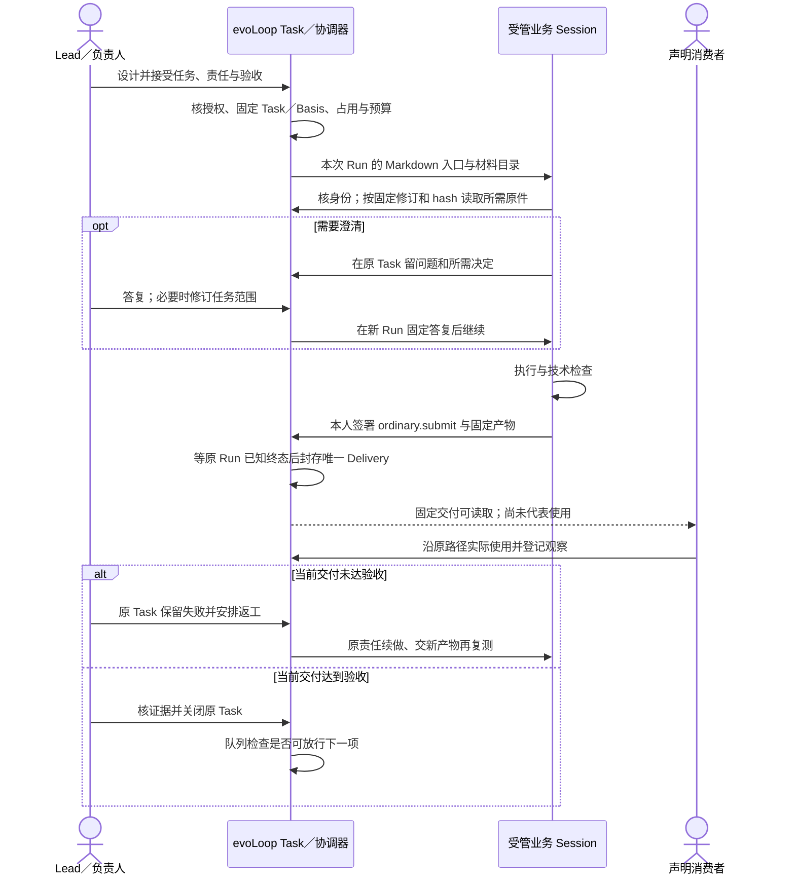
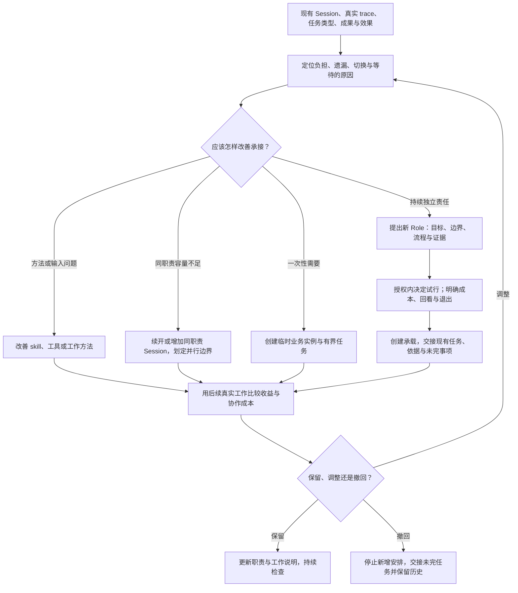

# 功能场景规划：把项目判断、协作执行与实际效果串起来

2026-10-29 · 两张[产品卫星图](definition.md#两张产品卫星图经营交付与组织改进)确定目标演员与交接，本页展开经营交付及组织方法改进的完整场景。局部任务时序、日常动作与运行合同仍按各专题维护。**这是目标行为与有限实跑的对照，不是完整运行验收报告；当前证据以[阶段路线](../roadmap.md#当前基线)为准。**

## 这篇文档要回答什么

evoLoop 希望帮助一个人与多个 Agent 持续推进项目：减少人反复补背景、传话、催促和补救遗漏，让交付经过实际使用，再用结果修正理解、下一步和分工。功能存在的理由，应当能从这些问题一直追到使用效果。

本文沿两条循环连接模块：**需求与方向怎样成为工作 → Leader 怎样组织，业务 Session 怎样交付，消费者怎样亲用与返工 → Evocation 怎样结合内部轨迹和 User Session 的独立体验试行改进 → 下一次真实工作怎样决定去留。** 它是产品定义与模块细则之间的连接层，不另外定义数据库字段或复制接口合同。

| 最初要解决的问题 | 场景中必须连上的机制 | 怎样判断有所改善 |
| --- | --- | --- |
| 人重复讲背景、在会话之间转告和催促 | 固定任务依据、明确承接、可靠唤醒与接续回查 | 新承接者能自行取得所需依据；授权内工作无需人反复转述 |
| Agent 写了报告，却没有真正使用和改善产品 | 技术交付、独立使用、问题回流、修复与复测 | 消费者沿原路径完成工作；失败有后续责任，而非停在“报告完成” |
| 纠正散落在聊天里，下一会话仍按旧理解做 | 有来源的知识修订、任务影响复核、实际采用 | 下游任务和产物能证明采用了适用的纠正 |
| 一个会话任务越来越杂、切换和交接越来越重 | 研究真实 Session trace、任务结构与负担，试行职责拆分 | 原负担下降，结果和交接更好；计入新职责的维护成本 |
| 文档、角色和任务增多，价值却不清楚 | 阶段回看与有条件的效果评价 | 下一步因此改变，或有依据地停止、撤回无收益的安排 |

前两项的用户结果不能只由任务数、消息数、Wiki 页数、Run 完成或代码合入推定。真实体验、Agent 代用、技术检查与长期收益分别留证。

## 两条循环怎样组成完整场景

[经营与交付卫星图](definition.md#两张产品卫星图经营交付与组织改进)沿“发现／澄清 → 同一 Task 与 Document → Leader 组织 → 业务 Session 执行与署名 → 独立使用 → 关闭或原任务返工”阅读；[组织与方法改进卫星图](../assets/company-evocation-loop.html)沿“用户方向、内部事实、User Session 亲用 → Evocation 诊断 → 共用改进 Task 和 Leader 排期 → 方法／分工试行 → User Session 复测 → 保留或撤回”阅读。两图完整交互版分别可[单独打开经营图](../assets/company-delivery-loop.html)和[单独打开改进图](../assets/company-evocation-loop.html)。它们画目标责任，局部时序和已验范围见下文及[当前基线](../roadmap.md#当前基线)。

| 循环 | 本页完整场景 | 相邻模块的产品责任 |
| --- | --- | --- |
| 经营与交付 | [场景 1：需求到安排](#场景-1从需求到-leader-安排)、[场景 2：执行到独立使用](#场景-2业务-session-怎样接任务提交结果并带回问题) | [日常工作](daily-loop.md)解释眼前动作，[Task 与过程文档](tasks-and-documents.md)解释共同对象，[工作台](workbench.md)解释人看见什么。 |
| 组织与方法改进 | [场景 3：Evocation 与 User Session](#场景-3evocation-与-user-session-怎样改进组织与方法)及其分工专题 | [Agent loop](agent-loop.md)解释判断、分工和 Wiki 的支撑能力；[Wiki 评价](wiki-evaluation.md)解释认识修订与效果比较。 |

J1—J6 是一次价值经历的简短地图；知识修订、定时检查、分工研究是两循环内的能力或变体，不各自成为第三条顶层循环。每个 Agent 在本职责内理解、判断、学习；Leader 组织跨任务推进，Evocation 研究工作方式，Human Requirement 按需澄清用户方向。没有任一中心会话作为所有 Task 的前置闸。

## 共同前提：谁负责、信息在哪里

### 职责、Session 与项目初始安排

System／business 是现有 Role 分类；卫星图中的逻辑职责并不保证每个常驻 Session 都已配置。

| 类别 | 项目初始职责 | 主要工作 |
| --- | --- | --- |
| **System Session** | Leader、Evocation；Human Requirement 按需承接 | Leader 组织任务组合和验收，Evocation 与 User Session 复盘并试行方法／组织改进，Human Requirement 澄清方向和需求 |
| **业务及独立体验 Session** | 架构、产品、开发流程与规范、功能开发及 User Session；按任务安排临时实例 | 在各自范围内判断、执行、修复、亲用、验证，并形成有来源的认识 |

这是目标分工，不是给所有项目预置完整岗位。现有 Role 合同支持 `system` / `business` 分类；历史模板中 Lead、认知、分工等名称保留为当时配置事实，不因本图自动改名、创建或授权 Role。User Session 是独立体验／评价职责，可按 Task 被指定为消费者，并非第四个系统统筹中心。架构、产品与流程规范仍属于业务职责。

**职责类别、持续时间和触发方式分别配置。** System Session 可按事件或定时回看；业务 Session 可为一次性任务创建，也可长期承载某职责、每天被唤醒检查。持续职责无需让模型全天空转，具体会话可以恢复或换实例接续。

领域 Session 在授权内可直接提出并完成本领域 Task；Leader 安排跨任务的承接和依赖。持续出现方法、容量或职责缺口时，Evocation 根据实际 trace 和独立体验比较选项，与 Leader 共用任务及排期；新持续 Role 仍须有工作说明、试行与退出条件，一次性体验可由临时实例承接。

### 对象之间的关系

- **Role** 表达持续职责；**Session** 是承载职责或临时任务的实例。换会话或增加同职责容量，不自动新增 Role。
- **Task** 表达要完成的业务工作、当前责任与验收；其主正文统一保存于 **Document** 的修订，开始工作时固定所采用的正文与依据。稳定业务领域独立于 `Task.kind`，选定的领域随 TaskRevision 固定；领域映射给 Role 是承接建议，不代替任务责任或派发授权。
- **Run** 是某个 Session 对某个固定 Task 修订与依据的一次执行。一个任务可以续做、返工或换承载，留下多个 Run；运行终态不自动完成任务验收。
- **Schedule** 表达何时检查、错过和重叠怎样处理。一次性和周期性是安排方式；到期后需要执行的工作进入普通任务流程，不把一个永不结束的 Task 当作全部周期历史。
- **Delivery / Observation** 分别记录产物与检查、消费者行为与效果。交付、收到、阅读、采用与有效，各自需要证据。

现有承载登记区分正式绑定的受管 Session 与外部 Desktop host link。外部链接须核实能力；即使可人工领取，也不获得自动启动或受管运行身份。未登记的 Desktop 聊天不能仅凭会话存在就算作 evoLoop 的 owned Role 承载。领域路由查询只报告当前映射与承载状态，不授予当前运行权限；任务队列和跨 Session 通信仍须按各自实施与实测进度判断。

Task/Schedule、过程 Document 修订和跨对象关系由 evoLoop/PostgreSQL 管理；Git 持代码和正式产品、架构、规范；外置 Wiki 持各 Session 的有来源认识。各责任者按问题读取相应权威，不以 Wiki 摘要替代必要原件。过程报告可以进入 Document，长期认识进入 Wiki，正式结论经审阅进入 Git；不是要求每项工作都复制三份正文。详细规则分别沿[项目数据](../architecture/project-data.md)和[任务与过程文档](tasks-and-documents.md)维护。

## 场景 1：从需求到 Leader 安排

### 问题与触发

需求可以来自用户方向、真实业务反馈、领域 Session 发现、定时检查或消费者失败。Human Requirement 按需澄清目标、需求和取舍；已在授权内且足够明确的工作可直接由领域责任者形成 Task。Leader（现有产品和 API 中的 Lead）主要看未分配、在途、阻塞和待验工作，安排依赖、顺序、承接者和验收责任。

例如：功能开发 Task 已关闭，User Session 仍无法沿原路径完成月报。产品责任者先区分实现、需求和交接缺口；Leader 接住未完成工作与消费者反馈，Human Requirement 只在目标或价值取舍不清时与用户澄清，Evocation 可把反复出现的交接或方法问题纳入改进循环。任务完成不代表目标达成。

### 输入、判断与接续

1. **明确工作和来源。** 需求责任者对照用户意图、当前目标、未完 Task、Document 和实际反馈，必要时读取仓库及 Wiki 原件；保留固定版本、未知和不能访问的来源，不要求每轮扫完整仓或全部知识。
2. **判断下一动作。** 领域 Session 对本领域问题比较解释、替代办法和停止条件。Human Requirement 处理方向、目标或验收歧义；确有跨任务优先级与容量冲突时交 Leader 组织，不让中央认知会话成为每项工作的先行入口。
3. **落入共同任务事实。** 有明确授权的工作创建或修订 Task 与主 Document，写清责任、验收、实际采用的依据和必要停止条件；未决定的问题留有来源与下一责任。Evocation 的方法/组织改进也使用这套 Task，而不自建第二张任务表。
4. **Leader 安排承接。** Leader 检查依赖、顺序、可用 Role/Session、消费者及在途状态；合适职责已存在就分派，缺容量或持续责任时把证据交改进循环比较。分配、受管派发、执行者实际读取分别核对。
5. **按真实结果调整。** 领域责任者处理使用失败或需求纠正；Leader 对账当前交付、阻塞和待验，决定继续、重排、等待或结束。Evocation 只对反复的工作方式问题作跨任务复盘；长期认识按来源维护，阶段效果和成本保持可检验。

### 人在前端应该看到什么

工作台应让人从目标差距追到需求来源、候选工作、Leader 的顺序和承接安排、业务执行、当前交付与消费者结果。下一次回看能看到返工、采用与实际效果；尚未派发或待补证的项不能显示为已经解决。普通入口见[项目工作台](workbench.md)，Task 详情不替代领域判断。

**闭环判据：** 工作的来源、责任、承接和结果可追，消费者用当前交付验证原目标，或留下有理由的调整/停止；输入不可达时明确补证责任。一次 Leader 排程或一条需求建议本身都不是价值完成。

## 场景 2：业务 Session 怎样接任务、提交结果并带回问题

### 分配、唤醒与执行是三步

任务分配改变谁负责；唤醒让承接者获得运行机会；执行者读任务并实际行动。三者需要分别可查，不能用“owner 已填”或“通知发出”代替接续完成。

下图说明一项**要求独立使用的受管任务**如何跨越 Lead 的任务设计、协调器派发、执行者署名与消费者验收。Markdown 首包和按需读取、Session 准备与复用、普通本人提交已有各自的本机任务验收；整图仍含目标交接，不能由局部实跑推定 Desktop 自动唤醒或长期收益。具体已验范围见[当前基线](../roadmap.md#当前基线)，运行合同下钻到[Codex 接入](../architecture/codex-integration.md)。

分配改变责任，派发给一次运行机会，按需读取才证明接手者取得原件；`ordinary.submit` 是本人意图，运行终态后的封存、不同 actor 的使用和关闭须分别读回。受限 worker 与普通受管 Run 的签署路径不同，普通静态 Run 无本人业务身份时由控制者核产物后以自身身份登记；不能从这张普通路径图推断所有宿主都能自动派发。外部 Desktop 仍是人工承接，原生主动通知 Lead 未获本轮保证。图中的问题回流是 Task 通道的有界路径，保存问题不证明收件人已读。操作说明以[Agent CLI](../development/agent-cli.md)为准。

### 执行者需要取得的交接内容

接收方至少能查到目标/任务 ID、当前责任、任务状态、固定正文与来源修订、已有成果及检查、发现的问题、在途或未知 Run、授权范围、验收与下一步。发送短消息可指向这些共同记录，不让另一段聊天摘要成为新的任务权威。

同一 Task 换承接者时，原运行先核清，再按任务规则调整责任与版本、确认交接并接续；不要重复创建同一工作。拆出独立子任务时，则分别明确交付、验收、依赖和结果回收责任。现有 Role handoff 的登记与确认不自动变更 Task owner，也不自动发消息，细则见[协作合同](../architecture/contracts.md)。

### 交付之后，谁接住未完成的工作

**声明消费者解决“谁来用”，任务责任者解决“谁确保有下一步”。** 消费者应记录自己实际使用的修订、做了什么、是否需要帮助及失败位置；执行者提供可用产物、检查和入口。普通静态 Run 没有业务身份时，由控制者核产物后以本人身份登记关联原 Run 的 Delivery；受限 worker 不能由控制者代签。收到或阅读不自动成为采用，代用 Agent 也不能署名为真人亲用。具体路径见[首次业务派工](daily-loop.md#以产品文档维护开始一项业务工作)。

从任务详情的“运行与关联”找到“驻留 Session 队列”，先核“队列读于”的时间，需要最新状态时点“重新读取队列”；回读失败时，不把旧状态或空列表当作当前结果。展开队列，查看排序理由、当前占用、后续顺位和等待原因，点击“原 Session”进入“分工与会话”，核对目标 Session 与职责。“就绪”表示会话能承接工作，不等于没有任务占用；还要结合队列和 Run 判断。“已领取／占用”表示当前项仍占用会话，“等待前项放行”表示后项尚未启动，顺位不等于运行事实。

回到任务的“运行与关联”，在“协作与待处理问题”点“重新读取协作”，展开“任务协作”，通过“阅读消息正文”查看固定提问、接收者、答复和下一责任。这里没有答复表单：页面发现问题后，由派出者或有权者通过项目 CLI 答复，再回页面读取答复及采用回执。“已答复”与“已采用”分别表示答复已登记和执行者已记录采用，接续是否实际运行仍须另核；结果未知或缺少答复时，交给明确的下一责任者处理。

交付后到“交付与使用”打开本次产物的固定修订，按验收实际使用。已有当前交付且具备权限时，消费者可在“任务操作”的“记录本次交付的使用观察”中填写结果与证据，或由消费者本人通过项目 CLI 提交后回页面核对；尚无正式交付时，不要求先出现该表单。使用失败在原任务留问题并返工，不沿用旧交付的通过记录，当前项继续占用会话。按消费者验收放行的队列，须当前交付满足验收并由有权者关闭任务后，调度器才检查和放行下一项；下一项是否真正运行另看它的新 Run。本项的验收不以关闭后才可能发生的下一项运行作为前提。

| 当前观察 | 谁接下一步，依据什么 | 何时可以结束 |
| --- | --- | --- |
| 交付有了，尚无约定消费 | 任务责任者提供固定版本与可用入口，落实消费者及待用原因；缺材料/权限先补对应前提 | 使用是验收条件时，原 Task 继续进行；等待不写成通过 |
| 消费失败，原目标仍有效 | 领域责任者按失败步骤判断实现、表达、输入或交接问题；授权内修复后用新交付复测原路径 | 通过当前验收才完成，旧 failed 保留；不能换成较容易的检查追认成功 |
| 消费暴露需求或目标需要改变 | 有权者比较原要求与新证据，决定保留、调整、取消或有限补证；在途 Run 先核清，任务依据按规则修订 | 有理由的取消可以结束投入，但不等于原目标达成；改版后的新一轮另验 |
| 消费达到本任务标准 | 验收责任者核固定交付、观察与判据；业务责任者和 Leader 按需回看阶段差距 | Task 可完成；阶段效果、长期收益与持续职责是否保留分别判断 |

若调查报告本身是交付，消费者能用它作出有依据的判断，可以满足该调查 Task；它不证明报告建议的功能已经实现。没有材料、入口或权限的失败也不能直接归因于产品方案或文档表达。更完整的归因需下一次有区分力的观察，而不是把失败一律转成新功能。

### 阻塞解除后怎样回到原业务工作

普通业务返工由原 Task 责任者和 Leader 接续。以下仅说明**已有受管认知 Loop 的特定 waiting 恢复路径**：若它因缺材料、权限或其他前提等待，先由相应责任者解除真实缺项。原任务需要新增输入，就由有权者通过正常修订显式选入固定依据；材料已经补齐不代表原链会自行再跑。

控制者可针对这份 waiting 决定登记一次新的回看意图，固定原业务结果、返工 Task 的当前版本与依据。暂停中的 Loop 可先登记，待明确恢复后才启动；旧认知职责的后续 Run 检查当前授权和原任务，再决定返工、补证或有据停止。这个存量技术合同不把认知 Loop 变成新产品蓝图的必经入口。旧失败、原交付及拒绝记录保留，不复制 Task 或重用旧 Run 来追认成功。每个新派发仍消耗原剩余额度；若返工与独立反馈需要更多运行，先作明确的范围与成本决定，不重置历史计数。经明确批准的有限增额也必须在原 Loop 内记录旧上限、新上限、理由与责任者，保持已用计数；它不是失败后的默认动作。具体命令见[业务 CLI](../development/agent-cli.md)，因果与恢复围栏见[协调合同](../architecture/contracts.md#5-coordinator派发交接与恢复)。这条恢复入口的实现与隔离检查不代替原失败路径上的实际使用复测。

### 完整例子：一次性产品体验带回 issue

1. 产品责任者或 Leader 根据目标和交付状态提出一次真实体验任务，明确用户路径、预期、材料和可操作范围；User Session 保持独立体验视角。
2. 查已有职责与可用实例；合适就分配，缺承载则请求创建临时业务 Session，缺持续职责才进入分工研究。
3. 运行协调器按实际授权创建或选择承载、派发 Run；体验 Session 回读任务和固定依据，不只读派发摘要。
4. 体验者沿用户实际路径操作。每个 issue 保留复现前提、步骤、预期与实际、影响、产物/需求版本、证据、已排除解释及未知项。
5. 提交完整体验报告到过程 Document，并在任务中关联交付、使用观察和问题；有新的认识时贡献到 Wiki，否则说明未产生需要更新的认识。
6. 协调机制核运行与提交情况，Leader 保留待接的问题与验收安排。临时实例完成后进入收束；没有交付、失败或结果未知时留下责任与恢复条件。
7. 产品责任者汇总本次体验批次的 issue，去重并形成明确修复 Task，Leader 安排承接；反复的交接或方法问题可由 Evocation 另行诊断。未决定的问题保留来源与下一责任，领域责任者对授权内修复可以直接推进。
8. 修复者提交产物与技术检查，原体验者或适合的消费者按新产物和原路径复测；原实例已结束时，新的实例可读取固定交接继续验证。
9. 复测通过后核任务约定与阶段目标；仍失败就返工、复核需求或补证。业务责任者记录领域认识变化，Leader 对账下一任务；Evocation 按需把跨任务模式带入改进循环，用户在工作台看到完整关联。

GUI 体验以实际可见页面为依据：从普通入口沿已观察的导航找到对象，必要时展开只读证据并分段阅读长材料。隐藏的缓存页面、折叠正文、未读完的分页或只取得 URL，都不能当作已完整体验。Agent 使用独立只读浏览器身份，报告区分它与签署交付的 worker 身份；任一必需页面被拒或工具能力不足时，记录实际边界和解除条件。负责人代查不替体验者的亲自操作，技术探测也不替三场景的真实导航、DOM、截图和交付证据。受限入口见[Codex 接入](../architecture/codex-integration.md#业务-worker-的受限工作台阅读)。

任务列表、工作状态和阶段关联须以同次真实列表响应为依据，文档选择列表也须沿实际分页读取，不能预填少量已知任务 ID 或只读第一页后把降级页面算完整体验。浏览器的有界读取到页数或对象数上限时，报告保留未读范围；列表中看见一个对象，也不自动授予它的所有页面、历史或原件读取权。持续新增对象的分页结果不等于项目冻结快照。

**闭环判据：** 用户路径是否改善有实际证据，issue 有明确处置且能追到修复和复测。体验任务“已提交报告”与其发现的所有问题“已解决”分别呈现；不把体验 Agent 的操作当作真人亲用。

### 周期性变体：架构、产品与流程规范巡检

项目初期可以为架构、产品、开发流程与规范职责分别配置每日一次的检查安排；这是用户提出的工作方式，具体时刻、时区、预算与权限须写进安排，本文不擅自生成实际日程。

每次到期读取上次检查锚点、当前仓库与正式文档、相关 Task/Document、Wiki 认识和新 trace，判断有没有新问题。已授权且属于职责范围的局部问题可以自己修复并验证；跨职责、目标变化或影响较大的争议回到适当判断者。无需动作时保存检查结果，不制造空修复任务。需要工作的本轮有独立任务/运行身份，能够追到当次输入与结果。

长期职责也可以仅在 Lead 明确安排新任务时工作，不必配置周期检查。首项 Task 完成不自动撤回 Role 或归档其常驻 Session；一次性实例是否收束按该实例约定核对，撤回职责还须交接未完事项。

暂停日程阻止后续触发；取消 Task、停止在途 Run 与收束 Session 分别处理。上次仍在运行时按约定排队、合并或允许有界并发；结果未知先对账，不能因为第二天到期就重复执行。

## 场景 3：Evocation 与 User Session 怎样改进组织与方法

User Session 先拿到用户想完成的事和必要授权，沿普通入口亲自使用产品、业务 Session 的交接与成果，记录“目标、步骤、看到什么、困惑与失败”。它不先阅读 Evocation 的根因判断，避免按预设答案完成体验；若 Task 指定它为消费者，亲用观察还须绑定当前 Delivery。Agent 代理体验与真人满意分开记录。

Evocation 把这份独立体验与 Leader 的任务事实、各业务 Session 的有权 trace、固定交付、返工及成本对照。诊断至少覆盖三层：跨 Session 交接是否反复传话或等待，单个职责的方法与 skill 是否被采用，端到端产品是否让用户完成目标。领域 Agent 保留自身判断和修复责任；Evocation 只对值得跨任务改进的模式比较产品修复、交接、方法、工具、容量或职责，不能从一次困惑直接判定唯一根因。

明确且授权内的改进进入**同一 Task/Document、Leader 排期与验收路径**，超出范围的资源或方向交有权者取舍。试行后 User Session 沿下一真实任务复测，Evocation 比较改动前后的结果与成本，决定采用、修订或撤回，并把来源和适用条件留给后续工作。每日 Big Picture 可以汇合 Leader 进度、User Session 亲用和改进选择；它是供人讨论的阅读节奏，不是所有业务 Task 的审批闸。上述联合复盘、每日节奏和长期收益仍是目标，需要后续独立实用证据；本机已验的交付侧范围见[阶段路线](../roadmap.md#当前基线)。

### 分工专题：从实际负担选择方法、容量或职责

#### 研究对象与触发

**Evocation 在分工专题研究选定观察期内的真实工作，Leader 提供承接、依赖与容量事实。** 研究既包括当前运行，也包括期间已结束、暂停或换承载的任务与历史；对象不必在检查瞬间都处于 active。对照现有职责、Task、Session trace、交付、返工、积压、交接等待、User Session 体验和下一阶段需求，判断哪些工作过重、反复切换或无人持续承担。触发可以是约定回看、明显负担变化或任一 Session 的分工请求。

例如，一个功能开发 Session 反复在开发、架构审查和流程修补之间切换。研究需要指出哪些真实任务、哪些 trace 片段和结果支持拆分，不能只凭会话长度或抽象“项目大了”新增岗位。trace 读取限本项目实际授权，原始私有会话不进入公开文档。

授权还不等于技术上已经可读。当前可利用已创建/登记的受管运行记录，以及经授权提供的既有会话材料；任意 Desktop 会话历史尚未自动接入。研究报告须说明实际覆盖了哪些 Session、时间与任务，哪些材料不可达；取证不足时先补输入，不能把未观察到的问题判断为不存在。接入范围见 [Codex 宿主边界](../architecture/codex-integration.md#状态与恢复规则)。

#### 从研究到可用承接者

1. 取得当前 Session、职责和任务分布，读取有区分力的真实工作片段，记录负担及结果基线。
2. 形成诊断：哪些任务类型需要拆分、为何会持续出现、预期怎样改善，比较改方法、补同职责容量、临时专项与新增持续职责。
3. 保存研究报告与来源，提出具体工作说明：目标、输入、可写范围、与 Leader/业务/User Session 的关系、触发、执行、交接、验收、成本和退出条件。
4. 在授权内试行，超出目标或资源范围才请求负责人取舍。业务与 Human Requirement 提供未来需求，Evocation 对诊断和试行理由负责，Leader 负责排期与承接对账。
5. 把“提案获准”“创建 Session”“绑定 Role”“变更任务责任”“接收方确认”“派发 Run”作为可分别核对的动作；某一步失败时保留已发生的结果与未完成责任，不用“分工完成”掩盖。
6. 新承接者读取真实交接并完成首批工作。回看原 Session 的负担、返工、交付与使用效果，以及新增交接/维护成本，再保留、调整、合并或撤回。

**闭环判据：** 研究、试行、首批实际工作、回看与必要交接均有可核对依据。保留新职责需要支持收益与成本值得的证据；实际试行后发现无收益并有据撤回，也可以证明该分工流程正确闭合。流程通过与产品收益成立分别判断，未知收益保持未知。只新增角色名称或创建一个空会话不算通过。若撤回，未完任务、知识和消费者承诺必须有人接走。

#### 用户怎样参与并回看

工作台应呈现现有分工、负担与体验证据、建议及替代办法、试行范围、当前承接与回看时间。负责人可以与 Evocation 讨论改进，与 Leader 讨论顺序；不承担日常任务搬运。试行结束能追到首批任务与 User Session 复测结果；未知收益、待承接和撤回后的遗留项应可见。

## 机制边界：现有什么，还需要验证什么

本节以现有源码与[Codex 接入](../architecture/codex-integration.md)、[业务 CLI](../development/agent-cli.md)、[本机运行](../development/local-run.md)的边界为依据。它不新增接口承诺，也不代替[阶段路线](../roadmap.md#当前基线)的实际验收记录。

| 环节 | 当前基础与限制 | 本轮场景需要验证的连接 |
| --- | --- | --- |
| skill＋CLI 业务操作 | 已有共同 API/core、权限、任务/文档修订及回执恢复 | 补齐从分配到承接、创建承载与派发的业务指引，不能猜测不存在的命令 |
| 受管 Session 与 Run | 已有创建/绑定、固定依据与终态对账；Loop 派发有受限 worker 身份和署名提交，普通 Run 可由本人 `ordinary.submit`，核原 Run 终态后封存固定 Delivery。首条有限认知闭环、恢复后 issue→代码修复→独立使用→反馈关闭原 Task，以及两期周期报告的使用反馈与正常收束均已有界验过 | 首次独立业务工作按[文档维护派工](daily-loop.md#以产品文档维护开始一项业务工作)区分执行、交付和验收；继续验证更多职责的承载、容量不足、失败恢复及连续收益，不由一次有界通过推断长期自动接续 |
| 持续协调与定时 | 日程接续桥已合入；两个有限窗口实际生成 Task 并接上认知、业务 Run、负责人代理使用及反馈关闭原任务，真实在途重叠跳过、日程暂停后原 Run 完成已有观察；最终 Schedule、Loop 停止，9 个 Run 与各自 Session 收束 | 本轮使用状态与消费负担见[有界使用核对](../roadmap.md#2026-10-24-有界使用核对)；忙碌排队、断线重启、全天可靠性和长期净收益须各有证据，不由有限窗口推定 |
| 既有 Desktop 会话 | 讨论和 CLI 可用；项目 Role 绑定不接受任意 Desktop 聊天，独立协调器的自动唤醒、状态监听与桥接尚未验证 | 区分受管后台承载与桌面讨论；仅有桌面承载且无自动入口时保持待承接，不能用另建聊天代替业务登记和派发 |
| 跨 Session 通信 | 共同对象与交接记录可查；无通用 Session 间消息通道 | 接收者如何发现入站工作、确认并继续；不能让用户承担默认转告 |
| Role 交接 | 通用准备与确认登记不自动转 Task owner，也不自动通知。受管分工已有显式模板、原意图消费与有限试行创建：先预留，再经正式 Task 修订转交，接收方以自己的已绑定运行签收；父任务关闭核这条真实事实链 | 本轮选择改方法，未创建新 Role。原 failed／403 保留；补入固定输入并获原 Loop 单次有限增额后，真实返工报告被独立 Agent 实际使用，反馈与临时会话归档完成，原 Loop 停于 13/13。前端缓存缺口修复后，负责人代理以真实阶段 v5→v6 正常变化复测回读通过，本次改方法分支闭环证据已补齐，见[最新路线记录](../roadmap.md#2026-10-25-原路返工使用与前端回读缺口)。不据此证明新职责试行、真人使用或净收益 |
| 有界工作轨迹与研究依据 | 已有本项目受当前授权约束的 trace 读取与固定 Run 输入引用；输入摘要不是原生轨迹全文的哈希。组合源码支持先暂停登记 Loop、声明精确固定材料，再激活，让首个自动认知任务固定所声明项；后续复制、派发与读取仍核当前权限。PR65 诊断修复已进入新运行实例，但不能据此追认历史根因已查明 | 研究接续与输入重选缺口见[路线图记录](../roadmap.md#2026-10-24-第三次分工研究接续)。先以固定报告与事件回答问题，必要时再读授权片段；声明已读不能证明采用。C8 有界实用不代表价值已证；业务 Session 的受限 GUI 原生实跑、固定报告独立采用及所发现界面缺陷的修复分别核验，见[独立窗口实测](../roadmap.md#2026-10-25-受限-gui-实跑与问题修复)。工程复测不冒作新版原生调用；总览 F4 后置，飞书实连延期 |
| 一次性 Session 收束 | `runtime.session.close` 已开放：空闲且已绑定的 Session 先记录关闭意图并进入 `closing`，原生归档身份经回读核实后才是 `closed`；owner 关闭路径的授权绑定缺口已由 PR59 修复，负责人代理沿原 Session 完成归档核验，原身份与历史保留 | 每条新路径仍须核交付、未完事项与知识交接；命令回执或服务进程 shutdown 都不能冒充完成收束，关闭权不隐含新执行权 |
| Stop hook 与提交检查 | 项目尚未接入对应完成检查 hook；官方支持的 hook 需按宿主与固定版本验证 | 缺交付的提醒或有界续做、有效暂停、异常退出兜底与防止无限续做 |

### 建议怎样分配软件与 Agent 的责任

**目标分工，按实际路径分别验收：**每个 Agent 在职责内判断；Leader 组织任务和对账，Human Requirement 按需澄清方向，业务 Session 经 skill＋CLI 执行，User Session 独立亲用，Evocation 对跨任务方法与组织改进负责。协调服务持久记录待接工作、固定依据、派发、回收事件与恢复条件。受管 Loop 和日程的有限接续已有实测；联合复盘、每日 Big Picture、分工长期收益、全天可靠性和 Desktop 自动桥接仍待独立验证。MCP 可以提供另一种工具入口，但不会自行让休眠会话开始工作。

受管 Codex 可由运行时适配器创建或恢复 Thread，再发起 Turn，并订阅运行终态；对应外部能力见 [OpenAI App Server 文档](https://learn.chatgpt.com/docs/app-server)。已有桌面聊天的自动控制须独立验证，不据此推定可用。

Stop hook 可在模型准备结束一轮时检查任务要求的交付是否登记，必要时提醒补齐；其作用点、续做行为见 [OpenAI Hooks 文档](https://learn.chatgpt.com/docs/hooks)。应识别“交付完成”“合法等待/受阻并有接续记录”等有效退出，不强迫每次暂停都完成整项任务或强写 Wiki。崩溃、进程退出、断线或 hook 未执行仍由运行回收与对账发现；不能只依赖最后一次提醒。

**任务完成、Turn 结束、日程停止与 Session 关闭是四个不同事实。** 消息或 hook 只承担其中的提示/检查环节，验收与实际效果仍由共同业务记录和证据判断。

## 怎样检验这篇规划与实际产品

先让读者沿三个场景解释输入、责任、依据、唤醒、交付、失败与前端结果；不能回答的连接应补设计或显露未知。之后再做受控运行，产品收益另由真实使用检验。

| 验证场景 | 应观察到什么 | 什么情况仍不算闭环 |
| --- | --- | --- |
| 产品或 Leader 提出体验工作 → User Session 亲用 → issue → 修复 → 复测 | 每次任务/运行与固定依据可查；问题完整回流，有修复与原路径复测；负责人能直接回看 | 只产出体验报告，或提醒用户手工转发后续每一步 |
| Evocation 对照内部 trace 和独立体验 → 试行方法／分工 → 后续任务复测 | 诊断有相反解释，改进与普通 Task 共享排期和验收，User Session 的下次体验能决定去留 | 只写每日 BP、只增加规则或 Role，未取得独立复测与成本证据 |
| 每日架构/产品/流程规范检查 | 到期判断、无动作或有界修复；读当次仓库；重叠、暂停与在途运行分别处理 | 重复执行同一工作，或把日程暂停当作在途已停止 |
| 研究现有 Session 后试行拆分 | 有真实 trace/任务/结果基线、替代方案、首批任务、回看和退出，能说明收益及代价 | 只因任务多就创建角色，或只验证新 Session 能启动 |
| 派发后断线或执行者缺少提交就结束 | 用原操作和原运行核对，不盲目重复；缺项有责任与恢复路径 | hook 没触发后工作无声消失，或把 unknown 当失败重派 |

本文仍是跨模块规划及其阅读入口。已有的受管试用证据须按各自版本核对；**修订本页本身不代表配置每日任务、接入 hook 或完成全部场景验收**。后续逐场景确认时，在所属章节修订并同步有影响的模块细则，保持产品要求、候选机制、实际实现与观察证据可区分。
