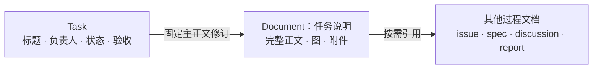
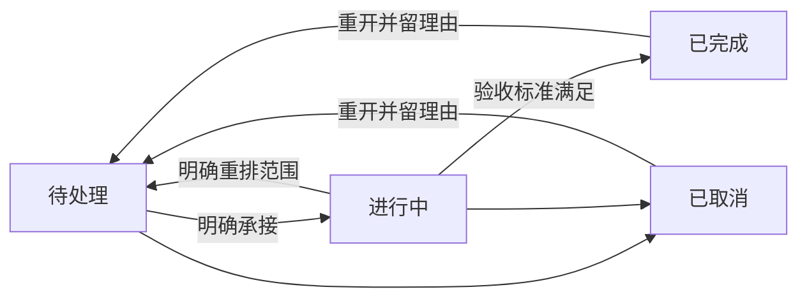

# 任务与过程文档：把工作交代清楚

2026-10-21 · 已确认的产品定义，DEC-031。实现与实际验收状态见[阶段路线 C5](../roadmap.md#c5-taskdocument-模型简化)。

Task 回答“谁要完成什么工作、现在到哪、怎样算完成”；Document 保存这份工作的完整正文及其他过程材料。人从工作台看清工作，和现有 Agent 沟通；Agent 经业务 skill＋CLI 维护同一组对象，再由人回看结果。

## 一项任务，一份完整说明

Task 保存简短标题、负责人、验收标准、工作状态和主正文的固定引用。完整正文称为 `content`，唯一原件存于 DocumentRevision；Task 查询直接带回这份正文，不另存一份可独立修改的 `goal`。项目目标 `Goal` 保留原义。

创建任务时一次提交标题、正文、验收和负责人，系统原子创建 Task 与主正文 Document。打开任务直接看到全文和验收，不必先单独建文档、采纳文档、再建任务。正文修改和 Task 修订一起保存，从创建时就固定所用正文修订。

一份主正文由一个 Task 管理；其他 Task 可以引用它，不能共同改写同一份任务说明。参考材料则可多对多关联：一份需求支持多个任务，一个任务也可引用问题、规格、讨论及报告。未形成具体工作的问题可以先记录在文档或现有会话中；小修复直接创建任务即可。

Task 的执行、文档发布、Run 的终态和消费者实际使用分别回答不同问题。任务完成也不表示整个项目目标已达成。

## Task 类型与状态

类型是轻量可选分类：`implementation`（实施）、`research`（调研）、`validation`（验证）。功能开发、缺陷修复和文档维护可以归入实施；不明确时允许不分类。所有类型共用一个状态机，不因分类增加必填模板或审批角色。

| 状态 | 含义 |
| --- | --- |
| `todo` · 待处理 | 工作已记录，尚未开始；记录本身不扩大授权。 |
| `in_progress` · 进行中 | 正在执行，包括约定的检查、交接和使用验证。 |
| `done` · 已完成 | 本次交付满足约定的验收标准，并有实际检查证据。 |
| `cancelled` · 已取消 | 决定不再继续，保留原因、现场和历史结果。 |

等待输入、暂缓、受阻或等待验收时，记录原因、责任和下一步，不再增加独立状态。五花八门的运行错误仍在 Run 与操作回执中核对，不塞进 Task 状态。旧八态历史保留原义，只把当前工作状态映射为四态；旧待处理任务不能因迁移而自动派发。 列表和详情保留当前旧修订对应的此前状态、实际判断和理由，避免把已拒绝或暂缓的工作看成已重新同意执行。形成新的四态修订后，这些判断仍可从历史追溯，不作为新范围的现行结论。

阶段关联是可选的。关联阶段已回看时，任务不能直接开始；有审核权限的操作者应先核对本轮正文、验收与授权，在待处理状态显式调整到一个正在进行的阶段，或解除阶段关联作为独立工作。调整产生新的任务修订并保留理由、旧关联和旧阶段回看，不新建重复任务，也不重新开放旧阶段。正在执行或仍有结果未知的运行时，先处理在途执行并明确重开。

## 验收留在原任务里

`acceptance` 写事先约定的完成标准；交付记录、检查结果和观察说明实际做过什么。写出标准不等于已经通过。

默认由原任务内的动作完成验证，不额外创建验收任务，也不设置通用的待验收状态。检查没完成就仍在进行中；未通过时保留失败，继续处理。明确要求独立消费者或真人使用的任务，不能拿作者自测替代；没有这项要求时不强制等待真人。

只有验证本身有独立负责人、需要单独安排并产生独立交付时，才按普通 Task 拆出验证工作。初期不因此引入强制子任务或依赖编排系统。后续若反复出现验收排队或责任不清，再依据使用记录决定增强。

重开后旧交付和验收仍可查，但不能自动作为新一轮已经通过的证据。

受管认知 Task 的本轮验收可由审核者显式引用正式署名、已结算的 `worker.decision`，而不虚构交付。系统核对同一 Task 的当前固定修订、原 Run 的已知终态、原入站来源及正式 outcome；`waiting` 还须留下一个可核对的承接：同来源、可发现的待承接入站及原业务 Task，或这位认知 worker 在决定前正式请求的同源子业务派发及其 Task。后者允许来源是首次入站，但不把来源 Task 和子 Task 混为一谈。若来源本身是另一认知 Task，不能冒充业务承接。关闭认知 Task 只表示本轮判断完成，不会关闭来源业务 Task 或子 Task，也不把等待事项当成已解决。要求消费者实际使用的 Task 仍走交付与使用证据路径。原有交付验收及历史不变。

## Document 的用途、格式和状态

| 用途类型 | 保存什么 |
| --- | --- |
| `task` · 任务说明 | 一项 Task 的完整正文，由任务操作统一维护。 |
| `issue` · 问题记录 | 实际现象、复现、影响和未知；不自动表示承诺修复。 |
| `spec` · 需求方案 | 要求、约定、方案及其适用范围。 |
| `discussion` · 讨论纪要 | 问题、选项、结论和未决项。 |
| `report` · 报告 | 调查、实施或验证的产物与证据。 |

类型可以为空，旧材料不按标题猜分类。Markdown、HTML 是格式，不能代替用途类型；图与必要附件跟随具体正文修订保存。正式产品、架构和开发规范继续在各仓库 `docs/`，不搬进 Document Table；外置 Wiki 也保持原正文权威。

体验中记录 issue 或 report 时，可注明它来自哪项 Task、哪次 Run；服务固定当时实际使用的任务修订，后来正文修订或任务移到别处也不改这份来源。受管 worker 只可引用自己的 Task/Run。带来源 issue 的初稿可进入对应范围的认知工作，调查、去重和是否形成修复任务另作决定；报告和没有来源的文档不因此自动触发。issue 已被记录或发布都不证明已修复，也不代替消费者的实际使用观察。若初稿后来已有新版，认知仍读取收到的固定初稿；不能偷偷改读或采纳新版来绕过原问题。

Document 用三个生命周期标签：

- **草稿**：尚无已发布版本。
- **已发布**：有可引用的固定版本，可以同时存在新草稿，例如“已发布 r3 · 有草稿 r4”。发布不证明文中主张全部成立，更不表示关联任务完成。
- **已归档**：退出常用工作入口，保留历史和固定引用；归档不等于删除或撤回其所有主张。

开始任务时一并发布主正文、固定本次依据，不增加一次独立的文档审批。任务主正文不能从通用文档入口旁路改写；需要变更时从任务操作创建新修订。其他过程文档可独立维护、发布和归档。

## 链接和改版

正文可以直接链接其他 Document、固定仓库文档和知识。链接说明名称、相关章节和阅读理由，并在任务正文保留必要摘要。

普通“进一步阅读”提供导航；明确作为执行依据的材料要在开始工作时固定修订。一个 URL 不会自动采纳目标内容，也不把所有链接变成必读材料。来源不可读或资源不完整时明确报告，不猜新版替代。

发布新 spec 或讨论结论不静默改变旧 Task 的依据。重新开始时默认继承并核对原有固定来源；只有明确选择替换或移除，才改变这一组来源。旧版本不再适用时须作出选择，不能默默取最新版。正在执行时若需改变正文或验收，明确重开、修订并重新开始；旧 Run 保持原快照。在途或结果未知的运行须先核对，不能只改文字就当作已停止。历史修订在当前权限及完整性允许时可读，保存历史不绕过权限变化。

文档在任务尚未开始时改版，可能没有进行中任务的影响记录。负责人仍可在开始时明确保留旧版：逐项核对所选旧修订、当时已发布的新修订和保留理由，与本轮依据一起封存审阅者和时间。它只覆盖当时观察的新修订，文档再次改版后仍须复核；任务更新中的一般理由不能代替这项决定。没有影响记录也不表示可以直接执行，不需要为保留旧版伪造一条影响记录。

## skill 怎样指导写正文

写给没参加前面讨论的接手者：开头直说要改变什么、为什么，再补会改变行动的背景、范围、约束、输入和输出。使用常用词和具体例子，解释必要术语；未知写成问题，不伪装成事实。小任务写几段即可，不强制填满大模板。

验收用“检查对象＋输入和做法＋通过条件”表达，避免只写“功能正常”“质量良好”。图用于说明文字难以交代的关系、顺序或状态，直接放进正文，标清方向和含义；简单任务无需配图。图源或图片资源随正文修订，实际阅读器须能显示，图不能代替关键限制和验收。

例如，修复 CSV 日期的任务应说明现象、采用的时区约定、限定修改范围，以及跨日、跨月和空值的预期输出；参考长规格时指出具体章节。技术检查、实际消费者使用和长期效果分别记录。

字段与持久化约束见[项目数据](../architecture/project-data.md)、[领域合同](../architecture/contracts.md)和[存储设计](../architecture/storage.md)；实际命令从[业务 skill 与 CLI](../development/agent-cli.md)进入。
