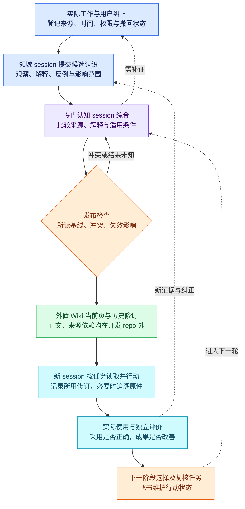

# 外置 Wiki 的建设、使用与有效性评价

2026-10-19 · 产品设计草案。本页细化[产品定义](definition.md)中的认知闭环、P04 与 P08 场景，约定第 4 部分“LLM Wiki 构建与有效性 evaluator”的期望行为。跨系统身份、任务和知识修订的最小语义见[领域合同](../architecture/contracts.md)。本页不指定后端，也不表示系统已经上线。

## 目的与权威边界

Wiki 的目的，是让实际工作形成的认识能够跨 session 被检查、修订和使用，帮助项目选择有依据的下一步。它的有效性由后续行动和使用结果判断，不由页数、检索命中、图谱规模或回答流畅度判断。

**Wiki 正文与修订存于开发仓库外的受控知识空间。** 原始材料保留在各自有权限的来源或证据存储中；本仓库只保存正式产品、架构、规范与可公开的研究报告。飞书任务表承担行动状态，Wiki 承担可修订的认识，正式文档表达已采纳的产品与工作约定。三者相互引用，但不互为可编辑副本。

所有领域 session 都可以提出观察、解释、反例和候选修订，并对自己的领域行动及验证负责。专门认知 session 负责跨来源比较、识别冲突、说明适用条件并提出下一步；Wiki 维护能力负责来源关联、修订、发布、失效标记和可回读版本。初期可以由同一专门 session 承担这两类责任，不预设新增岗位；底座提供存储或检索，也不能替它承担判断责任。

## 一条认识如何进入下一阶段

1. **登记材料。** 记录来源身份、原件或片段位置、观察与记录时间、权限范围、校验信息和撤回状态。用户纠正、使用评价、代码与运行结果都可能是材料；模型生成的摘要只是待核解释。
2. **提交候选认识。** 贡献者写明原判断、实际观察、解释或假设、支持与反对来源、适用条件、尚缺证据、建议影响的任务。不能因来源时间较新就自动覆盖旧判断。
3. **综合与审阅。** 认知责任者读现行页和原件，比较相反解释、检查旧结论的依赖，决定合并、保留争议、请求补证或提出撤回。来源不可访问时承认缺口，不从旧摘要补造原文。
4. **发布明确修订。** 维护者标出项目与主题、稳定页身份、所读基线、发布者、操作 ID、当前 revision、变更理由、受影响主张和来源。旧修订可查；有冲突或写入结果未知时先对账，不静默覆盖。
5. **面向任务消费。** 新 session 按任务读取相关当前修订、关键反例和来源，而不是无条件装入整库。它在任务记录中保留所读 revision，遇到过期、争议或权限缺口时下钻材料或请求澄清。
6. **使用产物并反馈。** 执行者交付具体成果，责任者或用户沿真实路径使用，记录采用了哪条认识、遗漏了什么、返工或提醒是否发生。通知送达、知识读到和实际采用是不同事实。
7. **再修订并决定下一步。** 反馈可形成知识维护任务、原任务复核或下一阶段选择。新证据足以推翻或限定认识时及时标记、修订或撤回；其对实际行动与产品效果的影响另行评价。证据不足时保留争议并安排补证。

图例：蓝色是工作与贡献入口，紫色是认知推理，绿色是外置持久资产，青色是独立消费与亲用，橙色是发布及行动控制。实线是工作推进，虚线是补证与反馈。箭头是期望的产品链路，并非声称现有候选已自动完成全部步骤。

## 一页认识最低应表达什么

| 内容 | 产品约定 |
| --- | --- |
| 状态与范围 | 将材料事实、观察、解释、假设、已采纳决定、争议、待审与已失效分开；说明适用项目、阶段、环境及失效条件。 |
| 依据与反例 | 关键主张能追到来源和片段，注明权限与观察时间；保留有力反例、相反解释和未确认条件。引用编号存在不等于主张被原文支持。 |
| 修订与依赖 | 稳定页身份、当前 revision、历史修订、读入基线、变更理由与受影响页／任务可查。新页出现不代表旧页已改。 |
| 决定与行动 | 说明谁有权作决定、当时为何选择、预期观察什么，以及哪些结果会触发重议；知识页不能替代飞书任务状态。 |
| 用户纠正 | 保留纠正原意、关联旧判断和受影响的未执行任务；检查旧入口和摘要是否仍传播过时内容。 |

来源被撤回时，先标记依赖它的主张、页和任务待审，再核剩余证据并发布修订；删除索引、链接或来源字段不代表正文已经正确。不同 session 同时修改同页时，未证实服务器有旧基线条件写，就限制为单维护者串行发布，发布前回读并保留快照。失败、超时和重启后都要核实际 revision；`unknown` 不当作失败后盲重试。语义与接口边界见[领域合同](../architecture/contracts.md)。

发布前的产品检查要同时问：旧结论在哪里仍可被找到，反例是否被压掉，来源权限是否允许当前读者看到，以及未执行任务是否需要重议。
发布后的检查要让另一个 session 按真实任务读取当前 revision；若只能从维护者的上下文理解页面，知识尚未完成交接。
无法判清的冲突可以保留为争议，并附上取得答案的下一步；不能用一个语气肯定的摘要填平证据缺口。
维护者的“已处理”只表示维护动作完成，知识正确、消费者采用和产品有效分别需要自己的证据。

## evaluator 要回答的问题

评价对象是**完整链路和具体适用范围**：哪类任务、多少材料、哪种权限与维护频率下，Wiki 是否比直接读材料更容易产生可靠行动。评价者要能看见知识正文、来源、独立消费者的过程、最终产物和真实使用反馈，不能只看候选系统的自评分。

| 维度 | 应观察的证据 | 不能用来代替它的信号 |
| --- | --- | --- |
| 来源忠实 | 逐条关键主张与原片段核对；限定、否定、版本、相反来源是否保留；无法定位则标未知。 | 有引用号、摘要看似合理、搜索命中。 |
| 纠正与依赖失效 | 用户纠正后，当前页、旧入口、依赖页和待做任务是否同步复核；撤回源后残留主张如何处理。 | 新建一页、Review 标为 resolved、来源链接被删除。 |
| 独立消费行动 | 无历史上下文的新 session 读到哪个 revision，是否下钻必要原件，是否据此完成可检查的任务。 | 仅回答知识问答、工具调用返回成功。 |
| 真实用户效果 | 产物被谁实际使用，目标差距、遗漏、提醒、返工与下一阶段选择是否改善；记录必要的人类取舍。 | 只交付报告、CI 通过或 Agent 自称满意。 |
| 系统恢复 | 同页竞争、超时未知、重复提交、停机恢复后，正文、来源、索引和消费者读取是否一致。 | 有快照按钮、写请求成功、备份文件存在。 |
| 总成本 | 摄入、编纂、索引、维护、读取、追源、纠错、失败重试、恢复、人工主动时间分别计；保留全部尝试与合格交付数。 | 只比较一次检索延迟，或从账本删去失败运行。 |

自动检查可以发现缺字段、断链、来源不可访问、修订不一致及确定的写入冲突；这些是质量门和待审线索。主张是否由证据支持、两个解释怎样并存、用户体验是否变好，需由独立消费者、原件核验和实际使用共同评价，可用独立模型辅助；涉及人的体验与目标取舍时纳入人类反馈。不能只由生成同一页的模型自评；有争议时回核原件并保留不同意见。

## 可比验证如何开始

建议在可回退的任务族中比较三种条件：**直接读取原材料**、**候选系统的原生 Wiki 流程**、**明确增加认知维护约定的治理 Wiki 流程**。这只是实验设计，不预设第三组一定更好。先测各组在自身条件下能否给出合格产物，再谨慎比较；如果改了模型、提示词或写入适配，就把它作为组合差异记录，不能把收益直接归因于 Wiki 底座。

开始前固定来源包、权限、时间切分、目标任务、消费模型与工具、调用预算、评价 rubric 和成功所需的硬约束。评价标准可事先公开，隐藏答案及尚未开放的评分反馈不得进入构建者与新消费者上下文；同一材料的改写不冒充独立样本。新 session 使用相同可见信息与任务边界，保留首次输出、失败、人工介入、重试和调用轨迹，防止只挑成功样本。

每组允许沿正常工作链追溯原件，但必须记录何时、读了多少；需要判断“综合页本身贡献了什么”时，再另做清楚标注的单因素试验。直接原料组也应允许合理检索与分批阅读。先比较合格产物、错误类型和总成本；原生能力、官方 Skill／模型流程、外部治理适配、人类判断分开记账。不能用生产模型配置表声称实际请求参数已生效。

样本稀疏时报告每条 case 的观察和不确定性，不报告确定增益、统计胜出或凭空设一个通过率阈值。先前失败记录保留为版本、样本和路径限定的反例；修复后需要用固定新版重新验证，不以新功能清单抹去旧失败。实验设计和已运行证据的区分见[机制与有效性分析](../references/wiki-effectiveness.md)及[首轮验证摘要](../references/validation-summary.md)。

## 三个必须覆盖的项目场景

### 1. 用户纠正独立知识空间的边界

**刺激：**旧材料曾建议把项目 Wiki 放在开发仓库；随后用户明确允许 Markdown，但要求活的认知正文及修订在仓库外。让新 session 接手设计知识接入方案。

**应观察：**维护者保留旧提案的来源和被取代状态，修订当前入口、相关摘要及未执行任务；新 session 读到新 revision，选择外置知识空间，并能解释旧建议为何不再适用。

**失败判据：**只新建一页而旧中心页仍指向仓库内 Wiki；消费者靠自己的常识猜对，却没有采用修订；产物再次把开发仓库当活 Wiki 权威。

### 2. 撤回支撑某项架构判断的来源

**刺激：**一份曾支持“某 Wiki 后端能自动处理多 session 同页冲突”的来源被撤回或证明只覆盖不同版本；已有知识页、任务和候选方案引用它。

**应观察：**系统定位受影响主张与任务，标待审；认知责任者核其他证据，必要时将结论改为“未验证、先串行维护”，发布新 revision。新消费者不把失效来源当成并发保证，旧任务复核后再继续。

**失败判据：**只删来源记录或链接，正文仍宣称安全；编译成功却没有检查依赖页；消费者从旧缓存或旧 revision 继续自由并发写入。

### 3. 下一阶段该继续加功能，还是先改协作方法

**刺激：**一个阶段的文档与代码已交付，但新人接手仍遗漏“Markdown 许可”或需用户重复传话；同时出现任务积压。需要选择下阶段是扩充 Wiki、改维护流程、补工具，还是调整责任实例。

**应观察：**认知 session 汇合产物、真实阅读与用户反馈，区分知识缺口、工具问题和容量问题，列出相反解释、适用条件及可回退试行；分工管理者与领域责任者据此提出有判据的任务或职责调整。下一阶段实际使用后再评价该选择。

**失败判据：**只凭 Wiki 页数或积压量新增固定角色；把提醒减少归因于没有使用的 Wiki；未亲用产物就宣布阶段目标达成。

## 评价怎样改变产品

每次评价应形成“观察 → 判断及不确定性 → 受影响的知识 revision／任务 → 下一次要验证的问题”。来源错误、旧页残留或消费者误用进入知识维护；工具故障或恢复缺口进入开发任务；职责缺口进入有退出条件的分工试行；用户价值判断仍由有权责任者作出。评价记录本身也是下一轮证据，但不能自动成为当前结论。

若直接读取少量材料已经更可靠、更便宜，就保留它；Wiki 可缩为检索和阅读辅助，或延后综合发布。若某类任务经可比验证确有收益，可只在该范围受限试点，继续补来源失效、恢复、权限与真人使用门槛。系统必须允许回退和更换底座，不能因已投入编纂成本而强迫采用。

**当前状态：本页是产品设计，加上既有有限合成实验的反例；尚无生产协作 harness、飞书任务适配或正式 Wiki。** 首轮只覆盖少量重建材料，不能代表长期项目收益。新实验、真实使用和后端选择将另行记录，并在证据变化时修订本页。
