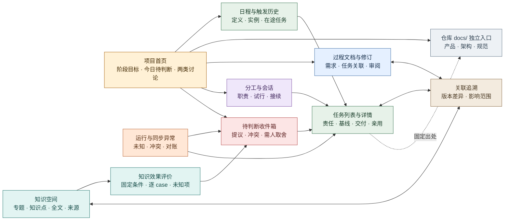
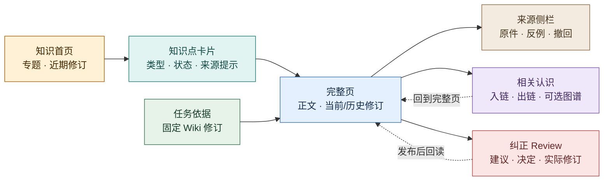
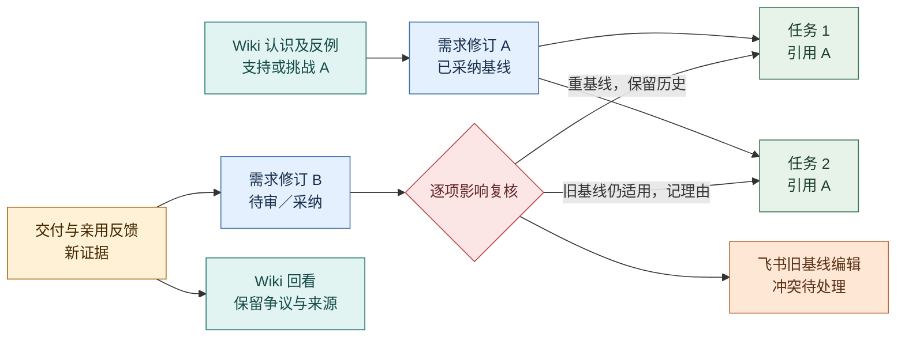

# 项目工作台：把判断、执行和认识连在一起

2026-10-20 · **前端产品设计，尚未实现。** 本页定义人和 Agent 面对同一项目时应看到什么、能作什么决定，以及怎样核对结果；它不是已上线界面或前端技术选型。依据[产品定义](definition.md)的两维度、四部分、[日常工作闭环](daily-loop.md)与[项目数据边界](../architecture/project-data.md)。页面可由分阶段的界面与既有协作入口共同承载，具体前端架构见[前端边界](../architecture/frontend.md)，知识浏览边界见[Wiki 工作区](../architecture/wiki-workspace.md)。[可点击工作台原型](../assets/workbench-prototype.html)仅含示例数据，未连接 evoLoop、Codex、飞书或 Wiki 服务，不能作为运行证据。

## 工作台要帮助人完成什么

当前原型对照完整产品路径的缺口、已补交互及未验证能力见[原型覆盖审阅](../research/workbench-prototype-review.md)；此报告指导下一轮实现，不改变本页验收标准。

负责人每天主要做两种有依据的讨论：与**分工管理 session**看当前职责是否接得住工作，与**专门认知 session**看下一阶段功能或实现方向。工作台在讨论前汇集目标、真实使用结果、待判断事项、分工负荷及争议；讨论后让决定落到需求文档修订、任务、Wiki 认识或职责试行，并显示后来是否被执行和采用。领域 session 仍可自行提出、判断并修复权限内的常规问题；负责人不承担日常传话和逐项批准。

四部分贯穿同一条工作路径：认知循环解释“为什么现在做”，动态多 session 说明“谁接得住”，Task 与状态机记录“怎样做、到哪一步”，Wiki 与 evaluator 检验“认识是否被采用、实际效果如何”。**页面以问题和下一动作组织，不以四个固定角色或四个孤立模块组织。** 用户能从任一对象回到其依据、责任、使用结果和被影响的后续对象。

图例：黄＝入口，红＝需要判断，绿＝执行，蓝＝过程文档，灰＝仓库文档独立入口，青＝认识，紫＝分工，棕＝追溯，橙＝异常。图表示信息入口与可跳转关系；知识正文仍由外置 Wiki 持有，工作台经受控读取呈现完整页面。

## 信息层级与共同约定

全局先选**项目**，再看当前阶段目标与需求基线；跨项目内容只有明确授权时出现。首页第一屏呈现“我现在需要判断或核对什么”和两类讨论入口；**知识空间**是并列的主动浏览入口，人可以不带任务进入专题阅读。二级导航按**待判断、任务、文档、知识空间、分工、关联、异常**组织，搜索结果按对象类型、项目、修订和权限分组；浏览历史版本时持续显示“所看修订”和“当前修订”的差别。对象详情的固定顺序是：当前结论或状态 → 为什么如此 → 谁负责与下一步 → 关联对象 → 历史及来源。

列表、卡片与详情都区分五种事实：**业务状态**（需求采纳、任务接受/完成）、**运行状态**（派发与会话实际结果）、**同步状态**（飞书投影）、**知识状态**（当前/争议/待审修订）、**效果状态**（目标消费者是否亲用）。只显示与该对象相关的状态，不合成一个“全部完成”标记。显眼地标出“待复核”“结果未知”“所见版本已过期”和权限缺口；时间、来源、责任者及所读修订可展开核对。空态告诉用户缺的是任务、证据、权限还是尚未接通的能力，不填示例数据冒充真实记录。

## 页面与动作

| 页面 | 首屏要回答的问题与核心内容 | 主要动作及状态反馈 |
| --- | --- | --- |
| **项目首页** | 当前阶段想达到什么，最近实际使用发现什么，今天哪几个决定会改变下一步？并列显示分工讨论与方向讨论的准备卡：证据、两三个备选、待取舍点、到期/阻塞项；无新证据时显示“暂无新取舍”。 | 打开讨论材料、提交反馈、查看已作决定及后续采用情况；讨论结果关联修订与任务，不用“讨论结束”代表工作完成。 |
| **待判断收件箱** | 提议从哪里来、属于缺陷还是需求、为何需要谁判断？分组显示常规职责内待接、跨领域/重大取舍、补证、外部编辑冲突、过期基线；保留 dogfood 来源与复现证据。 | 认领、查重并合并证据、要求有限补证、接受/暂缓/拒绝并写理由，或提交具体目标取舍；权限不足显示可交给谁与回看条件。 |
| **Task 列表与详情** | 列表按阶段、责任、接受状态、消费者验收与阻塞筛选；详情显示目标、所依需求/知识修订、验收、当前责任实例、交付、技术检查、亲用记录及后续任务。 | 提议/接受、调整责任、提交交付、请求或记录消费者亲用、暂停/停止；历史基线不随上游修订静默改变。飞书投影状态单独显示。 |
| **Document Table：过程文档与版本** | 默认使用表格，列出标题、格式（Markdown/HTML）、关联 Task、修订/采纳状态、更新时间；便于逐行扫描。只含过程文档，仓库 `docs/` 保持独立。 | 点击行或标题打开完整文档；关联 Task 单独跳转。正文页支持预览/原文、修订切换和返回列表，再提供修订、审阅、归档及整理到仓库的入口。 |
| **知识空间** | 知识首页展示专题、近期有依据的修订、待审争议与可继续阅读的知识点；目录和卡片按主题、知识类型、状态与关系浏览。完整页显示正文、适用范围、当前/所看修订、来源侧栏、反例、相关认识及双向链接；从任务进入时固定到任务所读修订。 | 浏览与搜索、打开完整页/原件、比较版本、沿关系跳转、提交带来源的观点或纠错并进入 Review；相关任务只在接受规则下创建。“已读”“已采用”“已证实有效”分别记录。外置知识不可达时显示已知引用与不可验证状态。 |
| **Session 分工与试行** | 当前职责覆盖、承载实例、待承接工作、积压/返工/交接证据；区分续开同职责、加容量、临时专项与新增持续职责。 | 查看已登记运行概要、准备可核对的讨论交接包；宿主支持并验证后才跳转现有 Codex 聊天。可提出有边界的试行、查看观察指标和退出条件、调整/撤回并交接未完任务。新聊天不自动成为新角色。 |
| **关联追溯** | 从需求修订出发，看依据它的任务、支持/挑战它的 Wiki 认识、交付与亲用；从任务或知识反向找到固定基线、当前版本与差异。 | 按关系类型及修订筛选、打开原件、提出影响复核；关系只说明关联，不自动宣称知识正确或任务符合需求。 |
| **运行与同步异常** | 哪些派发结果未知、交接未确认、飞书版本冲突/断线、权限收紧或投影丢失；区分核心主数据与外部显示。 | 回读对账、指派处理者、保留双方编辑意图、查看重试条件；不以“同步成功”“Turn 完成”关闭任务，也不因飞书掉线删除核心记录。 |
| **日程与触发历史** | 这项检查为何定时发生、下次何时执行、由谁负责、上一实例关联哪个 Task；显示时区、定义修订、错过与重叠策略。 | 提议或修改日程、暂停后续触发、查实例与在途任务；暂停日程不等于停止正在运行的任务。尚未接调度时明确显示能力未接通。 |
| **知识效果评价** | 哪个任务族、输入与 Wiki 修订下，独立消费者做出了什么；可比条件、失败、人工介入和成本是否齐全？ | 查看逐 case 的产物、采用与亲用记录，对比直接材料/原生 Wiki/治理 Wiki 的条件；缺数据标未知，提出补证或维护任务，不用页数和图规模代表收益。 |

### 从表格打开完整过程文档

过程文档列表以 table 为默认视图，避免用卡片摘要代替逐行查阅。标题支持键盘打开；行内 Task 链接是独立操作，不同时触发文档打开。后续真实服务提供标题搜索、格式/状态筛选和分页，返回列表保留所用条件与位置。手机可在表格区域横向滚动或收起次要列，标题、格式和打开入口仍可读。

点击后进入有足够宽度的完整正文阅读区；侧栏只承载元数据和关联。读者应能读到末尾、查看所选修订、返回原列表，而不是只能看一段摘要。

| 文档格式 | 人的阅读方式 | 保存与关联 |
| --- | --- | --- |
| Markdown | 排版后的完整正文；可切回 Markdown 原文，保留标题、列表、表格、代码块和附件引用 | 保存原文及固定修订，渲染结果为派生视图 |
| HTML 报告 | 在独立阅读区域保留报告排版、样式和已保存的图片/图表；可查看 HTML 原文 | 原始 HTML 与所需资源一并保留，入口和资源清单绑定同一修订；单文件报告也适用 |

HTML 报告直接作为过程文档，不要求先转成 Markdown。依赖 JavaScript 的筛选、图表或动画属于交互报告能力：默认可提供静态阅读，交互能力须在独立渲染环境验证后开放，受限时说明哪些部分不可用。没有保存的外部图片、脚本或需登录的数据不能显示成“完整报告”；原件保留，缺项可追踪。具体原件、资源和预览合同见[前端阅读设计](../architecture/frontend.md#过程文档表格与完整阅读)与[存储设计](../architecture/storage.md)。

以上是产品要求；当前单文件原型仅演示合成 Markdown 和静态 HTML 正文，不具备真实上传、保存、附件托管或任意 HTML 脚本执行能力。

### 过程文档和仓库正式文档的关系

Document Table 只管理过程文档，可直接关联 Task Table：记录“这次要做什么、怎样讨论、最后怎么决定”。产品、架构、规范位于代码仓库的 `docs/`，记录“项目现在采用什么行为和规则”，通过独立仓库入口或任务/过程文档的出处链接访问；它们不是 Document Table 中的另一类行。过程文档即使已完成，仍可作为历史依据；一份需求可更新多份仓库文档，多份讨论也可汇入一份架构。默认择要整理内容，而非整份搬运或把原过程文档切为 Git 引用。

“整理到仓库文档”入口须显示所选过程文档固定修订、成立与未决部分、关联交付/决定、目标仓库和段落、目标基线与候选差异。没有长期变化时可记录无需更新的理由。合入后从来源回链实际 repo 路径与 commit，构建与部署另有状态；这是跨来源链接，不新增正式 Document 行，也不能按任务完成状态自动发布。自动化未接通时，可以先由现有责任 session 完成仓库变更并登记来源。[架构流程](../architecture/project-data.md#3a-工作文档怎样沉淀为仓库正式文档)

## 知识空间是完整的阅读入口

借鉴[nashsu/llm_wiki 固定版的阅读、知识树、来源/Related、图谱与 Review 研究](../research/nashsu-llm-wiki/feature-workflows.md#24-人阅读编辑图谱与洞察)：让人先按主题找到认识，再读完整页面和原始依据，沿关系继续探索，最后有明确的纠错入口。借鉴的是信息组织与交互，不把它的 React/Zustand/Tauri 摄入实现、页级来源字段或图相关性分数直接当作 evoLoop 的知识正确性机制；外置 Wiki 仍是正文与修订权威。[Wiki 工作区架构](../architecture/wiki-workspace.md)负责可用读取、权限和修订映射。

| 阅读层 | 具体呈现与动作 |
| --- | --- |
| **知识首页与专题目录** | 当前项目的专题树/列表、主题说明、最近修订、待回看争议和关联阶段目标。用户可按专题、知识类型、适用范围、修订状态筛选，并从“继续阅读”回到先前所看修订；专题是导航，不自动表示已有共识。 |
| **知识点卡片** | 标题、一句话主张或问题、类型、适用条件、当前修订与更新时间、来源可核对性、反例/争议提示、关联任务/需求数。卡片点击进入完整页；它是外置 Wiki 某一可追溯修订的阅读视图，不另存可编辑的“社区帖子”，不能靠卡片文字代替原文。 |
| **完整页与来源侧栏** | 正文按原有段落、标题、引用与图表阅读；侧栏逐条列支持和挑战来源的身份、观察版本、权限与撤回状态，点击可核对原件。无来源、来源不可达或被撤回时显式提示正文待复核；不把编号存在当作主张已获支持。 |
| **相关认识与可选图谱** | 页内显示入链与出链、关系类型和所指修订，可从 A 到 B 再返回 A；相关认识包括支持、挑战、限定、取代和同主题。图谱可作为按主题缩放的辅助探索，节点点击回完整页、边可追来源；布局、社区或相似度只是找线索，不是正确性评分。首期先保证文字关系可用。 |
| **版本变化与纠正 Review** | 当前修订与历史版并排比较，标出改变的主张、原因、来源和受影响任务/需求。任何有权限者可提交具体反例、原件位置和预期修正；Review 区分待判断、需补证、已决定、修订已发布、后续消费者已采用。审阅结案须有决定与理由；拒绝、重复归并或确认无需修改可以结案。接受且需改正文的候选，另以发布回执和固定修订证明修改完成，不能用结案冒充正文已改。 |

知识卡片区分三个维度：页面类型（概念、方法、专题等）、认识性质（观察、解释、假设、已采纳决定或争议）与有效状态（当前、待复核、已取代、已撤回）。观察须写时间和来源；解释保留提出者、依据与反例；假设写可证伪条件；决定写权限、范围及取代条件；争议并列解释与下一次复核条件。同页可有多种性质的段落；已发布不代表每条主张已被证实，首期不承诺自动抽取和裁决逐条 claim。

图例：黄＝主动探索，青＝卡片，蓝＝全文，棕＝来源，紫＝关联，红＝纠错，绿＝任务固定引用。每日与认知 session 讨论下一步仍从项目首页进入；浏览知识空间可以独立发生，发现的新观点按来源提交候选认识，形成任务仍走正常接受条件。

讨论入口准备的是**受控工作交接包**：项目、目标、所读基线、证据链接、要回答的问题和权限边界，由人确认后交给合适的现有 session；已登记且获授权的自管任务可经协调服务发起。能否从页面直达 Desktop 聊天由宿主能力实测决定。Codex 仍是真实会话工具；工作台只显示可验证的会话概要、任务关联和经验证的跳转/发起入口，不嵌入或接管现有 Desktop 聊天，也不把自管 App Server Thread 伪装成同一窗口。若自动承接能力不可用，页面写“待承接”并给出人工接续入口。

## 六条端到端使用路径

1. **日常方向讨论产生一版新需求。** 首页方向卡给出当前需求基线、消费者失败记录、Wiki 中相反解释及候选下一步。负责人打开既有认知聊天讨论，形成“先补交接确认”的选择；有权 session 提交过程需求候选并审阅采纳。关联追溯标出两个旧基线任务：一个经复核改用新基线，另一个说明仍适用；Wiki 对“通知成功等于接收”的认识被回看。用户从首页能看见决定、两个任务的不同处理和下一次实际使用结果，而不是只看到新增了文档和任务。
2. **dogfood 缺陷从发现到亲用。** 领域 session 在真实工作中遇到重复派发，在收件箱提交步骤、实际结果、预期和不确定性；同类提议合并并保留新的复现证据。现有责任者在权限与预算内接受，Task 详情固定需求基线，记录修复、技术检查及受影响会话。目标消费者沿原路径重试后记录是否不再重复；知识阅读入口把失效解释和结果交给认知回看。若亲用失败，任务返回返工或新判断，不以代码合并为终点。
3. **分工试行与外部冲突恢复。** 首页分工卡显示某持续责任的积压、返工与交接等待；负责人在既有分工聊天比较改方法、加同职责实例和新职责。选择限期同职责加容量，登记首项任务、观察指标、退出条件与回看日期。期间飞书旧版本编辑同一任务，与 evoLoop 新修订冲突；异常页保留两份意图和基线，由有权者裁决并对账。试行结束用真实交接结果决定保留或撤回，未完任务明确转交；同步冲突解决不代表试行成功。
4. **从知识浏览发现新观点。** 用户不从任务或讨论卡进入，而从知识首页选择一个专题，在知识点卡片上看到“假设、来源待核”的提示。打开完整页、核对来源侧栏与挑战它的相关认识，再经双向链接读到限制条件；可选图谱只帮助发现相邻页。用户提交带原件位置的反例，Review 保留旧修订与待判断状态。维护者发布修订后，一个领域 session 读取新版、说明受影响需求或任务是否要复核；没有价值明确的下一步时不自动造任务。用户可从 Review 回看正文是否真的改变及后续消费者是否采用。
5. **定时检查遇到未知结果。** 从日程查看已触发实例、定义修订和对应 Task；派发回包丢失时运行页保持“结果未知”，提供按原操作回读的入口。暂停日程只停止后续触发，已有 Task 继续显示自己的状态；无法核实的在途动作保留对账责任，不靠新建运行来消除未知。定时检查发现新需求时仍先进入待判断。
6. **评价改变下一步。** 从知识页或阶段讨论进入某次评价，查看冻结材料/知识修订、各组条件与每个 case 的实际产物，区分知识采用、产物合格和真人效果。缺少可比对照或真人使用时显示未知；发现旧认识造成返工，形成带来源的维护提议并交认知 session 选择下一步。页面提供具体证据入口，不能用一个综合分数掩盖失败或人工补救。

图例：蓝＝需求版本，绿＝任务，青＝认识，黄＝亲用证据，红＝复核，橙＝外部冲突。A/B 是说明版本关系的占位符，不是已创建数据。页面必须同时展示旧基线、新修订与处理理由。

## 桌面、手机与阶段范围

**桌面**保留全局导航、列表与详情并排；适合对比需求修订、Wiki 全文/来源/相关认识、两个任务和外部编辑冲突。知识空间可让专题目录、正文和来源侧栏三栏协作，图谱单独展开，不压缩正文。侧栏讨论材料可逐条打开证据，但不会在工作台内伪造 Codex 聊天内容。键盘搜索和对象 ID 直达让 Agent 与人共享同一链接。**手机**优先首页待判断、讨论准备、任务状态、知识卡片和异常处理；列表改卡片，完整知识页仍能按“正文 → 来源 → 相关认识 → 版本/纠错”顺序展开。版本差异与来源保留完整内容及固定修订链接，允许横向查看或转桌面继续；不因窄屏隐藏反例、权限和冲突。高风险采纳/撤回须显示影响对象和确认后的状态，不能靠滑动误触。

| 阶段 | 能力边界 | 进入下一阶段的证据 |
| --- | --- | --- |
| **首期可用工作台** | 按 M1→M2 依次接通首页、待判断、Task/Document 版本与复核、关联追溯、分工摘要和异常，再接知识阅读/纠正与逐 case 评价；日程随着调度合同接通。Wiki 未接通时显式缺项，不能用原型数据填生产空态。完整知识切片含专题/卡片、全文、来源/双链与 Review；图谱可后置。Codex 仅显示已核能力，Git 与飞书保留各自入口。 | 各切片先验证对应路径；六条路径贯通后，才可说上述首期工作台范围完成。用户能找真实依据、作取舍、看影响和独立使用结果。手机原型可阅读不代表已有远程服务。 |
| **后续扩展** | 落实常在线主机、HTTPS 与登录后开放手机工作台；在知识后端与运行接入验证后，增加按主题缩放的图谱、跨项目授权查询、批量影响复核、丰富的会话活动与更深的飞书双向编辑。再根据真实阅读失败决定是否开发完整前端编辑器或更广的桌面会话控制。 | 由首期找不到依据、审阅成本、移动使用阻塞或外部入口切换负担等实测证据触发；手机真实工作台能完成关键阅读与授权动作，不以响应式原型代替。 |

**可观察验收：**新加入的用户从首页能在不重听背景的情况下解释当前阶段为何做、找到一条任务的需求和固定知识修订；另一名用户不经任务也能从专题找到知识点、读完整正文、核对支持与挑战来源、沿双向关系回到原页，提交反例后从 Review 追到实际修订。负责人完成两类讨论后能追到不同决定的责任者与实际后果；需求新版不会静默改写旧任务，飞书冲突与断线有可恢复入口；一个未参与编写的消费者能按任务完成真实操作并留下效果反馈。记录任务完成率之外，还记录找依据所需步骤、错误引用、重复解释、知识纠正是否被采用、交接等待、冲突恢复、手机阅读遗漏与人工主动时间。当前没有这些界面的运行数据或达标统计。
