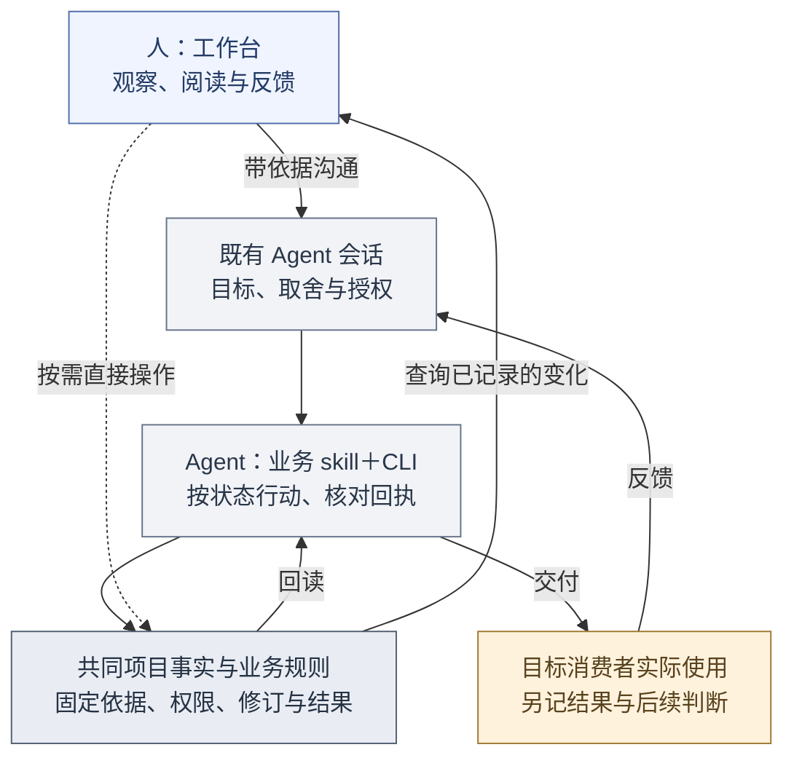
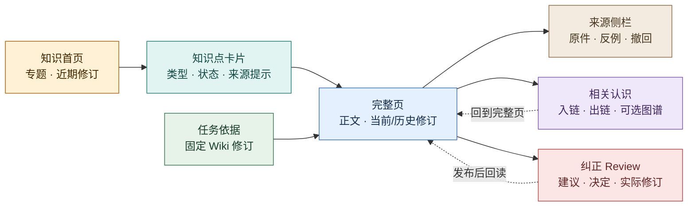
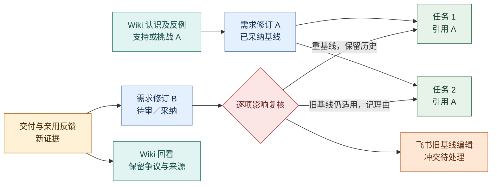

# 项目工作台：把判断、执行和认识连在一起

2026-10-21 · **产品目标与本机试用并存，前端已重组并完成有限浏览器与独立 Agent QA，真人使用反馈待收集。** 本页定义人如何阅读、判断和反馈，以及 Agent 怎样在同一事实与权限边界下接续工作；它不是已上线界面或前端技术选型。依据[产品定义](definition.md)的两维度、四部分、[日常工作闭环](daily-loop.md)与[项目数据边界](../architecture/project-data.md)。页面可由分阶段的界面与既有协作入口共同承载，具体前端架构见[前端边界](../architecture/frontend.md)，知识浏览边界见[Wiki 工作区](../architecture/wiki-workspace.md)。[可点击工作台原型](../assets/workbench-prototype.html)仅含示例数据，未连接 evoLoop、Codex、飞书或 Wiki 服务，不能作为运行证据。

## 工作台要帮助人完成什么

工作台服务两种连续的体验：第一次带着项目目标进入的人，应能说明谁受益、眼前缺什么，并形成一项有边界、有人承接的工作；已有项目的负责人和领域 session，应能从实际使用与纠正回到依据、责任和下一动作。它把选择、执行和亲用结果连起来，减少人类重复传话与重讲背景。领域 session 可在现有授权内直接修复；目标、资源或跨域争议才交合适的判断者取舍。

工作台本身不代替真实执行工具或知识权威：Codex 承载会话，evoLoop 保存任务与过程文档，Git 保存正式规范，外置 Wiki 保存持续修订的认识，飞书提供受控协作入口。负责人仍能准备两类有依据的讨论：与分工管理 session 判断责任是否接得住，与专门认知 session 判断下一阶段做什么。页面应让讨论前的相反依据、备选方案和待取舍点可见，讨论后能追到决定、执行及消费者使用的结果。四部分与两维度见[产品定义](definition.md#两个维度四个组成部分)；页面按人的问题和下一动作组织，而不按固定岗位分割。

图形界面主要服务人的阅读、取舍、例外处理和实际使用反馈。Agent 的常规入口是项目业务 skill 配合 CLI，经同一 Query／Command API、core 权限、固定版本和操作回执执行；MCP 是可选扩展，当前不以它作为可用入口。不要求 Agent 模拟点击页面，也不把每个权限内常规步骤交给人确认。跨目标、资源、授权或证据边界的取舍仍交相应责任者。浏览器 Agent 走读只能证明前端路径在所测条件下可操作，不能算作真人反馈或目标消费者亲用。这里的业务 skill 与用于开发界面的 frontend-design、web-design-guidelines 两项开发技能分属不同用途。

日常默认路径是：人先在工作台观察进展、变化、固定依据、责任、决定和结果，再到**既有 Agent 会话**说明判断或纠正；Agent 在已有授权内经 CLI 执行、核对回执，人回到同一对象读回变化。工作台不内嵌或伪造 Desktop 聊天。直接新建、编辑和审阅保留为按需入口，用于例外、无可用 Agent 的场景或明确的人工修订；表单覆盖率不是工作台的主要验收标准。

[原型覆盖审阅](../research/workbench-prototype-review.md)列出示例原型对完整路径的缺口。下面是产品要求，布局表达可随真实使用证据调整。

## 从旅程推到功能和页面

[产品定义的完整旅程](definition.md#从一个目标走到第一次有效交付)是唯一叙事。本页说明每一步人需要观察什么、Agent 经业务入口做什么，以及哪些共同结果让人继续判断；人工直接操作按需保留。J1—J6 不表示六个固定页面，也不要求一次接齐所有平台。

| 旅程 | 人需要看见或沟通什么 | Agent 经业务 skill＋CLI 承接什么 | 共同结果与回看 |
| --- | --- | --- | --- |
| **J1 目标与材料** | 说明希望谁完成什么、约束与授权；查看已有材料和未知。 | 读取或登记目标与消费者，核可用材料和缺项；不强制先接齐平台。 | 工作台可回读目标、依据、待补证项和责任；未持久化的聊天意图不冒充业务记录。 |
| **J2 阶段与首项任务** | 读备选与依据，对超目标或资源的事项作具体取舍。 | 形成阶段交付和学习问题；问题未定时保留在 issue/spec 或讨论，明确且获授权的工作创建待处理 Task 与主 Document。 | Task 正文、验收、责任和停止条件可查；没有独立“待判断／已接受”任务状态。 |
| **J3 固定依据并执行** | 追看谁承接、采用哪版、进度与异常。 | 按当前状态读主正文和来源，开始时封存实际采用的修订，执行或交接并核回执。 | 相同 Task/Document 修订、交付及运行可追；未知结果由原操作对账，不静默换基线。 |
| **J4 交付与亲用** | 看技术检查与交付，作为消费者时沿真实路径使用并反馈。 | 保存不可变交付，登记有依据的消费者观察；失败时返工或补证。 | 使用者类型、实际结果、失败步骤与技术通过分开，不能替人宣称用过。 |
| **J5 认识与需求复核** | 读变化、相反依据和受影响对象，沟通纠正。 | 复核旧基线任务，按权限提交/审阅知识候选并回读修订。 | 所读版与当前版、处理理由及发布/采用各自可查。 |
| **J6 下一步或停止** | 看目标差距与决定后果，必要时取舍方向和分工。 | 据证据继续、有限补证、暂缓、停止或提议职责试行，不为维持循环造任务。 | 人从工作台追看变化；目标结束、在途处理和实际效果分别记录。 |

图例：蓝＝人的观察入口，灰＝Agent 及共同规则，黄＝实际使用。此图表示产品分工，不表示页面会自动发送到 Desktop，或所有结果会自动记录；人携依据与现有会话沟通，Agent 经受控入口提交后仍需回读。知识与 Git 正文保持各自权威，外部动作和消费者使用另核。

## 对象关系与能力职责

用户从项目目标进入，先形成阶段交付与学习问题，再选择任务。**Task** 承接责任、四态进度与独立验收；**Document** 唯一保存任务完整正文 content，以及可独立存在的 issue/spec/discussion/report。一次创建任务同时创建主正文，开始时固定实际依据。事实不足时可以先有有限调查 Task，必要过程文档也可以先建再关联，不以固定创建顺序阻断 J1—J3。交付和技术检查回到 Task，目标消费者亲用结果另行记录；这样下一轮能辨认是实现失败、需求变化还是认识需要修订。

**repo `docs/`** 保存已采纳的正式产品、架构与规范，从独立仓库入口读取并以路径/commit 引用；它不进入 Document Table。**外置 Wiki** 保存持续修订的认识、来源、反例和争议，从知识空间完整阅读。关联追溯连接它们所用的固定修订与受影响的任务，但一条关系不自动改写另一对象。**Session 职责**说明谁判断或承接，**日程**只约定何时检查；飞书投影与运行记录提供协作和恢复线索，不改变任务及知识的权威。版本、权限与恢复的详细语义见[项目数据](../architecture/project-data.md)和[接口合同](../architecture/contracts.md)。

能力责任也按此分开：领域责任者在授权内提出问题、创建或开始 Task 并执行并验收局部修复；专门认知 session 汇合证据与下阶段选择；分工管理 session 诊断持续责任缺口并试行；目标消费者证明产物是否解决原问题。工作台须让这几种动作互相可追，不把认知或分工职责变成常规事项的中心审批。

Task 与 Document 的单一正文、类型和状态遵循[任务与过程文档](tasks-and-documents.md)。Task 主正文的修改从任务操作完成；通用文档入口提供固定阅读与跳回，避免旁路修改已执行的说明。

## 信息层级与共同约定

### 首次进入与已有项目的首页

**首次进入**时，首页先呈现项目目标、目标消费者、现有约束/授权和已有材料，让人看清已登记事实与缺口，再与既有 Agent 沟通首项工作或补证责任；必要时可从页面直接登记。材料可以是当前对话、仓库文件、用户描述或已有任务；零材料也能如实开始。选择来源或连接方式属于实现设计，不要求强制网页向导，也不把接通飞书、Wiki、Codex 自动控制作为创建项目的前置条件。尚无阶段或服务时显示“待判断／未接通”及下一步，不能填入原型数据。

**已有项目**首页先显示当前阶段交付与学习问题、进展与最近变化、最需判断或核对的事项、责任者、依据和消费者使用结果。人能从这里进入对象详情，带着相反依据和备选与既有 Agent 沟通；权限内常规修复由 Agent 执行后，首页与详情应可读回决定落到哪个需求修订、Task、知识 Review 或职责试行，以及后续是否实际被采用。阻塞、异常和无新证据都如实显示；补证、接受或取舍的直接页面操作按需可达。

### 项目范围、导航与事实状态

全局先选**项目**，跨项目内容只有明确授权时出现。任务、文档、关联、分工、日程和异常是能力及对象分类，不要求各占一个常驻左侧入口。**主入口收拢为“总览、工作、知识”**，另让讨论、协作、日程、运行和异常在清楚的上下文入口可达；在真实前端验证其可发现性，不再为完善目录扩写静态原型。这里改变的是入口组织，完整功能与验收仍保留。

| 常驻入口 | 首先回答什么 | 上下文中的功能入口 |
| --- | --- | --- |
| **总览** | 当前目标与阶段、最需要判断什么、谁接着做、最近使用与决定后果 | 待判断摘要直达工作区；方向讨论、分工与试行从相应卡片进入。没有新取舍就如实显示。 |
| **工作** | 工作进到哪、改了什么、依什么、谁负责、决定和结果如何？ | 待判断、任务、过程文档作为区内页签；过程文档可先于 Task 创建，不要求先开任务。日程从任务区或总览到期项进入；关联从 Task、Document 或知识详情的“依据与影响”进入，可沿稳定链接往返。 |
| **知识** | 当前认识是什么，来源/反例在哪，是否需要纠正？ | 专题、全文、来源、版本、Review；效果评价从知识区或阶段回看进入。知识空间仍允许独立浏览，不以已有任务为前提。 |

**待处理/异常保留固定的全局入口**，汇总阻塞、未知结果、外部编辑冲突及处理责任，并从相关对象回链；不因收拢侧栏而藏进多层“更多”。仓库 `docs/` 继续通过项目菜单中的独立仓库入口与上下文出处链接访问，不作为 Document Table 行。搜索与固定对象链接补充直达，不代替上述正常入口。

双层左栏采用轻量浅色 B2B 阅读密度：外层是稳定模块，内层随项目显示当前上下文，可收起；图标配中文名称。界面不使用绿色（含青绿、薄荷绿和绿色状态标签），主动作使用克制的蓝色。默认先读列表、详情、全文，再按需打开新建、编辑、判断；没有真实数据或能力时明确空态，不用虚构人员、搜索或统计填充。总览待工作和知识路径稳定、取得真实反馈后再定内容。

这些入口的日常可发现性仍待验证。真实使用若表明某项高频工作反复难找，再按证据提升入口，而不是把全部路由和技术对象提前平铺。首片范围与可观察验收见[工作台前端首片](../roadmap.md#工作台前端首片怎样落地)。

搜索结果按对象类型、项目、修订和权限分组。所看历史版与当前版的差别持续可见；详情先回答“现在是什么、为什么、谁接下一步”，再展示关系、历史及来源。列表、卡片与详情按对象区分业务、运行、同步、知识和效果五种事实，不合成一个“全部完成”。“待复核”“结果未知”“所见版本过期”和权限缺口须有可追的责任与下一入口；空态说清缺任务、证据、权限还是服务尚未接通。

## 页面与动作

### 推进工作：把判断交给有责任的人

**待处理收件箱**把提议按权限内待接、跨域/重大取舍、补证、外部编辑冲突和过期基线分组；每项能回到来源、复现条件、期望效果与判断责任者。用户可认领、查重并保留新增证据、接受、暂缓、拒绝或限定调查；权限不足时看见交给谁与何时再看。**Task 列表与详情**按轻量类型、责任和四态筛选；详情直接展开主 Document 正文、必要图、引用和独立验收，显示固定修订、交付、检查和约定的使用观察。等待/受阻说明原因与下一步，默认验收在原任务内；用户能提交成果、调整责任、取消或有理由地重开；飞书投影另显同步状态，上游改版不静默改写历史基线。

**Session 分工与试行**显示职责覆盖、承载实例、积压、返工和交接证据，区分续开同职责、补容量、临时专项与新持续职责。用户能查看已登记运行概要、准备讨论交接包，提出有边界的试行，回看指标与退出条件，撤回时交接未完任务。新聊天不自动成为新角色。**日程与触发历史**回答为何定时检查、由谁负责、下次何时、上次关联哪项工作，并显示时区、定义修订、错过与重叠策略；可提议或修改、暂停后续触发、查看实例和在途 Task。暂停日程不等于停止在途工作；调度未接通时标明状态。

### 阅读依据：从摘要回到完整原件

**Document Table** 默认以表格列出标题、用途类型、格式、关联 Task、草稿/发布/归档及修订状态；行或标题打开完整文档，Task 链接独立跳转。正文页可切原文/预览、比较修订、返回原列表，并在权限内修订、审阅、归档或提出整理到仓库。**知识空间**从专题/知识点卡片进入完整正文、来源、反例、相关认识和 Review，允许无任务的主动浏览；从 Task 进入时固定到该任务所读修订。用户可搜索、比较版本、追原件、提交带来源纠错；“已读”“已采用”“已证实有效”分开。外置知识不可达时显示已知引用与不可验证状态。**关联追溯**从需求、Task 或知识双向查固定基线、现行版、支持/挑战关系、交付和亲用；关系存在不自动证明主张正确。

### 控制与评价：让失败及收益可见

**运行与同步异常**显示派发未知、交接未确认、飞书旧版冲突/断线、权限收紧和投影丢失，并区分核心记录与外部显示。可回读对账、保留双方意图、指派处理者和查看重试条件；同步成功或 Turn 结束不关闭业务 Task。**知识效果评价**按固定任务族、输入与修订呈现逐 case 产物、采用、亲用、失败、人工介入及成本；可比较直接材料、原生 Wiki 和治理 Wiki 的条件，缺数据标未知。用户据此提出补证或维护任务，不用单一分数、页数或图规模证明收益。

### 首页与核心详情的布局约束

| 页面 | 产品层必须让用户同时看见或到达 | 可由设计选择的表达 |
| --- | --- | --- |
| 首页 | 首次进入的目标/消费者/约束与首项动作；已有项目的阶段问题、当前责任、真实使用结果、两类讨论和异常入口；决定之后能返回受影响对象。 | 卡片或列表、单栏或多栏、讨论材料折叠方式；首屏可按首次/已有状态调整。 |
| Task | 完整主正文、轻量类型、四态进度、固定需求/知识修订、责任者、验收、交付、技术检查、约定的亲用结果与等待/下一动作；上游修订差异可追。 | 列表筛选、侧栏、时间线或分栏详情；不能把同步或运行状态覆盖业务状态。 |
| Document | 表格逐行查阅与完整正文阅读可达，关联 Task 链接独立；所看版本、原文/预览、资源缺项和返回列表条件可见。 | 元数据侧栏、分页、手机收起次要列；不能用卡片摘要替代全文。 |
| Knowledge | 专题主动浏览到完整正文；所看/当前修订、来源及反例、相关认识、纠正 Review 与原件可核。 | 三栏或渐进展开、可选图谱、卡片密度；图谱不代替文字关系和正文。 |

这些约束描述用户必须完成的阅读与按需动作，不规定像素、颜色或唯一的页面组件。F1 的重点验收是人能沿工作区与详情解释进展、变化、依据、责任、决定和结果，与既有 Agent 沟通后读回经 CLI 提交的修订及有权读取的执行记录；仅把新建、编辑、审阅表单全部摆上页面不算成功。桌面与手机的使用边界见[阶段范围](#桌面手机与阶段范围)，具体前端读取、权限和修订映射见[前端边界](../architecture/frontend.md)及[Wiki 工作区](../architecture/wiki-workspace.md)。

### 从表格打开完整过程文档

过程文档列表以 table 为默认视图，避免用卡片摘要代替逐行查阅。标题支持键盘打开；行内 Task 链接是独立操作，不同时触发文档打开。后续真实服务提供标题搜索、格式/状态筛选和分页，返回列表保留所用条件与位置。手机可在表格区域横向滚动或收起次要列，标题、格式和打开入口仍可读。

点击后进入有足够宽度的完整正文阅读区；侧栏只承载元数据和关联。读者应能读到末尾、查看所选修订、返回原列表，而不是只能看一段摘要。

| 文档格式 | 人的阅读方式 | 保存与关联 |
| --- | --- | --- |
| Markdown | 排版后的完整正文；可切回 Markdown 原文，保留标题、列表、表格、代码块和附件引用 | 保存原文及固定修订，渲染结果为派生视图 |
| HTML 报告 | 在独立阅读区域保留报告排版、样式和已保存的图片/图表；可查看 HTML 原文 | 原始 HTML 与所需资源一并保留，入口和资源清单绑定同一修订；单文件报告也适用 |

HTML 报告直接作为过程文档，不要求先转成 Markdown。依赖 JavaScript 的筛选、图表或动画属于交互报告能力：默认可提供静态阅读，交互能力须在独立渲染环境验证后开放，受限时说明哪些部分不可用。没有保存的外部图片、脚本或需登录的数据不能显示成“完整报告”；原件保留，缺项可追踪。具体原件、资源和预览合同见[前端阅读设计](../architecture/frontend.md#过程文档表格与完整阅读)与[存储设计](../architecture/storage.md)。

以上是产品要求；当前单文件原型仅演示合成 Markdown 和静态 HTML 正文，不具备真实上传、保存、附件托管或任意 HTML 脚本执行能力。

### 过程文档和仓库正式文档的关系

Document Table 只管理过程文档，可直接关联 Task Table：记录“这次要做什么、怎样讨论、最后怎么决定”。产品、架构、规范位于代码仓库的 `docs/`，记录“项目现在采用什么行为和规则”，通过独立仓库入口或任务/过程文档的出处链接访问；它们不是 Document Table 中的另一类行。过程文档即使已完成，仍可作为历史依据；一份需求可更新多份仓库文档，多份讨论也可汇入一份架构。默认择要整理内容，而非整份搬运或把原过程文档切为 Git 引用。

“整理到仓库文档”入口须显示所选过程文档固定修订、成立与未决部分、关联交付/决定、目标仓库和段落、目标基线与候选差异。没有长期变化时可记录无需更新的理由。合入后从来源回链实际 repo 路径与 commit，构建与部署另有状态；这是跨来源链接，不新增正式 Document 行，也不能按任务完成状态自动发布。自动化未接通时，可以先由现有责任 session 完成仓库变更并登记来源。[架构流程](../architecture/project-data.md#6-工作文档怎样沉淀为仓库正式文档)

## 知识空间是完整的阅读入口

借鉴[nashsu/llm_wiki 固定版的阅读、知识树、来源/Related、图谱与 Review 研究](../research/nashsu-llm-wiki/feature-workflows.md#24-人阅读编辑图谱与洞察)：让人先按主题找到认识，再读完整页面和原始依据，沿关系继续探索，最后有明确的纠错入口。借鉴的是信息组织与交互，不把它的 React/Zustand/Tauri 摄入实现、页级来源字段或图相关性分数直接当作 evoLoop 的知识正确性机制；外置 Wiki 仍是正文与修订权威。[Wiki 工作区架构](../architecture/wiki-workspace.md)负责可用读取、权限和修订映射。

| 阅读层 | 具体呈现与动作 |
| --- | --- |
| **知识首页与专题目录** | 当前项目的专题树/列表、主题说明、最近修订、待回看争议和关联阶段目标。用户可按专题、知识类型、适用范围、修订状态筛选，并从“继续阅读”回到先前所看修订；专题是导航，不自动表示已有共识。 |
| **知识点卡片** | 标题、一句话主张或问题、类型、适用条件、当前修订与更新时间、来源可核对性、反例/争议提示、关联任务/需求数。卡片点击进入完整页；它是外置 Wiki 某一可追溯修订的阅读视图，不另存可编辑的“社区帖子”，不能靠卡片文字代替原文。 |
| **完整页与来源侧栏** | 正文按原有段落、标题、引用与图表阅读；侧栏逐条列支持和挑战来源的身份、观察版本、权限与撤回状态，点击可核对原件。无来源、来源不可达或被撤回时显式提示正文待复核；不把编号存在当作主张已获支持。 |
| **相关认识与可选图谱** | 页内显示入链与出链、关系类型和所指修订，可从 A 到 B 再返回 A；相关认识包括支持、挑战、限定、取代和同主题。图谱可作为按主题缩放的辅助探索，节点点击回完整页、边可追来源；布局、社区或相似度只是找线索，不是正确性评分。首期先保证文字关系可用。 |
| **版本变化与纠正 Review** | 当前修订与历史版并排比较，标出改变的主张、原因、来源和受影响任务/需求。任何有权限者可提交具体反例、原件位置和预期修正；Review 区分待判断、需补证、已决定、修订已发布、后续消费者已采用。审阅结案须有决定与理由；拒绝、重复归并或确认无需修改可以结案。接受且需改正文的候选，另以发布回执和固定修订证明修改完成，不能用结案冒充正文已改。 |

知识卡片区分三个维度：页面类型（概念、方法、专题等）、认识性质（观察、解释、假设、已采纳决定或争议）与有效状态（当前、待复核、已取代、已撤回）。观察须写时间和来源；解释保留提出者、依据与反例；假设写可证伪条件；决定写权限、范围及取代条件；争议并列解释与下一次复核条件。同页可有多种性质的段落；已发布不代表每条主张已被证实，首期不承诺自动抽取和裁决逐条 claim。

图例：黄＝主动探索，青＝卡片，蓝＝全文，棕＝来源，紫＝关联，红＝纠错，绿＝任务固定引用。每日与认知 session 讨论下一步仍从项目首页进入；浏览知识空间可以独立发生，发现的新观点按来源提交候选认识，形成任务仍须核当前授权与创建、开始条件。

## 关键交互怎样闭合

下表沿两类入口说明输入、执行者和人可见的后果；默认由 Agent 经业务 skill＋CLI 提交业务变更，人保留按需直接操作。具体控件、来源连接方式与自动化程度可在设计时选择。常规授权内工作不增加中心审批，页面上的“已发起”也不能冒充外部会话已接收。

| 路径 | 输入与前置 | 动作与选择 | 可见状态、下一入口与失败恢复 |
| --- | --- | --- | --- |
| **首次从目标形成可做任务（J1—J3）** | 负责人提供目标、消费者、约束/授权，以及已有材料或明确的未知；项目可以尚无 Task、Document 或 Wiki。 | 人从首页/既有会话沟通目标，责任 session 经业务入口登记阶段交付和学习问题；未定问题保留为 issue/spec 或讨论；首项工作限定到一项可核的修复或调查。依据足够且在授权内就创建待处理 Task；缺关键事实先指定有限补证；目标或资源超界才提交具体取舍。Task 主正文由创建时的 Document 承载；其他过程文档可先建立再关联 Task。 | 首页出现阶段判断与首项工作的范围、验收、责任和停止条件；开始后的 Task 可看到固定依据。无承接者时显示待承接和补位责任；平台未接通时提供人工接续入口，不能把任务标为已派发。 |
| **已有需求纠正到实际采用（J4—J6）** | 新版需求或消费者失败有原文、来源、旧基线和受影响对象；未完任务仍引用旧版。 | 人从 Document 修订追到影响并沟通纠正；Agent 读取固定新旧版，按任务及 Run 状态分流，再逐项记录改用新版、旧版仍适用或待补证；知识 Review 保留相反证据。已运行任务的接续边界见[需求纠正](daily-loop.md#需求纠正怎样处理)。责任者修复或补证，目标消费者沿原路径重试。 | Task、Document 和知识各显示所见修订与处理理由；首页能看到亲用结果与下一动作。飞书旧编辑冲突保留双方意图并转异常页；发布知识或合并代码后仍未亲用时，效果保持未知。 |
| **讨论跨 Codex 往返** | 首页已有分工或方向问题、备选、固定依据、授权边界和目标责任 session。 | 用户确认交接包后打开或人工转给既有 Codex 会话；讨论产生决定、未决项或补证要求，由有权 Agent 经业务入口记录到相应过程文档、Task、知识或职责说明，并登记所用来源；人工直接记录按需保留。 | 工作台展示“待承接／已登记决定／执行与亲用待核”等真实状态，提供返回对象的链接。若无法证实 Desktop 跳转或自动回写，就用可核对的人工记录和后续回读；不能将打开聊天或通知成功写成决定已执行。 |

讨论入口准备的是**受控工作交接包**：项目、目标、所读基线、证据链接、要回答的问题和权限边界，由人确认后交给合适的现有 session；已登记且获授权的自管任务可经协调服务发起。能否从页面直达 Desktop 聊天由宿主能力实测决定。Codex 仍是真实会话工具；工作台只显示可验证的会话概要、任务关联和经验证的跳转/发起入口，不嵌入或接管现有 Desktop 聊天，也不把自管 App Server Thread 伪装成同一窗口。若自动承接能力不可用，页面写“待承接”并给出人工接续入口。

本机实现提供“讨论当前分工”和“讨论下一阶段”两个入口，共用上述交接过程。交接包可完整阅读和复制，固定依据、问题、备选和授权边界随过程文档保存；人工承接观察、决定及其纠正各有署名和时间。可以登记“暂无新取舍”，也可以链接已经存在的 Task、Stage、Role 或 Document；这不会自动接受任务、建立常设职责或宣称对象已执行。Desktop 自动接入尚未验证，当前使用人工接续。总览的产品进度依据实际 Goal→Stage→Task 关系；工程里程碑见[路线图](../roadmap.md)，两者不按序号自动对应。

## 六条端到端使用路径

1. **日常方向讨论产生一版新需求。** 首页方向卡给出当前需求基线、消费者失败记录、Wiki 中相反解释及候选下一步。负责人打开既有认知聊天讨论，形成“先补交接确认”的选择；有权 session 提交过程需求候选并审阅采纳。关联追溯标出两个旧基线任务：一个经复核改用新基线，另一个说明仍适用；Wiki 对“通知成功等于接收”的认识被回看。用户从首页能看见决定、两个任务的不同处理和下一次实际使用结果，而不是只看到新增了文档和任务。
2. **dogfood 缺陷从发现到亲用。** 领域 session 在真实工作中遇到重复派发，经业务 skill＋CLI 登记步骤、实际结果、预期和不确定性，人从工作台收件箱追看；同类提议合并并保留新的复现证据。现有责任者在权限与预算内接受，Task 详情固定需求基线，记录修复、技术检查及受影响会话。目标消费者沿原路径重试后记录是否不再重复；知识阅读入口把失效解释和结果交给认知回看。若亲用失败，任务返回返工或新判断，不以代码合并为终点。
3. **分工试行与外部冲突恢复。** 首页分工卡显示某持续责任的积压、返工与交接等待；负责人在既有分工聊天比较改方法、加同职责实例和新职责。选择限期同职责加容量，登记首项任务、观察指标、退出条件与回看日期。期间飞书旧版本编辑同一任务，与 evoLoop 新修订冲突；异常页保留两份意图和基线，由有权者裁决并对账。试行结束用真实交接结果决定保留或撤回，未完任务明确转交；同步冲突解决不代表试行成功。
4. **从知识浏览发现新观点。** 用户不从任务或讨论卡进入，而从知识首页选择一个专题，在知识点卡片上看到“假设、来源待核”的提示。打开完整页、核对来源侧栏与挑战它的相关认识，再经双向链接读到限制条件；可选图谱只帮助发现相邻页。用户提交带原件位置的反例，Review 保留旧修订与待判断状态。维护者发布修订后，一个领域 session 读取新版、说明受影响需求或任务是否要复核；没有价值明确的下一步时不自动造任务。用户可从 Review 回看正文是否真的改变及后续消费者是否采用。
5. **定时检查遇到未知结果。** 从日程查看已触发实例、定义修订和对应 Task；派发回包丢失时运行页保持“结果未知”，提供按原操作回读的入口。暂停日程只停止后续触发，已有 Task 继续显示自己的状态；无法核实的在途动作保留对账责任，不靠新建运行来消除未知。定时检查发现尚未决定的问题时保留提议，明确工作可创建 todo Task，不能直接派发未开始的任务。
6. **评价改变下一步。** 从知识页或阶段讨论进入某次评价，查看冻结材料/知识修订、各组条件与每个 case 的实际产物，区分知识采用、产物合格和真人效果。缺少可比对照或真人使用时显示未知；发现旧认识造成返工，形成带来源的维护提议并交认知 session 选择下一步。页面提供具体证据入口，不能用一个综合分数掩盖失败或人工补救。

图例：蓝＝需求版本，绿＝任务，青＝认识，黄＝亲用证据，红＝复核，橙＝外部冲突。A/B 是说明版本关系的占位符，不是已创建数据。页面必须同时展示旧基线、新修订与处理理由。

## 桌面、手机与阶段范围

**桌面**保留全局导航、列表与详情并排；适合对比需求修订、Wiki 全文/来源/相关认识、两个任务和外部编辑冲突。知识空间可让专题目录、正文和来源侧栏三栏协作，图谱单独展开，不压缩正文。侧栏讨论材料可逐条打开证据，但不会在工作台内伪造 Codex 聊天内容。键盘操作和对象固定链接帮助人定位；Agent 常规读写走共同 API 的业务入口，浏览器走读用于界面验收。**手机**优先首页待判断、讨论准备、任务状态、知识卡片和异常处理；任务等列表可改卡片，过程文档仍按[表格阅读约定](#从表格打开完整过程文档)保留表格、横向查看或收起次要列。完整知识页仍能按“正文 → 来源 → 相关认识 → 版本/纠错”顺序展开。版本差异与来源保留完整内容及固定修订链接，允许横向查看或转桌面继续；不因窄屏隐藏反例、权限和冲突。高风险采纳/撤回须显示影响对象和确认后的状态，不能靠滑动误触。

完成单位须分开说明：**单片**是一条具体页面动作连到真实对象、状态反馈和对应路径的可观察验收，可单独交付；**阶段**是路线中相应 M1—M4 阶段所列能力及学习问题经真实使用核对；**首期整套工作台**要贯通六条使用路径并满足首期范围，整体运行验收跨 M1—M4：M1/M2 接通基础与知识切片，路径 3 的职责试行在 M3 核对，路径 5 的真实定时与持续接续在 M4 核对。某片技术检查通过、静态原型可点击或 M1 结束，都不能直接声明整套工作台完成。阶段与首片顺序以[路线](../roadmap.md#阶段及进入条件)为准，本页保留整套产品验收。

| 阶段 | 能力边界 | 进入下一阶段的证据 |
| --- | --- | --- |
| **首期可用工作台** | 从 M1→M2 依次接通首页、待判断、Task/Document 版本与复核、关联追溯、分工摘要和异常，再接知识阅读/纠正与逐 case 评价；分工试行沿 M3、真实定时与持续接续沿 M4 验证，日程随调度合同接通。Wiki 未接通时显式缺项，不能用原型数据填生产空态。完整知识切片含专题/卡片、全文、来源/双链与 Review；图谱可后置。Codex 仅显示已核能力，Git 与飞书保留各自入口。 | 各切片先验证对应路径；M2 结束不代表职责试行或真实定时已验证，六条路径均以真实对象、操作与结果贯通后，才可说上述首期工作台范围完成。用户能找真实依据、作取舍、看影响和独立使用结果。手机原型可阅读不代表已有远程服务。 |
| **后续扩展** | 落实常在线主机、HTTPS 与登录后开放手机工作台；在知识后端与运行接入验证后，增加按主题缩放的图谱、跨项目授权查询、批量影响复核、丰富的会话活动与更深的飞书双向编辑。再根据真实阅读失败决定是否开发完整前端编辑器或更广的桌面会话控制。 | 由首期找不到依据、审阅成本、移动使用阻塞或外部入口切换负担等实测证据触发；手机真实工作台能完成关键阅读与授权动作，不以响应式原型代替。 |

**可观察验收**：新加入的用户从首页能在不重听背景的情况下解释当前阶段为何做、找到一条任务的需求和固定知识修订；另一名用户不经任务也能从专题找到知识点、读完整正文、核对支持与挑战来源、沿双向关系回到原页，提交反例后从 Review 追到实际修订。负责人完成两类讨论后能追到不同决定的责任者与实际后果；需求新版不会静默改写旧任务，飞书冲突与断线有可恢复入口；一个未参与编写的消费者能按任务完成真实操作并留下效果反馈。记录任务完成率之外，还记录找依据所需步骤、错误引用、重复解释、知识纠正是否被采用、交接等待、冲突恢复、手机阅读遗漏与人工主动时间。当前已有受限浏览器与独立 Agent QA，以及本机真实对象操作证据；尚无真人使用数据或上述目标的达标统计。
