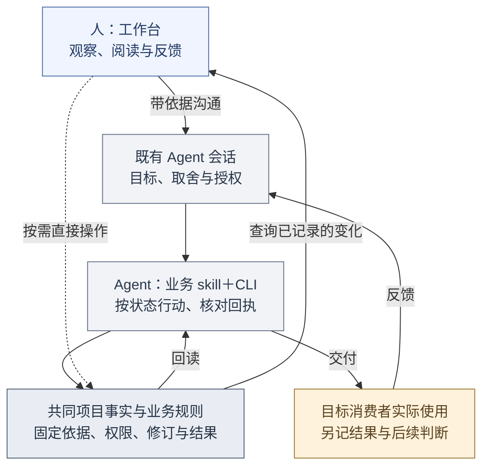
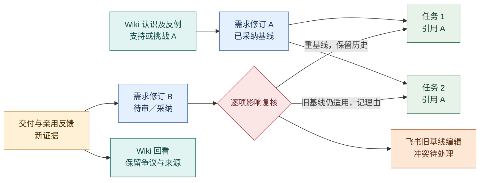

# 项目工作台：把判断、执行和认识连在一起

2026-10-30 迁移说明：页面和前端实现细则已归入独立前端目录；下面的旧试用说明和证据保留其原有范围。

2026-10-24 · **产品目标与本机试用并存，前端已重组并完成有限浏览器与独立 Agent QA，真人使用反馈待收集。** 本页定义人如何阅读、判断和反馈，以及 Agent 怎样在同一事实与权限边界下接续工作；它不是已上线界面或前端技术选型。依据[产品定义](definition.md)的两维度、四部分、[日常工作闭环](daily-loop.md)与[项目数据边界](../architecture/project-data.md)。页面可由分阶段的界面与既有协作入口共同承载，页面、交互和实现统一从[前端文档](../frontend/README.md)进入；具体前端架构见[前端边界](../frontend/architecture.md)，知识浏览边界见[Wiki 工作区](../architecture/wiki-workspace.md)。[可点击工作台原型](../assets/workbench-prototype.html)仅含示例数据，未连接 evoLoop、Codex、飞书或 Wiki 服务，不能作为运行证据。

## 工作台要帮助人完成什么

工作台服务两种连续的体验：第一次带着项目目标进入的人，应能说明谁受益、眼前缺什么，并形成一项有边界、有人承接的工作；已有项目的负责人和领域 session，应能从实际使用与纠正回到依据、责任和下一动作。它把选择、执行和亲用结果连起来，减少人类重复传话与重讲背景。领域 session 可在现有授权内直接修复；目标、资源或跨域争议才交合适的判断者取舍。

工作台本身不代替真实执行工具或知识权威：Codex 承载会话，evoLoop 保存任务与过程文档，Git 保存正式规范，外置 Wiki 保存持续修订的认识，飞书提供受控协作入口。负责人按需与 Human Requirement 澄清方向，从 Leader 看任务组合和承接，从 Evocation 与 User Session 的共同复盘理解方法、组织与体验问题。页面应让讨论前的相反依据、备选方案和待取舍点可见，讨论后能追到决定、执行及消费者使用的结果。[两张卫星图](definition.md#两张产品卫星图经营交付与组织改进)确定整体路径；页面按人的问题和下一动作组织，而不按固定岗位分割。

图形界面主要服务人的阅读、取舍、例外处理和实际使用反馈。Agent 的常规入口是项目业务 skill 配合 CLI，经同一 Query／Command API、core 权限、固定版本和操作回执执行；MCP 是可选扩展，当前不以它作为可用入口。不要求 Agent 模拟点击页面，也不把每个权限内常规步骤交给人确认。跨目标、资源、授权或证据边界的取舍仍交相应责任者。浏览器 Agent 走读只能证明前端路径在所测条件下可操作，不能算作真人反馈或目标消费者亲用。这里的业务 skill 与用于开发界面的 frontend-design、web-design-guidelines 两项开发技能分属不同用途。

日常默认路径是：人先在工作台观察进展、变化、固定依据、责任、决定和结果，再到**既有 Agent 会话**说明判断或纠正；Agent 在已有授权内经 CLI 执行、核对回执，人回到同一对象读回变化。工作台不内嵌或伪造 Desktop 聊天。直接新建、编辑和审阅保留为按需入口，用于例外、无可用 Agent 的场景或明确的人工修订；表单覆盖率不是工作台的主要验收标准。

人返回缓存的阶段页时，应有正常的“回读当前状态”入口，重新读取目标、阶段、文档和任务关联，才能核对 Agent 经 CLI 完成的变化。保留页面是为了保留阅读位置和草稿，不表示其中的状态仍是当前事实。回读进行中明确提示并阻止重复读取；失败时保留上次数据、草稿和未知操作回执，同时说明哪些信息尚未核实，允许重试。不要求整页刷新、重新登录或再执行一次业务操作来取得新状态。

负责人处理已有项目时，先从当前工作列表找待分派、运行中、待交付、待消费者使用、返工或受阻的 Task；列表的阶段和下一责任由任务、分派、Run、当前交付、使用观察、依赖和队列占用共同推导。进入 Task 详情后，先核完整正文与验收、当前修订、实际承载和依赖，再决定排序、分派或等待；处理决定要固定本次读到的变化位置，后续事实变化须重新审阅。沿同一页打开固定 Document、Run、Delivery 和 Session，再返回当前 Task 核结果。列表摘要、已保存的处理决定和原生 Turn 结束均不能替代作者交付、消费者使用或关闭记录。当前本机已实跑的 Lead 与本人提交路径见[阶段路线](../roadmap.md#当前基线)，具体 CLI 和状态读回见[工作观察](../development/agent-cli.md#观察会话具体接手与普通消息)。

现有双左栏 Session 工作区和 Lead 工作发现已有本机独立 Agent 使用：从项目入口找到实际承接 Session、当前 Task、队列与固定成果，沿“Session → Task → Delivery → 来源 Session”返回；Lead 能发现未入队工作并记录计划、依赖和处理决定。详情应分清当前任务状态、队列占用、Run、技术交付和消费者观察，并给出下一责任；页面显示某个 Role 或会话名称不等于它已被派发。此范围来自[阶段路线](../roadmap.md#当前基线)所列实际任务，不能据此宣称真人已完成整体体验。任务列表/详情的新版设计及 Session 关闭诊断仍在各自任务中验收，不作为本页已运行布局。页面路径与两类使用入口的协作规则分别见[功能场景](functional-scenarios.md#场景-2业务-session-怎样接任务提交结果并带回问题)和[前端架构](../frontend/architecture.md)。

[原型覆盖审阅](../research/workbench-prototype-review.md)列出示例原型对完整路径的缺口。下面是产品要求，布局表达可随真实使用证据调整。

## 从旅程推到功能和页面

[产品定义的完整旅程](definition.md#从一个目标走到第一次有效交付)是唯一叙事。本页说明每一步人需要观察什么、Agent 经业务入口做什么，以及哪些共同结果让人继续判断；人工直接操作按需保留。J1—J6 不表示六个固定页面，也不要求一次接齐所有平台。

| 旅程 | 人需要看见或沟通什么 | Agent 经业务 skill＋CLI 承接什么 | 共同结果与回看 |
| --- | --- | --- | --- |
| **J1 目标与材料** | 说明希望谁完成什么、约束与授权；查看已有材料和未知。 | 读取或登记目标与消费者，核可用材料和缺项；不强制先接齐平台。 | 工作台可回读目标、依据、待补证项和责任；未持久化的聊天意图不冒充业务记录。 |
| **J2 阶段与首项任务** | 读备选与依据，对超目标或资源的事项作具体取舍。 | 形成阶段交付和学习问题；问题未定时保留在 issue/spec 或讨论，明确且获授权的工作创建待处理 Task 与主 Document。 | Task 正文、验收、责任和停止条件可查；没有独立“待判断／已接受”任务状态。 |
| **J3 固定依据并执行** | 追看谁承接、采用哪版、进度与异常。 | 按当前状态读主正文和来源，开始时封存实际采用的修订，执行或交接并核回执。 | 相同 Task/Document 修订、交付及运行可追；未知结果由原操作对账，不静默换基线。 |
| **J4 交付与亲用** | 看技术检查与交付，作为消费者时沿真实路径使用并反馈。 | 保存不可变交付，登记有依据的消费者观察；失败时返工或补证。 | 使用者类型、实际结果、失败步骤与技术通过分开，不能替人宣称用过。 |
| **J5 认识与需求复核** | 读变化、相反依据和受影响对象，沟通纠正。 | 复核旧基线任务，按权限提交/审阅知识候选并回读修订。 | 所读版与当前版、处理理由及发布/采用各自可查。 |
| **J6 下一步或停止** | 看目标差距与决定后果，必要时取舍方向和分工。 | 据证据继续、有限补证、暂缓、停止或提议职责试行，不为维持循环造任务。 | 人从工作台追看变化；目标结束、在途处理和实际效果分别记录。 |

图例：蓝＝人的观察入口，灰＝Agent 及共同规则，黄＝实际使用。此图表示产品分工，不表示页面会自动发送到 Desktop，或所有结果会自动记录；人携依据与现有会话沟通，Agent 经受控入口提交后仍需回读。知识与 Git 正文保持各自权威，外部动作和消费者使用另核。

## 对象关系与能力职责

用户从项目目标进入，先形成阶段交付与学习问题，再选择任务。**Task** 承接责任、四态进度与独立验收；**Document** 唯一保存任务完整正文 content，以及可独立存在的 issue/spec/discussion/report。一次创建任务同时创建主正文，开始时固定实际依据。事实不足时可以先有有限调查 Task，必要过程文档也可以先建再关联，不以固定创建顺序阻断 J1—J3。交付和技术检查回到 Task，目标消费者亲用结果另行记录；这样下一轮能辨认是实现失败、需求变化还是认识需要修订。

**repo `docs/`** 保存已采纳的正式产品、架构与规范，从独立仓库入口读取并以路径/commit 引用；它不进入 Document Table。**外置 Wiki** 保存持续修订的认识、来源、反例和争议，从知识空间完整阅读。关联追溯连接它们所用的固定修订与受影响的任务，但一条关系不自动改写另一对象。**Session 职责**说明谁判断或承接，**日程**只约定何时检查；飞书投影与运行记录提供协作和恢复线索，不改变任务及知识的权威。版本、权限与恢复的详细语义见[项目数据](../architecture/project-data.md)和[接口合同](../architecture/contracts.md)。

能力责任也按此分开：领域责任者在授权内提出问题、创建或开始 Task 并执行局部修复；Leader 组织跨任务承接和验收；Human Requirement 按需澄清方向；目标消费者沿真实路径核成果；Evocation 对照内部 trace 与 User Session 亲用研究方法和持续责任缺口。工作台须让这些动作互相可追，不把 Evocation 变成常规事项的中心审批。

Task 与 Document 的单一正文、类型和状态遵循[任务与过程文档](tasks-and-documents.md)。Task 主正文的修改从任务操作完成；通用文档入口提供固定阅读与跳回，避免旁路修改已执行的说明。

具体实例、队列、原生消息与观察怎样呈现，见[团队与Session页面](../frontend/pages/team-and-sessions.md)。

## 六条端到端使用路径

1. **日常方向讨论产生一版新需求。** 首页方向卡给出当前需求基线、消费者失败记录、Wiki 中相反解释及候选下一步。负责人按需与 Human Requirement 澄清方向；业务责任者提出“先补交接确认”，有权 Session 提交过程需求候选并审阅采纳，Leader 组织受影响任务。关联追溯标出两个旧基线任务：一个经复核改用新基线，另一个说明仍适用；Wiki 对“通知成功等于接收”的认识被回看。用户从首页能看见决定、两个任务的不同处理和下一次实际使用结果，而不是只看到新增了文档和任务。
2. **dogfood 缺陷从发现到亲用。** 领域 Session 在真实工作中遇到重复派发，经业务 skill＋CLI 登记步骤、实际结果、预期和不确定性，人从工作台收件箱追看；同类提议合并并保留新的复现证据。现有责任者在权限与预算内接受，Task 详情固定需求基线，记录修复、技术检查及受影响会话。目标消费者沿原路径重试后记录是否不再重复；领域责任者复核失效解释，反复出现的交接问题交 Evocation 结合 User Session 体验研究。若亲用失败，任务返回返工或新判断，不以代码合并为终点。
3. **分工试行与外部冲突恢复。** 首页分工卡显示某持续责任的积压、返工与交接等待；Evocation 对照 Leader 的任务事实和 User Session 亲用结果，比较改方法、加同职责实例和新职责，与 Leader 安排限期试行。登记首项任务、观察指标、退出条件与回看日期。期间飞书旧版本编辑同一任务，与 evoLoop 新修订冲突；异常页保留两份意图和基线，由有权者裁决并对账。试行结束用真实交接结果决定保留或撤回，未完任务明确转交；同步冲突解决不代表试行成功。
4. **从知识浏览发现新观点。** 用户不从任务或讨论卡进入，而从知识首页选择一个专题，在知识点卡片上看到“假设、来源待核”的提示。打开完整页、核对来源侧栏与挑战它的相关认识，再经双向链接读到限制条件；可选图谱只帮助发现相邻页。用户提交带原件位置的反例，Review 保留旧修订与待判断状态。维护者发布修订后，一个领域 session 读取新版、说明受影响需求或任务是否要复核；没有价值明确的下一步时不自动造任务。用户可从 Review 回看正文是否真的改变及后续消费者是否采用。
5. **定时检查遇到未知结果。** 从日程查看已触发实例、定义修订和对应 Task；派发回包丢失时运行页保持“结果未知”，提供按原操作回读的入口。暂停日程只停止后续触发，已有 Task 继续显示自己的状态；无法核实的在途动作保留对账责任，不靠新建运行来消除未知。定时检查发现尚未决定的问题时保留提议，明确工作可创建 todo Task，不能直接派发未开始的任务。
6. **评价改变下一步。** 从知识页或阶段讨论进入某次评价，查看冻结材料/知识修订、各组条件与每个 case 的实际产物，区分知识采用、产物合格和真人效果。缺少可比对照或真人使用时显示未知；发现旧认识造成返工，领域责任者提出带来源的维护建议，Leader 安排受影响任务，Evocation 结合独立体验判断是否有跨任务的方法问题。页面提供具体证据入口，不能用一个综合分数掩盖失败或人工补救。

图例：蓝＝需求版本，绿＝任务，青＝认识，黄＝亲用证据，红＝复核，橙＝外部冲突。A/B 是说明版本关系的占位符，不是已创建数据。页面必须同时展示旧基线、新修订与处理理由。

## 分期与整体完成判据

完成单位须分开说明：**单片**是一条具体页面动作连到真实对象、状态反馈和对应路径的可观察验收，可单独交付；**阶段**是路线中相应 M1—M4 阶段所列能力及学习问题经真实使用核对；**首期整套工作台**要贯通六条使用路径并满足首期范围，整体运行验收跨 M1—M4：M1/M2 接通基础与知识切片，路径 3 的职责试行在 M3 核对，路径 5 的真实定时与持续接续在 M4 核对。某片技术检查通过、静态原型可点击或 M1 结束，都不能直接声明整套工作台完成。阶段与首片顺序以[路线](../roadmap.md#阶段及进入条件)为准，本页保留整套产品验收。

| 阶段 | 能力边界 | 进入下一阶段的证据 |
| --- | --- | --- |
| **首期可用工作台** | 从 M1→M2 依次接通首页、待判断、Task/Document 版本与复核、关联追溯、分工摘要和异常，再接知识阅读/纠正与逐 case 评价；分工试行沿 M3、真实定时与持续接续沿 M4 验证，日程随调度合同接通。Wiki 未接通时显式缺项，不能用原型数据填生产空态。完整知识切片含专题/卡片、全文、来源/双链与 Review；图谱可后置。Codex 仅显示已核能力，Git 与飞书保留各自入口。 | 各切片先验证对应路径；M2 结束不代表职责试行或真实定时已验证，六条路径均以真实对象、操作与结果贯通后，才可说上述首期工作台范围完成。用户能找真实依据、作取舍、看影响和独立使用结果。手机原型可阅读不代表已有远程服务。 |
| **后续扩展** | 落实常在线主机、HTTPS 与登录后开放手机工作台；在知识后端与运行接入验证后，增加按主题缩放的图谱、跨项目授权查询、批量影响复核、丰富的会话活动与更深的飞书双向编辑。再根据真实阅读失败决定是否开发完整前端编辑器或更广的桌面会话控制。 | 由首期找不到依据、审阅成本、移动使用阻塞或外部入口切换负担等实测证据触发；手机真实工作台能完成关键阅读与授权动作，不以响应式原型代替。 |

**可观察验收**：新加入的用户从首页能在不重听背景的情况下解释当前阶段为何做、找到一条任务的需求和固定知识修订；另一名用户不经任务也能从专题找到知识点、读完整正文、核对支持与挑战来源、沿双向关系回到原页，提交反例后从 Review 追到实际修订。负责人完成两类讨论后能追到不同决定的责任者与实际后果；需求新版不会静默改写旧任务，飞书冲突与断线有可恢复入口；一个未参与编写的消费者能按任务完成真实操作并留下效果反馈。记录任务完成率之外，还记录找依据所需步骤、错误引用、重复解释、知识纠正是否被采用、交接等待、冲突恢复、手机阅读遗漏与人工主动时间。当前已有受限浏览器与独立 Agent QA，以及本机真实对象操作证据；尚无真人使用数据或上述目标的达标统计。

## 已有实现与证据边界

以下保留2026-10-24时的有界实现与独立代理观察，后续当前能力见[阶段路线](../roadmap.md#当前基线)。

本机已部署 [PR #90](https://github.com/cyl19970726/evoLoop/pull/90) 的分页、固定文档反向 Task、当前版提示与 Mermaid 阅读，[PR #97](https://github.com/cyl19970726/evoLoop/pull/97) 的来源 Run 返访回读，以及 [PR #98](https://github.com/cyl19970726/evoLoop/pull/98) 的最小首页、负责人名称、七模板和宿主入口。首页先按 Task 的 `in_progress` 状态列出真实工作，包含未入队项，再独立呈现队列占用、下一顺位和暂停原因；任务状态不代表模型正在运行。读取时间、分页截断和未展开项明确显示，尚无可靠项目级汇总的待答问题保留原 Task 入口。独立代理已实际核对进行中任务与空闲队列边界、四已建三未建职责、精确 Role 定位、原 Session 历史，以及普通任务列表→固定交付→来源 Run→返回的路径。当前内建浏览器的安全策略拒绝原生聊天协议，页面只记录打开请求，提供完整引用和人工查找说明；复制提示已见，系统剪贴板效果和外部聊天实际打开仍未验证，不绕过安全策略或宣称自动唤醒。部署、隔离浏览器回归、代理实际使用和人类亲用分别记录，当前阶段证据见[路线](../roadmap.md#当前基线)，数据边界见[职责与队列合同](../architecture/contracts.md#5-coordinator派发交接与恢复)。

## 前端文档与旧章节入口

本页维护工作台的产品职责、业务关系和端到端验收；具体信息架构、视觉交互、页面说明与前端实现已归入[前端文档](../frontend/README.md)。以下仅保留旧深链的去向，相关正文在新位置维护。

### 信息层级与共同约定

正文见[对应前端说明](../frontend/experience.md)。

### 首次进入与已有项目的首页

正文见[对应前端说明](../frontend/experience.md#首次进入与已有项目的首页)。

### 同一项工作，信息主次怎样随结果改变

正文见[对应前端说明](../frontend/experience.md#同一项工作信息主次怎样随结果改变)。

### 项目范围、导航与事实状态

正文见[对应前端说明](../frontend/experience.md#项目范围导航与事实状态)。

### 页面与动作

正文见[对应前端说明](../frontend/README.md#页面说明)。

### 推进工作：把判断交给有责任的人

正文见[对应前端说明](../frontend/pages/tasks.md)。

### 阅读依据：从摘要回到完整原件

正文见[对应前端说明](../frontend/pages/documents.md)。

### 控制与评价：让失败及收益可见

正文见[对应前端说明](../frontend/experience.md#上下文页面与返回)。

### 首页与核心详情的布局约束

正文见[对应前端说明](../frontend/experience.md#首页与核心详情的布局约束)。

### 从表格打开完整过程文档

正文见[对应前端说明](../frontend/pages/documents.md#从表格打开完整过程文档)。

### 过程文档和仓库正式文档的关系

正文见[对应前端说明](../frontend/pages/documents.md#过程文档和仓库正式文档的关系)。

### 知识空间是完整的阅读入口

正文见[对应前端说明](../frontend/pages/knowledge.md#知识空间是完整的阅读入口)。

### 关键交互怎样闭合

正文见[对应前端说明](../frontend/experience.md#关键交互怎样闭合)。

### 桌面、手机与阶段范围

正文见[对应前端说明](../frontend/design-system.md#桌面手机与阶段范围)。
