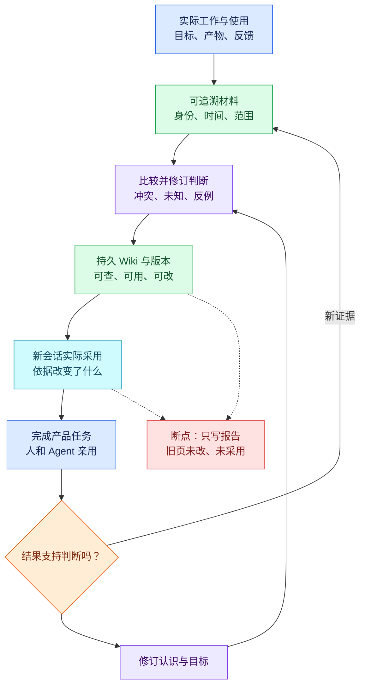
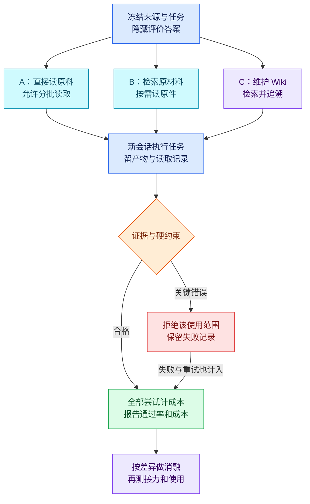

# Wiki 怎样可能有效，以及怎样验证

完整计划、两条研究会话的独立结果与后续代码复用建议，见[研究与探索](../research/README.md)。

2026-10-19 · OpenViking **0.5.0**／nashsu/llm_wiki **v0.6.12**。

**目前证明的是部分工作链能运行，尚未证明它们能改善 evoLoop 的真实项目开发。** 本文综合两条原始验证会话的实际使用、固定版源码复核和交叉审阅，解释机制、作用条件与反例，并给出下一轮测试设计。功能清单和六张实现流程图见[功能与工作流程](wiki-feature-comparison.md)，已运行结果见[首轮验证摘要](validation-summary.md)。

下文新增测试均为**设计，尚未执行**。没有把设计中的预期结果写成验收通过；没有因补查到更多功能而撤销此前的失败记录。原始操作日志、完整会话和外置 Wiki 不进入公开开发仓库。

## 我们需要验证的“有效”是什么

对 evoLoop，认知的工作性定义是：**围绕目标，把观察、证据、约束和反馈组织成可解释、可质疑、可修订的判断，用它选择行动，再以行动和实际使用的结果修订判断与目标。** 这是本项目用于验收的定义，不是对人类认知理论的完整定义，也不把知识页本身称为认知。

一个有用的 Wiki 应让多 session 少做重复调查，能区分当前决定与旧提案、事实与假设、适用范围与例外，并在新反馈出现后改变实际工作。检索命中、写入成功、图谱变大和措辞流畅只能证明其中局部。

图是 **evoLoop 要完成的闭环**，不是声称两个候选已经提供了全部环节。蓝色是实际工作／入口，绿色是持久资产，紫色是推理，青色是消费，橙色是检查，红色是断点。

评价分五层，逐层留证：①存得下并能恢复；②找得到正确材料；③知识本身完整、当前且有依据；④另一个 session 正确采用；⑤产品体验、返工或下一阶段选择得到改善。前一层通过不能替代后一层。

## OpenViking：机制、因果假设与证据

### O1：持久上下文使认知能跨会话传递

**机制。** 客户端把来源和知识写入 VikingFS；内容与向量索引分别持久化。新会话通过 URI、目录、搜索和原文读取重建工作背景，依赖共享资产而非上一个 Agent 的聊天上下文。[存储机制][o-storage]

**为什么可能有用。** 若当前判断、来源和入口完整，接手者可以复用前次调查，把上下文留给新问题。此前 fresh consumer 和冷备恢复后的消费者确实读到知识并完成方案，支持“能跨会话读取”。

**成立条件与反例。** 共享范围、权限、链接和修订要正确，接手者还要实际读懂。私有目录、失效链接、旧规则或错误摘要会让错误同样持久。此前没有三棒实际项目接力，故“减少长期交接成本”仍是假设。

### O2：摘要和检索可能降低定位成本

**机制。** 资源处理产生目录 L0／L1 摘要和检索表示，消费者定位后按需读 L2。固定版检索实现采用全局召回与可选规划／重排；类名 `HierarchicalRetriever` 不意味着递归遍历目录。[分层上下文][o-layers] · [检索实现][o-retrieval]

**为什么可能有用。** 当资料多、任务只涉及局部时，短表示可过滤无关内容。但摘要可能压掉否定、例外和版本；语义相似也可能找到过时规则。小材料全集本就容易读，额外工具调用可能更慢。

**已有证据。** 找页和下钻已跑通；未做 L2-only 或检索消融，不能把效果归因于 L0／L1。八条材料上，Wiki 消费约 **94.651 秒**，直接原料约 **82.784 秒**，前者还遗漏了 Markdown 许可。这个样本反驳“小规模也自然更省”的说法。

### O3：Wiki 编译提前完成跨来源比较

**机制。** 调用方显式发起 compile；运行时加载官方 Wiki Skill、来源与旧页；模型决定主题、关系、冲突和修改；运行时校验输出并持久写回。[编译链][o-compile] · [官方 Skill][o-skill]

**为什么可能有用。** 主题页可以提前完成“谁提出什么、后来如何修正、什么仍未确定”的比较，让后续多个消费者复用这次推理。价值来自模型实际做对的综合及持续维护，存储使它可复用。

**已有证据与反例。** 分批编译采用了用户纠正，并保留两种故障解释；完整性仍有漏项反证。结构、路径和来源 ID 校验不等于逐主张证据支持校验。来源权威或范围不明、旧页未读、只新增页不修旧页，都能使“综合”变成矛盾累积。

### O4：认识更新依赖完整的维护链

**机制。** 来源变化／删除与目标 Wiki 修订是分开的动作；维护者显式重编或编辑，再检查发布与消费。快照支持显式留版，普通写入不会自动为每次修改保留历史。[快照][o-snapshot]

**已有证据。** 删除来源后 Wiki 立即未变；再编译才修订。0.5.0 普通同页双写还发生静默丢更新。Watch 刷新来源、路径锁保护一次写入、任务去重，均不足以保证模型读旧页到发布之间不覆盖别人。

**作用条件。** 需要明确触发、影响范围、维护人、受控写入口、版本和发布后复查。尤其不能把“某证据被撤回”推成“相反解释已经成立”。这些条件成立，持续维护才可能减少过时行动。

### O5：长期 memory 与公共 Wiki 有不同价值

Session commit 可以归档原文并按策略抽取个人／Peer 记忆；working memory 默认关闭，Wiki 又是独立编译路径。稳定偏好和经验可能减少重复介绍，公共主题判断则需要另一套维护责任。[会话与记忆][o-session] · [默认 WM 状态][o-wm]

此前实验关闭了记忆提取与 WM，实际跑的是归档原文→Wiki，**不能把收益记到未启用的 memory 功能**。后续若开启，需单因素比较，并检查私人偏好是否误升为团队规则、两份知识是否分叉。

### O6：成本只能通过合格复用摊薄

此前正式三次编译约 **214.8 秒**，输入 **127,748**／输出 **7,056 tokens**，尚不含全部来源语义与嵌入成本。编译希望把后续重复比较前置，但本样本单次消费没有节省，因此目前算不出正的摊薄点。

只有在质量合格、单次消费确实更便宜、主题反复使用且维护成本可控时，规模化才可能有收益。频繁变更、一次性探索、每次仍需核读全部原文，会使编译增加负担。墙钟、模型用量、人主动时间和运行成本应分别报告，不能混成一个“更快”的数字。

## nashsu：机制、因果假设与证据

### N1：分析再生成，把一次阅读转成可复用知识

来源解析后，应用加载 purpose／schema／索引，让模型先分析，再输出 FILE／REVIEW；应用校验、合并并写入外置 Markdown。前次八份材料生成了 **39 页**，分析不完整时也曾正确停止，随后恢复。[摄入实现][n-ingest]

分开分析与写作，可能让模型先处理关系和限定，再组织内容；重复消费时可少读原件。但没有两阶段／单阶段消融，不能证明两阶段更好。八条简单材料拆成 39 页也可能增加碎片和阅读负担；分析阶段丢掉的条件会被生成阶段固化。页数是运行结果，不是收益指标。

### N2：purpose／schema 让积累围绕目标组织

项目规则进入摄入上下文，决定知识应服务谁、关注什么、放入哪些类型；它可能减少一般百科式扩写和重复发明分类。[生成与规则][n-ingest]

这需要规则与真实任务一致，并容纳反例。过窄 purpose 会筛掉不同意见，过时 schema 会把新职责硬塞进旧分类。此前没有规则对照；“按模板建了目录”不能证明产品方案更好。组织规则也不能成为事实证据。

### N3：缓存与同页合并支持积累，跨页一致性仍会断裂

内容 hash 与已写文件检查避免重复计算；新输出命中旧页路径时，合并器读取旧正文并维护来源字段。[合并实现][n-merge]

前次两种解释确实合并到了同一页，但用户纠正只进入了新页，部分旧中心页仍保留旧认识。机制更依赖页身份和模型选对受影响页，没有保证枚举所有语义依赖。不同 slug、旧页漏选、缓存保留旧产物，都能阻止纠正传播。应检查所有仍被当前入口使用的页和实际动作，不能只看最新一页。

### N4：导航、搜索和来源回读可能比综合文本更重要

Markdown、索引、搜索和图链接使材料可定位；消费者自己的模型读后再决定行动。前次原生组约 **120 秒／11 次入口操作**，外部维护组约 **104 秒／19 次**，直接材料约 **88 秒**。嵌入当时未开启，不能给向量检索记收益。[搜索实现][n-search]

其中一份来源摘要增加了原文没有的日志位置描述，消费者通过回读原件拒绝了这个延伸。外部维护后的消费者也读了七份原始来源。因此“任务通过”是 **Wiki＋原件＋消费者推理的联合结果**。可追溯是价值；反复读回几乎全部原文则是维护或综合不足的成本，需要分开归因。

### N5：Review、Lint、去重与编辑能辅助维护

这些入口可以聚焦断链、冲突、重复页和知识缺口，由人选择修复、合并、建页或研究。前次 HTTP resolve 只改变 Review 状态，没有改正文；UI 操作路径可执行其他动作，不能混为同一个行为。[Review UI][n-review] · [状态 API][n-review-api] · [Lint][n-lint]

有效性取决于建议准确、处理量可承担、操作真的修好知识、下一消费者用到修订。误报太多、合并了两个不同对象、resolved 但正文不变，会把维护工具变成新的负担。完整 UI 纠错、去重和真人维护收益尚未实测。

### N6：Deep Research 扩展证据，但收到什么决定了能知道什么

查询→Web／AnyTXT 搜集→去重限量→模型筛选→综合→正文和引用编号检查→直接保存研究页，是固定版主要链路。输入使用提供方返回的 snippet／content／markdown，不能一概称为已抓取并阅读网页全文。[研究实现][n-research]

它可能在确有缺口时引入反例和新证据；若关键限定只在未收到的正文／附件中，模型没有依据做完整判断。筛选也可能排除反对意见，编号引用检查不证明内容蕴含。固定版有避免研究页再次摄入的路径，但未实际运行此功能；研究价值仍需测试。普通聊天的 deep 模式、Save to Wiki 和研究队列要分别验。

### N7：外部维护者让多 session 协作可实现，也增加新的责任

外部 Agent 可经 HTTP／MCP 写页。前次外部维护修正了部分中心页，做了 **27 次字节验证写入**，却丢失了不少机器使用的 `sources` 字段。[写页实现][n-write]

接口使“领域贡献→维护者综合→其他会话消费”可执行，但不自动保证认识正确或来源合同完整。更强模型、更长提示词或人工填答案带来的改进，要归给相应因素。维护者也不应因此成为所有领域行动的唯一审批者。

## 怎样做公平比较

**先测每个系统内部是否有增益，再比较两个系统。** 前轮消费者较一致，但 Wiki 生产模型、提示词、维护方法和运行入口不同。系统整体比较可以回答“这套实际组合好不好用”；要归因某个存储、综合或检索机制，则需要同模型、同信息、单因素变化。

| 条件 | 下一轮必须固定和记录什么 |
| --- | --- |
| 版本 | 两个固定提交；原生、外部维护适配、实验性消融分别编号，改一项就留差异 |
| 信息 | 同一来源包、权限、时间与权威状态；评价账本、答案和构建会话不交给生成者／消费者 |
| 模型 | 实际请求／响应模型、effort、工具定义、上下文、输出与迭代预算；相同配置不代表实际生效相同 |
| 调用差异 | OpenViking 0.5.0 Codex adapter 未透传 temperature／max_tokens；只能记录为配置值，不能宣称生成端受控 [适配器][o-adapter] |
| 消费 | 全新上下文、同任务和读权限、相同预算；Wiki 正常允许追源，禁止追源只用于单独消融 |
| 评价 | 先冻结硬约束和真实任务验收；评价者未参与构建，产物匿名，争议回核原件；不能只由生成模型自评 |
| 成本 | 摄入、索引、分析、生成、维护、消费、追源、重试、恢复和人工时间分开记；未知用量保留未知 |
| 重复 | 按任务族分层、交错顺序、保留首次失败；相同题目的改写不冒充独立样本 |

默认原生配置可分别沿用原验证会话，以保持纵向可比；**这不构成两候选间的严格模型控制**。只有核实调用端参数与信息预算匹配后，才报告机制的直接差异。产品没有原生消融开关时，使用明确标识的独立测试适配，不能虚构一个设置。

所有分配任务都进入成本账，包含失败、废弃输出和重试；同时报告完成率、首次通过率，以及“全部尝试总成本 ÷ 合格交付数”。质量门用于判断是否采用，不能过滤掉失败运行的成本；零合格交付时报告无合格交付及总支出。

A／B／C 是本次提出的统一测试设计，不是三个已测完的组。尤其 nashsu 当前 MCP 没有独立的 source.search 工具；B 需只读测试适配暴露原料搜索，并保持消费者协议一致。不能偷偷改用另一个内置聊天模型来代替 B。

## 具体测试 case

以下统一编号便于两个 session 使用同一验收口径；由它们各自报告中的 case 合并而来。**所有新增组合均未运行**，每项单列已有局部证据。

### T1 · 综合是否比原料检索多创造价值

- **假设与输入：**保留八条原样材料作小规模对照；另冻结 12–20 份材料、6 个新任务，包含跨来源条件、旧提案、新决定、反例和干扰。至少一个任务实际操作隔离测试项目，其余交实施方案、诊断或修订产物。
- **对照：**A 直接原料、B 只检索原料、C Wiki＋正常追源；三组新上下文、同模型／预算／任务，不把答案写入 purpose 或 Skill。大材料不可一次容纳时，A 允许统一分批读，不能故意截掉关键事实。
- **评价与失败：**盲核硬约束、遗漏、无依据断言、动作正确性、回读量和全部尝试成本及每个合格交付的成本。C 相对 B 没有减少错误／重复调查却持续更贵，就不支持综合的额外价值。8 条上仅已有 A／C 局部对照，B 和新任务未跑；建库、索引与维护分别计账。

### T2 · 多轮纠正能否改变所有当前入口

- **假设与扰动：**同一主题依次出现未采纳提案→明确决定→低权威相反猜测→带范围的新决定→撤回其中一个依据；保留持续成立的例外。改变到达顺序，防止系统把“最后一条”当真。
- **对照与产物：**各批后冻结；比较原生流程、另加限额维护者、直接读取完整历次来源及相同状态事件。新消费者每轮交当前决定、历史变化、未知及实施修改；消费者自行判断当前有效性，业务上可见的撤回／授权事件对所有组同样可见，隐藏的只是评价答案。维护者不看答案。原生和适配分别记，不能将额外维护记成自动能力。
- **评价与失败：**盲查预先定义的受影响当前页、入口和实际动作。新页正确但中心页仍让人照旧做，仍失败；历史提案可保留，必须标清状态。记录维护、复核、重编成本与更新延迟。两边已有一次纠正实验，nashsu 已见跨页漏改；完整多轮组合未跑。

### T3 · 冲突与撤回：综合正确，还是消费者在补救

- **假设与扰动：**交接事件三变体：只有提交记录、可靠送达但无消费证据、撤回一份观察；加入相似事件干扰。撤回一个依据不能证明另一解释为真。
- **对照与产物：**同份冻结 Wiki 分为允许／禁止原文回读，另有原料检索组；只改这一个条件。交可执行诊断、最少取证动作及推翻各解释的条件。额外人工注入的摘要歧义须单列，不能算原生错误率。
- **评价与失败：**核是否虚构日志、武断定责、继续用失效依据，以及追源成本。允许回读才赶上 B，说明可追溯入口和消费者有贡献，不足以证明综合可靠。已有 nashsu 回读纠错和两边撤回观察；新的 on/off 对照尚未运行。

### T4 · 根据失败模式选择机制消融

| 独立问题 | 一次只改变什么 | 必须观察的结果 |
| --- | --- | --- |
| OpenViking L0／L1 是否帮助定位 | 相同内容和任务，带摘要定位 vs L2-only；记录工具差异 | 关键证据可得性、漏限定、实际动作、总读取量，不能只比摘要长度 |
| 主题综合是否有价值 | 同来源检索 vs 生成主题页；保持消费者与维护次数一致 | 跨源比较错误、重复调查、产物质量和总成本 |
| nashsu 两阶段是否必要 | 同输入预算，原生两阶段 vs 一阶段测试适配 | 条件保留、无依据断言和真实任务错误；更多页不算收益 |
| 合并是否保留旧限定 | 同一新候选页，合并旧页 vs 只保新稿 | 旧证据、例外、来源字段及新决定是否完整 |
| 图扩展／向量是否有收益 | 同快照分别只关一个因素，不一起换模型 | 被召回的关键证据是否改变动作；无关邻居带来的噪声 |
| purpose／schema 是否聚焦目标 | 通用、具体、过时／过窄规则分别比较 | 实际方案相关性及反例保留，不能只看目录合规 |

这些消融都未运行。没有原生开关的，改用独立适配并披露精确差异。只选能解释 T1–T3 结果的一项开始，不跑所有机制的全排列。模型、提示长度、调用数与人工修复均单列成本。

### T5 · 无历史的多 session 实际接力

- **假设与输入：**先做三条独立接力链，每条诊断→实施→验收；第二棒前加入纠正，第三棒要识别一条未证实假设。只把实际产物和反馈作为后续材料，不传构建聊天、答案或另组结果。
- **对照与产物：**Wiki 链与原料检索链，同工具、模型、任务与预算；串行发布，暂不开额外长期 memory。交可运行变更、交接和验收记录，注明哪条认识改变了哪个动作。
- **评价与失败：**检查重复调查、过时动作、错误继承、人类提醒和完整链成本。下一棒没有用到前一棒结果，或需要人补全历史，就未证明接力收益。此前只有 fresh consumer，完整三棒接力未跑。

### T6 · 真人能否发现并修好知识错误

- **假设与输入：**在固定含错知识副本中，让真实使用者找当前结论、定位原始限定、修改并回退；安排交错顺序，避免熟悉答案带来优势。
- **对照与产物：**产品 UI vs 同来源的普通文件阅读／搜索。nashsu 另可比较无辅助清单与 Review／结构 Lint 辅助；语义 Lint 作为后续单因素。保存原始操作、实际修改和下一消费者结果。
- **评价与失败：**成功率、主动用时、误报、澄清、来源判断与修正后是否仍错。resolved 状态或 Agent 截图不算真人验收。完整真人纠错尚未运行；用户主动时间、等待和模型调用分别计。

### T7 · nashsu Deep Research 是否尊重证据边界

- **假设与扰动：**冻结搜索输入：零结果、全无关、短 snippet 缺关键限定、相反来源、同源重复；再与提供足够正文片段的条件对照。来源 fixture 明确标为测试适配，模型真实运行，不能当作联网研究成绩。
- **产物与检查：**研究页逐条主张／引用核对；检查是否承认不足、保留反例，保存后是否异常触发再摄入／Review 增殖。普通 Save to Wiki 另走其合同，不混作研究队列。
- **失败与成本：**零来源仍宣称已验证、有编号却无支持、忽略关键限定或循环自证均失败。搜索、筛选、综合、嵌入及后续摄入分别计。此项此前只核源码，完全未运行。

### T8 · 并发、未知结果与恢复门槛

- **扰动：**同基线双写、提交成功后丢响应、重试、介入写者、处理中重启；再做原生快照／ZIP／OVPack 恢复，与手动备份分别记。
- **产物与检查：**请求与基线账、最终内容、来源字段、引用、索引、冲突响应和恢复后正常消费。机械故障大多不需模型；恢复后的任务消费才需另计模型成本。一次静默丢更新足以拒绝该并发入口，字节读回与历史快照不能抵消。
- **已有状态：**两个固定版本均已见同页覆盖失败；无修改无需重复花钱验证同一缺陷。OpenViking 原生认证打包、nashsu 原生 ZIP UI 及完整恢复矩阵未验收。仅用受控串行入口做语义筛查；要求自由多写时先过此门槛。多用户接入前另测权限、撤权后的搜索／历史／导出与恢复，不用存在 ACL／token 推断安全通过。

### T9 · 材料增长与成本拐点

- **假设与输入：**通过小样本后，按自然主题从约 20→80→200 条增长，包含变化与稳定主题，保留新增陌生任务；不以重复灌水模拟规模。
- **对照与产物：**各阶段重复共同 A／B／C 任务并增加新任务，模型、嵌入与预算固定。记录知识快照、过时率、维护范围、待审积压、合格产物、p50／p95 延迟与累计成本。
- **失败与状态：**质量失守、维护接近全量重编、人工债务不断增加，或目标使用次数内没有净收益，则拒绝相应适用区间。尚未运行长期增长；达到预算上限记未完成，不偷换模型。前置编译＋累计维护＋所有消费＋修复成本，都要计入 Wiki 组。

### T10 · 真实阶段使用能否改善下一步

- **假设与场景：**选可回退的真实项目阶段，先固定交付目标、学习问题、基线和验收。交付后让人和新 Agent 使用产品，再用 trace、反馈和结果修订认识、提出下一阶段；包含“只需增加容量”和“可能需要新持续职责”的不同问题。
- **对照与产物：**相近任务配对并交错使用 Wiki 或原料检索；无可比任务时只做过程追踪，披露跨组学习。保留可用产品、亲用记录、修订依据、目标候选及退出条件，由实际责任人决定是否采用。
- **评价与失败：**谁能完成什么、返工／提醒是否减少、哪条新证据改变了行动与结果。只生成报告、未用产品、只是多设角色，均不通过。此项完全未做；开发、亲用、知识维护、交接和人主动时间分开记。它是采用前必要证据，不能由 T1 的正确回答替代。

## 下一轮怎样收敛，什么时候不采用

**先完成 T1、T2、T3，共用一套小材料与隐藏评价账本。** 它们分别区分综合增益、纠正传播、原件补救。两个原始会话均优先提出这类机制筛查；OpenViking 会话还把多 session 接力列为最重要项，因此 T5 接在筛查之后。T4 只针对已出现差异做一种消融，T6／T7 根据采用场景选择；T9 再找规模适用区间，T10 检验真实阶段收益。

T8 是共享写入的独立门槛：已知有静默覆盖的入口不能靠问答成绩抵消。当前可用串行隔离副本做筛查，不能因此称生产并发已经解决。

开始下一轮前冻结材料、任务、评分账本和每 case 的调用／时间／人工预算；结果有歧义时才按预定规则复跑。筛查样本小，不作统计胜出声明。每次交回的应是**首次产物、调用与使用轨迹、知识修订差异、独立评价、成本和不确定性**，而非只有一张通过表。

| 结果 | 对 evoLoop 的判断 |
| --- | --- |
| 某类任务稳定减少关键遗漏／重复取证，纠正能被采用，成本可承担 | 在该任务范围继续有限试点；完成相应恢复、权限和真实使用验收后再扩大 |
| 人阅读或原文定位更方便，但综合没有额外收益 | 保留阅读／检索工具价值，不升为共享认知权威 |
| 反复出现旧决定、失效依据、错误定责，或写入静默丢失 | 不采用对应共享权威或多写路径；修复后另开固定版本验证 |
| 只有更强模型、更多人工或答案提示才能成功 | 保留这些组合的实际效果，不能归因产品原生机制 |
| 预算耗尽、数据不足或未有真人使用 | 记证据不足，不包装为可靠，也不扩大为所有场景无效 |

这套验证要回答的是：**哪一种机制，在什么任务与规模下，通过什么证据，值得我们支付多少维护成本。** 两个候选可以有不同的有效范围，不必为了选一个“赢家”而忽略原材料检索已经足够好的场景。

## 固定源码与证据说明

运行数字来自两条原始验证会话保留的实际记录；公开摘要见[首轮验证](validation-summary.md)。它们只覆盖八条合成材料，非完整历史审计、非生产评估。本文机制解释结合下列固定源码；源码不证明尚未运行的效果。功能覆盖、其他接口和完整流程图见[功能比较](wiki-feature-comparison.md)。

[o-storage]: https://github.com/volcengine/OpenViking/blob/20f9c11362ad16193b0daa4a414e1095061af427/docs/en/concepts/05-storage.md
[o-layers]: https://github.com/volcengine/OpenViking/blob/20f9c11362ad16193b0daa4a414e1095061af427/docs/en/concepts/03-context-layers.md
[o-retrieval]: https://github.com/volcengine/OpenViking/blob/20f9c11362ad16193b0daa4a414e1095061af427/openviking/retrieve/hierarchical_retriever.py
[o-compile]: https://github.com/volcengine/OpenViking/blob/20f9c11362ad16193b0daa4a414e1095061af427/bot/vikingbot/compile/service.py
[o-skill]: https://github.com/volcengine/OpenViking/blob/20f9c11362ad16193b0daa4a414e1095061af427/examples/compile/ov-compile-skills/llm-wiki/SKILL.md
[o-snapshot]: https://github.com/volcengine/OpenViking/blob/20f9c11362ad16193b0daa4a414e1095061af427/docs/en/api/11-snapshot.md
[o-session]: https://github.com/volcengine/OpenViking/blob/20f9c11362ad16193b0daa4a414e1095061af427/docs/en/concepts/08-session.md
[o-wm]: https://github.com/volcengine/OpenViking/blob/20f9c11362ad16193b0daa4a414e1095061af427/docs/en/guides/working-memory-default-off.md
[o-adapter]: https://github.com/volcengine/OpenViking/blob/20f9c11362ad16193b0daa4a414e1095061af427/openviking/models/vlm/backends/codex_responses_adapter.py
[n-ingest]: https://github.com/nashsu/llm_wiki/blob/48fd970e206a02a6d2028d1dbfc41b7a0345bf0b/src/lib/ingest.ts
[n-merge]: https://github.com/nashsu/llm_wiki/blob/48fd970e206a02a6d2028d1dbfc41b7a0345bf0b/src/lib/ingest.ts#L2053-L2189
[n-search]: https://github.com/nashsu/llm_wiki/blob/48fd970e206a02a6d2028d1dbfc41b7a0345bf0b/src-tauri/src/api_server.rs#L1910-L1938
[n-review]: https://github.com/nashsu/llm_wiki/blob/48fd970e206a02a6d2028d1dbfc41b7a0345bf0b/src/components/review/review-view.tsx
[n-review-api]: https://github.com/nashsu/llm_wiki/blob/48fd970e206a02a6d2028d1dbfc41b7a0345bf0b/src-tauri/src/api_server.rs#L1551-L1565
[n-lint]: https://github.com/nashsu/llm_wiki/blob/48fd970e206a02a6d2028d1dbfc41b7a0345bf0b/src/lib/lint.ts
[n-research]: https://github.com/nashsu/llm_wiki/blob/48fd970e206a02a6d2028d1dbfc41b7a0345bf0b/src/lib/deep-research.ts
[n-write]: https://github.com/nashsu/llm_wiki/blob/48fd970e206a02a6d2028d1dbfc41b7a0345bf0b/src-tauri/src/api_server.rs#L1790-L1835
