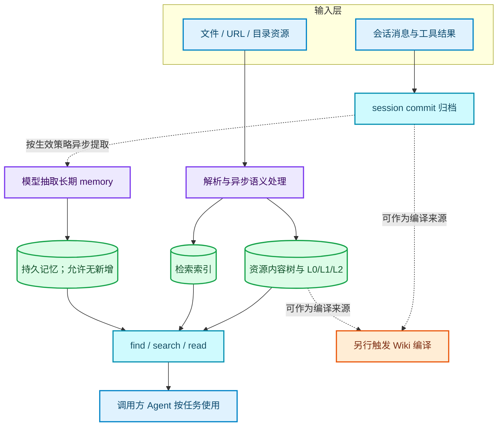
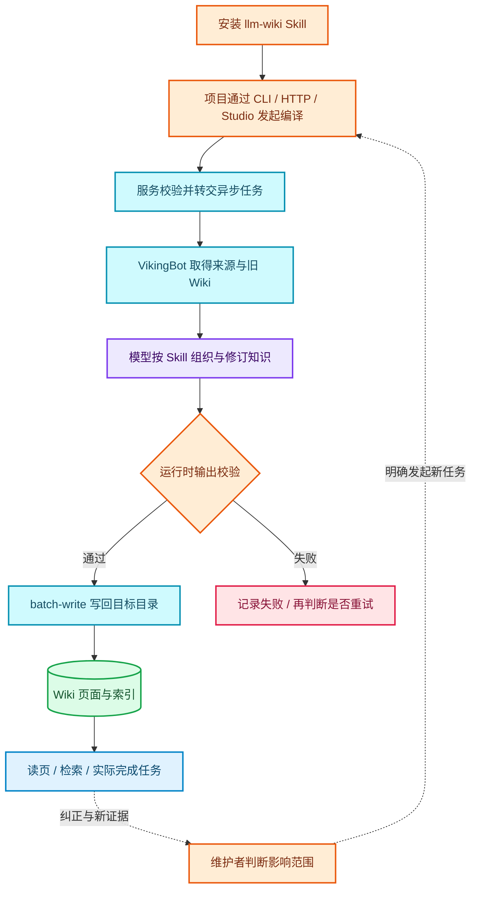
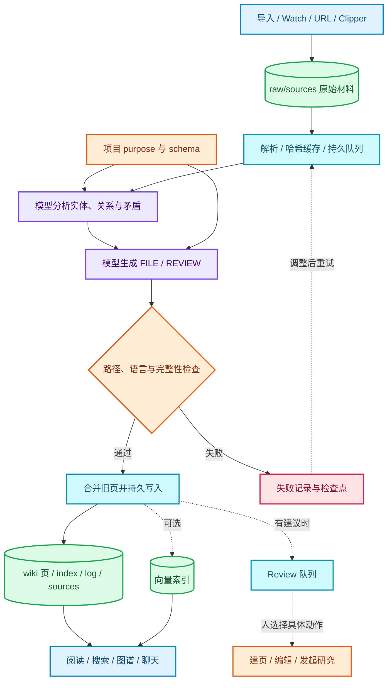
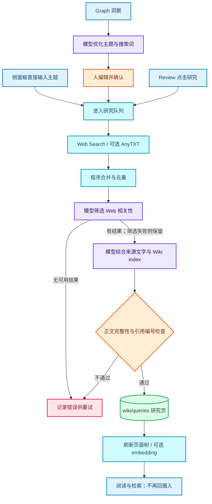
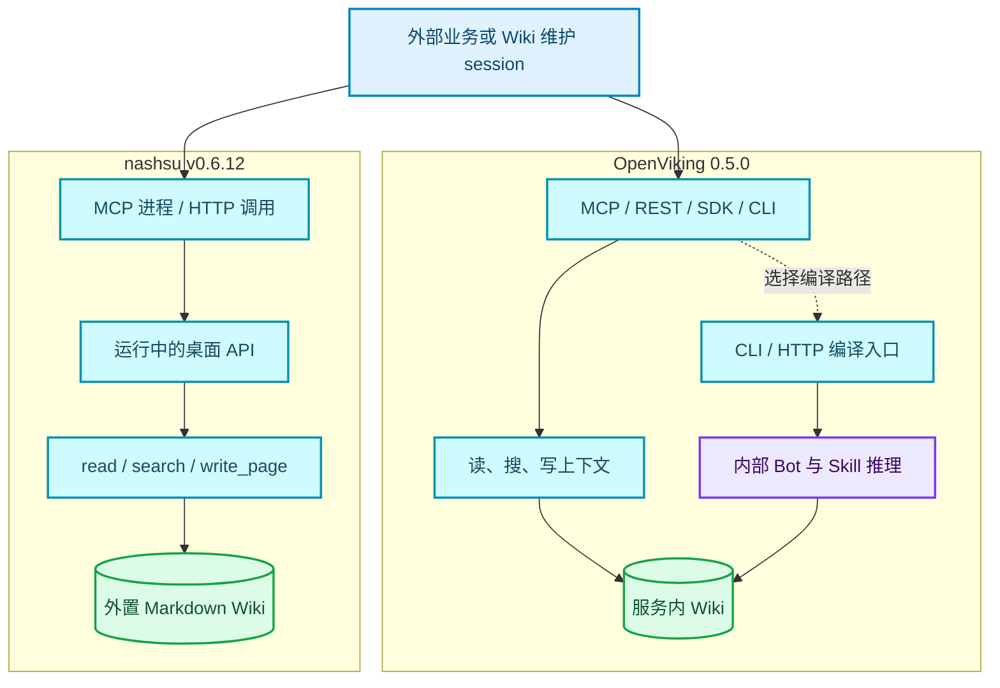
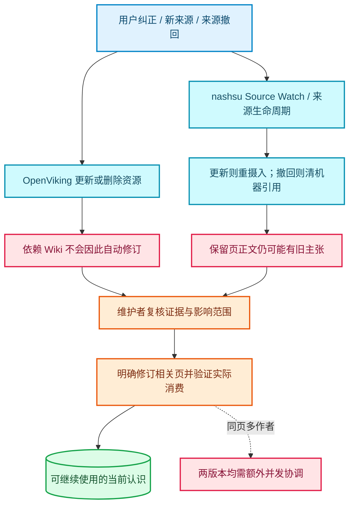

# OpenViking 与 llm_wiki：功能与工作流程

完整计划、两条研究会话的独立结果与后续代码复用建议，见[研究与探索](../research/README.md)。

2026-10-19 · 固定比较 **OpenViking 0.5.0** 与 **nashsu/llm_wiki v0.6.12**。

本页按产品入口、官方文档、API 注册和主要实现链路盘点功能；“功能存在”“模型能否做对”“在 evoLoop 中是否有效”分别判断。此前八条合成材料的试验只覆盖部分能力，完整结果见[验证摘要](validation-summary.md)。本次补充源码与流程研究，没有重新运行两套产品的全部功能。机制为什么可能有效、反例与下一轮测试见[机制与有效性验证](wiki-effectiveness.md)。

## 先理解两者分别是什么

**OpenViking** 的中心是 Agent 可调用的上下文服务：接收资源、会话与技能，组织可分层读取和检索的持久上下文，并提供 Wiki 编译工作链。它适合先考虑“多个 Agent 怎样通过服务接口读取和维护项目知识”。

**nashsu/llm_wiki** 的中心是人可以直接操作的桌面 Wiki：选择独立知识文件夹，导入材料，让应用中的模型整理页面，再阅读、编辑、问答、研究和通过 MCP 使用。它适合先考虑“人和 Agent 怎样围绕同一个 Wiki 工作”。

两者有重叠，却不是同一种产品换了一套界面。Wiki 页面是交集；上下文服务、会话记忆、桌面阅读和研究体验的覆盖面不同。

## 阅读方式与证据等级

| 标记 | 怎样理解 |
| --- | --- |
| 原生 | 固定版本中存在的服务、存储、界面或接口实现；不代表本次已跑通所有边界 |
| 模型流程 | 依靠模型、提示词、官方 Skill 或 Agent 工具循环完成；存在提示要求不等于输出必然正确 |
| 实测 | 我们此前固定版本实验实际观察到的结果，只在该样本和运行条件下成立 |
| 待补 | evoLoop 需要、但尚不能从候选的原生能力获得可靠保证的部分 |

图中颜色按责任区分：**蓝色＝输入与人机入口，紫色＝模型推理，绿色＝持久资产，青色＝服务与检索，橙色＝人的选择或控制条件，红色＝已知风险或需要额外维护的边界**。虚线表示可选或后续动作，不能读作每次自动发生。

固定源码：OpenViking [`20f9c113`](https://github.com/volcengine/OpenViking/tree/20f9c11362ad16193b0daa4a414e1095061af427)；nashsu [`48fd970e`](https://github.com/nashsu/llm_wiki/tree/48fd970e206a02a6d2028d1dbfc41b7a0345bf0b)。后者提交对应 `v0.6.12` 标签；这个版本确实包含 MCP 写页能力，此前只读判断已被源码与实际调用纠正。

## 功能全景

下表覆盖固定版本面向用户与集成者的主要功能面。它不是逐一列出内部函数或全部配置键的 API 字典；未列为“实测”的能力，依据是固定源码与官方说明。

### 产品形态与存储

| 功能 | OpenViking 0.5.0 | nashsu/llm_wiki v0.6.12 |
| --- | --- | --- |
| 主要形态 | 自部署上下文服务，附 Web Studio、VikingBot 与编译任务 | macOS / Windows / Linux 桌面应用，附本地 HTTP API 和 MCP |
| 知识放在哪里 | `viking://` 虚拟内容树；内容存储和向量索引分离，可选择本地或远端后端 | 用户选定的独立项目文件夹；`raw/` 原料、`wiki/` Markdown、`.llm-wiki/` 工作状态 |
| 普通文件兼容 | 可以读写 Markdown，但虚拟 URI 不是开发仓库里的物理路径 | 普通 Markdown vault，带 wikilink、frontmatter 和 Obsidian 配置 |
| 项目与使用者 | account、user、peer、session 的命名空间；权限需明确配置 | 多项目创建、打开、切换；项目 UUID 和 MCP 项目绑定；不等于多用户 ACL |
| 运行依赖 | 服务、内容/索引后端与模型配置；Wiki 编译另需可用的 Bot 和 Skill | 桌面进程、项目目录与模型配置；桌面退出后其 API/MCP 入口也不可用 |
| 许可证声明 | 主项目 AGPL-3.0；示例目录另有 Apache-2.0 声明 | GPL-3.0 |

依据：[OpenViking 存储][o-store]、[多租户][o-tenant]、[发行说明与许可][o-license]；[nashsu 项目结构][n-project]、[本地服务][n-api]、[许可][n-license]。许可证列只记录固定版本声明，不代表已完成集成授权判断。

### 材料进入系统

| 功能 | OpenViking 0.5.0 | nashsu/llm_wiki v0.6.12 |
| --- | --- | --- |
| 文件与目录 | 文件、目录、上传、URL、代码库资源 | 多文件、递归目录、外部文件监测、API/MCP 重扫 |
| 文档格式 | PDF、Markdown/HTML/文本、Office、表格/PPT、EPUB 等解析路径 | PDF、DOCX、PPTX、表格、EPUB/MOBI 等；导入选择器还放行代码及多种文本格式 |
| 网页与外部来源 | 网页、有限递归、站点地图、RSS/Atom、Feishu/Lark 文档 URL 等；按解析器及权限配置使用 | 批量 URL、Chrome Web Clipper；研究功能接 Web Search 与可选 AnyTXT 本地搜索 |
| 图片与音视频 | 图片可选 VLM 描述；音视频语义处理依兼容模型配置 | 图片预览/可选视觉 caption，音视频播放器；不能从“可导入/播放”推断已提供语音转写 |
| 来源变化 | 对可重读远端来源设置 Watch；本地上传通常是静态快照 | Source Watch 跟踪项目来源变化，按源内容哈希判断重摄入；相同内容缓存可跳过 |
| 排队与失败 | 异步解析、语义处理、索引任务及可查询状态 | 持久摄入队列、暂停/取消/重试、检查点、重启恢复；默认一 worker，可配置 |

依据：[OpenViking 资源与格式条件][o-resources]；[nashsu 导入入口][n-input]、[解析与格式说明][n-formats]、[URL 导入][n-url]、[来源监测][n-watch]、[摄入队列][n-queue]。格式支持需要区分“文件可选择”“解析器存在”和“提取质量已验证”。

### 从材料形成持久知识

| 功能 | OpenViking 0.5.0 | nashsu/llm_wiki v0.6.12 |
| --- | --- | --- |
| 分层上下文 | L0／L1 是目录 `.abstract.md`／`.overview.md` sidecar；L2 为原文件；并非每文件各有三份 | 没有同名三层合同；以来源、来源摘要、主题/实体/综合页组织 |
| 会话记忆 | 原生 session 消息/工具结果归档，commit 后按策略异步抽取长期 memory，允许无新增；working memory 默认关闭；与 Wiki 编译分开 | 持久聊天与查询记录；未核到与 OpenViking 对等的通用 session.commit → memory 服务合同 |
| 编写规则 | 安装并选择 `llm-wiki` 示例 Skill，来源、旧页及附加指令进入编译 | 项目 `purpose.md` / `schema.md` 与内置提示词约束摄入、问答、检查 |
| Wiki 生成 | CLI/HTTP/Studio 主动发起 compile；VikingBot 调模型，运行时校验并批量写回 | 摄入队列驱动模型先分析、再生成 `FILE` / `REVIEW`；程序校验、合并并落盘 |
| 页面组织 | 示例 Skill 定义 entity/concept 等及条件性 method/comparison/analysis；根 index | 来源摘要、实体/概念/综合页、查询/研究页；维护 index、log 与 `sources` 字段 |
| 已有页维护 | Skill 要求先读旧页、多源综合、保留矛盾；是否做对取决于实际输出 | 摄入有旧页合并逻辑；是否找到所有受影响旧结论仍取决于模型及上下文 |
| Skill 管理 | 包安装、列举、语义查找、校验、更新/删除及共享命名空间；不只用于 Wiki 编译 | 内置 Agent 可读取项目/全局配置的 Skill；与外部独立 Skill 仓库不同，未核到对等的服务端 Skill 资产管理 API |
| 其他编译用途 | 有知识图谱、日报、蒸馏等示例；`--skill memory` 是不经 Bot 的专门分支 | 有问答保存到 Wiki、图谱洞察、Review 和研究产物等原生交互路径 |

依据：[OpenViking 分层存储][o-store]、[session 归档][o-sessions]、[编译服务][o-compile]、[Wiki Skill][o-skill]、[Bot 写回][o-write]；[nashsu 项目结构][n-project]、[两阶段摄入][n-ingest]、[旧页合并][n-merge]。**L0/L1/L2、长期 memory、Wiki 页是不同资产，不能画成同一种“认知”。**

### 阅读、检索、问答与研究

| 功能 | OpenViking 0.5.0 | nashsu/llm_wiki v0.6.12 |
| --- | --- | --- |
| 浏览与编辑 | Studio 浏览资源/文件树、读改页面、看检索和编译任务 | 知识树、来源树、Markdown/Milkdown 编辑、预览、数学和 Mermaid |
| 直接查找 | `read/list/tree`、`grep/glob`、层级摘要读取 | 页/文件读取；HTTP/MCP 搜索扫描 `wiki/**/*.md`，中文 bigram、标题加权；原件按引用另读 |
| 语义检索 | 每查询全局向量召回，非从根递归下降；find 与可规划／重排的 search、URI/标签等约束 | token + 可选向量 + 图扩展的混合检索，本地 LanceDB 可选 |
| 对话使用 | 通过调用方 Agent 或配套 VikingBot 使用上下文服务；不是 `find` 自己完成业务判断 | 桌面聊天与后端 Agent；fast/standard/deep/local_first 等模式，引用、重新生成、保存到 Wiki |
| 来源优先模式 | 调用者可限制范围、回读原件；实际策略由 Agent/Skill 决定 | Read Sources Only/Faithful 约束只用来源证据；回答与引用仍需检查 |
| 知识图谱 | 图谱编译示例等路径，不能等同 nashsu 的同套交互分析界面 | 原生交互图、关联加权、2-hop 扩展、社群、孤立页/稀疏区/桥接点洞察 |
| Deep Research | 可借 Bot/Skill 构建研究任务；未核到与右侧相同的专用桌面研究工作区 | 专用研究主题规划、搜索与来源筛选、模型综合、研究页保存；与 chat 的 deep 模式不同 |
| 检查与建议 | Skill/编译校验、任务错误和运行观察；不等同语义正确性验收 | 结构 Lint、模型语义 Lint、Review 建议、图谱缺口推动研究或编辑 |

依据：[OpenViking 检索][o-search]、[编译入口及 Studio][o-compile-doc]、[观察界面][o-observe]；[nashsu 搜索实现][n-search]、[Agent 模式][n-mcp]、[来源约束][n-faithful]、[图谱构建][n-graph]、[图洞察][n-insights]、[研究实现][n-research]、[Lint][n-lint]。

### 更正、来源、历史与并发

| 功能 | OpenViking 0.5.0 | nashsu/llm_wiki v0.6.12 |
| --- | --- | --- |
| 追溯来源 | URI 与原件读取；Wiki 来源表达主要由 Skill + 模型维护 | 原始来源、页 `sources` 字段、wikilink/引用；外部写页需保留这些机器字段 |
| Review / 冲突 | Skill 要求记录矛盾与不确定性；未核到通用人工维护队列保证 | 原生 Review 可执行建页、跳转编辑或研究；HTTP resolve 只改状态，和 UI action 不同 |
| 重复页维护 | Skill／编译可整理重复主题；未核到与右侧对等的专用人工合并队列 | 疑似重复检测、可选嵌入预筛、人工选 canonical／非重复；模型合并，维护来源与交叉引用，备份并删冗页；持久串行队列，未实测 |
| 来源删除 | 删除源不自动改写依赖 Wiki；需要重新编译/维护 | 有来源字段、独占页、索引和链接级联清理；共享页的残留语义仍可能存在 |
| 页面历史 | Snapshot 提供显式 commit/log/show/diff/restore；不会每次写后自动提交 | 可选文件历史，默认关闭；启用后可列历史与恢复，有限额 |
| 覆盖保护 | 固定版普通写/批写无调用者旧 hash 条件；编译目标锁只覆盖部分路径 | 默认 create-only 可拒绝已存在页；显式允许覆盖后没有旧 revision/hash 条件 |
| 多人并发保证 | 本轮同基线写丢更新；不能以路径锁/提交幂等代替页面冲突保护 | 本轮显式覆盖丢更新；进程锁、原子文件替换、字节读回各自不等于 CAS |

依据：[OpenViking 写入请求字段][o-content]、[编译锁范围][o-lock]、[Snapshot][o-snapshot]；[nashsu 来源级联][n-lifecycle]、[UI Review][n-review]、[Review API][n-review-api]、[历史配置][n-history]、[写请求][n-write]。实测判断见[首轮实验](validation-summary.md)。

### 集成、权限与运行维护

| 功能 | OpenViking 0.5.0 | nashsu/llm_wiki v0.6.12 |
| --- | --- | --- |
| 编程接口 | REST、Python/Go/JS-TS HTTP SDK、Rust CLI、Streamable HTTP MCP；另有 WebDAV 文件树读写挂载 | 桌面本地 HTTP API、Node MCP 代理；MCP 提供 12 个工具 |
| MCP 写能力 | write/edit/add_resource/add_skill/remember 等；**固定版 MCP 工具表没有 compile** | 有 `llm_wiki_write_page` 与 `llm_wiki_embed_page`，非只读；可绑定项目 |
| Agent 工具与工作区 | 配套 VikingBot 负责模型工具循环；上下文服务可供外部 Agent 调用 | 内置 Agent 可读 wiki/source/graph/web/AnyTXT/skill，按请求写页或工作区文件；shell 有批准边界，工作区产物可预览 |
| 模型配置 | 上下文处理、embedding 与 Bot 编译分别涉及模型/运行配置 | 多模型提供方、Chat/Ingest 路由、项目覆盖、可选视觉/embedding/外部搜索 |
| 认证/隔离 | account/user 与 ROOT/ADMIN/USER；ACL 开关和共享根默认值需明确设置 | API token、API/MCP 开关、项目绑定、路径限制；默认本地监听，可配置 LAN |
| 备份与恢复 | OVPack 子树导入导出、account backup/restore；不含账号/API-key registry、队列、锁、Watch 控制文件等，非完整实例灾备 | 项目 ZIP 导入导出；项目文件与应用级模型配置/密钥分开 |
| 可观察与维护 | health/ready、队列、请求日志、observer、Prometheus、编译状态与用量 | 活动/队列面板、失败重试、Review、Lint、索引重建、历史清理 |
| 其他原生运行能力 | Gateway 模型代理／上下文注入、Bot 渠道与定时任务；multi-write 存储复制、可选加密，均未验收 | 定时外部目录导入等；外部删除不等于清理已导入副本 |
| 接入的运行责任 | 持续服务、Bot、模型和后端的配置及可用性 | 桌面进程保活、vault 与本地 API/MCP 的配置及可用性 |

依据：[OpenViking API 总览][o-api]、[Skill 管理][o-skills]、[WebDAV][o-webdav]、[MCP 工具表][o-mcp]、[ACL][o-acl]、[OVPack][o-backup]、[运行观测][o-observe]；[nashsu HTTP 路由][n-api]、[MCP 工具定义][n-mcp]、[Agent 工具与工作区][n-agent]、[token 与开关][n-auth]、[项目归档][n-backup]、[维护入口][n-maintenance]。两边本项目都只完成手工备份恢复，不能把原生归档功能存在写成已经通过恢复验收。

补充边界：

- **目录与检索：**L0／L1 是目录附属摘要；固定版每查询全局召回，不按 `HierarchicalRetriever` 名称推断为递归树搜索。[分层][o-layers] · [检索实现][o-retriever]
- **记忆：**working memory 默认关闭，归档成功不意味着已生成 overview／压缩摘要；长期 memory 与 WM 的策略要分别核对。[默认说明][o-wm]
- **模型控制：**0.5.0 Codex Responses adapter 转发 model／reasoning effort，但未透传 temperature／max_tokens；配置相同不足以证明实际采样与输出上限相同。[适配器][o-adapter]
- **运维：**Gateway 与 Wiki 编译是不同路径；multi-write 是存储复制，不是多作者冲突合并，也不承诺自动主备切换。[Gateway][o-gateway] · [复制][o-multiwrite] · [加密][o-encryption]
- **nashsu 搜索与保存：**MCP 搜索以 Wiki 页为范围，原文由引用下钻；聊天 Save to Wiki 可触发再摄入，Deep Research 的不回摄入规则不能泛化到它。[搜索范围][n-search-scope] · [原文读取][n-source-read] · [聊天保存][n-chat-save]
- **nashsu 去重：**页级重复检测与确认合并是原生维护功能，和研究搜索结果去重不同；效果尚未验证。[检测][n-dedup] · [合并][n-dedup-runner] · [定时导入][n-scheduled]

## OpenViking 流程一：上下文与记忆怎样形成

资源摄入后，服务组织内容、摘要和检索索引；会话归档还可以触发长期记忆抽取。调用方可以直接消费这些上下文，**不必先生成 Wiki**。图中的模型步骤要使用对应模型配置；索引任务完成与输入被接受是不同状态。[资源处理][o-resources] · [会话链路][o-sessions]

## OpenViking 流程二：真正的 Wiki 编译

`llm-wiki` 是需要安装并选择的官方示例 Skill。CLI/HTTP/Studio 提交任务，服务转交 VikingBot；模型根据 Skill、来源与既有页产出编译结果，运行时校验并批写。取消、失败、等待和完成有任务状态；完成还需要检查实际页的语义。新增或撤回来源后，需要明确安排维护编译。[编译服务][o-compile] · [模型执行与写回][o-write] · [Skill 维护约定][o-skill]

## nashsu 流程一：来源摄入与知识页维护

建项目时确定 `purpose.md` 与 `schema.md`。来源经过解析、缓存与队列，再由模型完成分析和页面生成，程序执行格式/路径/完整性检查与写入。已有页合并、Review 和来源关系是这条链的一部分，但旧判断是否真正被改正仍需要内容验收。[摄入][n-ingest] · [持久队列][n-queue] · [写入合并][n-merge]

## nashsu 流程二：Deep Research 与普通聊天不同

专用研究工作区有三种入口：直接输入主题通常以该主题搜索；Graph 洞察先由模型优化主题和搜索词，再由人编辑确认；Review 可沿预生成 query 直接入队。之后才进入来源搜索、综合和保存。Web 来源相关性筛选由模型执行，失败会保留候选；全部拒绝或无来源时任务报错。研究综合实际读取搜索提供方返回的文字（`snippet/content/markdown` 等按提供方转换）；固定实现不能据 README 的文案直接认定会逐 URL 再抓完整正文。

**研究成果直接写入 `wiki/queries/`，不会自动重新经过 source ingest。** 代码明确避免将生成研究再当新来源，造成重复摘要和 Review 循环。引用的检验、正文是否完整、主题是否值得继续，仍需实际使用评估。[三入口与 Graph 确认][n-research-entry] · [搜索与筛选][n-research-filter] · [搜索上下文][n-research-context] · [直接保存与避免重复摄入][n-research-save]

后端 chat 的 `deep` 是 Agent 证据收集模式；桌面 Deep Research 是独立任务流程。两者名称相近，但入口、状态与产物路径不能合并为一条“自动研究”箭头。

## 外部 session 怎样读取和写入

两边都可让外部 Agent 读写，但协议入口与谁负责推理不同。外部 Agent 自己写页，与让候选内部模型编译，是两条可选路径；选择其中一条也不会自动承担来源修订与并发协调。

OpenViking 的编译需使用该版本实际提供的 CLI/HTTP/Studio；nashsu 的 MCP 代理依赖运行中的桌面 HTTP 服务。项目 pin 约束一次 MCP 连接选择的项目，不等同多个用户的权限体系。[OpenViking MCP][o-mcp] · [nashsu MCP][n-mcp]

## 变化发生以后，哪里会断开

下面把“来源更新/撤回”与“知识已修订”分开，展示两套产品各自的缺口。红色节点来自固定实现与既有实验，不能扩展成对新版本的判断。

## 相同任务放进两套系统，会发生什么

### 用户纠正一个旧判断

| 环节 | OpenViking 0.5.0 | nashsu/llm_wiki v0.6.12 |
| --- | --- | --- |
| 接收纠正 | 可作为新资源或归档会话进入知识编译链 | 可摄入新来源，也可由外部 Agent 调写页工具 |
| 让当前页采用纠正 | 官方 Skill 读取相关材料并编译；本轮纠正案例通过 | 本轮新页采用纠正，但旧中心页仍保留过时状态 |
| 所有依赖内容随之更新 | 不能仅凭编译任务成功作保证，需要检查依赖页面与后续消费者 | 不能仅凭新页出现或 Review 状态改变作保证，需要检查旧页正文 |
| 下一会话是否用对 | 本轮仍漏掉“Markdown 可以接受”等约束 | 消费者完成任务，但曾下钻原始来源纠正摘要 |

这是我们的[有限实测](validation-summary.md)，不是对全部模型、提示词、版本和材料的普遍评价。能力比较必须同时看**入口、存储变化、依赖传播和实际消费**。

### 两个 session 同时改一页

两边本轮都出现过覆盖写丢更新。`write_page`、路径锁、任务队列或 Review 标记不能自动替代“按调用者读过的版本做条件写”。evoLoop 的受限试点仍须约束写入路径、保留快照并处理冲突；固定新版是否解决，需要另外运行同协议验证。

### 撤回一份来源

两边都不能把“源文件已删”直接当作“所有综合结论已修正”。OpenViking 本轮经显式再编译可更新；nashsu 清掉元信息/链接后仍有正文残留。正确闭环还包括定位受影响的主张、修订当前页、保留撤回说明，以及让尚未执行的任务复核依据。

## 对 evoLoop 意味着什么

| 我们需要的能力 | 可以借用候选什么 | 仍由 evoLoop 负责什么 |
| --- | --- | --- |
| 各 session 提交材料与认识 | 摄入、读写、搜索、模型整理入口 | 来源身份、项目边界、观察与推断的区分、贡献和发布的责任 |
| Wiki 维护 session 持续修订 | 编译/编辑工具、页面、来源与查询界面 | 冲突判断、旧页修订、反例、影响任务、读入基线与发布检查 |
| 人和新 Agent 都能使用知识 | 文档阅读、搜索、聊天、MCP/服务接口 | 按真实任务验收、记录所用修订、纠正采用与使用成本 |
| 任务持续推进 | 将知识 ID 与任务关联 | 飞书任务权威、责任、交接确认、未知结果恢复 |
| 动态增加或撤回职责 | 从来源、知识和工作记录取得依据 | 分工诊断、角色试行、收益与成本评估、退出条件 |
| 每阶段通过实际使用形成认识 | 保存材料和研究结果 | 交付目标、学习问题、真实亲用、下一阶段选择 |

**选择关系：**如果重点是程序化上下文、会话记忆和服务集成，OpenViking 的覆盖更直接；如果重点是尽快获得可操作的桌面 Wiki、阅读、编辑和研究体验，nashsu 的入口更直接。对 evoLoop 的多 session 共享认知权威，两者都还需要补验和协调机制；目前仍维持“OpenViking 可继续受限试点、nashsu 保留阅读整理候选”的判断，没有完成正式选型。

产品最终要验证的是：一次认识修订能否减少后续误解、返工和人类传话，并让阶段成果更接近目标。页面数量、功能数量、图谱规模或回答流畅度不能单独回答这个问题。

[o-store]: https://github.com/volcengine/OpenViking/blob/20f9c11362ad16193b0daa4a414e1095061af427/docs/en/concepts/05-storage.md#L9-L140
[o-tenant]: https://github.com/volcengine/OpenViking/blob/20f9c11362ad16193b0daa4a414e1095061af427/docs/en/concepts/11-multi-tenant.md#L21-L114
[o-license]: https://github.com/volcengine/OpenViking/blob/20f9c11362ad16193b0daa4a414e1095061af427/README.md#L418-L425
[o-resources]: https://github.com/volcengine/OpenViking/blob/20f9c11362ad16193b0daa4a414e1095061af427/docs/en/api/02-resources.md#L7-L145
[o-sessions]: https://github.com/volcengine/OpenViking/blob/20f9c11362ad16193b0daa4a414e1095061af427/openviking/server/routers/sessions.py#L660-L713
[o-compile]: https://github.com/volcengine/OpenViking/blob/20f9c11362ad16193b0daa4a414e1095061af427/openviking/service/compile_service.py#L333-L390
[o-skill]: https://github.com/volcengine/OpenViking/blob/20f9c11362ad16193b0daa4a414e1095061af427/examples/compile/ov-compile-skills/llm-wiki/SKILL.md#L26-L249
[o-write]: https://github.com/volcengine/OpenViking/blob/20f9c11362ad16193b0daa4a414e1095061af427/bot/vikingbot/compile/service.py#L847-L1196
[o-search]: https://github.com/volcengine/OpenViking/blob/20f9c11362ad16193b0daa4a414e1095061af427/openviking/server/routers/search.py#L369-L617
[o-compile-doc]: https://github.com/volcengine/OpenViking/blob/20f9c11362ad16193b0daa4a414e1095061af427/docs/en/context-compilation/01-overview.md#L3-L37
[o-observe]: https://github.com/volcengine/OpenViking/blob/20f9c11362ad16193b0daa4a414e1095061af427/docs/en/guides/05-observability.md#L5-L73
[o-content]: https://github.com/volcengine/OpenViking/blob/20f9c11362ad16193b0daa4a414e1095061af427/openviking/server/routers/content.py#L39-L78
[o-lock]: https://github.com/volcengine/OpenViking/blob/20f9c11362ad16193b0daa4a414e1095061af427/bot/vikingbot/compile/service.py#L767-L817
[o-snapshot]: https://github.com/volcengine/OpenViking/blob/20f9c11362ad16193b0daa4a414e1095061af427/docs/en/guides/15-snapshot.md#L1-L51
[o-api]: https://github.com/volcengine/OpenViking/blob/20f9c11362ad16193b0daa4a414e1095061af427/docs/en/api/01-overview.md#L5-L85
[o-mcp]: https://github.com/volcengine/OpenViking/blob/20f9c11362ad16193b0daa4a414e1095061af427/openviking/server/mcp_endpoint.py#L449-L509
[o-acl]: https://github.com/volcengine/OpenViking/blob/20f9c11362ad16193b0daa4a414e1095061af427/docs/en/concepts/15-acl.md#L66-L108
[o-backup]: https://github.com/volcengine/OpenViking/blob/20f9c11362ad16193b0daa4a414e1095061af427/docs/en/guides/09-ovpack.md#L160-L202
[n-project]: https://github.com/nashsu/llm_wiki/blob/48fd970e206a02a6d2028d1dbfc41b7a0345bf0b/README.md#L473-L493
[n-api]: https://github.com/nashsu/llm_wiki/blob/48fd970e206a02a6d2028d1dbfc41b7a0345bf0b/src-tauri/src/api_server.rs#L357-L385
[n-license]: https://github.com/nashsu/llm_wiki/blob/48fd970e206a02a6d2028d1dbfc41b7a0345bf0b/LICENSE
[n-input]: https://github.com/nashsu/llm_wiki/blob/48fd970e206a02a6d2028d1dbfc41b7a0345bf0b/src/components/sources/sources-view.tsx#L167-L211
[n-formats]: https://github.com/nashsu/llm_wiki/blob/48fd970e206a02a6d2028d1dbfc41b7a0345bf0b/README.md#L304-L335
[n-url]: https://github.com/nashsu/llm_wiki/blob/48fd970e206a02a6d2028d1dbfc41b7a0345bf0b/src/lib/url-source-import.ts#L155-L190
[n-watch]: https://github.com/nashsu/llm_wiki/blob/48fd970e206a02a6d2028d1dbfc41b7a0345bf0b/src/lib/project-file-sync.ts#L337-L426
[n-queue]: https://github.com/nashsu/llm_wiki/blob/48fd970e206a02a6d2028d1dbfc41b7a0345bf0b/src/lib/ingest-queue.ts#L35-L149
[n-ingest]: https://github.com/nashsu/llm_wiki/blob/48fd970e206a02a6d2028d1dbfc41b7a0345bf0b/src/lib/ingest.ts#L1073-L1167
[n-merge]: https://github.com/nashsu/llm_wiki/blob/48fd970e206a02a6d2028d1dbfc41b7a0345bf0b/src/lib/ingest.ts#L2053-L2189
[n-search]: https://github.com/nashsu/llm_wiki/blob/48fd970e206a02a6d2028d1dbfc41b7a0345bf0b/src-tauri/src/api_server.rs#L1910-L1938
[n-mcp]: https://github.com/nashsu/llm_wiki/blob/48fd970e206a02a6d2028d1dbfc41b7a0345bf0b/mcp-server/src/index.ts#L35-L205
[n-faithful]: https://github.com/nashsu/llm_wiki/blob/48fd970e206a02a6d2028d1dbfc41b7a0345bf0b/src-tauri/src/agent/runtime.rs#L2915-L2928
[n-graph]: https://github.com/nashsu/llm_wiki/blob/48fd970e206a02a6d2028d1dbfc41b7a0345bf0b/src/lib/wiki-graph.ts#L170-L206
[n-insights]: https://github.com/nashsu/llm_wiki/blob/48fd970e206a02a6d2028d1dbfc41b7a0345bf0b/src/lib/graph-insights.ts#L52-L135
[n-research]: https://github.com/nashsu/llm_wiki/blob/48fd970e206a02a6d2028d1dbfc41b7a0345bf0b/src/lib/deep-research.ts#L530-L720
[n-research-context]: https://github.com/nashsu/llm_wiki/blob/48fd970e206a02a6d2028d1dbfc41b7a0345bf0b/src/lib/deep-research.ts#L535-L611
[n-research-save]: https://github.com/nashsu/llm_wiki/blob/48fd970e206a02a6d2028d1dbfc41b7a0345bf0b/src/lib/deep-research.ts#L638-L711
[n-lint]: https://github.com/nashsu/llm_wiki/blob/48fd970e206a02a6d2028d1dbfc41b7a0345bf0b/src/lib/lint.ts#L157-L205
[n-lifecycle]: https://github.com/nashsu/llm_wiki/blob/48fd970e206a02a6d2028d1dbfc41b7a0345bf0b/src/lib/source-lifecycle.ts#L460-L660
[n-review]: https://github.com/nashsu/llm_wiki/blob/48fd970e206a02a6d2028d1dbfc41b7a0345bf0b/src/components/review/review-view.tsx#L250-L303
[n-review-api]: https://github.com/nashsu/llm_wiki/blob/48fd970e206a02a6d2028d1dbfc41b7a0345bf0b/src-tauri/src/api_server.rs#L1551-L1565
[n-history]: https://github.com/nashsu/llm_wiki/blob/48fd970e206a02a6d2028d1dbfc41b7a0345bf0b/src-tauri/src/commands/file_history.rs#L35-L49
[n-write]: https://github.com/nashsu/llm_wiki/blob/48fd970e206a02a6d2028d1dbfc41b7a0345bf0b/src-tauri/src/api_server.rs#L1790-L1835
[n-auth]: https://github.com/nashsu/llm_wiki/blob/48fd970e206a02a6d2028d1dbfc41b7a0345bf0b/src-tauri/src/api_server.rs#L587-L705
[n-backup]: https://github.com/nashsu/llm_wiki/blob/48fd970e206a02a6d2028d1dbfc41b7a0345bf0b/src-tauri/src/commands/project_maintenance.rs#L155-L266
[n-maintenance]: https://github.com/nashsu/llm_wiki/blob/48fd970e206a02a6d2028d1dbfc41b7a0345bf0b/src/components/settings/sections/maintenance-section.tsx#L195-L228

[n-research-entry]: https://github.com/nashsu/llm_wiki/blob/48fd970e206a02a6d2028d1dbfc41b7a0345bf0b/src/components/graph/graph-view.tsx#L815-L870
[n-research-filter]: https://github.com/nashsu/llm_wiki/blob/48fd970e206a02a6d2028d1dbfc41b7a0345bf0b/src/lib/deep-research.ts#L403-L482

[o-skills]: https://github.com/volcengine/OpenViking/blob/20f9c11362ad16193b0daa4a414e1095061af427/openviking/server/routers/skills.py#L559-L747
[o-webdav]: https://github.com/volcengine/OpenViking/blob/20f9c11362ad16193b0daa4a414e1095061af427/openviking/server/routers/webdav.py#L1-L80
[n-agent]: https://github.com/nashsu/llm_wiki/blob/48fd970e206a02a6d2028d1dbfc41b7a0345bf0b/src-tauri/src/agent/runtime.rs#L2447-L2464

[o-layers]: https://github.com/volcengine/OpenViking/blob/20f9c11362ad16193b0daa4a414e1095061af427/docs/en/concepts/03-context-layers.md
[o-retriever]: https://github.com/volcengine/OpenViking/blob/20f9c11362ad16193b0daa4a414e1095061af427/openviking/retrieve/hierarchical_retriever.py
[o-wm]: https://github.com/volcengine/OpenViking/blob/20f9c11362ad16193b0daa4a414e1095061af427/docs/en/guides/working-memory-default-off.md
[o-adapter]: https://github.com/volcengine/OpenViking/blob/20f9c11362ad16193b0daa4a414e1095061af427/openviking/models/vlm/backends/codex_responses_adapter.py
[o-gateway]: https://github.com/volcengine/OpenViking/blob/20f9c11362ad16193b0daa4a414e1095061af427/docs/en/guides/15-gateway.md
[o-multiwrite]: https://github.com/volcengine/OpenViking/blob/20f9c11362ad16193b0daa4a414e1095061af427/docs/en/concepts/14-multi-write-storage.md
[o-encryption]: https://github.com/volcengine/OpenViking/blob/20f9c11362ad16193b0daa4a414e1095061af427/docs/en/concepts/10-encryption.md
[n-search-scope]: https://github.com/nashsu/llm_wiki/blob/48fd970e206a02a6d2028d1dbfc41b7a0345bf0b/src-tauri/src/commands/search.rs#L327-L414
[n-source-read]: https://github.com/nashsu/llm_wiki/blob/48fd970e206a02a6d2028d1dbfc41b7a0345bf0b/src-tauri/src/api_server.rs#L943-L980
[n-chat-save]: https://github.com/nashsu/llm_wiki/blob/48fd970e206a02a6d2028d1dbfc41b7a0345bf0b/src/components/chat/chat-message.tsx#L552-L628
[n-dedup]: https://github.com/nashsu/llm_wiki/blob/48fd970e206a02a6d2028d1dbfc41b7a0345bf0b/src/lib/dedup.ts#L200-L230
[n-dedup-runner]: https://github.com/nashsu/llm_wiki/blob/48fd970e206a02a6d2028d1dbfc41b7a0345bf0b/src/lib/dedup-runner.ts#L378-L440
[n-scheduled]: https://github.com/nashsu/llm_wiki/blob/48fd970e206a02a6d2028d1dbfc41b7a0345bf0b/src/lib/scheduled-import.ts
