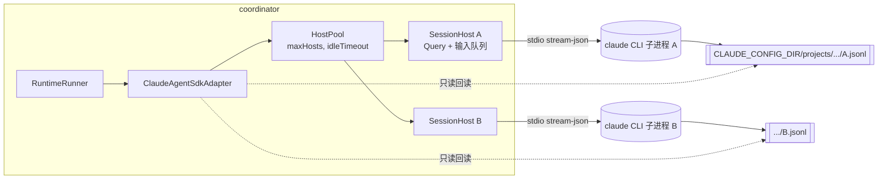

# Claude Agent SDK 接入方案（研究提议）

> 状态：**研究提议，未实施、未实测**。2026-11-08 基于 evoLoop `main@d8f60eb` 源码与 `@anthropic-ai/claude-agent-sdk@0.3.319`（npm 2026-11-06 发布，直接读取其 `sdk.d.ts` 类型声明）以及 Claude Code / Agent SDK 官方文档撰写。注意：SDK 运行的就是 Claude Code 二进制，**本文映射的能力面是 Claude Code 本身**（工具、权限、hooks、skills、CLAUDE.md、斜杠命令、压缩、auto memory），SDK 只是控制接口，见 §2.5。文中标注 **[已核]** 的是从类型声明/官方文档直接确认的事实；**[待 spike]** 的是推断，必须先用真实进程验证。按 [AGENTS](../../AGENTS.md) 约定，研究是证据与提议，不等于采纳；采纳后应登记新 DEC 并修订 [Codex 接入](../architecture/codex-integration.md)、[包架构](../architecture/packages.md)、[接口合同](../architecture/contracts.md)。

---

## 0. 结论摘要

1. **接入点非常清晰：实现第二个 `RuntimePort`。** evoLoop 的运行时边界已经抽象成 `packages/contracts/src/runtime.ts` 里的 `RuntimePort`，Codex 只是它的一个实现（`packages/adapter-codex-app-server`）。新增 `packages/adapter-claude-agent-sdk`，实现同一个端口即可让 Role/Session/Run/Queue/消息/编排全部复用。
2. **但"可插拔"目前是名义上的。** core 和 coordinator 有 ~10 处直接依赖 Codex：`owner: "evoloop-codex-app-server"` 字面量校验、从 Codex 适配器 import 错误类、Codex 原生方法名（`turn/start`、`thread/resume`、`agentMessage`…）、`sandbox/approvalPolicy` 的 Codex 词汇、配置里的 `protocolVersion` 枚举。**第一步必须是"去 Codex 化"重构（P1），否则 Claude 适配器只能伪装成 Codex。**
3. **Claude SDK 与 evoLoop 的"先落库、只发一次、按同一 ID 对账"哲学契合度很高**，甚至比 Codex 更好：
   - `Options.sessionId` 允许**由调用方预先指定原生会话 UUID** [已核] → 先写 PG，再启动，永远不会出现"进程建了线程但我们不知道 ID"的窗口。
   - `SDKUserMessage.uuid` 由调用方指定，并在 assistant/result 消息上以 `user_message_uuid(s)` 回显 [已核] → **原生 Turn ID 可以在派发前就确定并落库**，对账直接按 uuid 在转录里查找。Codex 侧 turn id 要等 `turn/start` 应答后才知道，这正是现在大量 "unknown" 状态机的来源。
   - `getSessionMessages / getSessionInfo / listSessions / renameSession / tagSession / forkSession` [已核] 提供重启后的只读回读能力，对应 `listTurns / listItems / readThreadName / archive`。
4. **最大差异是进程模型**：Codex 是"一个 app-server 进程承载多个 Thread"；Claude SDK 是"**每个 `query()` 一个 Claude Code CLI 子进程**"（官方："A library that runs the Claude Code binary"）。适配器内部需要一个 `SessionHost` 池：每个活跃 Session 一个流式输入 `Query`，空闲超时后关闭，下次用 `resume` 重新拉起。
5. **要按 Claude Code 的行为来设计隔离**：Claude Code 会自动加载 CLAUDE.md、`.claude/` 下的 skills/hooks/settings，并有不受 `settingSources` 控制的 **auto memory**。auto memory 会形成 evoLoop 之外、无修订的第二知识库，必须用 `CLAUDE_CODE_DISABLE_AUTO_MEMORY=1` 关闭；原生输入（AskUserQuestion）与守卫要放在 `PreToolUse` hook，因为全权限模式下调用可能到不了 `canUseTool`。
6. **鉴权是硬约束**：官方明确"未经批准，第三方不得提供 claude.ai 登录或订阅额度"，Agent SDK 产品须用 API Key（或 Bedrock / Vertex 等）。这与 Codex 侧"沿用 ChatGPT 登录、无需 API Key"的做法不同，需要你确认计费路径（见 §13）。
7. **并存已定**：Claude 与 Codex 长期并存，28 项关键能力的逐项适配策略见 [并存抽象与能力适配](runtime-coexistence-codex-claude-20261108.md)。
8. **建议路线**：P0 spike（2–3 天）→ P1 去 Codex 化重构（不改行为，现有测试全绿）→ P2 Claude 适配器 MVP（create/resume/startTurn/interrupt/事件/回读）→ P3 能力补齐（压缩、原生输入、工作区时间线、动态工具、执行画像）→ P4 dogfood 与双运行时并行。

---

## 1. 现状：evoLoop 运行时是怎么跑的

### 1.1 层次

```
apps/workbench (React)   apps/cli (Agent 业务 CLI)
        │  HTTP                 │ HTTP
        ▼                       ▼
apps/coordinator  ── RuntimeRunner / SessionMessagePump / OrchestrationRunner / CompactionMaintenance
        │                 │ ManagedRuntime (= RuntimePort + 若干 Codex 专有可选方法)
        │                 ▼
        │        packages/adapter-codex-app-server  ── stdio JSON-RPC ──> `codex app-server`
        ▼
packages/core (领域服务: RuntimeService/workflow/queues/...)  ── packages/adapter-postgres
packages/contracts (zod 合同 + 端口接口)
```

关键对象（`packages/contracts/src/runtime.ts`）：

| evoLoop 对象 | 含义 | 原生绑定字段 |
| --- | --- | --- |
| `RuntimeSessionRecord` | Role 的一次受管承载（owned Session），状态 `reserved→creating→ready→closing→closed / unknown` | `nativeThreadId`, `nativeSessionId`, `observedModel/Provider`, `executionProfile` |
| `RuntimeRunRecord` | Session 上的一次任务执行，状态 `requested→dispatching→running→completed/failed/interrupted/unknown` | `nativeTurnId`, `inputHash`, `preTurnProof` |
| `RuntimeBinding` | 适配器认可的"项目拥有的原生绑定"，带 `owner: "evoloop-codex-app-server"` | — |
| `RuntimePort` | 运行时端口：`create / resume / startTurn / interruptTurn / listTurns / listItems / readWorkPage / readWorkspaceHistory / compactThread / observeCompaction / archiveThread / onEvent / onApprovalRequest / onNativeInput ...` | — |

核心原则（贯穿 `docs/architecture/codex-integration.md` 和 `RuntimeRunner` 注释）：

- **持久预留是权威**：先在 PG 写 reserve，再调用原生；"结果未知"时**绝不重复外部启动**，而是保留原 Run/operation ID 等待回读对账。
- **Owner connection**：只有建立该绑定的那个原生连接可以对它发写操作（压缩、续接等），连接丢失即进入恢复。
- **DEC-033**：所有新 Session 统一 `danger-full-access + approvalPolicy: never + 正常网络`；成本/身份由 grant 与 `maxTurns` 约束。
- **"Turn 完成"不等于任务验收**：原生终态只是证据，验收在 PG 的 Task/Delivery 流程里。

### 1.2 与 Codex 的硬耦合点（P1 必须处理）

| # | 位置 | 耦合内容 |
| --- | --- | --- |
| C1 | `packages/core/src/runtime/service.ts:53,171,207` | `binding.owner !== "evoloop-codex-app-server"` 字面量校验 |
| C2 | `apps/coordinator/src/runtime/runner.ts:87` `bindingOf()` | 构造绑定时写死 `owner: "evoloop-codex-app-server"` |
| C3 | `packages/contracts/src/runtime.ts` `RuntimeBinding.owner` | 类型就是单一字面量 |
| C4 | `apps/coordinator/src/runtime/{runner,compaction}.ts`、`session-messages/pump.ts`、`session-timeline/read-only-owner.ts` | 从 `@evoloop/adapter-codex-app-server` import `RuntimeServerError / RuntimeUnknownError / RuntimeProtocolError / NativeChildDiagnostic` |
| C5 | `runner.ts:29,50,349,997` | 故障分类按 Codex 方法名 `"thread/resume" / "turn/start" / "thread/archive"` |
| C6 | `runner.ts` `finalMessages()` | 按 Codex item `type==="agentMessage"`、`phase==="final_answer"` 抽取最终回复 |
| C7 | `packages/core/src/native-observation/index.ts:5` | 观察事件白名单是 Codex 通知名 `turn/started, item/completed, thread/tokenUsage/updated ...` |
| C8 | `apps/coordinator/src/main.ts:326` | 直接 `new CodexAppServerAdapter(...)`；`listRuntimeModels` 强转为 Codex 类型 |
| C9 | `apps/coordinator/src/configuration.ts:108-134` | `runtime.protocolVersion` 是 Codex CLI 版本枚举；`runtimeThreadConfig` 产出 Codex thread config |
| C10 | `runtime.ts` `preTurnProofSchema` | `code: z.literal(-32600)`、`requestId` 是 JSON-RPC 概念 |
| C11 | `RuntimeSessionRecord.sandbox / approvalPolicy` | Codex 权限词汇（`danger-full-access`, `never`） |
| C12 | `apps/coordinator/src/runtime/browser-read.ts` | 用 Codex 实验性 `dynamicTools` 协议暴露浏览器只读工具 |

---

## 2. Claude Agent SDK 能力核对（0.3.319）

以下均 **[已核]**（来自 `sdk.d.ts` 或官方文档），只列与本方案相关部分。

### 2.1 入口与选项

```ts
query({ prompt: string | AsyncIterable<SDKUserMessage>, options?: Options }): Query
```

与本方案相关的 `Options`：

| 选项 | 用途 |
| --- | --- |
| `cwd`, `additionalDirectories` | 工作目录 = `RuntimeSessionRecord.cwd` |
| `sessionId` | **指定新会话 UUID**；与 `resume/continue` 互斥（除非 `forkSession`） |
| `resume`, `forkSession`, `resumeSessionAt`, `resumeDropsTurn` | 续接、分叉、截断续接（带校验） |
| `persistSession`（默认 true）, `sessionStore`(alpha), `sessionStoreFlush`, `loadTimeoutMs` | 转录持久化；`sessionStore` 可镜像到外部存储 |
| `model`, `fallbackModel`, `effort: 'low'\|'medium'\|'high'\|'xhigh'\|'max'`, `thinking` | 执行画像 |
| `maxTurns`, `maxBudgetUsd`, `taskBudget`(alpha) | 成本上限（超限得到 `error_max_turns` / `error_max_budget_usd` 结果） |
| `permissionMode: 'default'\|'acceptEdits'\|'bypassPermissions'\|'plan'\|'dontAsk'\|'auto'`, `allowDangerouslySkipPermissions`, `permissionPrompts: 'host'\|'none'`, `canUseTool`, `allowedTools`, `disallowedTools`, `tools` | 权限 |
| `hooks: Partial<Record<HookEvent, HookCallbackMatcher[]>>` | 生命周期钩子（`PreToolUse, PostToolUse, PostToolUseFailure, Stop, StopFailure, SessionStart, SessionEnd, PreCompact, PostCompact, PermissionRequest, PermissionDenied, SubagentStart/Stop, UserPromptSubmit, Notification, ...`） |
| `mcpServers`, `strictMcpConfig` | MCP，含 `createSdkMcpServer()` 进程内服务 |
| `systemPrompt: string \| {type:'preset',preset:'claude_code',append?,excludeDynamicSections?,snapshot?} \| {type:'custom',...}` | 系统提示 |
| `settingSources: ('user'\|'project'\|'local')[]`（省略=全部加载；`[]`=隔离；加载 CLAUDE.md 需要 `'project'`） | 配置隔离 |
| `skills: string[] \| 'all'`, `plugins: [{type:'local',path}]`, `agents` | 技能、插件、子代理 |
| `env`, `executable`, `pathToClaudeCodeExecutable`, `spawnClaudeCodeProcess`, `stderr`, `debugFile` | 进程控制（`spawnClaudeCodeProcess` 可注入自定义子进程 → 用于测试夹具） |
| `includePartialMessages`, `includeHookEvents` | 流式细粒度事件 |
| `outputFormat` | 结构化输出（JSON Schema） |
| `title` | 新会话标题 |
| `abortController` | 取消 |

### 2.2 `Query` 控制方法（流式输入模式可用）

`interrupt()`, `setPermissionMode()`, `setModel()`, `setMaxThinkingTokens()`, `applyFlagSettings()`, `initializationResult()`, `reinitialize()`, `supportedCommands()`, `supportedModels()`, `supportedAgents()`, `mcpServerStatus()`, `getContextUsage()`, `accountInfo()`, `rewindFiles()`, `setMcpServers()`, `streamInput()`, `stopTask()`, `reloadSkills()`, `close()`。

### 2.3 消息流（`SDKMessage` 联合，节选）

| 消息 | 关键字段 | evoLoop 用途 |
| --- | --- | --- |
| `system/init` | `session_id, model, cwd, tools, mcp_servers, permissionMode, skills, plugins, claude_code_version, apiKeySource` | 绑定确认、`observedModel`、版本钉、工具面校验 |
| `user` (`SDKUserMessage`) | `message, uuid?, session_id?, priority?: 'now'\|'next'\|'later'` | 我们发出的 Turn 输入；**uuid 由我们指定** |
| `assistant` | `message, uuid, user_message_uuid?, user_message_uuids?` | 工作项、最终回复；`user_message_uuid` 把回复绑回我们的发送 |
| `result` | `subtype: success \| error_during_execution \| error_max_turns \| error_max_budget_usd \| error_max_structured_output_retries`，`is_error, num_turns, duration_ms, total_cost_usd, usage, modelUsage, permission_denials, errors[], stop_reason, startup_failure_reason?, user_message_uuid(s)?` | **Turn 终态** |
| `system/compact_boundary` | `compact_metadata: {trigger:'manual'\|'auto', pre_tokens, post_tokens?, preserved_segment?...}, uuid` | 压缩观察 |
| `system/session_state_changed` | `state: 'idle'\|'running'\|'requires_action'` | Session 空闲/忙判断 |
| `system/permission_denied`, `tool_progress`, `task_*`, `api_retry`, `rate_limit_event`, `session_writes_lost`, `hook_*`, `stream_event` | — | 诊断、进度、时间线 |

### 2.4 会话函数（无需活进程即可调用）

`listSessions()`, `getSessionInfo(id)`（含 `customTitle, tag, cwd, createdAt, lastModified`）, `getSessionMessages(id, {limit, offset, includeSystemMessages})`（返回 `{type, uuid, session_id, message, parent_tool_use_id, parent_agent_id}`）, `getSubagentMessages`, `listSubagents`, `renameSession`, `tagSession`, `forkSession(id, {upToMessageId, title})`, `deleteSession`, `importSessionToStore`。转录默认在 `CLAUDE_CONFIG_DIR`（默认 `~/.claude`）的 `projects/<cwd编码>/<sessionId>.jsonl`。

### 2.5 SDK 继承的 Claude Code 能力（映射的真正对象）

官方定位：Agent SDK 是"a library that runs the Claude Code binary"。**所以我们接入的能力面 = Claude Code 本身**（工具、权限、hooks、skills、CLAUDE.md、斜杠命令、压缩、子代理、auto memory），SDK 只是控制面。以下来自 Claude Code / Agent SDK 文档（[Use Claude Code features in the SDK](https://code.claude.com/docs/en/agent-sdk/claude-code-features)、[Skills](https://code.claude.com/docs/en/agent-sdk/skills)、[User input](https://code.claude.com/docs/en/agent-sdk/user-input)）**[已核]**，并给出 evoLoop 的取舍：

| Claude Code 能力 | 加载/行为 | evoLoop 取舍 |
| --- | --- | --- |
| 内置工具（Bash/Read/Edit/Write/Grep/Glob/WebFetch/WebSearch/Agent/AskUserQuestion/Skill…） | 默认全部可用；`tools`/`allowedTools`/`disallowedTools` 控制 | 保留 Bash/文件/搜索/Web；禁用 `CronCreate`、`EnterWorktree`、`Artifact` 等与 evoLoop 调度/交付权威重叠的工具（清单在 P0 按 `system/init.tools` 确定） |
| CLAUDE.md 与 `.claude/rules/*.md` | `settingSources` 含 `'project'` 时，从 `cwd` 及**所有父目录**加载 | 受管 Session 的 cwd 是业务仓库，CLAUDE.md 属于该仓库的正式指引，可以加载；**不加载 user 级** |
| Skills | 只从 `<cwd 到仓库根>/.claude/skills/`、`~/.claude/skills/`、`additionalDirectories` 的 `.claude/skills/`、`plugins` 路径发现；**不认 `.agents/skills/`**；`skills` 选项做白名单；也可用 `/<name>` 直接派发 | 见 §6.5 |
| 斜杠命令 | 作为 prompt 文本发送即可；`system/init.slash_commands` 列出可用命令；`/compact` 官方支持，产出 `compact_boundary{trigger:'manual'}`；无可压缩内容时返回 `success` 且**没有** `compact_boundary`，原因在 result 文本 | `compactThread` 直接用 `/compact`（§5） |
| Hooks | 文件型（settings.json，随 `settingSources`）与编程型（`query({hooks})`）**并行运行**，编程型也在子代理中触发 | 只用编程型；目标仓库若有 `.claude/settings.json` 的 hooks 也会运行——需在 P0 决定是否接受 |
| 权限评估顺序 | deny 规则 → 权限模式 → allow 规则 → `canUseTool`；**被前面步骤放行的调用不会再到 `canUseTool`**，但 `PreToolUse` hook 对所有调用都运行 | 守卫与原生输入都放在 `PreToolUse`（§6.3、§5） |
| AskUserQuestion | 走 `canUseTool`（`toolName==='AskUserQuestion'`），返回 `{behavior:'allow', updatedInput:{questions, answers:{[question]: label}}}`；回调可无限挂起；长时间等待建议 `PreToolUse` 返回 `defer`，让进程退出、之后从持久会话恢复；子代理中不可用；每次 1–4 题 × 2–4 选项 | 映射 `NativeInputEvent`；`defer` 恰好契合 evoLoop"先落库、可恢复"的模型 |
| 子代理（Agent 工具 / `agents` 选项） | 子代理转录可用 `listSubagents/getSubagentMessages` 读取 | 视为 **Run 内部实现细节**，不映射为 evoLoop Session/Run；trace 中计入 `unsupportedCount` 或折叠展示 |
| Agent teams | CLI 功能，SDK 不直接配置 | 不使用；多 Session 协作由 evoLoop 编排承担 |
| **Auto memory**（`~/.claude/projects/<project>/memory/`） | **不受 `settingSources` 控制**，会话启动时注入系统提示，Agent 用 Write/Edit 写入 | **必须关闭**：`CLAUDE_CODE_DISABLE_AUTO_MEMORY=1`。否则形成 evoLoop 之外、无修订/无来源的第二知识库，违背"认知外置于 Wiki、PG 为主数据权威"（DEC-006/018/027） |
| `~/.claude.json` 全局配置 | 总是读取 | 用独立 `CLAUDE_CONFIG_DIR` 重定位 |
| claude.ai MCP connectors | 用 claude.ai 登录时加载；`mcpServers:{}` 不能抑制 | `strictMcpConfig:true`；且我们用 API Key，本就不会加载 |
| 托管策略 / 服务端托管设置 | 主机 MDM/managed settings 总是加载；用组织凭据鉴权时还会拉取服务端托管设置 | 在 Runtime 面板展示 `system/init` 观察到的有效设置来源，作为诊断证据 |
| 文件检查点 `enableFileCheckpointing` + `rewindFiles()` | 按用户消息回滚文件 | 暂不使用：evoLoop 以 Git 与 Delivery 为准，回滚应走正常任务 |

> 官方对多租户的建议是 `settingSources: []` + `CLAUDE_CODE_DISABLE_AUTO_MEMORY=1` + 每租户独立文件系统。evoLoop 目前是本机单人试用，按项目隔离 `CLAUDE_CONFIG_DIR` 即可；若将来多人/远程部署需升级到该建议。

### 2.6 鉴权与条款

- 官方：*"Unless previously approved, Anthropic does not allow third party developers to offer claude.ai login or rate limits for their products, including agents built on the Claude Agent SDK."* → 使用 `ANTHROPIC_API_KEY`，或 Bedrock / Vertex 等云厂商凭据。
- 受 Anthropic Commercial Terms 约束；对外品牌不得自称 "Claude Code"，可用 "Claude Agent" / "evoLoop Powered by Claude"。

---

## 3. 概念映射：Codex App Server ↔ Claude Agent SDK

| evoLoop / Codex 概念 | Claude Agent SDK 对应 | 备注 |
| --- | --- | --- |
| app-server 进程（多 Thread 共用） | **每个 Session 一个 CLI 子进程**（一个流式 `Query`） | 适配器内部 `SessionHost` 池 |
| `initialize/initialized` 握手 | 首条 `system/init` 消息；`query.initializationResult()` | |
| `thread/start` → `threadId` | `query({options:{sessionId: <预分配 UUID>}})` | `nativeThreadId = nativeSessionId = 预分配 UUID` |
| `thread/resume` | `query({options:{resume: sessionId}})` | 失败形态：`result.error_during_execution` 或进程启动失败 → 映射 `NativeResumeRejection` |
| `turn/start` → `turnId` | `streamInput` 推送 `SDKUserMessage{uuid: <预分配>}` | **Turn ID 预先确定** |
| `turn/started` / `turn/completed` 通知 | 首条带 `user_message_uuid` 的 assistant/stream_event / `result` 消息 | 适配器合成中立事件 |
| `item/started` / `item/completed` | assistant 内容块（`text`、`tool_use`）+ user `tool_result` | 映射到 `RuntimeWorkItem` |
| `turn/interrupt` | `query.interrupt()` | 结果是 `result`（中断）+ interrupt receipt |
| `thread/compact` | 流式模式发送 `/compact` 用户消息 **[待 spike]** | 观察 `compact_boundary{trigger:'manual'}`、`PostCompact` 钩子 |
| `thread/list`、`thread/turns/list`、items 分页 | `getSessionMessages(id,{limit,offset})` 后按 `user_message_uuid` 切分 Turn | 无原生 Turn 列表，适配器重建 |
| `thread/name/set`、读取标题 | `renameSession()` / `getSessionInfo().customTitle` | |
| `thread/archive`、`isThreadArchived` | `tagSession(id,'evoloop:archived')` / `getSessionInfo().tag` | 无原生归档；语义需在文档写清 |
| approval 请求（`item/commandExecution/requestApproval`…） | `canUseTool` 回调 / `PermissionRequest` 钩子 | DEC-033 下基本不触发 |
| `request_user_input`（原生输入） | `AskUserQuestion` 工具 → `canUseTool` 返回 `updatedInput.answers`；或 `onUserDialog` **[待 spike]** | 映射 `NativeInputEvent` |
| 实验性 `dynamicTools` | `createSdkMcpServer({tools:[tool(name,desc,zodShape,handler)]})` 进程内 MCP | 正式 API，比 Codex 侧更稳 |
| `model/list` | `query.supportedModels()` | |
| 协议 schema hash 钉版本 | 锁定 npm 精确版本 + `system/init.claude_code_version` 白名单 + 能力探针 | |
| `sandbox: danger-full-access` + `approvalPolicy: never` | `permissionMode:'bypassPermissions'` + `allowDangerouslySkipPermissions:true` | 仍可用 `PreToolUse` 钩子做 evoLoop 级守卫 |
| `CODEX_HOME` 登录 | `ANTHROPIC_API_KEY` / 云凭据 + 独立 `CLAUDE_CONFIG_DIR` | |

---

## 4. 目标架构

### 4.1 包结构

```
packages/
  contracts/src/runtime.ts            # 中立化：RuntimeOwner、中立错误、中立事件
  contracts/src/runtime-errors.ts     # 新：RuntimeUnknownError/RuntimeServerError/RuntimeProtocolError 移到这里
  adapter-codex-app-server/           # 现有，改为 owner="evoloop-codex-app-server"，实现中立事件
  adapter-claude-agent-sdk/           # 新
    src/index.ts                      # ClaudeAgentSdkAdapter implements RuntimePort
    src/session-host.ts               # 单 Session 的 Query 生命周期、输入队列、Turn 状态机
    src/host-pool.ts                  # 多 SessionHost 池、并发上限、空闲回收
    src/history.ts                    # getSessionMessages → RuntimeTurn / RuntimeWorkItem / NativeWorkspacePage
    src/events.ts                     # SDKMessage → 中立 RuntimeEvent / WorkspaceRuntimeUpdate
    src/failures.ts                   # result/startup 失败 → RuntimeTurnFailure 分类
    src/tools.ts                      # DynamicToolSpec → createSdkMcpServer
    src/environment.ts                # 子进程 env 白名单、CLAUDE_CONFIG_DIR、凭据注入
    src/version.ts                    # SDK/CLI 版本钉与能力探针
    test/fake-cli.mjs                 # 通过 spawnClaudeCodeProcess 注入的假 CLI（stream-json）
apps/coordinator/src/runtime/
  factory.ts                          # 新：按配置 provider 构造适配器（替代 main.ts 里的 new Codex...）
```

### 4.2 进程模型



- **SessionHost**：持有一个 `query({prompt: AsyncQueue<SDKUserMessage>, options})`，消费其输出流；同一时刻最多一个"在途 Turn"（evoLoop 的 Session 门禁本来就是串行的）。
- **懒启动 + 空闲回收**：`create()` 时立刻启动以拿到 `system/init` 作为绑定证据；Turn 结束后空闲 N 分钟（默认 10）关闭子进程；下次 `startTurn` 前用 `resume` 拉起。这对应 Codex 侧"连接丢失 → resume"路径，可复用 runner 的恢复逻辑。
- **connectionId**：每次拉起子进程生成新 `connectionId`（UUID），等价于 Codex 的 owner connection；`compactThread` 等要求"原 owner 连接"的操作按 SessionHost 的 connectionId 校验。
- **并发上限**：`maxHosts`（默认 4）。超出时 `startTurn` 返回可重试的 `RUNTIME_BUSY`，不改变持久状态（与 `mayDispatchRun` 等待语义一致）。

---

## 5. `RuntimePort` 逐方法实现设计

| 方法 | Claude 实现 | 失败/未知语义 |
| --- | --- | --- |
| `create(spec)` | 由调用方（core reserve 阶段）**预分配并已落库**的 `nativeSessionId` 作为 `options.sessionId`；启动 SessionHost，等待 `system/init`，校验 `init.session_id === 预分配值`、`cwd`、`claude_code_version ∈ 白名单`、`tools` 含预期工具、`permissionMode==='bypassPermissions'`；返回 `RuntimeBinding{nativeThreadId: id, nativeSessionId: id, owner:'evoloop-claude-agent-sdk', observedModel: init.model, observedProvider: 'anthropic'\|'bedrock'\|'vertex'}` | 进程起不来/超时 → `RuntimeUnknownError("session/create")`。因 ID 预分配，**恢复时可直接 `getSessionInfo(id)` 判定是否已创建**，比 Codex 少一个未知窗口 |
| `resume(binding, spec)` | 若 SessionHost 存活且画像一致则直接返回；否则 `query({resume: id, model, effort, ...})`，等 `system/init` | `getSessionInfo(id)` 为空 → `NativeResumeRejection{category:'rollout_not_found'}`；其他启动失败 → `thread_unavailable` |
| `startTurn(binding, input, operationId, profile)` | `turnId = uuidv5(operationId, NS)`（确定性，可重算）；**先由 runner 落库 `nativeTurnId`**（见 §6.1）再 push `SDKUserMessage{uuid: turnId, message:{role:'user',content: input}, priority:'next'}`；返回 `{id: turnId, status:'inProgress'}` | push 后进程崩溃 → `RuntimeUnknownError`；对账时在转录里找 `uuid===turnId` 的 user 条目与其后的 result |
| `interruptTurn(binding, turnId)` | 校验在途 Turn 是 `turnId`，调用 `query.interrupt()`；记录 receipt 的 `still_queued` | Turn 已结束 → no-op |
| `listTurns(binding, cursor)` | `getSessionMessages(id, {includeSystemMessages:true, limit, offset})`，按顶层 user 消息 uuid 切 Turn；状态由该段内是否有 result 记录（需确认 result 是否落转录 **[待 spike]**；若不落，用 `Stop/StopFailure` 钩子 + 适配器侧落 PG 的 turn ledger 补足） | cursor = offset 编码；cursor 重复由 runner 已有逻辑拒绝 |
| `listItems / readWorkPage(binding, turnId)` | 取该 Turn 段：assistant `text`→`message`；`tool_use`+`tool_result`→`command`(Bash)/`file_change`(Edit/Write)/`web_search`(WebSearch/WebFetch)/`tool`(其他)；`truncated` 按 `maxFieldChars` | `unsupportedCount` 计子代理内部消息等 |
| `readWorkspaceHistory / onWorkspaceUpdate` | 回读同上；实时更新来自 SessionHost 消费的 `SDKMessage`（`includePartialMessages` 可选） | `historyMode:'paginated'`, `method:'items'` |
| `compactThread(binding, baselineTurnId, beforeSend, afterAccepted)` | 只允许 SessionHost 空闲时；生成 `requestId`，`beforeSend(requestId)` 落库，push `/compact` 用户消息（uuid 预分配）；收到 `compact_boundary{trigger:'manual'}` 后 `afterAccepted(connectionId)`；返回该 uuid 作为 compaction turn id。`/compact` 作为 prompt 发送是官方支持用法 **[已核]** | 收到 `success` 但无 `compact_boundary` = 未压缩（如 "Not enough messages to compact."），映射为 `failed` 而非 `unknown`；流式模式下的具体时序 **[待 spike]** |
| `observeCompaction(binding, target)` | 从转录找 `compact_boundary` 条目：`compactionItemId=uuid`、`tokenUsage={inputTokens: pre_tokens→post_tokens}` | |
| `readThreadName / setThreadName` | `getSessionInfo().customTitle` / `renameSession()`（只写元数据，不启动 Turn ✔） | |
| `archiveThread / isThreadArchived` | `tagSession(id, 'evoloop:archived')` / `getSessionInfo().tag === 'evoloop:archived'` | 文档需写明这是"标记"而非原生归档 |
| `onEvent` | 中立事件（§7.3），附 `projectId/sessionId/threadId/turnId` | |
| `onApprovalRequest` | DEC-033 下 `bypassPermissions` 不会产生；保留 `canUseTool` 兜底：默认 deny 并发出 `runtime.approvalDeclined` | |
| `onNativeInput / respondToInput / hasPendingInput` | 文档确认 AskUserQuestion 走 `canUseTool`，但 `bypassPermissions` 可能在到达 `canUseTool` 前就放行（权限评估顺序）。因此**在 `PreToolUse` hook 拦截 `AskUserQuestion`**：发 `NativeInputEvent` 并挂起，人类回答后返回 `permissionDecision:'allow'` + `updatedInput:{questions, answers}`；等待超过阈值则返回 `defer`，让进程退出，回答到达后 resume 继续 **[待 spike：bypass 下 PreToolUse 的 updatedInput 是否生效、defer 恢复形态]** | 进程重启后挂起的输入作废（与 Codex "handle 属于单连接"一致）；`defer` 路径则可跨重启 |
| `close()` | 关闭所有 SessionHost（`query.close()`），等待子进程退出，产出 `NativeChildDiagnostic` | |

Codex 专有的可选方法（`hasFreshStartProof`、`qualifyConversationThread`、`startConversationTurn`、`activateExecutionProfile`、`listModels`…）在 P1 中整理进 `ManagedRuntime` 的中立可选能力，Claude 侧按需实现：`listModels → query.supportedModels()`，`activateExecutionProfile → setModel()` + 下一次 resume 带 `effort`。

---

## 6. 关键机制设计

### 6.1 ID 与幂等（本方案最重要的收益）

```
runtime.session.reserve  ──>  PG: session{state:reserved, nativeSessionId: uuidv4 预分配}
runner dispatch create   ──>  PG: state=creating
                              adapter.create({sessionId: 预分配})  ── system/init ──> PG: state=ready, observedModel
runtime.run.reserve      ──>  PG: run{state:requested}
runner dispatch          ──>  PG: run{state:dispatching, nativeTurnId: uuidv5(operationId)}   ← 先落库
                              adapter.startTurn → push SDKUserMessage{uuid: nativeTurnId}
result 消息              ──>  PG: run{state:completed|failed|interrupted, resultSummary, cost}
崩溃/未知                ──>  run{state:unknown}；对账 = 在转录中查 uuid==nativeTurnId
                              · 找不到 user 条目  → 确认"从未送达"，可由人复核后安全重派（新 operation）
                              · 有 user 无终态    → 仍 unknown，等待/人工 reconcile
                              · 有终态            → 补写终态
```

- 需要 **contracts 小改**：`RuntimeSessionRecord.nativeSessionId` 在 reserve 时即可非空（Claude 适配器要求），Codex 继续在 bound 时写入。建议在 `RuntimeSessionSpec` 增加可选 `nativeSessionId`，由 core 在 reserve 时生成并持久化，适配器通过 `capabilities.preassignedIds` 声明是否使用。
- `nativeTurnId` 在 dispatching 时写入（Claude），Codex 维持 bound 时写入。runner 中"dispatching 但无 nativeTurnId"的未知分支保留给 Codex。
- **注意 fold-in 风险**：SDK 在 Turn 运行中收到新用户消息会"折叠"进当前 Turn（`user_message_uuids` 有多个）。适配器必须保证**上一个 `result` 到达前绝不 push 下一条**；若在 result 中看到非本 Turn 的 uuid，记 `native.childDiagnostic` 并把相关 Run 标 unknown。

### 6.2 进程生命周期与恢复

- SessionHost 状态：`starting → idle ⇄ busy → closing → closed`，以及 `lost`（子进程意外退出 / stdout 关闭）。
- `lost` 时：在途 Turn → 通知 runner `RuntimeUnknownError`；发 `NativeChildDiagnostic{stopReason, exitCode, exitSignal, nativeTurnOutcome:'unknown'}`（复用现有 `nativeChildDiagnosticSchema`，与 Codex 同表）。
- coordinator 重启：内存池为空 → 所有 Session 在下一次需要时走 `resume`；`verifyBinding` 照旧查 PG。
- `persistSession` 必须为 true；`session_writes_lost`（ENOSPC/EDQUOT）消息 → 立即把 Session 标 unknown 并告警，因为回读证据已不完整。

### 6.3 权限与隔离

| 维度 | 设定 | 理由 |
| --- | --- | --- |
| 权限模式 | `permissionMode:'bypassPermissions'`, `allowDangerouslySkipPermissions:true`；**不要**设 `permissionPrompts:'none'`（它会让 `canUseTool` 永不调用） | 对齐 DEC-033 |
| 守卫 | `hooks.PreToolUse`（官方：对已被模式/规则放行的调用也会运行）：校验 Run 仍有效（grant、lease epoch、未被中断）、禁止访问 `CLAUDE_CONFIG_DIR` 与凭据目录、拦截 `AskUserQuestion` 转原生输入；拒绝时返回 `permissionDecision:'deny'` + `permissionDecisionReason` | 在全权限下保留 evoLoop 的"每次重核"能力 |
| 配置隔离 | `CLAUDE_CONFIG_DIR=<evoLoop 托管目录>/claude/<projectId>`（同时重定位 `~/.claude.json` 与转录目录）；`settingSources:['project']`（读取仓库 CLAUDE.md、rules、`.claude/settings.json`）或 `[]`（完全隔离）——**建议 `['project']`** | 防止用户全局 `~/.claude` 的 hooks/MCP/插件/CLAUDE.md 渗入受管 Session |
| Auto memory | `env.CLAUDE_CODE_DISABLE_AUTO_MEMORY=1` | 不受 `settingSources` 控制，必须显式关闭（见 §2.5） |
| 环境变量 | 沿用 Codex 适配器的白名单思路（`HOME, PATH, LANG, 代理, CA…`），去掉 `CODEX_HOME`，加入 `ANTHROPIC_API_KEY`（或 `CLAUDE_CODE_USE_BEDROCK/VERTEX` + 云凭据）、`CLAUDE_CONFIG_DIR`、`CLAUDE_CODE_DISABLE_AUTO_MEMORY`；**不继承 coordinator 的 DB/令牌** | 与现有 `childEnvironment()` 原则一致 |
| MCP | `strictMcpConfig:true`，只用适配器显式传入的 `mcpServers` | 防止 `.mcp.json` 意外引入工具 |
| 预算 | `maxTurns` ← grant 的预算；`maxBudgetUsd` ← 新增 grant 字段；`result.total_cost_usd` 写入 Run 事件 | DEC-033 "maxTurns 预算继续限定成本" |

### 6.4 工具面

1. **evoLoop 业务 CLI**：现状是 runner 通过 `cliEntryForRun` 把 CLI 命令注入 Run 输入，Agent 用 shell 调用——Claude 的 `Bash` 工具天然支持，**无需改动**。
2. **浏览器只读工具（C12）**：把 `browserRead.tools(spec)` 返回的 `DynamicToolSpec[]`（JSON Schema）转换成 `createSdkMcpServer({name:'evoloop', tools:[...]})`。`tool()` 需要 zod shape——P1 中把 browser-read 的 schema 定义改为 zod 源（contracts 已用 zod），两边各自导出 JSON Schema / zod。调用仍走 `callDynamicTool(call, binding)`，由 coordinator 重核 Run 授权；工具名在 Claude 侧为 `mcp__evoloop__<name>`。
3. **可选：evoLoop MCP**：文档已说"MCP 是按需增加的同类工具入口"。同一个进程内 MCP 可以逐步承载只读查询（任务、文档修订），但变更类操作仍应经 CLI→coordinator，避免适配器直写。

### 6.5 Role 技能与系统提示

- 项目技能在 `.agents/skills/`，Claude Code 只从 `.claude/skills/`（cwd 到仓库根、`~/.claude`、`additionalDirectories`）和 `plugins` 路径发现技能 **[已核]**。三选一：
  - **A（推荐，零侵入）**：保持现有 `roleContextForRun` 把技能引用/正文注入 Run 输入——与 Codex 路径同源，两运行时行为可比。
  - B：适配器在 `CLAUDE_CONFIG_DIR` 下生成一个本地插件目录（`.claude-plugin/plugin.json` + `skills/` 软链到 `.agents/skills/*`），`plugins:[{type:'local',path}]`、`skills:['<plugin>:evoloop-workflow']` 精确开启；可用 `system/init.skills/plugins` 核对实际加载，比 A 多一份"原生已加载"证据，且技能按需加载、省上下文。
  - C：在仓库加 `.claude/skills` 软链——会影响开发者本地 Claude Code，不推荐。
- `systemPrompt:{type:'preset', preset:'claude_code', append:<evoLoop 受管 Session 说明：身份、不可自行宣布验收、使用 CLI 回写>, snapshot:true}`。`append` 内容放 contracts 里作为固定修订文本，便于评测对比。

### 6.6 历史回读与时间线

- 以 `getSessionMessages` 为唯一回读来源（只读、无副作用，满足"never resumes or starts work"）。
- 只读 owner（`session-timeline/read-only-owner.ts`）可以**不启动子进程**直接读转录——比 Codex 更轻。
- 后续（P4+）可评估 `sessionStore`（alpha）把转录镜像进 PG，解决"转录在本机磁盘、coordinator 迁机即丢"的问题；alpha 期间不作为权威。

### 6.7 失败分类（`RuntimeTurnFailure`）

| SDK 信号 | category |
| --- | --- |
| `result.subtype==='error_max_turns' / 'error_max_budget_usd'` | 新增 `budget_exhausted`（或映射 `provider_rejected` + providerCode） |
| `errors[]` / assistant 合成错误以 `USAGE_LIMIT_ERROR_PREFIXES` 开头，或 `rate_limit_event` | `rate_limited` |
| `ORG_POLICY_LIMIT_PREFIXES` | `provider_rejected` |
| `api_retry` 后最终失败、5xx | `provider_unavailable` |
| `startup_failure_reason` 存在 / 模型不可用 | `unsupported_model` 或 `native_failure` |
| 其他 `error_during_execution` | `native_failure` |

`summary` 只放分类后的短句，不放原始 provider 文本（与现有约束一致）。**Pre-turn refusal（C10）**：Claude 侧对应"result 出现但该 Turn 无任何 assistant 消息且 `startup_failure_reason` 存在"；`preTurnProofSchema` 需改为 provider 中立（`code` 变 `string`，`requestId` 变 `nativeRequestRef`）。

### 6.8 执行画像

`SessionExecutionProfile.revision.{model, reasoningEffort}` → `model` + `effort`（Codex 的 reasoningEffort 取值与 Claude `EffortLevel` 不同，需在 grant 层分别校验）。运行中切换：`query.setModel()`；effort 变化需在下一次 resume 时生效（**[待 spike]** 是否有运行时 setter）。`observedModel` 取 `system/init.model` 与 `result.modelUsage` 的键。

### 6.9 版本钉

- `package-lock` 锁定 `@anthropic-ai/claude-agent-sdk` 精确版本（SDK 内带 CLI 二进制清单 `manifest.json`）。
- 配置 `runtime.claude.expectedCliVersions: string[]`，`system/init.claude_code_version` 不在列表 → 拒绝绑定（对标 `PINNED_PROTOCOLS`）。
- 能力探针：启动后 `initializationResult()` 检查必需能力（如 `interrupt_cancel_queued_v1` 若需要）。

---

## 7. contracts / core / coordinator 改动清单（P1：去 Codex 化）

> 目标：**不改变 Codex 行为**，现有 `npm test` 与 `test:integration` 全绿；只是把 Codex 的东西挪回 Codex 包。

### 7.1 contracts

1. `RuntimeBinding.owner: RuntimeOwner`，`type RuntimeOwner = "evoloop-codex-app-server" | "evoloop-claude-agent-sdk"`。
2. `RuntimeSessionRecord` 增加 `runtimeProvider: "codex" | "claude"`（迁移默认 `codex`）。Session 一旦创建不可换 provider（换 provider = 新 Session，符合"同职责换会话不等于新角色"）。
3. 新文件 `runtime-errors.ts`：`RuntimeUnknownError / RuntimeServerError / RuntimeProtocolError`，字段 `operation: RuntimeOperation`（中立枚举 `session.create | session.resume | turn.start | turn.interrupt | session.archive | session.compact`）+ `nativeMethod?: string`（仅诊断）。Codex 包改为 re-export/继承。
4. 中立事件：`RuntimeEvent.kind: "turn.started" | "turn.completed" | "item.started" | "item.completed" | "session.status" | "usage.updated"`，保留 `method` 作为原生诊断字段。
5. `preTurnProofSchema`：`code` 改 `z.union([z.literal(-32600), z.string()])`，增加 `provider`。
6. `RuntimePort` 增加 `readonly provider` 与 `capabilities(): RuntimeCapabilities`。现在用"可选方法是否存在"判断能力，改成显式声明更可审计。完整字段、端口切面拆分、`RuntimeRegistry` 路由与 P1 的 11 步拆分见 [并存抽象 §4、§8](runtime-coexistence-codex-claude-20261108.md#4-抽象设计)。
7. `RuntimeSessionSpec.nativeSessionId?`（预分配）。

### 7.2 core

- `runtime/service.ts` 三处 owner 校验 → `binding.owner === ownerFor(saved.runtimeProvider)`。
- reserve 时若 provider 声明 `preassignedIds`，生成并落库 `nativeSessionId`。
- `native-observation/index.ts`：白名单改为中立 `kind`。

### 7.3 coordinator

- 新 `runtime/factory.ts`：`createRuntime(config) → ManagedRuntime`，main.ts 不再 import 具体适配器。**同时支持两个 provider 并存**：`RuntimeRunner` 持有 `Map<provider, ManagedRuntime>`，按 `session.runtimeProvider` 路由（P2 可先单 provider，P4 再并存）。
- `runner.ts`：`bindingOf()` 用 `session.runtimeProvider` 决定 owner；故障分类改用中立 `operation`；`finalMessages()` 下沉到各适配器（端口新增可选 `finalMessages(items)` 或在 `RuntimeWorkItem` 上标 `isFinal`）。
- `compaction.ts / pump.ts / read-only-owner.ts`：改从 contracts import 错误类。
- `browser-read.ts`：工具 schema 改 zod 源，导出给两个适配器。

### 7.4 配置（`configuration.ts`）

```jsonc
"runtime": {
  "enabled": true,
  "provider": "claude",                  // 新：判别字段，默认 "codex" 以兼容
  "codex":  { "executable": "...", "protocolVersion": "0.167.0-alpha.3.2", "nativeUserInput": true },
  "claude": {
    "sdkVersion": "0.3.319",
    "expectedCliVersions": ["<spike 时记录的 claude_code_version>"],
    "configDir": "<数据目录>/claude",   // CLAUDE_CONFIG_DIR，绝对路径
    "credential": { "kind": "apiKeyFile", "path": "<数据目录>/secrets/anthropic.key" },  // 或 bedrock/vertex
    "settingSources": ["project"],
    "maxHosts": 4,
    "idleTimeoutMs": 600000,
    "defaultModel": "claude-opus-5-5",
    "defaultEffort": "high"
  },
  "grants": [ { "...": "...", "provider": "claude", "model": "claude-opus-5-5", "effort": "high", "maxTurns": 200, "maxBudgetUsd": 20 } ]
}
```

凭据只从文件读，不进配置正文、不进 Git、不进日志（与"secrets 不进公开 Git"一致）。

### 7.5 数据库迁移（059_runtime_provider）

- `runtime_session.runtime_provider text NOT NULL DEFAULT 'codex' CHECK (runtime_provider IN ('codex','claude'))`。
- `runtime_run` 增加 `cost_usd numeric NULL`, `usage jsonb NULL`（仅分类后计数，不含正文）。
- 放宽 `018_runtime_session_close` 等约束中对 `native_thread_id` 的假设（Claude 下 `native_thread_id = native_session_id`）。
- `session_compaction.native_request_id` 由 integer 扩展为 text（或新增 `native_request_ref text`）。

---

## 8. 分阶段实施计划

### P0 · Spike（2–3 天，产出研究报告，不进主代码）

在 `scripts/research/claude-agent-sdk/`（仿照现有 `scripts/research/codex-app-server/`）写隔离脚本，逐项留证：

| # | 验证项 | 通过标准 |
| --- | --- | --- |
| S1 | `sessionId` 预分配 + `system/init.session_id` 一致 | 一致，且转录文件名为该 UUID |
| S2 | 流式输入下 `SDKUserMessage.uuid` → assistant/result 的 `user_message_uuid` 回显 | 每个 Turn 可按 uuid 精确关联 |
| S3 | result 是否写入 JSONL 转录；`getSessionMessages` 能否重建 Turn 终态 | 能 / 不能（不能则 P2 加 turn ledger） |
| S4 | 进程 kill -9 后 `resume` 行为；中断（`interrupt()`）后的 result 形态 | 记录形态，确定 unknown→对账规则 |
| S5 | 流式输入中发送 `/compact`（文档已确认单次 query 可用）：流式模式下 `compact_boundary` 与 result 的先后、uuid 回显 | 确定 `compactThread` 实现 |
| S6 | `bypassPermissions` 下 `AskUserQuestion`：是否仍到达 `canUseTool`；`PreToolUse` 返回 `updatedInput`(answers) 是否生效；`defer` 后 resume 的形态 | 确定原生输入路径 |
| S7 | `CLAUDE_CONFIG_DIR` + `settingSources:['project']` + `CLAUDE_CODE_DISABLE_AUTO_MEMORY=1` 隔离：用户全局 hooks/MCP/CLAUDE.md/auto memory 不生效；仓库 CLAUDE.md 生效；`system/init` 列出的工具/技能/插件与预期一致 | 隔离成立 |
| S8 | 4 个并发 SessionHost 的内存/CPU；冷启动与 resume 时延 | 得到 `maxHosts`、`idleTimeoutMs` 默认值 |
| S9 | 进程内 MCP 工具调用、超时与取消 | 浏览器工具可迁移 |
| S10 | 跑一个真实 evoLoop 风格任务：读 Run 输入 → 调 evoLoop CLI 回写 | CLI 链路无需改动 |
| S11 | host 存活期间 `tagSession` / `renameSession` 与转录写入是否冲突（[并存 F05/F06](runtime-coexistence-codex-claude-20261108.md#a-身份与生命周期-1)） | 无冲突，或确定须先关 host |
| S12 | 转录中 Bash 等工具的 `tool_use_result` 结构（exitCode、截断） | 确定 `readWorkPage` 映射 |
| S13 | effort 是否可从 init / 转录 / `getContextUsage` 任何一处回读 | 确定执行画像回读强度 |
| S14 | fold-in：在途 Turn 期间再 `streamInput` 时，result 的 `user_message_uuids` 与 Turn 边界 | 确认"单在途 Turn"守卫足够 |

### P1 · 去 Codex 化重构（约 1 周）

§7 全部条目。**验收**：`npm test`、`npm run test:integration` 全绿；Codex 真实 owned Turn 回归一次；diff 中 core/coordinator 不再出现 `adapter-codex-app-server` import（除 factory）与 Codex 方法名字面量。拆成 3–4 个小 PR：contracts+错误类 → core owner/provider + 迁移 → coordinator factory/runner 中立化 → browser-read schema。

### P2 · Claude 适配器 MVP（约 1–1.5 周）

- `create / resume / startTurn / interruptTurn / onEvent / listTurns / listItems / readWorkPage / close / readThreadName / setThreadName / archive(tag)`。
- HostPool + 空闲回收 + 子进程诊断。
- 配置 `provider:'claude'` 单运行时可启动。
- **测试**：`test/fake-cli.mjs` 通过 `spawnClaudeCodeProcess` 注入，脚本化 stream-json 输出，覆盖：正常 Turn、中断、崩溃中途、resume 失败、fold-in 异常、预算超限；以及一份**两适配器共用的 RuntimePort 合同测试套件**（`packages/contracts/test-kit/runtime-port.suite.ts`），用 Codex fixture 与 Claude fake CLI 各跑一遍。
- **验收**：一个真实 Task 经 Queue → Run → Claude Session 完成并由 CLI 提交 Delivery；coordinator 重启后 Run 对账正确。

### P3 · 能力补齐（约 1–1.5 周）

- `compactThread / observeCompaction`（接现有 `CompactionMaintenance`）。
- 原生输入（AskUserQuestion ↔ `NativeInputBridge`）。
- `readWorkspaceHistory / onWorkspaceUpdate`（工作台 Session 时间线）。
- 浏览器只读工具经进程内 MCP。
- 执行画像激活（setModel / effort），`listModels`。
- 成本：`total_cost_usd`、`usage` 落 Run 事件；工作台 Runtime 面板显示。

### P4 · Dogfood 与双运行时并存（持续）

- `RuntimeRunner` 多 provider 路由；同一项目内不同 Role 可选不同 provider（grant 决定）。
- 用现有 evaluation 机制做 Codex vs Claude 的对照（同 Task 修订、同固定依据），产出 `docs/research/` 报告。
- 评估 `sessionStore` 镜像转录到 PG。
- 通过后登记 DEC，修订架构文档。

---

## 9. 测试策略

| 层 | 做法 |
| --- | --- |
| 单元 | `events.ts / history.ts / failures.ts` 纯函数映射，用录制的真实 `SDKMessage` 样本（P0 采集，脱敏后入 `test/fixtures/`） |
| 适配器 | fake CLI（stream-json 协议）+ `spawnClaudeCodeProcess`；**不打真实 API** |
| 合同 | 共用 RuntimePort 合同套件，两个适配器都必须通过 |
| 集成 | 复用 `tests/integration/runtime*.test.ts` 场景，参数化 provider |
| 手工/E1 | 仿 `tests/manual/session-compaction-e1.ts`，真实 API Key 跑压缩、中断、重启对账；证据按 [证据与交付](../development/standards.md#证据与交付) 保存，原始会话不进公开 Git |

---

## 10. 风险与未决问题

| 风险 | 影响 | 缓解 |
| --- | --- | --- |
| 鉴权政策：不能用 claude.ai 订阅 | 必须 API 计费，成本结构与 Codex 不同 | grant 加 `maxBudgetUsd`；Run 记录 `total_cost_usd`；或申请 Anthropic 批准 |
| 每 Session 一个子进程 | 内存占用、冷启动时延 | HostPool 上限 + 空闲回收；`prewarm()`/`startup()` 可评估 |
| 转录在本机 `CLAUDE_CONFIG_DIR` | coordinator 迁机/磁盘满会丢证据 | 托管目录纳入 `scripts/backup.mjs`；监听 `session_writes_lost`；后续 `sessionStore` |
| SDK 0.x 迭代快（0.3.319 说明发布频繁） | 字段变动 | 精确锁版本 + CLI 版本白名单 + 录制样本回归 |
| 无原生 Turn 列表、无原生归档 | 回读逻辑由适配器重建 | 合同测试覆盖；文档明确"tag 归档"语义 |
| fold-in：运行中消息被并入当前 Turn | Run 边界被破坏 | 严格"一个在途 Turn"；检测 `user_message_uuids` 异常 |
| `bypassPermissions` 全权限 | 与 Codex 同风险等级（DEC-033 已接受） | `PreToolUse` 守卫 + 配置隔离 + env 白名单 |
| 斜杠命令压缩、原生输入路径未确认 | P3 可能需要替代方案 | P0 S5/S6 先验证 |

---

## 11. 需要决定的事项

1. **计费路径**：Anthropic API Key、Bedrock、Vertex，还是先申请订阅登录的批准？（影响 §6.3 与配置）
2. ~~**定位**：替换还是并存？~~ **已决定（2026-11-08）：长期并存**，按 grant/Role 选择 provider。P1 中立化由"建议"升为"前置必做"；抽象层、能力清单与逐项适配见 [双运行时并存：抽象层与能力适配](runtime-coexistence-codex-claude-20261108.md)，其 §9 另有 8 项待确认。
3. **技能装载**：§6.5 选 A（输入注入，推荐）还是 B（生成本地插件）。
4. **settingSources**：`['project']`（读仓库 CLAUDE.md/.claude/settings.json）还是 `[]`（完全隔离）。
5. **是否先只做 P0 spike**，拿到实测证据后再决定是否进入 P1。

---

## 附录 A：SessionHost 核心伪代码

```ts
class SessionHost {
  private input = new AsyncQueue<SDKUserMessage>();
  private q: Query; private inflight: { turnId: string; resolve: (r: SDKResultMessage) => void } | null = null;
  readonly connectionId = randomUUID();

  static async start(spec: HostSpec, mode: { kind: 'create'; sessionId: string } | { kind: 'resume'; sessionId: string }) {
    const host = new SessionHost();
    host.q = query({ prompt: host.input, options: {
      cwd: spec.cwd, model: spec.model, effort: spec.effort,
      ...(mode.kind === 'create' ? { sessionId: mode.sessionId, title: spec.title } : { resume: mode.sessionId }),
      permissionMode: 'bypassPermissions', allowDangerouslySkipPermissions: true,
      settingSources: spec.settingSources, strictMcpConfig: true, mcpServers: spec.mcpServers,
      systemPrompt: { type: 'preset', preset: 'claude_code', append: spec.append, snapshot: true },
      maxTurns: spec.maxTurns, maxBudgetUsd: spec.maxBudgetUsd,
      env: { ...spec.childEnv, CLAUDE_CONFIG_DIR: spec.configDir, CLAUDE_CODE_DISABLE_AUTO_MEMORY: '1' },
      hooks: { PreToolUse: [{ hooks: [spec.guard] }, { matcher: 'AskUserQuestion', hooks: [spec.nativeInput] }] },
      stderr: line => spec.diagnostics.stderr(line),
    }});
    const init = await host.firstInit();           // 等 system/init，超时 → RuntimeUnknownError
    assertInit(init, spec, mode.sessionId);        // session_id / cwd / 版本 / 工具面 / permissionMode
    void host.pump();                              // 消费输出流 → 中立事件、Turn 终态
    return { host, init };
  }

  startTurn(turnId: string, text: string): Promise<SDKResultMessage> {
    if (this.inflight) throw new RuntimeBusyError();
    const done = new Promise<SDKResultMessage>(resolve => (this.inflight = { turnId, resolve }));
    this.input.push({ type: 'user', uuid: turnId, parent_tool_use_id: null, priority: 'next',
                      message: { role: 'user', content: text } });
    return done;
  }

  private async pump() {
    for await (const m of this.q) {
      this.emit(m);                                                     // → RuntimeEvent / WorkspaceRuntimeUpdate
      if (m.type === 'result') {
        if (this.inflight && m.user_message_uuid !== this.inflight.turnId) this.flagFoldIn(m);
        this.inflight?.resolve(m); this.inflight = null;
      }
    }
    this.onLost('stdout_closed');                                       // 流结束 = 连接丢失
  }
}
```

## 附录 B：参考

- evoLoop：[Codex 接入](../architecture/codex-integration.md) · [接口合同](../architecture/contracts.md) · [包架构](../architecture/packages.md) · 自管压缩（`docs/development/owned-compaction.md`，未发布到站点） · [决定记录](../decisions.md)（DEC-015、DEC-033、PROP-005）
- 源码：`packages/contracts/src/runtime.ts`、`packages/adapter-codex-app-server/src/index.ts`、`apps/coordinator/src/runtime/runner.ts`、`apps/coordinator/src/main.ts`、`packages/core/src/runtime/service.ts`
- Claude Agent SDK：<https://code.claude.com/docs/en/agent-sdk/overview> · TypeScript 参考 <https://code.claude.com/docs/en/agent-sdk/typescript> · Sessions <https://code.claude.com/docs/en/agent-sdk/sessions> · npm `@anthropic-ai/claude-agent-sdk@0.3.319`（`sdk.d.ts`）
