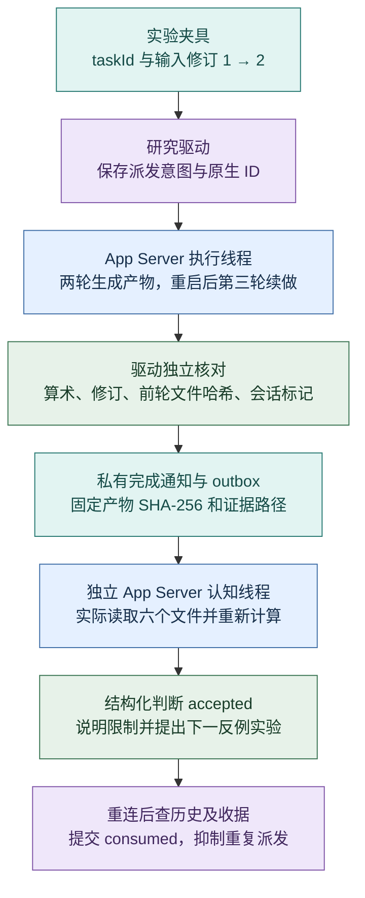
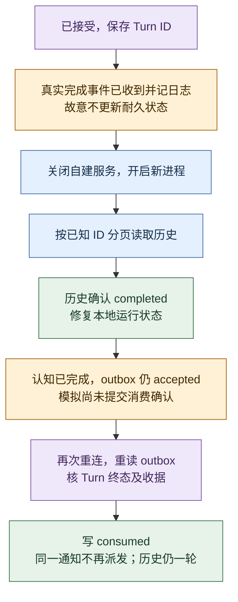

# Codex 集成实测：执行、恢复与认知接收

> 2026-10-20 纳入补记：本文保留 2026-10-19 的隔离实验范围与当时设计。Task/Schedule 当前权威已按 DEC-018 改为 evoLoop PostgreSQL，飞书仅为 connector；本实验的飞书/Wiki 夹具不表示这些生产路径已接通。本次协调仅重跑离线协议检查，不重跑四轮模型任务或桌面消费。

> 2026-10-19 · 隔离实验已运行，生产接入未部署。接续[首次协议调查](codex-app-server-20261019.md)。本次用实验夹具代替飞书任务，外置生产 Wiki 和定时器未接通；它们仍服从[现行架构边界](../architecture/codex-integration.md)。

## 结论与适用范围

**自管 App Server 的最小链已通过：创建执行线程 → 连续两轮实际任务 → 退出并重启服务 → 分页历史对账与续做 → 独立认知线程读取证据、核算并给出下一动作。** 结果来自真实模型轮次、工具执行与文件检查，没有用模拟 Turn 代替宿主运行。

另起 App Server 能读取明确授权的现有桌面会话元数据；桌面宿主工具也能读取这次协议创建线程的历史。两端在本机环境可访问相同的持久线程，但**可读历史不等于共享实时运行控制**。没有对既有桌面聊天调用 `thread/resume`／`turn/start`，没有测试桌面并发写入、UI 自动同步或在独立客户端直接唤醒桌面认知聊天。

桌面结果通知的宿主桥接也已通过：主认知会话实际读取证据、独立重算并给出受限通过与下一动作；它不属于独立 App Server 协议能力。生产采用仍需真实飞书任务、未知派发结果、并发与审批恢复等证据。

## 固定环境与证据

| 项目 | 实际观察 |
| --- | --- |
| 执行时间 | 2026-10-19 20:02:12—20:03:37，Asia/Taipei；自管协议链约 85 秒，不含桌面桥接和文档工作 |
| CLI | `codex-cli 0.154.0`；本机 macOS、Python 标准库客户端、stdio JSONL |
| schema | 用本次 CLI 重新生成 v2 schema；SHA-256 `f3487938786b729cb6773dbc9e83a7efab9c78c845db7094e8f539f373cbacc9`，与首次调查一致 |
| 模型 | `model/list` 实际提供 GPT-6 Astra 及部分 GPT-5.6 型号，没有返回 GPT-6 Sol/Luna；两次 `thread/start` 均确认 `model=gpt-6-astra`、`modelProvider=openai` |
| 推理档 | 四次 `turn/start` 显式发送 `effort=low`；新 Thread 默认回执为 `high`，执行后 `thread/resume` 回执为 `low`。这是请求及运行时配置证据，不声称独立审计了模型服务内部路由 |
| 权限 | `workspace-write`、`approvalPolicy=never`；服务回执的命令沙箱为 `workspaceWrite`、`networkAccess=false`。未修改登录、账号或全局配置 |
| 实例 | 两条持久线程：执行者三轮、认知接收者一轮；三次自建 stdio 进程均退出码 0 |
| 流观察 | 收到四组 `turn/started` 与 `turn/completed`，以及 Item、命令输出、增量文本、token usage 更新；随后从持久历史再次核对 Turn 和 Item |
| 原始证据 | 请求/事件 JSONL、进程退出记录、线程映射、分页历史、产物及收据保留在私有忽略目录；不随公共代码发布 |

现有 Codex 登录由 CLI 自行使用，客户端没有读认证文件、调用凭据导出或配置 API key。正常用户级配置、Hook、MCP 启动及指令加载仍存在；`instructionSources` 确认载入用户、项目和夹具指令。模型任务限定本地夹具，不能据此声称整个 App Server 的进程环境已完全隔离。

公开脚本在 `scripts/research/codex-app-server/`：`client.py` 处理握手、请求/事件、分页和退出；`verify.py` 执行真实夹具与证据核对；`test_client.py` 检查失效边界。它们是研究工具，没有实现正式 `SessionRuntime` 包，也没有决定应用技术栈。公开报告的摘要和指纹可供审阅；原件未公开，因此外部读者不能仅凭本报告独立重放当次运行。脚本可重新执行同类实验，不保证相同模型文本、随机标记或文件字节。

## 实际最小闭环



图例：青＝实验数据及持久证据；紫＝项目侧研究代码；蓝＝原生运行时与模型工作；绿＝实际核验和判断。图描述本轮已运行链路，不包含飞书或生产 Wiki。

### 任务与前文使用

第一轮读取输入 `[12,7,5]`，实际创建 `delivery.v1.json`：修订 1、数量 3、总和 24。驱动比较完整字段，而非仅判断文件存在。首条消息另给一个随机标记，要求当轮不写入文件、不在答复中重复。

第二轮仍在同一 Thread，输入修订为 2、数值追加 9。模型实际读取新输入和第一轮产物，写出数量 4、总和 33、前轮总和 24、前轮文件 SHA-256，以及前一轮会话中的随机标记。第二条指令没有重发标记值；驱动核对所有字段与实际文件字节。这证明当次续轮使用了前文和原产物，不能外推无限长度上下文可靠性。

退出自己启动的第一个 App Server 后，第二进程握手并用 `thread/read`、`thread/turns/list`、`thread/items/list` 读回。分页大小分别为一轮和两个 Item，实际跨页取得两轮完成历史及 11 个 Item。随后 `thread/resume(excludeTurns=true)` 并开启第三轮，模型读取 v2，生成 `resumed.json`，核对修订、总和与标记；持久历史中执行者恰好三轮。

恢复后的标记同时存在于 v2 文件，因此第三轮不是“完全不依赖文件的纯会话记忆”实验；历史保存本身由第一、二轮持久 Item 的回读另行证实。第一版输入文件被修订 2 覆盖，当次认知接收者没有冻结的修订 1 输入文件；它明确指出这项限制，没有把当前输入前三项等同完整历史来源。

### 认知接收不是完成回执

驱动核对产物后，落盘带通知 ID、任务 ID、输入修订、产物 SHA-256 和证据引用的 `completion-notice.json`。然后创建独立认知 Thread 并派发消费任务，而不是让执行模型临时决定是否通知。

认知线程有三个成功的命令 Item，实际读了通知、执行摘要、当前输入、v1、v2 和恢复产物，并运行独立核算。其 `cognition-receipt.json` 给出 `accepted`，确认当前算术和数量、修订、任务 ID、前轮及最终文件哈希、标记一致性；驱动再次核验通知 ID、修订、哈希、总和、决定及非空下一动作，随后才承认消费成功。

它提出的下一动作是：另建反例夹具，把总和从 33 改为 34，同时保留通知中的原哈希，要求接收者拒绝，以验证判断依赖证据而不是完成标志。**这个反例尚未运行**。接收者也明确说明自己消费的摘要不能独立证明进程重启、模型内部执行或生产系统接通；这些分别由驱动的协议日志、进程记录与实际范围说明支持，不能由模型自评代替。

## 恢复与通知可靠性的实测边界



图例同上，黄＝明确注入的漏应用／确认缺口。完成事件在传输层没有丢失；注入点是消费者忽略终态后留下旧检查点。它验证了“本地状态落后于真实历史”的恢复，没有验证网络断开期间事件是否送达，也没有杀死正在运行的模型轮次。

通知实验在接收者完成后、发送端写 `consumed` 前关闭连接，重新载入 outbox，再用已知 Thread/Turn ID 和实际收据对账。再次执行派发资格检查时被抑制，接收者历史仍一轮。请求意图和已接受 Turn ID 保存在私有记录；`dispatching_unknown`、`accepted`、`consumed` 不会被盲重发。

这是**单个研究驱动、已知 Turn ID 的恢复试验**。脚本模拟确认缺口并重启 App Server，没有让 Python 驱动进程崩溃后由另一驱动接管，没有跨进程锁或持久队列保证。RPC 与本地日志间仍有非原子窗口；响应丢失而没有 Turn ID 的情况仍是 `unknown`。它不证明 exactly-once、断电耐久性、多消费者去重、生产 outbox 或无人工长期运行。

## Desktop 的观察、桥接与未测项

| 操作 | 所属能力 | 观察与边界 |
| --- | --- | --- |
| 从桌面列出会话、读取原始人类任务 | Codex 宿主工具 | 确认当前 evoLoop 主讨论接收端及人类通知授权；另一个旧认知聊天的 cwd 属于其他项目，没有向其派新业务 |
| 对明确 ID 调用 `thread/read(includeTurns=false)` | 独立 App Server 原生协议 | 成功读取现有桌面会话元数据；返回来源 `vscode` 和本连接内 `notLoaded`，不能当成桌面实际空闲或可抢占证据 |
| `read_thread` 读取本次执行者第三轮 | 桌面宿主工具 | 成功看到协议线程的持久历史和最终答复；不证明它自动显示在 sidebar 或实时同步 |
| 自建线程的来源分类 | 本机运行观察 | `thread/start` 实际返回来源 `vscode`，即使客户端名为 `evoloop_research`；不能仅靠 `sourceKinds=appServer` 找出本驱动线程，仍须保存原生 ID 映射 |
| 向 evoLoop 主讨论提交结果、核消费 | 桌面宿主桥接 | 一次宿主消息提交；接收端实际读取报告、state/outbox、产物和日志，独立重算并保存 `accepted_with_scope` 收据；宿主等待工具观察到接收 Turn 完成 |
| 独立客户端接续既有桌面 Thread、监听桌面活动 | 未测 | 未调用 `thread/resume` 或 `turn/start` 接管现有桌面聊天，没有清锁、修改聊天数据库或关闭用户 App |

本次桥接于 20:07:14 开始接收轮次、20:10:00 完成（Asia/Taipei）。发送回执只给目标会话 ID，随后由宿主等待及读取工具核对实际消费。接收端保存的私有 `desktop-cognition-receipt.json` 关联通知 ID、证据路径及所读文件哈希；本验证方又保留消费轮次和收据的观察记录。收据固定的是当时报告修订，之后本报告只补入桥接验收和最终检查。没有让接收者向本线程回信，也没有自动派生新任务。

接收端认可受限自管链通过，但区分“读取证据并核验”和“项目级认知质量”。它建议先补两种错误证据反例（原哈希下篡改文件、哈希匹配但算术错误），再测服务端已接受但派发回执丢失时的对账或保持未知，随后接可撤销的真实飞书测试任务。这些是已经消费结果后形成的判断，**后续实验没有自动执行**。

这里没有把“独立协议不能接管桌面”写成失败结论，因为没有做该写入实验。已知事实是双向可读持久历史，以及本地运行状态与桌面状态不能直接等同。桌面插件、连接认证、审批、推送消息入口和独立 CLI 的互操作也没有被共同验证。

## 通过、失败、未测矩阵

| 验收项 | 结果 | 证据或限制 |
| --- | --- | --- |
| 版本、schema、稳定 API 握手 | 通过 | 重新生成指纹一致；三次初始化成功 |
| `thread/start`、`turn/start`、事件和真实文件 | 通过 | 两个线程、四个真实轮次，产物字段及字节哈希通过 |
| 同 Thread 第二轮使用前文/产物 | 通过 | 未重发的随机标记、前轮实际文件哈希与总和 |
| 服务退出重连、历史分页、`thread/resume` 后续做 | 通过 | 三次进程退出码 0、三轮执行历史、恢复产物 |
| 忽略完成通知后由历史修复旧状态 | 通过（限定注入） | 忽略已收到的事件；不是网络中断或在途进程崩溃 |
| 独立认知线程实际消费与下一判断 | 通过 | 六份材料、三个成功命令 Item、结构化判断和下一反例建议 |
| 收据确认前重连、已知 Turn 去重 | 通过（单驱动） | 对账后 `consumed`，接收者仍一轮；没有持久分布式队列 |
| 双端按授权 ID 读取持久线程 | 通过（本机） | 独立协议读桌面元数据、宿主工具读本次执行历史 |
| 桌面结果通知与实际认知消费 | 通过（宿主桥接） | 一次消息、真实接收轮次完成、独立重算与结构化私有收据；不是脚本原生入口 |
| 预期能力失败 | 本轮无 | 不把未测或模型列表缺少某型号写成协议失败 |
| 未知派发响应、真实断线/在途停止、实时桌面订阅 | 未测 | 不作可靠性承诺 |
| 真实审批/拒绝、中断、双写竞争、权限变更 | 未测 | 离线测试只证明本客户端遇未知服务器请求失败关闭 |
| 飞书任务、生产 Wiki、定时触发与用户亲用 | 未测 | 夹具不是正式适配，也没有验证用户体验收益 |

## 复跑、检查与决定影响

先用本机 `model/list` 核对模型和推理档，固定 CLI 及生成 schema。保留已有登录，选择新的私有忽略目录。复跑会创建两个持久测试线程并运行四个真实模型轮次，会消耗账号额度；不会发送桌面消息。

```sh
python3 -m unittest discover -s scripts/research/codex-app-server -v
python3 scripts/research/codex-app-server/verify.py \
  --output .local/codex-proof/run-NEW \
  --model gpt-6-astra --effort low --run-live
```

`--desktop-thread` 仅在已有明确授权时加入；它只读目标元数据。脚本拒绝已有输出目录，失败保留证据，不自动重试未知写入。它是整轮实验复跑器，没有任意中断运行的生产恢复命令。九个离线检查覆盖事件先于响应、错误 Thread 终态、失败终态、未知审批请求、重复分页游标、超时不重发、非完成历史、旧/损坏收据及 outbox 去重；这些不能代替真实宿主能力的四轮证据。

本地验证结果：九项 Python 离线检查、七项现有文档测试、39 页 `docs:check` 与 `docs:build`、`git diff --check` 通过。两张 Mermaid 图在实际浏览器渲染成功并经桌面截图检查；390px 布局测量时页面宽度为 390px，两图宽度均未超过容器，未造成页面横向溢出。截图和浏览器临时产物留私有忽略目录。构建检查不等于人类亲用评价；远程 CI 只以 PR 对应提交的实际运行记录为准。

本轮支持继续实现**自管 stdio SessionRuntime**和基于已知 ID 的持久历史对账。人类日常讨论可保留在 Desktop；自动执行和自动认知回看先由自管线程承接，必要的桌面通知经另行验证的宿主桥接。桥接能力目前由本会话调用宿主工具提供，不是仓库脚本可独立使用的服务。

根据桌面认知接收端的判断，先补错误证据拒绝和派发回执丢失这两个短实验，再选择真实飞书可撤销测试任务，落实单活派发、未知结果对账和确认协议；审批及并发继续单独验证。此次不发布 Wiki，不引入长期任务数据库，不部署服务，不把模型的 `accepted` 提升为人类体验验收。

协议含义以[官方 App Server 文档](https://learn.chatgpt.com/docs/app-server)与固定本机 schema 共同核对；本轮实现及观察的采纳状态见[接入架构](../architecture/codex-integration.md)，生产模块责任仍见[包架构](../architecture/packages.md)。
