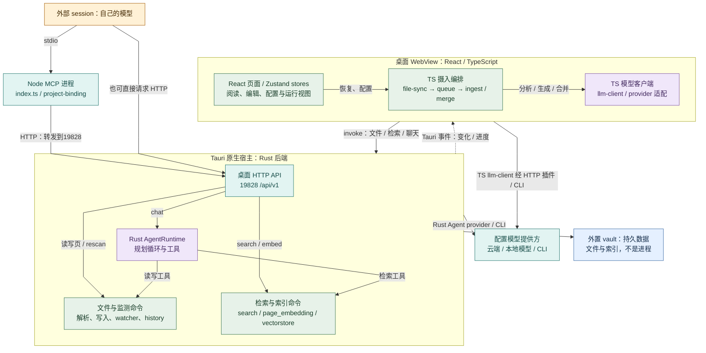
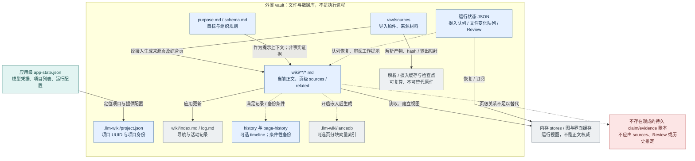
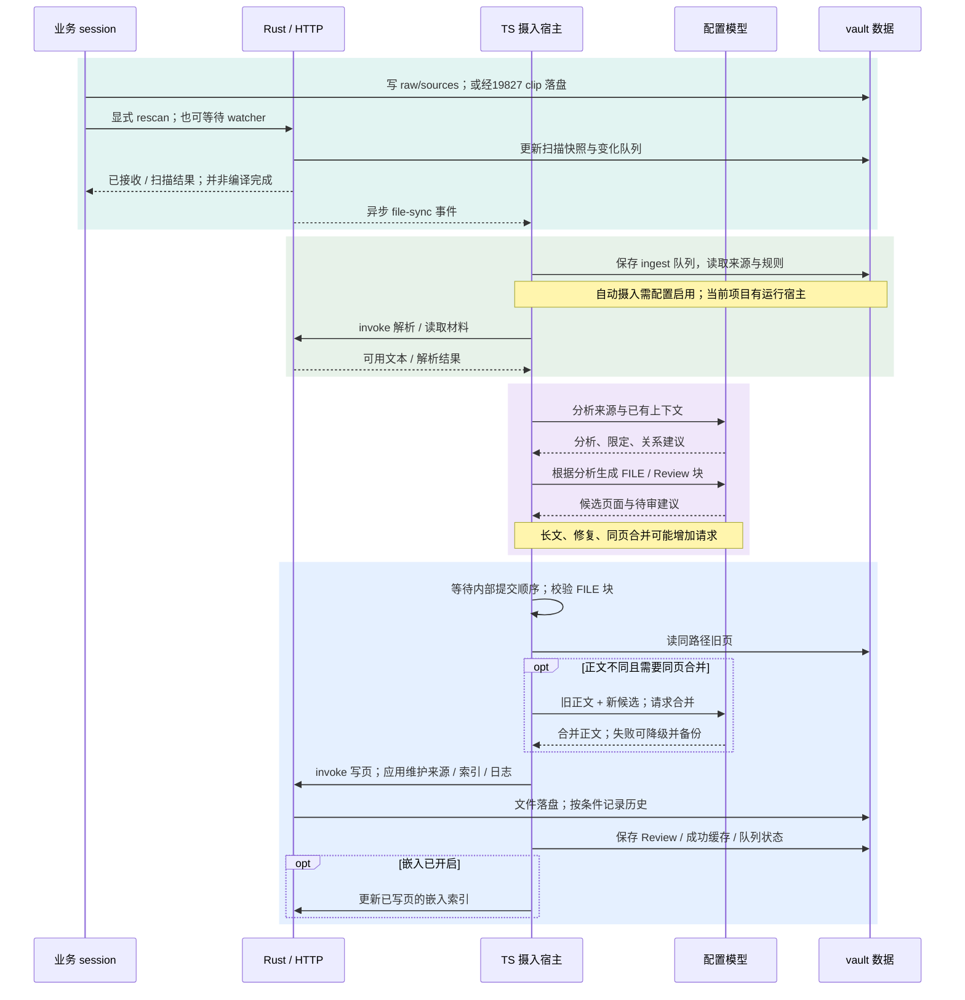
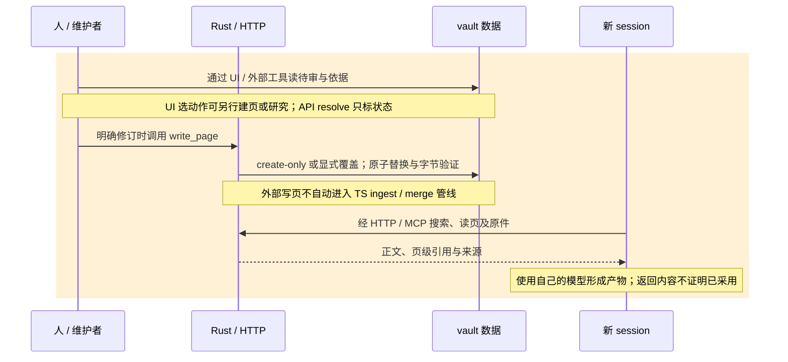
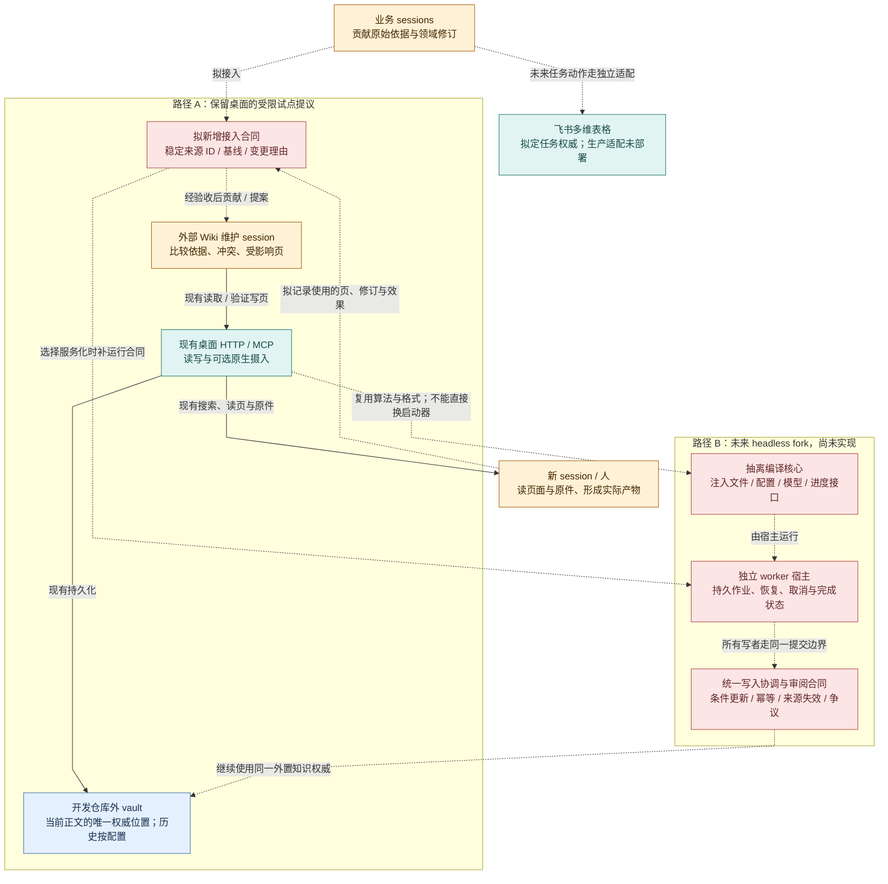

# nashsu/llm_wiki：组件、存储与改造边界

> **研究记录，非正式架构承诺。2026-10-19。** 固定研究对象为 [v0.6.12 / `48fd970e206a02a6d2028d1dbfc41b7a0345bf0b`](https://github.com/nashsu/llm_wiki/tree/48fd970e206a02a6d2028d1dbfc41b7a0345bf0b)。本文复用[实测结果](results.md)，重新核对该版本源码；本次没有启动模型实验或修改原始实验数据。

核心结构是 **React WebView 编排摄入，Tauri/Rust 提供本地能力和 HTTP 服务，外部 Node MCP 代理该 HTTP 服务**。另有一套 Rust Agent 运行时负责内置聊天。两条模型执行路径共享项目材料，但并非同一个编译器。要改造成共享 Wiki 服务，既要抽离桌面编译宿主，也要补协同修订合同。

读图约定统一如下。颜色表示职责，不能当作测试状态；**实线**表示现行调用、读写或数据生成关系，**虚线**表示异步通知、可选步骤或明确标注的拟议连接，具体以箭头文字为准；时序图虚线也用于响应返回。目录节点是数据边界，框内组件才是执行者。

| 颜色 | 含义 |
| --- | --- |
| 浅黄 | 人或业务 session 的选择、输入、审阅 |
| 浅绿 | 现有应用编排与本地能力 |
| 浅紫 | 模型推理职责；输出仍需应用处理 |
| 浅蓝 | 持久文件或项目状态 |
| 青色 | 外部进程、接口或服务 |
| 灰色 | 可重建派生物、内存视图或可选索引 |
| 浅红 | 尚未实现/验收的合同、改造或风险 |

## 1. 组件依赖与进程边界

跨线框箭头表示该运行环境通过注明的接口发起调用，具体命令由框内模块承担。此图按运行环境分层，不承诺各操作系统的固定进程数；WebView 渲染进程由平台管理，Rust 中的 HTTP、watcher 和 Agent 也不是三个独立守护服务。`lib.rs` 在桌面 setup 中启动 HTTP 与剪藏服务，并注册 Tauri commands。图省略独立的19827剪藏入口：它接收材料并落来源文件，不是另一套模型编译器。[原生入口][host] [HTTP 路由][api] [剪藏][clip]

**摄入路径**由 `App.tsx` 装载项目配置、恢复队列并启动同步；`project-file-sync.ts` 监听 Rust 事件，选择来源入队；`ingest-queue.ts` 调 `autoIngest`。`ingest.ts` 直接依赖 wiki/review/activity stores、文件命令和 TS 模型客户端。因此界面不是只有展示作用。TS 网络请求通常通过 Rust 支持的 Tauri HTTP 插件传输；这不把提示词组装与编排迁到了 Rust。[项目装载][app] [事件桥][sync] [队列][queue] [摄入][ingest] [模型传输][transport]

**聊天路径**由 React 或 HTTP 调 Rust `AgentRuntime`，再经工具读取 Wiki、原文、图和搜索；它可明确调用写页工具。外部 session 调 MCP `search/read_file/write_page` 时，推理在外部宿主；只有调产品 `chat` 才进入产品模型运行时。MCP 自身不读 vault、不思考、不启动编译服务。[运行时][runtime] [工具][tools] [MCP][mcp]

**异步边界**：HTTP `sources/rescan` 调 Rust `rescan_project_files`，返回扫描结果；文件事件再由前端处理为模型摄入任务。该响应不是“所有 Wiki 已编译完成”。非当前项目可被扫描并持久排队，但 `enqueueInactiveProjectBatch` 明确不立即做模型工作；不能从多项目监测推导所有项目都在后台持续编译。前次应用退出后 HTTP 不可用已实测；关闭/缺失 WebView 时是否仍能完整编译未实测，源码也不支持把它宣称为独立 headless 编译服务。[重扫处理][rescan] [同步事件][sync] [非当前项目队列][queue]

## 2. 存储关系与数据权威

“持久”与“权威”不同：Wiki 页最初由模型生成，但保存后承担当前正文，直接编辑不一定能从原件重新生成同样内容；不能把整棵 Wiki 当可随意删除的索引。原件承担来源文本依据，原件中也可能包含猜测或过时决定。purpose/schema 是组织规则，不是主张真实性证明。索引、向量和内存图主要用于定位；重建它们不能修复正文误解。[项目布局][project] [模板][templates] [身份][identity] [缓存][cache] [向量][vectors]

| 存储类别 | 固定实现与恢复边界 |
| --- | --- |
| 来源与页级依赖 | `sources[]` 是页到来源的依赖字段，`related` / wikilinks 是页面关系。原生同页合并确定性并集数组字段，并保住部分标量元数据；正文合并依赖模型和完整性检查。这不是每条主张的证据、争议和修订事务。[合并][merge] |
| 队列与快照 | TS 摄入队列为 `.llm-wiki/ingest-queue.json`；Rust 扫描另存 `file-snapshot.json`、`file-change-queue.json`。两种队列职责不同。摄入队列持久化是 best-effort，当前内存队列仍是运行期权威；不应画成事务消息总线。[摄入队列][queue] [文件同步][watch] |
| Review 与聊天 | `review.json` 保存待审及 resolved 状态；TS 聊天与 Rust Agent 会话有各自保存路径。Review 是工作提示，API resolve 仅改状态，已实测不会替调用者建页。不能把它当事实批准或已执行修订的收据。[持久化][persist] [Review 类型][reviews] [Agent 会话][sessions] [API][api] |
| 历史与备份 | timeline 默认关闭，启用后写 `.llm-wiki/history`，受保留限制；摄入 fallback / 去重另有 `.llm-wiki/page-history` 条件备份。存在旧字节不等于不可变审计、条件写或完整跨页版本。[历史][history] [摄入备份][ingest] |
| 可选索引 | TS 嵌入编排和 Rust `page_embedding` / `vectorstore` 维护 LanceDB 分块索引。其页指纹/内部锁服务索引一致性，不是外部 Wiki 写入的 expectedRevision。前次未开启嵌入。[嵌入][embedding] [后端单页嵌入][page-embedding] [向量][vectors] |
| 项目外配置 | `app-state.json` 管模型配置、凭据和项目列表；项目 UUID 在 vault 内。项目包不携带项目外全部凭据/设置。原生归档从源码看遍历隐藏项目状态；前次只验过手动 ZIP 的58文件恢复，未验原生按钮。[配置][store] [归档][archive] |

删除来源时，前端 `source-lifecycle.ts` 会处理来源页、依赖数组和部分链接；前次撤回试验仍留下未标失效的正文。图中的依赖是已有机制，**不是撤回已经能自动撤销每条主张**。[来源生命周期][lifecycle] [实测撤回结果](results.md#原生能力与共同案例)

## 3. 一轮来源摄入、审阅与新 session 消费

以下接续相同 vault；审阅与消费是独立动作，不是摄入事务的一部分。

序列图是逻辑顺序，不是一个跨文件原子事务。TS 到 vault 的箭头表示通过文件命令发起的逻辑存取，实际磁盘写入由 Rust 执行。准备可并发；`IngestCommitCoordinator` 按任务开始顺序保留提交轮次，提交还使用 TS 项目锁。同路径旧正文的模型合并可能位于该提交阶段，使后续任务等待；它没有协调所有外部写者。默认 worker 为1，固定版可配置更多，前次只跑默认串行。[提交协调器][commit] [队列执行][queue] [摄入与降级][ingest] [合并][merge]

两处失败边界值得在改源码时保留：分析截断可在写页前阻止生成；提交中后段失败则可能已经有部分文件落盘，重试不能假设“失败即未写”。队列代码明确保留已完成写入，避免取消后删掉原有合并页。成功缓存须通过完整性条件才保存；可选嵌入失败不保证整个摄入回滚。[摄入完整性闸][ingest] [取消与队列][queue]

外部 `pages/write` 和 MCP `write_page` 最终调 Rust `write_wiki_page_verified`：默认拒绝覆盖，显式覆盖时原子替换并读回核字节，历史按设置记录。该 handler 不调用 `autoIngest` / `mergePageContent`，不替维护者补齐 `sources[]`、语义审阅、索引/日志或嵌入的全套维护。文件监测可能刷新视图，不等于重跑编译。它也没有调用者基线条件或幂等键；前次同基线覆盖已复现丢更新。[HTTP 写页][write] [底层写工具][tools] [MCP 参数映射][mcp] [实测并发结果](results.md#原生能力与共同案例)

## 4. evoLoop 接入：先保留桌面，headless 另行抽离

路径 A 的接口和外部维护消费已在隔离小样本接通；红色接入合同仍未完成。最小试点可先约束同页串行、写前重读、超时先读回，并保留完整来源字段。但若原生摄入同时能写该页，单独串行外部维护仍不覆盖所有写者；要冻结自动写入窗口或另行统一协调。这些流程限制不能宣传成 CAS。维护者处理知识维护，不获得全项目审批权；飞书任务动作另走拟议适配。[接入研究](integration.md) [当前正式接口约定](../../architecture/contracts.md)

路径 B 是**改造建议，未实现、未跑**。先从 TS 核心移除对 Zustand、活动 UI 和 `invoke` 的直接依赖，注入文件解析/写入、配置与凭据、模型传输、Review 仓储、进度/取消、时钟等接口；再实现可独立启动的作业宿主。`page-merge.ts` 已以参数注入模型合并函数，适合复用；`ingest.ts` / 队列仍有 UI 与项目全局状态依赖。Rust HTTP 也依赖 `AppHandle`、应用配置和事件，不能因为语言是 Rust 就视为现成无桌面服务。[合并函数][merge] [摄入][ingest] [队列][queue] [HTTP][api]

### 源码修改导航

下表是改动落点和验收建议，不是已完成任务。先复用现有 vault/算法，不另建第二份可编辑 Wiki；新增修订与证据结构应归外置知识系统，并先与正式接口合同对齐。

| 要改变的行为 | 主要源码落点 | 需要明确新增/验收的边界 |
| --- | --- | --- |
| 脱离 WebView 编译 | `App.tsx`、`project-file-sync.ts`、`ingest-queue.ts`、`ingest.ts`、`commands/fs.ts` | 注入宿主依赖；事件/扫描与编译作业分开；无前端进程时真实完成编译、重启恢复、取消与部分写入处理。 |
| 调整摄入认知质量 | `ingest.ts` 的分析/生成提示、长文流程；`page-merge.ts` | 先保住截断与完整性检查；独立测限定保留、冲突和旧认识更新，不能以 FILE 块合法证明语义正确。 |
| 多写者条件修订 | `api_server.rs` 的写请求、`agent/tools.rs` 写工具、MCP schema、TS 提交协调器 | expected revision/hash、冲突响应、请求 ID/幂等；所有相关写者接入同一边界。不能只给 HTTP 加锁而让 TS 文件写绕过。 |
| 来源纠正/撤回传播 | `source-lifecycle.ts`、`sources-merge.ts`、文件同步、外部维护入口 | 稳定来源版本、受影响页/主张、失效与待复核状态；保留历史依据与相反解释，不把撤回一方推成另一方已证实。 |
| 审阅与实际修订分离 | `review-store.ts`、`persist.ts`、Review UI、HTTP Review handler | 分清建议、决定、执行和验证；审阅状态连接具体变更和基线，resolve 不能等同修订完成。 |
| 新 session 用了哪个认识 | Rust read/search/chat 响应、MCP 返回结构、外部消费者适配 | 可核对的页 ID/修订与使用记录；返回200或通知送达不证明它被行动采用。 |
| 重建索引与恢复 | `embedding.ts`、`page_embedding.rs`、`vectorstore.rs`、`file_history.rs`、`project_maintenance.rs` | 原件/正文/审阅与派生索引分别恢复；正文新修订对应索引，原生归档 UI 往返及新消费者再消费需补验。 |

**哪些已经证实，哪些没有**：已观察到桌面摄入、39页持久化、MCP/HTTP 写读、重启读取、默认 create-only 和手动备份恢复；同时观察到旧页未传播、来源摘要延伸、撤回残留、同基线覆盖。源码支持上图的组件与存储划分；headless 宿主、持久 claim/evidence 账本、条件更新、完整审阅事务和生产 Feishu 接入均未实现。真人纠错体验、向量恢复和长期收益也未验证。后续判据见[功能与可证伪测试设计](feature-workflows.md#8-可证伪测试设计)。

[host]: https://github.com/nashsu/llm_wiki/blob/48fd970e206a02a6d2028d1dbfc41b7a0345bf0b/src-tauri/src/lib.rs
[api]: https://github.com/nashsu/llm_wiki/blob/48fd970e206a02a6d2028d1dbfc41b7a0345bf0b/src-tauri/src/api_server.rs
[clip]: https://github.com/nashsu/llm_wiki/blob/48fd970e206a02a6d2028d1dbfc41b7a0345bf0b/src-tauri/src/clip_server.rs
[app]: https://github.com/nashsu/llm_wiki/blob/48fd970e206a02a6d2028d1dbfc41b7a0345bf0b/src/App.tsx#L455
[sync]: https://github.com/nashsu/llm_wiki/blob/48fd970e206a02a6d2028d1dbfc41b7a0345bf0b/src/lib/project-file-sync.ts
[queue]: https://github.com/nashsu/llm_wiki/blob/48fd970e206a02a6d2028d1dbfc41b7a0345bf0b/src/lib/ingest-queue.ts
[ingest]: https://github.com/nashsu/llm_wiki/blob/48fd970e206a02a6d2028d1dbfc41b7a0345bf0b/src/lib/ingest.ts
[transport]: https://github.com/nashsu/llm_wiki/blob/48fd970e206a02a6d2028d1dbfc41b7a0345bf0b/src/lib/tauri-fetch.ts
[runtime]: https://github.com/nashsu/llm_wiki/blob/48fd970e206a02a6d2028d1dbfc41b7a0345bf0b/src-tauri/src/agent/runtime.rs
[tools]: https://github.com/nashsu/llm_wiki/blob/48fd970e206a02a6d2028d1dbfc41b7a0345bf0b/src-tauri/src/agent/tools.rs#L671
[mcp]: https://github.com/nashsu/llm_wiki/blob/48fd970e206a02a6d2028d1dbfc41b7a0345bf0b/mcp-server/src/index.ts
[rescan]: https://github.com/nashsu/llm_wiki/blob/48fd970e206a02a6d2028d1dbfc41b7a0345bf0b/src-tauri/src/api_server.rs#L2853
[project]: https://github.com/nashsu/llm_wiki/blob/48fd970e206a02a6d2028d1dbfc41b7a0345bf0b/src-tauri/src/commands/project.rs
[templates]: https://github.com/nashsu/llm_wiki/blob/48fd970e206a02a6d2028d1dbfc41b7a0345bf0b/src/lib/templates.ts
[identity]: https://github.com/nashsu/llm_wiki/blob/48fd970e206a02a6d2028d1dbfc41b7a0345bf0b/src/lib/project-identity.ts
[cache]: https://github.com/nashsu/llm_wiki/blob/48fd970e206a02a6d2028d1dbfc41b7a0345bf0b/src/lib/ingest-cache.ts
[vectors]: https://github.com/nashsu/llm_wiki/blob/48fd970e206a02a6d2028d1dbfc41b7a0345bf0b/src-tauri/src/commands/vectorstore.rs
[merge]: https://github.com/nashsu/llm_wiki/blob/48fd970e206a02a6d2028d1dbfc41b7a0345bf0b/src/lib/page-merge.ts
[watch]: https://github.com/nashsu/llm_wiki/blob/48fd970e206a02a6d2028d1dbfc41b7a0345bf0b/src-tauri/src/commands/file_sync.rs
[persist]: https://github.com/nashsu/llm_wiki/blob/48fd970e206a02a6d2028d1dbfc41b7a0345bf0b/src/lib/persist.ts
[reviews]: https://github.com/nashsu/llm_wiki/blob/48fd970e206a02a6d2028d1dbfc41b7a0345bf0b/src/stores/review-store.ts
[sessions]: https://github.com/nashsu/llm_wiki/blob/48fd970e206a02a6d2028d1dbfc41b7a0345bf0b/src-tauri/src/agent/session.rs
[history]: https://github.com/nashsu/llm_wiki/blob/48fd970e206a02a6d2028d1dbfc41b7a0345bf0b/src-tauri/src/commands/file_history.rs
[embedding]: https://github.com/nashsu/llm_wiki/blob/48fd970e206a02a6d2028d1dbfc41b7a0345bf0b/src/lib/embedding.ts
[page-embedding]: https://github.com/nashsu/llm_wiki/blob/48fd970e206a02a6d2028d1dbfc41b7a0345bf0b/src-tauri/src/commands/page_embedding.rs
[store]: https://github.com/nashsu/llm_wiki/blob/48fd970e206a02a6d2028d1dbfc41b7a0345bf0b/src/lib/project-store.ts
[archive]: https://github.com/nashsu/llm_wiki/blob/48fd970e206a02a6d2028d1dbfc41b7a0345bf0b/src-tauri/src/commands/project_maintenance.rs
[lifecycle]: https://github.com/nashsu/llm_wiki/blob/48fd970e206a02a6d2028d1dbfc41b7a0345bf0b/src/lib/source-lifecycle.ts
[commit]: https://github.com/nashsu/llm_wiki/blob/48fd970e206a02a6d2028d1dbfc41b7a0345bf0b/src/lib/ingest-commit-coordinator.ts
[write]: https://github.com/nashsu/llm_wiki/blob/48fd970e206a02a6d2028d1dbfc41b7a0345bf0b/src-tauri/src/api_server.rs#L1790
