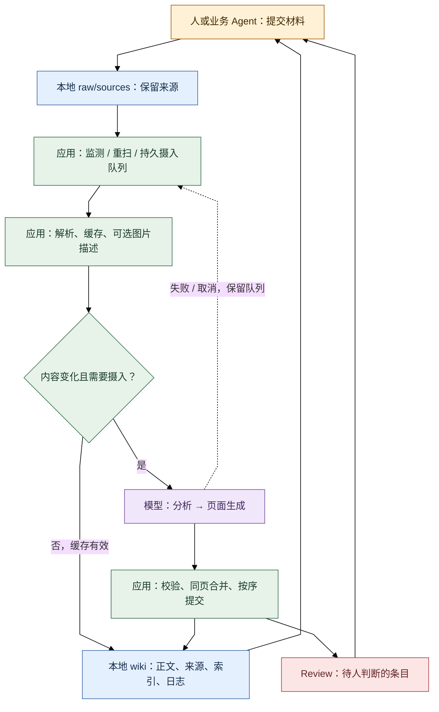
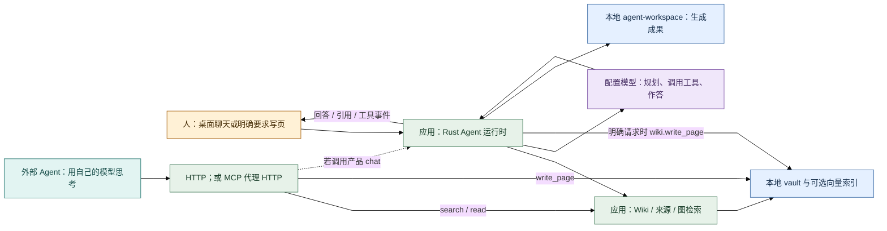
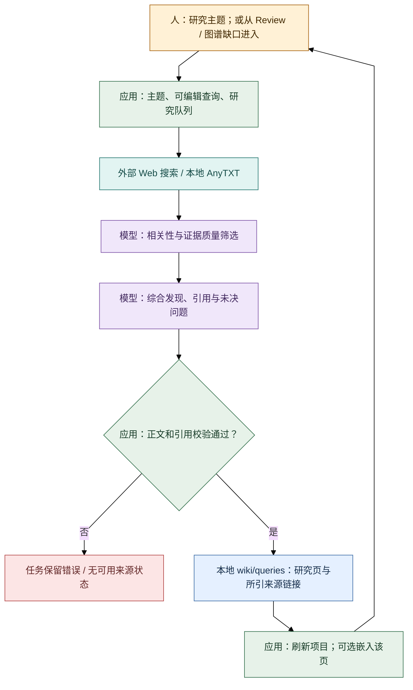

# nashsu/llm_wiki v0.6.12：主要功能与完整工作流程

> **研究记录，非正式选型。公开整理版：2026-10-19。原始运行证据外置、未发布；本次公开整理未重新运行实验。** 阶段：固定源码功能核查、机制推断与后续可证伪测试设计。

2026-10-19。固定版本：** v0.6.12 / `48fd970e206a02a6d2028d1dbfc41b7a0345bf0b`**。本报告补充产品功能版图，不重复跑模型实验，不重启应用，也不修改既有验证结果。

它是一套以独立文件夹为知识项目、由桌面应用组织模型摄入与维护的个人知识工作台：包含材料导入、持久 Wiki、阅读编辑、图谱、检索聊天、研究和维护工具。它还提供外部 Agent 可读写的接口。**“已有这些功能”与“能可靠承担 evoLoop 的多会话认知治理”是两项不同判断**；此前样本暴露的修订、并发和撤回缺口仍成立，不能据此反过来说产品只有搜索或不能写页。

证据标签：** N**＝原生代码机制；**P**＝官方内置提示词/模型执行；**A**＝本轮验证新增适配；**H**＝人或 Agent 显式操作。**已跑**指本会话先前真实运行；**源码核实、未跑**不能当成功测试。所有源码引用都锁定上述 commit；README 与实现不一致时以实现为准。

## 1. 三条端到端流程

三图统一配色：浅黄为人/显式选择，浅蓝为本地文件，浅绿为应用机制，浅紫为模型推理，青色为外部 Agent 或服务，浅红为待审/失败分支。图中“模型”可以是已配置的云端或本地模型，不意味着知识正文离开本地；云端请求会发送本次所需材料。

### 1.1 从来源到持久 Wiki：应用编排，模型分析，应用提交

谁启动：用户导入、外部写入来源后 Source Watch/重扫、网页剪藏或定时导入。谁推理：所配置的 ingest 模型；长材料可分块分析并合并摘要，图片可额外调用视觉模型，同路径旧页合并也可能再调用模型。谁写入：应用解析 FILE 块、修整 frontmatter/来源并写文件；索引有确定性更新，日志有补写。**不是模型直接拥有任意文件系统写权限，也不是一次摄入固定只花两次模型调用。** [摄入入口与提交][ingest] [长材料分析][long-source] [同页合并][page-merge]

默认 ingest 并发为1，但固定版已允许配置 worker 数，准备阶段可重叠，提交按任务开始顺序协调；这只协调应用内部摄入，不能当作外部 MCP/HTTP 写者的 CAS。已跑的是默认串行配置，未测64路并发。[队列][queue] [提交协调器][commit] [并发边界][concurrency]

### 1.2 知识如何被使用：内置聊天与外部 Agent 是两种推理归属

内置聊天使用产品配置的模型与 Rust 工具运行时；外部 session 可以自己搜索、读来源、形成认识，再调用原生写页，**这时推理属于外部 session**。调用 `llm_wiki_chat` 则会进入产品聊天运行时，需要产品模型配置。MCP 自身不推理，也不离线扫描 vault；它代理运行中的桌面 HTTP 服务。此区别决定模型费用、故障边界和维护责任。[Agent请求类型][agent-types] [运行时][runtime] [MCP实现][mcp]

已跑：真实 MCP 写读/项目绑定，HTTP 检索，以及外部无历史消费者和维护 Agent。未跑：产品内置 chat 完成同组任务、Skills/shell 的完整运行。本轮外部消费者成功，不能改写成“内置聊天已验收”。

### 1.3 Deep Research：新的研究页面，不等同聊天的 deep 档

该工作台流程支持多查询、Web/AnyTXT/both、URL去重、最多20个来源、默认最多3个研究任务并行。模型筛选失败时有保留候选的降级路径，不能宣称筛选永远生效。综合正文需通过非空与来源编号引用检查，保存时只列实际引用的来源。**当前实现直接保存研究 query 页并可选嵌入，不再自动把研究结果重新摄入为来源**；README 的 auto-ingest 描述已滞后。图谱入口另有模型优化主题和人确认步骤。此整条流程均源码核实、未实际联网研究。[研究收集/校验][research] [研究执行与保存][research-save] [图谱入口][graph-ui]

## 2. 主要功能盘点与实际覆盖

### 2.1 项目、vault、模式与存储

| 功能 | 固定版实际能力与边界 | 层 / 本会话覆盖 | 固定源码 |
| --- | --- | --- | --- |
| 多项目 | 新建/打开独立文件夹、最近项目和项目UUID；配置记住当前项目。可把知识文件夹放在开发 repo 外，不要求与代码同仓。MCP可绑定项目，但不是新建项目工具。 | N/H；已创建、重启、挂载测试副本。 | [项目命令][project] [项目身份][identity] [应用配置][store] |
| Markdown/Obsidian | `purpose.md` 描述目标，`schema.md` 描述类型/路由；`raw/sources` 原材料，`wiki` 持久页，`.llm-wiki` 队列/Review/聊天/缓存等；生成 `.obsidian` 配置。正文可脱离应用作为Markdown读取。 | N/P/H；目录与正文已跑；未实际在Obsidian打开。 | [创建布局][project] [模板][templates] |
| 五类模板 | Research、Reading、Personal Growth、Business、General；模板给不同purpose/schema和附加目录，Research可含 thesis/methodology/finding 等类型。自定义schema会进入摄入路由提示词。 | N/P/H；只跑General，未验证各模板效果。 | [模板][templates] [schema路由提示词][generation] |
| 本地与云的边界 | 文件在本地不等于所有计算在本地。模型、嵌入、MinerU Cloud、搜索服务按配置接收有关内容；Ollama、本地MinerU、CLI是另外的执行路径。应用级模型凭据不等于vault里的页面。 | N；隔离HOME、环境凭据转发仅为A，不是产品自带凭据方案。 | [配置持久化][store] [模型接口][providers] [MinerU][mineru] |

### 2.2 导入、解析与来源监测

| 功能 | 固定版实际能力与边界 | 层 / 本会话覆盖 | 固定源码 |
| --- | --- | --- | --- |
| 本地导入 | 文件/递归文件夹导入，保留子目录，目录上下文可传给模型；可预解析以降低随后摄入阻塞。批量URL导入另有入口，上限50，保留来源URL、限制响应大小并校验HTTP URL。 | N/H；只用合成Markdown来源，未跑PDF/Office/URL。 | [来源生命周期][source-life] [预解析][preprocess] [URL导入][url-import] |
| 文本、Org、PDF、电子书 | UTF-8文本直接读；Org转换；PDF内置解析/提图，复杂PDF可选MinerU Cloud、Local API或Pipeline；EPUB/MOBI有专用提取。解析缓存与模型摄入缓存不同。 | N；未跑这些格式或MinerU。 | [读文件分派][fs] [电子书][ebook] [MinerU][mineru] |
| Office范围 | 固定版首选AnyDoc；接受 doc/docx/docm、ppt/pps/pot/pptx/pptm/ppsx/ppsm、xls/xlsx/xlsm/xlsb、odt/ods/odp、rtf。兼容回退只覆盖其中部分（DOC/DOCX、PPTX、XLS/XLSX/ODS、ODT/ODP）。不能将扩展名接受等同所有文件都能无损解析。 | N；源码核实、未跑；README仍主要写旧解析器。 | [格式白名单及分派][fs] [Office兼容回退][office] |
| 图片与音视频 | 图片有预览、PDF/Markdown图片提取、项目内 `wiki/media`、可选视觉描述及缓存，搜索可携带图片引用。音视频可在内置播放器查看，但普通读文件对音视频返回媒体占位信息；未核到自动转写/完整视频理解链路。`.pages/.numbers/.key` 也只是“不支持文本提取”的占位分支。 | N/P；图片描述需要视觉模型、默认关闭；全部未跑。 | [格式分派][fs] [图片描述][caption] [预览组件][preview] |
| Source Watch | 监测项目内 `raw/sources` 的新增/编辑/删除，按扩展名、目录、glob、大小筛选；重扫复用生命周期。默认监测开启、autoIngest开启，解析并发2、摄入并发1、单文件100MB；可配置多项目扫描。 | N/H；新增、空白修改触发恢复、重扫与删除已跑；多项目后台模式未跑。 | [默认值][watch-defaults] [配置][watch-config] [同步器][file-sync] |
| 定时导入外部目录 | 独立于Source Watch：定期扫描选定目录，把新增/修改文件复制到项目并排摄入；追踪已导入文件。**外部目录删除文件不会自动删除项目副本。** | N/H；源码核实、未跑。 | [定时导入][scheduled] [界面边界说明][scheduled-ui] |
| 网页剪藏 | 官方MV3扩展用Readability/Turndown提取Markdown，选项目后送19827 `/clip`；应用拾取后可摄入。扩展离线预览不等于桌面停止后仍可入库。 | N/H；仅实际调用clip端点，没安装/运行浏览器扩展。重复请求生成2份来源，未按业务事件ID去重。 | [扩展][extension] [clip服务][clip] |

### 2.3 模型整理与知识更新

| 功能 | 固定版实际能力与边界 | 层 / 本会话覆盖 | 固定源码 |
| --- | --- | --- | --- |
| 两阶段摄入 | 分析材料与已有知识，再按schema生成来源摘要及实体/概念/自定义类型页、交叉链接、Review等。长材料可按语义块与全局digest处理，并保留检查点。 | N/P；短中文材料真实摄入；长文/图片/自定义schema未跑。 | [摄入][ingest] [长材料][long-source] [生成提示词][generation] |
| 增量缓存和恢复 | SHA256内容缓存，成功产物缺失时缓存不视为有效；磁盘队列有pending/processing/failed/cancelled等状态、取消/暂停/重试与重启恢复，重试计数有上限。不是每次查询都重新编整库。 | N；内容未变跳过逻辑源码核实；已跑失败、自动重试与重启后的保留/恢复。 | [摄入缓存][ingest-cache] [队列][queue] |
| 同页增量合并 | 已存在的非聚合页可模型合并正文，确定性合并来源等数组；仅由同一来源拥有的页有替换路径，异常合并可备份。它已有“更新旧页”的机制；缺口是**不能保证选中和修订所有受影响页**，此前中心旧页未更新正属此边界。 | N/P；原生S05/S06同页合并已发生，S02纠正未传播也已发生。 | [写入与合并][ingest-write] [合并器][page-merge] |
| 聚合导航 | 当前生成提示词要求模型不要生成index/overview；写入器忽略这些模型FILE块，索引由应用确定性加入Recently Updated，日志有确定性补写。不能继续按README宣称“每次摄入由模型自动重写overview”。本次overview保持初始模板。 | N/P；索引/日志实际存在；未核到该路径对overview做同等全局重写。 | [聚合页拦截][aggregate] [确定性索引][index-update] [生成规则][generation] |
| 来源与撤回 | 页frontmatter的 `sources`、来源摘要和wikilink支撑追溯；原生删除会清缓存/来源页、保留多来源页、改来源列表、清索引/失效链接。外部改名另有同hash唯一配对迁移。**元数据级联不等于重新推理剩余正文或自动撤销主张。** | N；S05删除实际留下依赖撤回来源的正文；未验证所有改名情形。 | [来源生命周期][source-life] [同步器][file-sync] |

原生摄入有专门的来源字段规范化；外部 `write_page` 是另一条写入路径，不会自动替外部维护者补齐完整认知治理语义。本轮外部维护者丢掉 `sources` 字段，是新增适配的问题，不能倒推原生没有来源追踪，也不能据“写成功”认定其兼容来源删除。[摄入字段处理][ingest-write] [API写页][api-write]

### 2.4 人阅读、编辑、图谱与洞察

| 功能 | 固定版实际能力与边界 | 层 / 本会话覆盖 | 固定源码 |
| --- | --- | --- | --- |
| 阅读与编辑 | Knowledge类型树、Files树、来源筛选、页面预览、来源与Related入口、原始Markdown编辑/富文本编辑路径；GFM、wikilink、KaTeX和Mermaid显示；PDF/图片/表格/音视频按类型预览。 | N/H；实际创建项目和读认识页，看到来源/Related/Edit；完整纠错保存未验。 | [知识树][knowledge-tree] [预览面板][preview-panel] [文件预览][preview] |
| 可视图谱 | sigma/graphology布局；按类型/社区着色，邻居高亮、缩放、布局缓存；直接链接、来源重叠、Adamic-Adar共同邻居、类型亲和度四种信号，Louvain社区与凝聚度。是页面级关联图，不是已经裁决真假的claim数据库。 | N；源码核实，未验交互/大库性能。 | [图视图][graph-ui] [四信号][relevance] [图分析][graph-analysis] |
| 图洞察 | 跨社区/类型等“意外连接”，孤立页、稀疏社区、桥接节点等知识缺口；可标已看、定位图上节点，从缺口进入主题优化和研究确认。结构异常仅是研究线索，不证明知识缺失或新角色必需。 | N/P/H；源码核实、未跑。 | [洞察][insights] [图谱研究入口][graph-ui] |
| HTTP图接口 | 有q/nodeType/分页/edgeScope/hasMore；固定实现从页面链接/related建边，输出边weight为1。**不能把UI四信号加权图的分数当成HTTP graph输出的同一算法结果。** | N；接口存在及源码核实，未做UI/API图等价测试。 | [API图构建][api-graph] |

### 2.5 搜索、问答与Agent模式

| 功能 | 固定版实际能力与边界 | 层 / 本会话覆盖 | 固定源码 |
| --- | --- | --- | --- |
| 统一搜索 | 关键词/CJK切词、标题信号、可选OpenAI兼容嵌入+LanceDB、图扩展/融合；UI搜索与HTTP调用共享Rust搜索服务。向量失败有关键词降级，结果提供token/vector/graph命中信息。 | N；无嵌入的HTTP搜索已跑；向量、召回率和大库未跑。`mode: hybrid`本身不足以证明向量开启。 | [前端搜索入口][search-ui] [Rust搜索][search-backend] [嵌入][embedding] |
| 内置聊天Agent | Rust运行时可规划检索、读Wiki/来源、图/Web/AnyTXT，返回带引用回答、流式工具事件、用量和生成文件；支持取消和会话持久化。只有明确请求时才应写Wiki，属于提示词与工具边界的组合。 | N/P；本会话未跑内置chat任务，不能拿外部消费者成绩替代。 | [请求字段][agent-types] [运行时][runtime] [工具][agent-tools] |
| 两组正交模式 | AgentMode为fast/standard/deep/local_first，影响规划和检索/迭代预算；RetrievalMode为standard/smart/faithful。smart是有预算、无进展停止的证据循环；faithful仅允许原始来源检索为回答证据，并移除生成overview/schema上下文。不是选择一次“deep”就开启所有研究功能。 | N/P/H；源码核实、未对各模式做对照。faithful减少生成知识污染，不保证模型绝不出错。 | [模式类型][agent-types] [模式预算/faithful边界][agent-modes] |
| 会话与回答保存 | 多对话切换/命名/持久化、引用面板、重生成；Save to Wiki把回答写入queries，更新索引/日志，配置可用时再调用autoIngest提取知识。这条路径与Deep Research“不再回灌”不同。 | N/P/H；源码核实、未跑保存回答。 | [聊天UI][chat-ui] [保存回答][chat-save] [后端会话][sessions] |
| Agent成果与Skills | 成果写到项目 `agent-workspace` 并显示预览/文件变化；可扫描项目 `.llm-wiki/skills` 及用户级Claude/Codex/Agents目录，启用、按需读指令，自动选择或显式选择；可请求结构化用户输入。允许的工作区命令与其他需要精确命令批准的shell执行有不同边界。 | N/P/H；源码核实，未执行。产品“扫描全局Skill”不是本轮获准新增全局Skill。 | [Skills根和加载][skills] [运行时/批准][runtime] [权限集合][permissions] |

`maxContextSize` 内部单位是字符，前端显示/转换与具体路径另行处理；不能将README的固定60/20/5/15分配或“1M”直接当作所有新Rust模式的硬合同。已存在预算与响应预留机制，但各模型真实上限和输出协议仍需实际核验。[预算分配][budget] [Agent模式预算][agent-modes]

### 2.6 Deep Research、Review、Lint、历史与去重

| 功能 | 固定版实际能力与边界 | 层 / 本会话覆盖 | 固定源码 |
| --- | --- | --- | --- |
| Deep Research | 独立研究工作台、Review/图缺口入口，多查询、Web/AnyTXT/both、来源去重/模型筛选/带编号引用综合、正文与引用检查、保存queries并可选嵌入。Web配置分支含Tavily、SerpApi、SearXNG、Ollama Web Search、Brave、Bocha、Firecrawl，依各provider配置。 | N/P/H；仅源码核实，未请求网络搜索或研究模型。 | [研究][research] [保存][research-save] [搜索配置][web-search] |
| Review | 摄入模型提出missing/duplicate/contradiction/confirm/suggestion等条目，用户异步处理；UI可建页、研究、跳过，部分操作可删文件/更新索引日志；可批量研究。Review sweep做确定性检查和模型判断，倾向保留争议/人工判断项。 | N/P/H；真实产生Review并测状态PATCH；完整UI动作、批研究与sweep质量未验。 | [Review界面动作][review-ui] [清理策略][review-sweep] |
| Review API | GET可筛选未解决/已解决/类型；PATCH可resolve/reopen，POST批量resolve。只修改resolved/标签，**不执行标签所称建页/研究/删文件**；MCP有reviews读取，没有与HTTP PATCH等价的专用Review写工具。 | N；“Created page”标记成功但正文hash未变已跑。 | [HTTP Review][api-review] [MCP工具][mcp] |
| Lint | 结构扫描包括孤页、坏链接、无出链，可按页/类别忽略；语义Lint调用模型找矛盾/缺口等，另有修复操作。它是维护入口，非数据库层自动真值裁决。 | N/P/H；本会话的额外链接扫描是A，**未跑产品Lint UI/语义模型**。 | [Lint][lint] [忽略配置][lint-config] [修复][lint-fixes] |
| 重复检测与合并 | 可选嵌入预筛+模型判重复，用户选canonical/标非重复；合并正文/数组、改其他页引用、删被并页并改索引，触及文件先备份；持久串行合并队列可恢复。不是简单把同标题自动删掉。 | N/P/H；源码核实，未跑。 | [去重模型][dedup] [合并持久化][dedup-runner] [队列][dedup-queue] |
| 文件历史 | 可选文件timeline/恢复/清空，默认关闭、通常每页10版，上限30；记录路径、时间、author/tool等，受单文件大小及存储配额约束。另有摄入fallback与去重的 `.llm-wiki/page-history` 备份。**默认timeline关闭不等于所有操作都没有任何备份。** | N/H；显式开启后实际生成1历史文件3条记录；未跑UI恢复。历史不代替条件写入。 | [文件历史][history] [摄入备份][merge-backup] [去重备份][dedup-runner] |

### 2.7 模型配置、程序接口与权限

| 功能 | 固定版实际能力与边界 | 层 / 本会话覆盖 | 固定源码 |
| --- | --- | --- | --- |
| 多provider与本地CLI | OpenAI、Anthropic、Google、Azure、Ollama及自定义兼容协议，内置DeepSeek/Groq/xAI/NVIDIA/Kimi/GLM/MiniMax/百炼/MiMo/Ark等预设；支持自定义预设、模型名、端点/headers、流式/非流式、超时与推理配置。另有本地Claude Code/Codex CLI检测、启动、取消和隔离配置。 | N/H；只实测DeepSeek经凭据转发；其他provider/CLI均未验。预设存在不代表账户已开通或当前每个模型名可用。 | [预设][presets] [协议适配][providers] [CLI命令][cli] |
| 分项目/分任务路由 | 全局配置、项目override；无项目override时可为chat/ingest选不同预设。项目profile避免复制apiKey/customHeaders，凭据从provider配置合并。视觉描述、嵌入、Web搜索、MinerU另有配置。 | N；源码核实；恢复轮只改模型/端点以正常发送thinking开关，没有业务提示词调优。 | [任务路由][task-routing] [存储][store] [设置][model-ui] |
| HTTP API | 19828 `/api/v1`：health、projects、files/content、reviews与状态修改、search、graph、sources/rescan、pages/embed、pages/write、chat及取消。HTTP chat支持普通JSON及SSE；终帧含完整聚合答案，客户端不可再当第二份回答重复显示。 | N；健康、项目、搜索/读取、写页、Review状态、重扫、重启依赖已跑；embed/chat/SSE任务未跑。 | [路由][api-routes] [聊天响应][api-chat] |
| MCP完整12工具 | `status`、`projects`、`set_project`、`files`、`read_file`、`reviews`、`search`、`chat`、`graph`、`rescan_sources`、`embed_page`、**`write_page`**，均有 `llm_wiki_` 前缀。stdio服务依赖Node和运行中的桌面HTTP API，启用MCP开关。 | N；真实list、pin、write/read和跨项目override拒绝已跑。不是仅README声明。 | [固定tag MCP][mcp] |
| 写页语义 | 只在已知项目的 `wiki/*.md` 中创建/显式覆盖；默认create-only，需allowOverwrite/allow_overwrite同意覆盖；2MiB内容上限、路径边界、原子替换和字节核验。没有expectedRevision/expectedHash/idempotency key，未强制知识元数据完整。外部写页后可显式embed_page。 | N/H；MCP/HTTP写读、默认409、旧基线覆盖/丢响应后盲重试已跑。API工具已有，协同写入协议仍不足。 | [API写入结构][api-write] [写工具实现][agent-tools] |
| 网络与访问边界 | 默认loopback，可配置LAN/绑定host；API开关/token/MCP开关；读取可选免token，但chat/embed/write仍强制token。公共文件读取限purpose/schema/wiki/raw-sources，隐藏内部状态不直接暴露，Review走专门端点。 | N；token保护、项目绑定及桌面停止后API不可用已跑；未做LAN或对抗性安全测试。 | [认证][api-auth] [路径读取][api-paths] [bind配置][bind] |
| 权限不等于多租户 | token是服务访问凭据；MCP pin主要避免误用项目，可再次set_project切换，不是项目级RBAC。19827 clip服务本地免token，LAN请求才走token；其projectPath处理也不能假定与主API完全同一项目绑定检查。Agent能力集合和shell精确批准是另一个层。 | N；源码核实；未核到完整多用户/每项目角色授权模型，不据此宣称企业多租户可用。 | [MCP绑定][binding] [clip][clip] [能力策略][permissions] |

### 2.8 导出、恢复与诊断维护

| 功能 | 固定版实际能力与边界 | 层 / 本会话覆盖 | 固定源码 |
| --- | --- | --- | --- |
| 原生项目归档 | Settings维护区有ZIP导出/导入。导出遍历完整项目含隐藏状态、跳过symlink；导入校验路径/格式/大小并要求空目标目录。应用级app-state/provider凭据位于项目外，不能指望项目包迁移所有设置。项目内自己放的秘密文件仍可能被打包。 | N/H；**原生按钮未跑**。先前58文件一致恢复是手动ZIP加原生API读取，不能替换为按钮成功。 | [维护UI][maintenance-ui] [归档实现][archive] |
| 索引和缓存维护 | 可确定性重建wiki/index；嵌入有清理/重建、分块索引与单页更新相关入口，和文本知识正文不同。删缓存或重建索引不会自动恢复丢失认识或错误归因。 | N/H；重建/向量功能源码核实，未跑。 | [维护UI][maintenance-ui] [索引/归档命令][archive] [嵌入][embedding] [向量存储][vectorstore] |
| 诊断和恢复可见性 | API health暴露enabled/auth/MCP/bind状态，端口冲突与重试有状态；Activity/队列展示步骤、失败、取消/重试；ingest警告落项目日志；模型设置有连接/功能测试。不同“诊断”不等于已经完成业务故障定责。 | N/H；真实截断、402、重试、端口服务停止/恢复已观察；未跑全部设置诊断按钮。 | [health/路由][api-routes] [服务启动][api-server] [连接测试][connection] [摄入告警][ingest] |

## 3. 此前未覆盖、但固定版已经存在的能力

不能把“此前未验证”写成“产品没有”：多场景/自定义schema、Office扩展格式与AnyDoc、EPUB/MOBI/Org、MinerU本地/云、图片描述与图片搜索引用、URL批量导入、定时外部目录导入、完整网页扩展、多项目后台监测、可配置并发、长文检查点、向量/图融合、社区/图洞察、内置Rust Agent及三类检索模式、本地CLI模型、项目/任务路由、Skills/结构化输入/成果工作区、Deep Research、结构与语义Lint、重复检测合并、原生ZIP和索引重建，均有固定代码路径。

这些能力中，有模型、搜索服务、解析器或本地CLI前提的功能，其真实质量/兼容性仍未知。没有在本轮追加付费实验、安装扩展、启用全局Skill或激活新服务。功能广度不改变此前V1/V3/V4的运行结论；反过来，运行缺口也不否认已有维护工具。

## 4. 本会话误判与修正记录

| 先前表述或容易误读之处 | 固定证据后的修正 |
| --- | --- |
| 旧调研“未核到MCP写页” | **已纠正，产品有真实write_page。** 本会话开工时也曾沿MCP README的较短工具清单推断偏读取，继续读注册表并实际调用后纠正。不能再沿旧清单做功能对比。 |
| 是否只是main分支后来加的写页 | **不是。** `git rev-parse v0.6.12^{}`等于48fd970e；`git show v0.6.12:mcp-server/src/index.ts`同时有write工具与handler。引入提交 `4ffe41407b09696d3d7f85e91ec711eb8743fd1a` 是固定tag祖先。详见外置证据 `evidence/feature-workflows-source-audit.json` 与 `evidence/mcp-live-probe.json`。 |
| 官方独立Skill说只读/没有写端点 | 固定的外部Skill `642b438...` 已滞后。它不等于产品注册表，也不等于内置ingest提示词。本轮未安装该Skill。 |
| 两步骤、串行队列 | 两阶段是核心组织方式，但分块、图片描述、合并、修复/Review会增加调用；worker数已可调，内部提交有序。此前实际运行设为1，只能证明该配置。 |
| 每次模型重写overview/index | 当前提示词和写入器禁止/忽略模型聚合FILE块，索引由应用确定性维护；未证实每次自动重写overview，已有实测overview仍为模板。不能继续原样引用README。 |
| Deep Research结果自动回灌摄入 | 当前实现直接保存query页、可选嵌入，明确避免再次来源摄入导致递归Review。**Save to Wiki回答保存仍有autoIngest路径**，两者不能混写。 |
| 历史默认关闭＝没有任何备份 | 关闭的是可配置文件timeline；摄入fallback/去重另有page-history快照机制。它们都不能自动提供调用者基线检查或不可变审计。 |
| 所有“支持格式”都做内容理解 | 音视频有播放器/占位信息，不等于自动转写；Legacy iWork为不支持提取的占位路径；Office有格式白名单与不同回退能力。 |
| 图能力都由同一接口返回同一分数 | UI有四信号关联和社区分析，HTTP graph固定边weight=1；共享存储/部分服务不代表各图接口语义完全相同。 |

## 5. 接入evoLoop还需补什么

已有接口足以做“业务贡献材料→外部Wiki维护→新session读取”的受控原型；本会话已做过外部维护和fresh消费，不需要另造一套正文数据库。但要成为共享认知权威，仍需这些补齐/验收：

1. **贡献与认识变更合同**：稳定事件/来源ID、原始证据位置、变化理由与适用范围；决定哪条路径提交来源、哪条提出认识修改。clip重复请求生成新文件，write_page不替代完整变更提案。所有业务session继续认知与负责局部修复，维护者不变成总审批者。
2. **可靠协同修订**：同一页的基线比较、幂等与超时核对；内部摄入锁/提交协调器不能协调任意外部写者。只约定串行维护可降风险，但不能宣传跨进程CAS。对受影响旧页的选择与重看要有明确流程。
3. **来源字段与失效传播**：外部写入保留机器字段和原文引用；撤回/纠正时找出受影响正文并标待重看，不能只删除来源或依赖列表。本轮外部维护适配漏字段必须先修，不能拿模型“记得引用”替代约束。
4. **修订、争议与实际使用证据**：明确页级历史/备份的保留、争议状态和最终决定归属；新会话记录实际使用的页/修订与产物效果。现有schema/Review/Lint/历史工具可以复用，但它们不是已经接好的完整治理闭环。
5. **运行方式与最小权限**：选清桌面常驻还是另选服务底座，应用退出后API/MCP不可用；固定项目身份，明确哪些来源/文件可读写，别把一个token加pin当多用户RBAC。评估本地CLI/Skills读用户目录的范围；本轮不新增全局发现入口。
6. **平台验收与成本**：补真人阅读纠错、内置chat/faithful、真实格式、长文、大库检索、向量、原生归档UI和跨机器/并发测试；比较总摄入/维护/消费开销。本次小样本没有显示Wiki消费效率优势，不应凭功能列表迁入全量历史。

认知正文继续在开发repo外；正式产品/架构/规范文档仍在repo；飞书仍是任务权威。新增研究、图洞察和Review是供证/维护入口，不自行改变角色或任务授权。本文不评价OpenViking的功能，供主会话与其同版本报告并列综合。

## 6. 证据边界

既有实测完整记录见 [实测结果](results.md)、[接入边界](integration.md)。本轮只新增本文及外置辅助核查记录，不修改其结论。没有重新启动当轮桌面API、剪藏或隔离转发服务，没有新模型请求，没有提交/推送或全局配置变更。Nowledge一次定向thread搜索未命中；本报告依据本会话原有运行产物和固定源码，不从记忆推断测试通过。

<!-- 固定源码引用；不使用会随main变化的链接 -->
[project]: https://github.com/nashsu/llm_wiki/blob/48fd970e206a02a6d2028d1dbfc41b7a0345bf0b/src-tauri/src/commands/project.rs#L12
[identity]: https://github.com/nashsu/llm_wiki/blob/48fd970e206a02a6d2028d1dbfc41b7a0345bf0b/src/lib/project-identity.ts
[store]: https://github.com/nashsu/llm_wiki/blob/48fd970e206a02a6d2028d1dbfc41b7a0345bf0b/src/lib/project-store.ts
[templates]: https://github.com/nashsu/llm_wiki/blob/48fd970e206a02a6d2028d1dbfc41b7a0345bf0b/src/lib/templates.ts
[fs]: https://github.com/nashsu/llm_wiki/blob/48fd970e206a02a6d2028d1dbfc41b7a0345bf0b/src-tauri/src/commands/fs.rs#L16
[office]: https://github.com/nashsu/llm_wiki/blob/48fd970e206a02a6d2028d1dbfc41b7a0345bf0b/src-tauri/src/commands/fs.rs#L630
[ebook]: https://github.com/nashsu/llm_wiki/blob/48fd970e206a02a6d2028d1dbfc41b7a0345bf0b/src-tauri/src/commands/ebook.rs
[mineru]: https://github.com/nashsu/llm_wiki/blob/48fd970e206a02a6d2028d1dbfc41b7a0345bf0b/src/lib/mineru.ts
[source-life]: https://github.com/nashsu/llm_wiki/blob/48fd970e206a02a6d2028d1dbfc41b7a0345bf0b/src/lib/source-lifecycle.ts
[preprocess]: https://github.com/nashsu/llm_wiki/blob/48fd970e206a02a6d2028d1dbfc41b7a0345bf0b/src/lib/source-preprocess.ts
[url-import]: https://github.com/nashsu/llm_wiki/blob/48fd970e206a02a6d2028d1dbfc41b7a0345bf0b/src/lib/url-source-import.ts
[caption]: https://github.com/nashsu/llm_wiki/blob/48fd970e206a02a6d2028d1dbfc41b7a0345bf0b/src/lib/image-caption-pipeline.ts
[preview]: https://github.com/nashsu/llm_wiki/blob/48fd970e206a02a6d2028d1dbfc41b7a0345bf0b/src/components/editor/file-preview.tsx
[watch-defaults]: https://github.com/nashsu/llm_wiki/blob/48fd970e206a02a6d2028d1dbfc41b7a0345bf0b/src/lib/source-watch-defaults.json
[watch-config]: https://github.com/nashsu/llm_wiki/blob/48fd970e206a02a6d2028d1dbfc41b7a0345bf0b/src/lib/source-watch-config.ts
[file-sync]: https://github.com/nashsu/llm_wiki/blob/48fd970e206a02a6d2028d1dbfc41b7a0345bf0b/src/lib/project-file-sync.ts
[scheduled]: https://github.com/nashsu/llm_wiki/blob/48fd970e206a02a6d2028d1dbfc41b7a0345bf0b/src/lib/scheduled-import.ts
[scheduled-ui]: https://github.com/nashsu/llm_wiki/blob/48fd970e206a02a6d2028d1dbfc41b7a0345bf0b/src/components/settings/sections/scheduled-import-section.tsx#L98
[extension]: https://github.com/nashsu/llm_wiki/tree/48fd970e206a02a6d2028d1dbfc41b7a0345bf0b/extension
[clip]: https://github.com/nashsu/llm_wiki/blob/48fd970e206a02a6d2028d1dbfc41b7a0345bf0b/src-tauri/src/clip_server.rs
[ingest]: https://github.com/nashsu/llm_wiki/blob/48fd970e206a02a6d2028d1dbfc41b7a0345bf0b/src/lib/ingest.ts#L623
[long-source]: https://github.com/nashsu/llm_wiki/blob/48fd970e206a02a6d2028d1dbfc41b7a0345bf0b/src/lib/ingest.ts#L3120
[ingest-write]: https://github.com/nashsu/llm_wiki/blob/48fd970e206a02a6d2028d1dbfc41b7a0345bf0b/src/lib/ingest.ts#L2145
[generation]: https://github.com/nashsu/llm_wiki/blob/48fd970e206a02a6d2028d1dbfc41b7a0345bf0b/src/lib/ingest.ts#L2418
[aggregate]: https://github.com/nashsu/llm_wiki/blob/48fd970e206a02a6d2028d1dbfc41b7a0345bf0b/src/lib/ingest.ts#L2053
[index-update]: https://github.com/nashsu/llm_wiki/blob/48fd970e206a02a6d2028d1dbfc41b7a0345bf0b/src/lib/ingest.ts#L1703
[queue]: https://github.com/nashsu/llm_wiki/blob/48fd970e206a02a6d2028d1dbfc41b7a0345bf0b/src/lib/ingest-queue.ts
[commit]: https://github.com/nashsu/llm_wiki/blob/48fd970e206a02a6d2028d1dbfc41b7a0345bf0b/src/lib/ingest-commit-coordinator.ts
[concurrency]: https://github.com/nashsu/llm_wiki/blob/48fd970e206a02a6d2028d1dbfc41b7a0345bf0b/src/lib/concurrency-limits.ts
[ingest-cache]: https://github.com/nashsu/llm_wiki/blob/48fd970e206a02a6d2028d1dbfc41b7a0345bf0b/src/lib/ingest-cache.ts
[page-merge]: https://github.com/nashsu/llm_wiki/blob/48fd970e206a02a6d2028d1dbfc41b7a0345bf0b/src/lib/page-merge.ts
[knowledge-tree]: https://github.com/nashsu/llm_wiki/blob/48fd970e206a02a6d2028d1dbfc41b7a0345bf0b/src/components/layout/knowledge-tree.tsx
[preview-panel]: https://github.com/nashsu/llm_wiki/blob/48fd970e206a02a6d2028d1dbfc41b7a0345bf0b/src/components/layout/preview-panel.tsx
[graph-ui]: https://github.com/nashsu/llm_wiki/blob/48fd970e206a02a6d2028d1dbfc41b7a0345bf0b/src/components/graph/graph-view.tsx
[relevance]: https://github.com/nashsu/llm_wiki/blob/48fd970e206a02a6d2028d1dbfc41b7a0345bf0b/src/lib/graph-relevance.ts
[graph-analysis]: https://github.com/nashsu/llm_wiki/blob/48fd970e206a02a6d2028d1dbfc41b7a0345bf0b/src/lib/wiki-graph-analysis.ts
[insights]: https://github.com/nashsu/llm_wiki/blob/48fd970e206a02a6d2028d1dbfc41b7a0345bf0b/src/lib/graph-insights.ts
[api-graph]: https://github.com/nashsu/llm_wiki/blob/48fd970e206a02a6d2028d1dbfc41b7a0345bf0b/src-tauri/src/api_server.rs#L2634
[search-ui]: https://github.com/nashsu/llm_wiki/blob/48fd970e206a02a6d2028d1dbfc41b7a0345bf0b/src/lib/search.ts
[search-backend]: https://github.com/nashsu/llm_wiki/blob/48fd970e206a02a6d2028d1dbfc41b7a0345bf0b/src-tauri/src/commands/search.rs
[embedding]: https://github.com/nashsu/llm_wiki/blob/48fd970e206a02a6d2028d1dbfc41b7a0345bf0b/src/lib/embedding.ts
[agent-types]: https://github.com/nashsu/llm_wiki/blob/48fd970e206a02a6d2028d1dbfc41b7a0345bf0b/src-tauri/src/agent/types.rs
[runtime]: https://github.com/nashsu/llm_wiki/blob/48fd970e206a02a6d2028d1dbfc41b7a0345bf0b/src-tauri/src/agent/runtime.rs
[agent-modes]: https://github.com/nashsu/llm_wiki/blob/48fd970e206a02a6d2028d1dbfc41b7a0345bf0b/src-tauri/src/agent/runtime.rs#L2775
[agent-tools]: https://github.com/nashsu/llm_wiki/blob/48fd970e206a02a6d2028d1dbfc41b7a0345bf0b/src-tauri/src/agent/tools.rs
[chat-ui]: https://github.com/nashsu/llm_wiki/blob/48fd970e206a02a6d2028d1dbfc41b7a0345bf0b/src/components/chat/chat-panel.tsx
[chat-save]: https://github.com/nashsu/llm_wiki/blob/48fd970e206a02a6d2028d1dbfc41b7a0345bf0b/src/components/chat/chat-message.tsx#L554
[sessions]: https://github.com/nashsu/llm_wiki/blob/48fd970e206a02a6d2028d1dbfc41b7a0345bf0b/src-tauri/src/agent/session.rs
[skills]: https://github.com/nashsu/llm_wiki/blob/48fd970e206a02a6d2028d1dbfc41b7a0345bf0b/src-tauri/src/agent/skills.rs
[permissions]: https://github.com/nashsu/llm_wiki/blob/48fd970e206a02a6d2028d1dbfc41b7a0345bf0b/src-tauri/src/agent/permissions.rs
[budget]: https://github.com/nashsu/llm_wiki/blob/48fd970e206a02a6d2028d1dbfc41b7a0345bf0b/src/lib/context-budget.ts
[research]: https://github.com/nashsu/llm_wiki/blob/48fd970e206a02a6d2028d1dbfc41b7a0345bf0b/src/lib/deep-research.ts#L139
[research-save]: https://github.com/nashsu/llm_wiki/blob/48fd970e206a02a6d2028d1dbfc41b7a0345bf0b/src/lib/deep-research.ts#L524
[web-search]: https://github.com/nashsu/llm_wiki/blob/48fd970e206a02a6d2028d1dbfc41b7a0345bf0b/src/lib/web-search.ts
[review-ui]: https://github.com/nashsu/llm_wiki/blob/48fd970e206a02a6d2028d1dbfc41b7a0345bf0b/src/components/review/review-view.tsx
[review-sweep]: https://github.com/nashsu/llm_wiki/blob/48fd970e206a02a6d2028d1dbfc41b7a0345bf0b/src/lib/sweep-reviews.ts
[lint]: https://github.com/nashsu/llm_wiki/blob/48fd970e206a02a6d2028d1dbfc41b7a0345bf0b/src/lib/lint.ts
[lint-config]: https://github.com/nashsu/llm_wiki/blob/48fd970e206a02a6d2028d1dbfc41b7a0345bf0b/src/lib/lint-config.ts
[lint-fixes]: https://github.com/nashsu/llm_wiki/blob/48fd970e206a02a6d2028d1dbfc41b7a0345bf0b/src/lib/lint-fixes.ts
[dedup]: https://github.com/nashsu/llm_wiki/blob/48fd970e206a02a6d2028d1dbfc41b7a0345bf0b/src/lib/dedup.ts
[dedup-runner]: https://github.com/nashsu/llm_wiki/blob/48fd970e206a02a6d2028d1dbfc41b7a0345bf0b/src/lib/dedup-runner.ts#L379
[dedup-queue]: https://github.com/nashsu/llm_wiki/blob/48fd970e206a02a6d2028d1dbfc41b7a0345bf0b/src/lib/dedup-queue.ts
[history]: https://github.com/nashsu/llm_wiki/blob/48fd970e206a02a6d2028d1dbfc41b7a0345bf0b/src-tauri/src/commands/file_history.rs
[merge-backup]: https://github.com/nashsu/llm_wiki/blob/48fd970e206a02a6d2028d1dbfc41b7a0345bf0b/src/lib/ingest.ts#L3358
[presets]: https://github.com/nashsu/llm_wiki/blob/48fd970e206a02a6d2028d1dbfc41b7a0345bf0b/src/components/settings/llm-presets.ts
[providers]: https://github.com/nashsu/llm_wiki/blob/48fd970e206a02a6d2028d1dbfc41b7a0345bf0b/src/lib/llm-providers.ts
[cli]: https://github.com/nashsu/llm_wiki/blob/48fd970e206a02a6d2028d1dbfc41b7a0345bf0b/src-tauri/src/commands/codex_cli.rs
[task-routing]: https://github.com/nashsu/llm_wiki/blob/48fd970e206a02a6d2028d1dbfc41b7a0345bf0b/src/lib/llm-task-routing.ts
[model-ui]: https://github.com/nashsu/llm_wiki/blob/48fd970e206a02a6d2028d1dbfc41b7a0345bf0b/src/components/settings/sections/llm-provider-section.tsx
[api-routes]: https://github.com/nashsu/llm_wiki/blob/48fd970e206a02a6d2028d1dbfc41b7a0345bf0b/src-tauri/src/api_server.rs#L315
[api-server]: https://github.com/nashsu/llm_wiki/blob/48fd970e206a02a6d2028d1dbfc41b7a0345bf0b/src-tauri/src/api_server.rs#L89
[api-chat]: https://github.com/nashsu/llm_wiki/blob/48fd970e206a02a6d2028d1dbfc41b7a0345bf0b/src-tauri/src/api_server.rs#L1943
[api-review]: https://github.com/nashsu/llm_wiki/blob/48fd970e206a02a6d2028d1dbfc41b7a0345bf0b/src-tauri/src/api_server.rs#L1551
[api-write]: https://github.com/nashsu/llm_wiki/blob/48fd970e206a02a6d2028d1dbfc41b7a0345bf0b/src-tauri/src/api_server.rs#L1790
[api-auth]: https://github.com/nashsu/llm_wiki/blob/48fd970e206a02a6d2028d1dbfc41b7a0345bf0b/src-tauri/src/api_server.rs#L580
[api-paths]: https://github.com/nashsu/llm_wiki/blob/48fd970e206a02a6d2028d1dbfc41b7a0345bf0b/src-tauri/src/api_server.rs#L983
[bind]: https://github.com/nashsu/llm_wiki/blob/48fd970e206a02a6d2028d1dbfc41b7a0345bf0b/src-tauri/src/server_bind.rs
[mcp]: https://github.com/nashsu/llm_wiki/blob/48fd970e206a02a6d2028d1dbfc41b7a0345bf0b/mcp-server/src/index.ts
[binding]: https://github.com/nashsu/llm_wiki/blob/48fd970e206a02a6d2028d1dbfc41b7a0345bf0b/mcp-server/src/project-binding.ts
[maintenance-ui]: https://github.com/nashsu/llm_wiki/blob/48fd970e206a02a6d2028d1dbfc41b7a0345bf0b/src/components/settings/sections/maintenance-section.tsx
[archive]: https://github.com/nashsu/llm_wiki/blob/48fd970e206a02a6d2028d1dbfc41b7a0345bf0b/src-tauri/src/commands/project_maintenance.rs
[vectorstore]: https://github.com/nashsu/llm_wiki/blob/48fd970e206a02a6d2028d1dbfc41b7a0345bf0b/src-tauri/src/commands/vectorstore.rs
[connection]: https://github.com/nashsu/llm_wiki/blob/48fd970e206a02a6d2028d1dbfc41b7a0345bf0b/src/lib/connection-tests.ts

## 7. 机制与有效性：哪些链条成立，哪些仍是假设

下面解释的是可能的因果链，不是用功能名证明有效。证据强度分为：** E1直接运行事实**（持久化/调用/失败前后可复查）；**E2合成小样本任务表现**（有产物，但因果隔离有限）；**E3固定源码支持的机制推断**；**E0尚未验证的效果假设**。E1证明程序做了什么，不自动证明它改善真实项目。

### M1. 两阶段摄入把一次阅读变成可重复使用的中间资产

- **观察到的使用现象**：八份短材料生成39页持久Wiki；S01被识别为未确认提案。S03曾只产生推理、无最终分析而失败，应用没有把截断分析继续生成页面。后续真实恢复完成。
- **底层机制/调用链**：来源解析→读取purpose/schema/索引等上下文→分析请求→生成FILE块→应用校验与提交→保存成功缓存。长文可增加分块digest、合并或修复请求。[摄入][ingest] [长材料][long-source]
- **为什么可能改善认知与行动**：先显式选择实体、关系、疑问和已有知识关联，可能减少生成阶段同时“理解+定结构+写文档”的负担；跨任务复用已经生成的页，可能减少后续重复阅读。改善应表现为更完整、忠实、可复用的任务依据，而非页数更多。
- **必要条件**：材料本身有可复用信息；分析不遗漏关键限定；生成器能识别既有页；输出协议和预算匹配；编译与维护的总成本能被多次消费摊薄。
- **反例/失效方式**：八条简单材料本来一次就能读完，拆成39页反而膨胀；分析摘要先损失条件，生成只是把错误固化；分析/推理耗尽输出预算；多页命名不一致形成碎片。两阶段也可能只比单阶段更贵，没有额外质量收益。
- **已有证据强度**：调用、持久化与截断保护为E1；“两阶段优于一次生成、跨任务可摊薄”仍为E0，未做消融。不能从本次成功入库推出该优势。

### M2. purpose/schema提供稳定的任务边界和知识组织规则

- **观察到的使用现象**：General项目有独立purpose/schema，产物进入source/concept/query等目录；没有运行不同模板或purpose变化对照。当前空白/通用purpose不足以解释消费者全部答对。
- **底层机制/调用链**：模板创建文件；摄入读取这些文件，生成提示词优先按schema路由自定义类型，purpose用于方向上下文；faithful聊天有意排除生成overview/schema，限制证据污染。[模板][templates] [生成规则][generation] [faithful][agent-modes]
- **为什么可能改善认知与行动**：减少每次临时发明目录和概念分类；把“为谁、为何积累”持续带入筛选，可能提高知识对下一阶段任务的相关性，减少一般百科式扩写。
- **必要条件**：规则具体且与真实目标一致；规则变化有版本和来源；区分知识组织规则与事实证据；模型正确执行。schema允许描述不代表写入端有同等强制校验。
- **反例/失效方式**：过窄purpose筛掉反例；过时schema把新职责强行归入旧类；模板中confidence/status只是字段，不是实际可信度；用组织规则中的领域描述冒充来源事实。
- **已有证据强度**：读取/路由路径为E3，模板布局为E1；提高相关性、减少返工的效果为E0。应测任务产物，不能只查目录是否符合模板。

### M3. 增量缓存与同页合并能积累，但不保证形成全局一致认识

- **观察到的使用现象**：S05/S06在同页合并并保留两份sources；S02已经进入新页，中心认识和位置问题仍只保留S01。确实有局部更新，同时有跨页传播失败。
- **底层机制/调用链**：内容hash和已写文件检查决定是否跳过；当生成结果命中既有页路径时，合并器读取旧正文、合并新材料，确定性维护来源数组并按条件备份；没有保证枚举所有语义受影响页的事务。[缓存][ingest-cache] [写入][ingest-write] [合并][page-merge]
- **为什么可能改善认知与行动**：来源更新不必重编全部内容；同一议题能汇集多来源和限定，消费者有机会一次找到综合状态。缓存把计算留给变化部分。
- **必要条件**：实体/页身份稳定，相关旧页被选中，合并保留限定与不同来源，依赖变更能触发重看；应用内提交顺序与外部写者协调另有机制。
- **反例/失效方式**：同义不同slug永不相遇；旧页漏选；合并将后一条猜测覆盖前一条；缓存把过时产物长期保留；两外部写者旧基线覆盖。缓存成功不是认知新鲜度证明。
- **已有证据强度**：局部合并、遗漏传播与丢更新均E1；长期增量知识收益尚E0。本次反例已经足以否定“只要新来源入库，所有当前认识就会自动一致”。

### M4. Markdown、索引、搜索与图谱是可定位的外部工作记忆

- **观察到的使用现象**：fresh消费者能经入口找到材料并交付计划/诊断/分工方案；原生组约120秒、11次入口操作，外部维护组约104秒、19次；直接读原材料约88秒。原生旧页存在但消费者仍能找到新来源。至少两个Related链接在界面中找不到目标。
- **底层机制/调用链**：持久Markdown提供可重读内容；索引和标题提供导航；Rust搜索做词/可选向量/图融合；图中链接和来源重叠提供相邻页线索；读取后消费者自己的模型再形成行动方案。UI可视图和HTTP图不是完全同一个分数接口。[搜索][search-backend] [关联][relevance] [API图][api-graph]
- **为什么可能改善认知与行动**：在大量异质来源中减少需要读的内容，沿关联发现遗漏条件，把已综合结论带到新任务；人还能直接检查和编辑，避免知识只存在于不可见聊天状态。
- **必要条件**：任务重复利用既有认识，索引命名准确，检索保住关键反例，引用可解析；相关页总量小于原文阅读负担；消费者确实依据这些内容而非仅凭自身常识完成。
- **反例/失效方式**：小材料全读更快；拆页导致重复上下文；关键词排序把旧提案排在新决定前；错误图链接扩散噪声；graph引入“邻近但无关”页；导出产物链接失效。
- **已有证据强度**：可消费与读取开销E1/E2；**本样本没有显示效率优势**。图谱/向量提高行动质量仍E0，未开启嵌入，未做graph-off对照；不能拿README召回数字代替本任务效果。

### M5. 来源下钻既是价值，也可能是生成Wiki的补救成本

- **观察到的使用现象**：原生S06摘要错误延伸了日志位置，原生消费者读取S05/S06原文后明确拒绝该延伸，最终诊断合格。外部维护后的消费者也读了七份原始来源。
- **底层机制/调用链**：来源ID/frontmatter/引用→读取原始材料→比较摘要与原文→消费者重新区分观察和推测。原文仍在独立raw目录，通过正常入口可查，而非由生成页完全替代。[来源][source-life] 原生消费者产物（外置证据：`consumer/native/handoff-diagnosis.md`）
- **为什么可能改善认知与行动**：可追溯性允许发现错误、校准置信度和保留异议；决定或定责前能核实限定。真正贡献可能来自“有组织地找到原文”，而不是生成综合文本本身。
- **必要条件**：引用指到正确原件/版本；关键来源仍可访问；消费者知道何时必须核对；回读成本可接受。撤回后需要明确失效状态，不能继续静默引用不存在来源。
- **反例/失效方式**：每次都要回读大部分原文，Wiki没有节省信息获取；消费者信任漂亮摘要而不核对；摘要链接错误；撤回只清元数据却留下被当作当前事实的正文。
- **已有证据强度**：一处独立发现并纠正为E2，来源撤回残留为E1；**“消费者通过”是Wiki+原文+消费者模型的联合结果**，不能完全归功于自动综合。必须把来源回读作为消融变量。

### M6. Review、Lint与去重为主动维护提供杠杆，不是自动正确性保证

- **观察到的使用现象**：真实摄入产生Review；HTTP标记“Created page”没有改变Wiki正文。未跑产品语义Lint、完整Review UI、重复合并或真人纠错。
- **底层机制/调用链**：模型/结构检查提出待审项→人选操作→UI执行建页/研究/修复/合并→保存状态与备份；API resolve只更新状态。去重的canonical选择和模型合并发生在另一条受控队列。[Review][review-ui] [Lint][lint] [去重][dedup-runner]
- **为什么可能改善认知与行动**：把维护注意力集中在断链、疑似冲突/别名和缺口，而非全库手查；让人保留判断权，缩短发现错误至纠正的时间。
- **必要条件**：提示具有足够准确性、有人持续处理、操作确实改变知识并被下一次消费采用；待审量不持续超过处理能力，跳过/误报能被记录。
- **反例/失效方式**：Review泛滥、重复建议自我繁殖；状态被批量resolved但知识未改；Lint修复结构而没有恢复语义；去重把两个相似但不同对象合并，误删反例。
- **已有证据强度**：状态/正文分离为E1，其他流程为E3；维护收益、漏报率与人力成本为E0。此前“不适合直接作权威底座”不等于这些维护工具不存在。

### M7. Deep Research能补外部证据，前提是实际收到足够的证据

- **观察到的使用现象**：未实际运行研究；只读到固定源码的收集、模型筛选、综合、引用校验和直接保存路径。
- **底层机制/调用链**：多查询搜集Web/AnyTXT→去重/限量→相关性模型→用返回结果的title/snippet组织综合上下文→正文/编号引用校验→保存query页和所引来源链接→可选嵌入。格式上引用存在不等于支持相应主张。[研究收集][research] [综合上下文与保存][research-save]
- **为什么可能改善认知与行动**：在确有知识缺口时引入新依据、对照解释与反例，避免只在旧Wiki内部循环；有独立本地来源时还能补回搜索结果缺失的细节。
- **必要条件**：查询覆盖关键视角，返回内容含结论所需限定，来源可核验且与任务有关；失败/没有来源需显式处理。若provider只返回短snippet，不能假定系统已经读过网页全文。
- **反例/失效方式**：关键参数只在正文/附件但未进snippet；只取前20个来源漏掉反证；筛选器错误排除矛盾来源，或失败降级保留噪声；有[N]编号却无法蕴含主张。生成页被反复当来源摄入会形成自证循环——当前实现已特意避免研究页再回灌，但仍需实际测行为；Save to Wiki是不同路径。
- **已有证据强度**：机制E3，改善研究/行动E0。不能从“有Deep Research按钮”推出完成了有证据的研究。

### M8. 内置Agent与外部维护者的贡献必须分开归因

- **观察到的使用现象**：外部维护者经HTTP完成27次字节验证写入，修正中心页，消费者仍通过；同时丢失不少sources字段。原生/外部维护/原材料三组消费者都用GPT-6.1 Sol，构建Wiki的模型和维护提示词却不相同。
- **底层机制/调用链**：内置Agent由产品运行时选工具并调用产品模型；外部维护者由外部宿主模型决定如何汇集、更新，再借HTTP/MCP做确定性持久化。原生写页只校验路径、覆盖选项和字节，不替外部模型保证来源元数据/语义。[Agent][runtime] [写页][api-write]
- **为什么可能改善认知与行动**：业务session可贡献证据，专门维护者跨来源整合，新session再使用，形成责任清楚的循环；工具接口把这一分工变得可执行。
- **必要条件**：维护任务有明确边界、来源字段合同、变更理由、并发协调和失效传播；消费者通过正常入口得到当前状态；外部维护成本计入总成本。
- **反例/失效方式**：用更强外部模型/更长提示词修好答案，却把收益归给产品原生；维护者变成唯一思想来源/全项目审批者；写入成功但依赖字段丢失；新session实际读原材料全集，无法证明知识组织有贡献。
- **已有证据强度**：接口接通E1，三类成果E2；可靠长期认知循环E0。外部维护适配还未满足产品来源级联合同，不是可直接上线的完整集成。

## 8. 可证伪测试设计

以下全部是**拟议设计**，除“既有状态”明确列出的部分外均未运行。不在本轮启动付费请求、不用模拟模型响应代替真实能力，也不把产品未提供的消融开关写成已有功能。

### 8.1 共用冻结、评价与成本合同

- **版本/配置**：继续固定v0.6.12/48fd970e，使用新的外置隔离副本；默认生产者 `deepseek-v4-pro`、thinking disabled、`maxContextSize=128000`字符、temperature 0.1、ingest worker1/解析2，嵌入关闭。记录实际API模型标识/时间/指纹；这是下一轮建议配置，不保证未来provider仍同一权重。要测向量必须另开明确分支，固定模型和索引，不与graph同时改变。
- **消费者一致**：各组同一可用模型/effort（优先沿用GPT-6.1 Sol medium）、同任务、输出限制、工具协议和预算，fork无历史。不能将产品内置chat与外部消费者不加说明地当同模型对照。评价者可读完整证据，消费者不得读rubric、gold、构建对话或另一组产物。
- **真实可检查产物**：除了事实回答，至少交付阶段实施说明、可执行诊断任务、带来源/基线的修订提案或能实际走通的操作说明；真实试点再加产品使用记录与下一阶段选择。命中率或多写页面不独立算成功。
- **独立评价**：按输入原件/明确授权决定建一份不入库的证据账本；把产物随机编号，由未参与构建者盲评“来源蕴含、遗漏限定、当前决定、反例、行动可执行性”。关键争议再由人核原件，不能只用同一生成模型自评。新case预先固定输入、评价条目与停止条件，不看首轮答案后临时加提示。
- **指标**：关键约束/来源错误数、未支持主张、正确保留的不确定性、受影响页覆盖、实际任务成功/澄清次数、知识和原文读取量、检索/生成/总墙钟、API token、维护与真人主动用时；先检查关键错误，再比较效率，不用加权总分掩盖硬约束失守。
- **成本归属**：首次导入/编译、增量编译、嵌入、研究搜索与筛选、外部维护、消费者宿主、评价、人工纠错、备份/运行分开记账。缓存命中与新增计算分开报告；缺某层token统计就保留未知。预先设置单case调用/时间/token上限，达到上限判未完成，不不断重试。
- **重复与消融**：先小规模成对机制实验；仅有模型随机性争议时按预先约定最多3次同提示复跑，保留首轮。两阶段/合并/graph等没有原生开关的对照必须用独立测试适配A，记录精确差异，不改固定产品或把适配成绩回填为N。禁止做所有机制的全排列。

### 8.2 P0：最小下一轮，先做这三个case

#### C1. 三臂知识获取：直接读原文、搜索原料、Wiki消费

- **目标假设**：Wiki的生成综合相对“已有原料检索”还有可观察的增益，而不只是提供了搜索入口；即使不更快，也应在复杂行动任务上降低错误/遗漏。
- **输入与扰动**：先固定12–20份短材料，含跨来源条件、旧建议、新决定、相关反例和干扰资料；6个未见任务，至少2个要求跨来源决策、2个定位具体依据、2个形成实施/修订产物。不能只重复已知T1–T3，也不能把答案提前写进purpose。
- **固定与实验/对照**：沿8.1配置。A直接读原件全集；B只有原始来源搜索/按需读；C只有正常Wiki检索/读取，可按引用回读原文。B需通过只读测试适配暴露原生`source.search`或可审计的等价原料索引，让消费者/协议一致；当前MCP没有独立source.search工具，不能默默改为不同内置聊天模型。无法匹配时明确混杂。
- **产物/独立评价**：三组都交相同6份任务产物，由隐藏证据账本盲评；对每个决定检查依赖了哪一条来源、是否采用新约束。记录C实际用了Wiki综合还是主要回读原件。
- **指标/失败判据**：关键约束错误为硬失败；若C不优于B的错误/遗漏，读取/墙钟反而持续更高，则“生成Wiki有额外收益”假设暂不成立。若C只是回读几乎全部原文，不能宣称综合节省上下文。小样本不声称统计显著。
- **成本归属/已运行状态**：C计首次编译+维护并分别给单次消费与多次摊销；B计索引；A无编译。**已有仅8条材料的A/C及外部维护C，均答对且A更快；B未运行，不能作因果结论。**

#### C2. 分批、反复纠正：检验当前认识是否真的传播

- **目标假设**：新证据/明确决定进入后，系统不仅多建新页，还能修订被旧认识影响的当前页和下一阶段动作。
- **输入与扰动**：同一项目分6批：助手未确认建议→用户明确纠正→相同问题的有根据异议→决定附加适用条件→撤销该条件的证据→下一阶段任务。时间晚不自动为真；预先区分决定权、观察与猜测。先冻结每批输出，不能一次喂完全部历史。
- **固定与实验/对照**：沿8.1，同模型。A原生自动摄入；B同样摄入后安排一次明确限额的外部维护，维护者不得看任务/gold；C新消费者直接读完整原件。B属于A适配，额外维护成本独立计；不让维护者根据测出的答案修库。
- **产物/独立评价**：每批后由全新消费者交“当前决定、历史变化、待决点、受影响实施说明/变更提案”；评价者用预先列出的依赖页和实际任务结果盲核，不要求所有旧提及都删除，允许清楚标历史。
- **指标/失败判据**：漏更新的当前页/错误动作数、发现旧认识所需时间、修订理由与来源覆盖；任何把未确认建议当已定、用时间戳压过证据、旧决定被当前任务继续采用均失败。新页正确不能抵消中心页仍旧。
- **成本归属/已运行状态**：每批编译、影响分析、维护、消费分别记。**既有S01→S02及恢复后仍旧的中心页已构成一次原生反例；6批反复纠正与盲测尚未运行。**

#### C3. 冲突、来源回读与撤回：分清综合收益和消费者补救

- **目标假设**：Wiki综合既保留相反解释与证据边界，又能在依据失效后使消费者避免过度判断；原文回读是否是必要补救可以被测出。
- **输入与扰动**：E17类案例做3个新变体：只有提交记录；新增可靠送达回执但无消费证据；撤回/更正一份观察。另置一个相似事件作干扰。预置一处明确标识的摘要歧义用于诊断，但该组标为人工注入A，不能算原生生成错误率。
- **固定与实验/对照**：沿8.1，同一冻结Wiki复制两份，C-on允许来源回读，C-off只读生成页；原料搜索B作依据可得的对照。源撤回前后再做独立新上下文，禁止消费者继承撤回前答案。只改变一个因素，不同时开graph/向量/新模型。
- **产物/独立评价**：交诊断小任务、最少证据采集计划、何种结果推翻何种解释，以及撤回后哪些认识待复核。盲评者核原件和撤回账本；保留历史引用可以，但必须标失效及影响，不能由删S05推出S06为真。
- **指标/失败判据**：武断定责、虚构日志/回执、沿用撤回依据、断链和不明来源主张数；C-on若只有大量原文回读才能赶上B，应把收益归于可追溯入口和消费者，而不全归综合。C-off劣化证明回读重要，不证明产品自动综合可靠。
- **成本归属/已运行状态**：来源回读、改库/重编、维护和消费者分别计。**已有原生S06摘要延伸被消费者用原文纠正，以及S05撤回残留；on/off与新变体盲测未运行。**

### 8.3 P1：小规模机制实验，按P0结果选择，不全做

| Case | 目标假设、输入与扰动 | 固定/实验与对照 | 可检查产物、独立评价、指标/失败 | 成本归属 / 当前状态 |
| --- | --- | --- | --- | --- |
| C4 两阶段与同页合并消融 | 两阶段是否比一次生成更忠实；合并是否比“只取新草稿”更能保旧限定。各用4组多条件来源、4组旧页+新材料，含必须保留的反例。 | 沿8.1模型和预算。两个分开小实验：同输入下原生两阶段 vs 一阶段测试适配；同一份新候选页下原生合并 vs 只保新候选。没有原生toggle，A适配差异和提示长度必须披露，不能同时消融两项。 | 冻结Wiki页+依据账本，再让同消费者交一份变更/实施产物；盲评限定保留、unsupported claim、旧证据丢失及任务错误。更多页/更长正文不算优势；无质量改善而显著增成本则否定该场景机制价值。 | 分析、生成、合并各自调用计费；每对最多预定3次。未运行；已有局部合并不等于有消融证据。 |
| C5 graph与检索路径消融 | 邻接扩展是否找回任务关键条件，而非引入关联噪声。设计4题：直接标题、词不重叠但有有效链接、同来源干扰、错误链接。 | 同一编译快照/消费者、嵌入关闭；完整Rust搜索 vs 仅禁graph扩展的独立只读适配。当前无已核实的graph-off API开关，不能用fast或HTTP图weight替代消融。向量只在另一个后续分支测。 | 要交能使用关键条件的诊断/步骤说明。盲核关键证据是否被读到并改变动作；计错扩展、遗漏、引用与阅读量。召回升但行动更差仍失败。 | 无重编费，搜索CPU/读取/消费者分记；未运行。 |
| C6 purpose/schema与主动维护消融 | 目标约束能否减少无关扩写；Review/Lint是否让人更快发现真实错误。 | 同原始材料，通用与具体purpose/schema成对编译，另放一个过时/过窄规则反例；维护阶段用同一缺陷快照比较“无辅助清单”和“产品Review/结构Lint辅助”，先不引入语义模型，再按需要单独测语义Lint。 | 前者交Wiki及实际任务方案，后者交可复查修订补丁；盲核相关性、反例保留、发现/修复率、误报与主动用时。目录合规不等于行动正确；resolved但未改正文不算修复。 | 模型编译、辅助生成、人处理分别计；未运行。它是两段小实验，不能一次把schema+所有维护工具同时开启后归因。 |
| C7 Deep Research证据不足/回流 | 研究是否在信息不足时停住，并避免引用格式制造假证据或研究页自我再摄入。 | 沿8.1研究模型，固定查询/时间和研究并发1。用明确标为测试适配的冻结搜索fixture：零结果、全无关、snippet漏关键限定、相反来源、同源重复；关键一组再对照包含完整证据片段的结果。模型必须真实调用，fixture只控制检索来源，不能冒充真实联网研究表现。 | 交研究页+逐条主张/引用对照；盲评是否蕴含、是否承认不足、是否保留反例；再检查保存后摄入/Review队列变化。零来源也宣称完成、存在[N]却不支持结论、query页循环增殖均失败。另对Save to Wiki按其不同设计验，不混算。 | 搜索/筛选/综合/嵌入/后续摄入分别计。未运行；仅固定源码明确有研究页防回灌路径。 |

### 8.4 P2：运行可靠性、增长与真实项目试点

| Case | 目标假设、输入与扰动 | 固定/实验与对照 | 可检查产物、独立评价、指标/失败 | 成本归属 / 当前状态 |
| --- | --- | --- | --- | --- |
| C8 材料增长与跨阶段新鲜度 | 增长后仍能定位当前认识，维护成本不失控。 | 固定自然主题材料按10→30→100份增量，混入重复、同名、条件变化和长期未变来源；每档固定相同6任务+2新任务。与同规模原料搜索对照，遵守总token上限；达到上限停止，不假定能跑满100。嵌入/模型不随规模偷换。 | 每档Wiki快照、队列/Review账、实际方案；盲评关键错误、过时采用、引用可解析、总阅读量、P50/P95查询时间、增量编译和待审增长。页数/Review增加但任务无收益是失效信号。 | 原始导入与增量、索引、人工/外部维护、消费摊销独立计；未运行。长文分块另取2份固定长材料做检查点恢复，不与全部规模组合。 |
| C9 多session接力 | 新上下文是否借正常知识入口接续阶段工作，而非因建库者暗中携带历史答对。 | 3个独立session连续完成“诊断→修订提案→下一阶段实施”，每阶段实际产物和反馈才成为新来源；对照同样接力但只用原料搜索。限制每阶段知识读取预算，禁止给答案、构建历史或全Wiki。 | 三段可检查产物+使用页/修订/来源记录；独立评价接续遗漏、重复取证、错误继承、用户提醒与交接成本。接力任务没有用到前段结果或必须人工补全历史则失败。 | 贡献/维护/消费/交接全部计；已有的是一次fresh消费，不是三阶段接力，未运行完整设计。 |
| C10 并发、丢回包、崩溃与恢复 | 存储与调用协议是否能辨别未知写入结果、防静默丢更新，并完整恢复可用知识。 | 固定版本无需模型；两写者同基线、发送后丢回包、介入写者、重复提交、进程退出。新增可靠写入适配后才重做对照：原生 vs 适配。恢复同时测原生ZIP按钮与手动快照，分开记。 | 明确版本/字节/来源状态账、冲突响应、恢复后新消费者关键任务。旧基线被200静默覆盖、重复副作用、恢复后ID/引用/争议失效均失败。历史有快照不能抵消并发失败。 | API/磁盘/人工恢复单列；机械层已有同基线/丢响应失败及手动58文件恢复/重启读取，原生归档UI、完整崩溃组合与任务再消费未运行。已知失败不必无改动重跑。 |
| C11 真人阅读与纠错 | 来源、Related、编辑、Review/历史是否真的降低人理解/纠错成本。 | 同一固定库与含错页，邀请少量真实使用者做交叉顺序任务：产品UI vs 同vault的普通Markdown/文件搜索。给出“找当前结论、定位原始限定、纠正并复验”目标，不告诉具体答案/按钮。 | 原始操作记录、修订文件、新session能否采用纠正；测完成率、主动时间、误点/澄清、来源判断、错误回退。不把Agent截图或愿意点击当用户满意；找不到依据或保存后下一次仍错为失败。 | 真人主动时间、应用等待、模型调用分记；未运行真人测试，此前仅部分Agent UI观察。 |
| C12 实际阶段使用与下一目标 | 累积认识是否改变真实产品/工作流动作，并产生可观察效果。 | 在可逆TEST环境选一个evoLoop实际阶段，先固定目标/基线/验收/真实用户反馈入口。一轮用Wiki支持，一轮/匹配任务用原料搜索；现有飞书保持任务权威，不新建真实外部表。无可比任务时只做过程追踪，不强称因果。 | 实际可用产物、用户/新Agent亲用记录、缺陷修复、认识修订、下阶段任务选择；独立核对“哪条证据改变了什么动作”和使用效果。只写报告、未用产品、没有反馈改变判断或只多设角色均不通过。 | 开发/试用/知识维护/交接/用户时间分别计；未运行真实试点，既有T1–T3只是合成样本任务产物。 |

### 8.5 采用、继续验证或停止的决策规则

**最小下一轮只做C1、C2、C3**，共用同一小材料包和冻结协议：先回答是否有额外收益、纠正能否传播、可靠性来自综合还是来源回读。P1只根据其失败模式选一项消融；没有必要同时测试所有模板、provider、向量和并发档位。P2的真人/真实阶段是采用前的独立证据，不由机制实验替代。

- **继续有限试点**：Wiki在至少某类真实行动任务上稳定减少关键遗漏/重复取证，能说明是哪种机制贡献；纠正与来源失效能被下次消费者采用；收益足以覆盖已记录的编译/维护成本。仍需完成权限、协同写入和恢复的对应验收。
- **只保留阅读/整理入口**：人阅读或原文定位有收益，但综合没有额外行动收益，或可靠性需要全量原文复读和持续外部人工维护；不把它升级为认知权威。
- **不采用共享底座**：C2/C3继续产生未标记过时决定、撤回依据和错误定责；并发协议仍静默丢更新；恢复丢关键证据/争议；维护成本持续超过可承担上限。不能用漂亮图谱、更多页或某次消费者答对抵消这些问题。
- **证据不足**：只有更换更强模型/追加定向答案提示后成功，评价者看过答案且无法盲化，或预算耗尽/真人未参与。保留结果和限制，不把“未测完”写成产品已失败，也不把一次偶然成功写成已可靠。

上述门槛针对evoLoop的共享认知目的；不否认它作为个人桌面知识工作台在较低并发、有人主动维护、有合适模型和可追溯原件条件下的合理价值。
