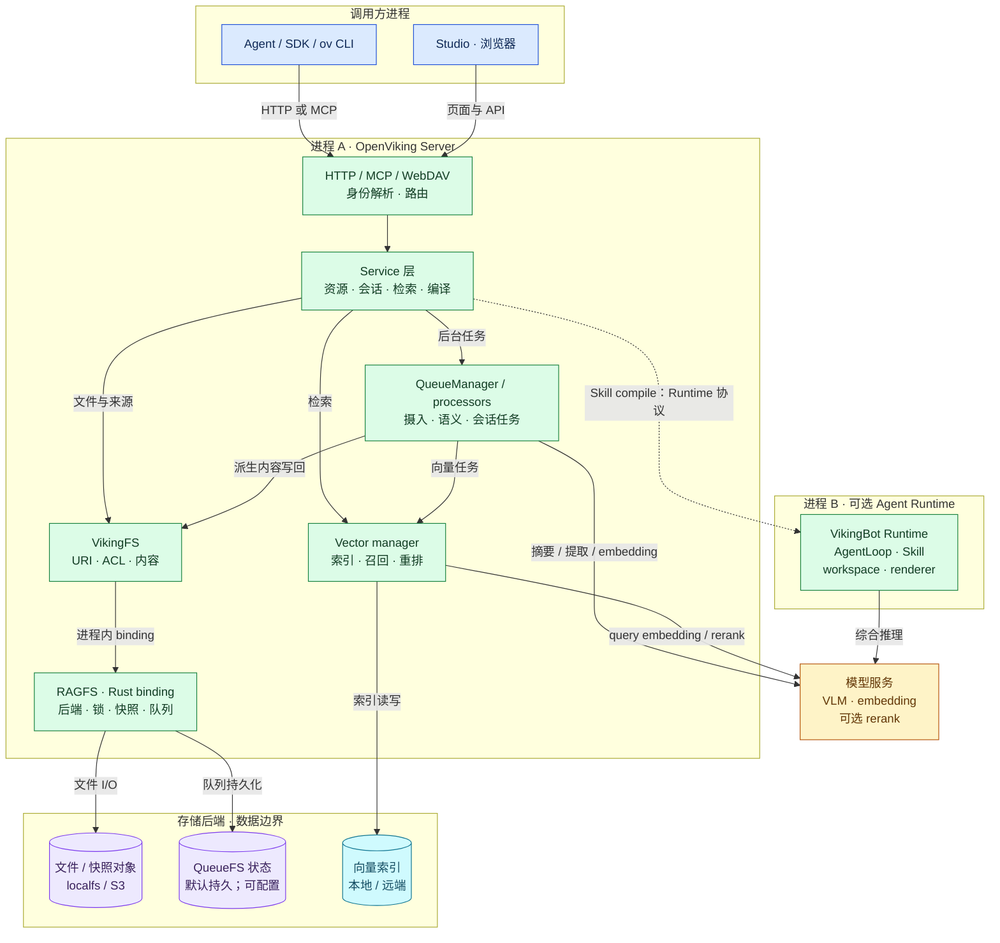
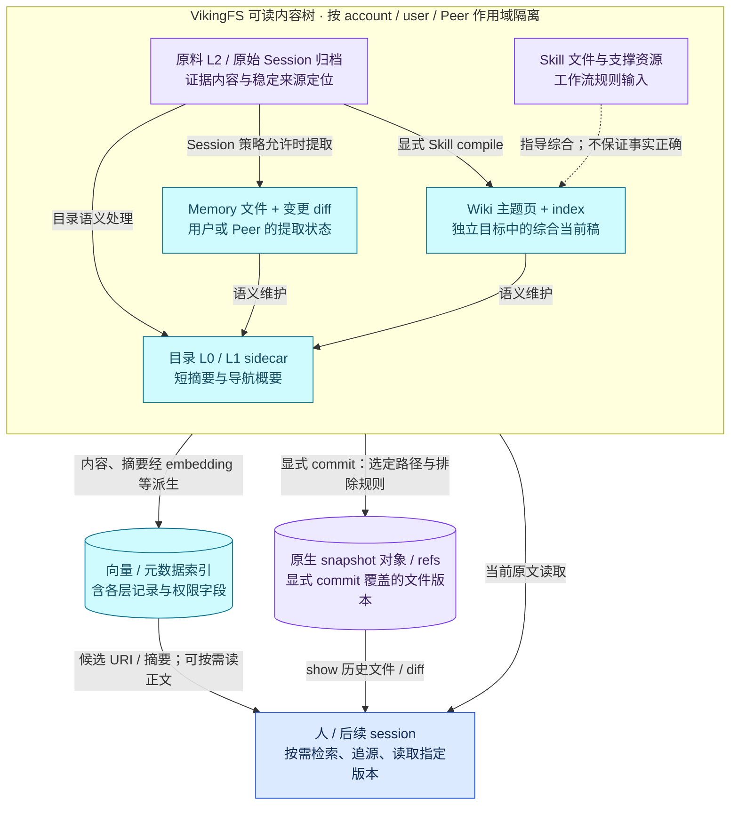
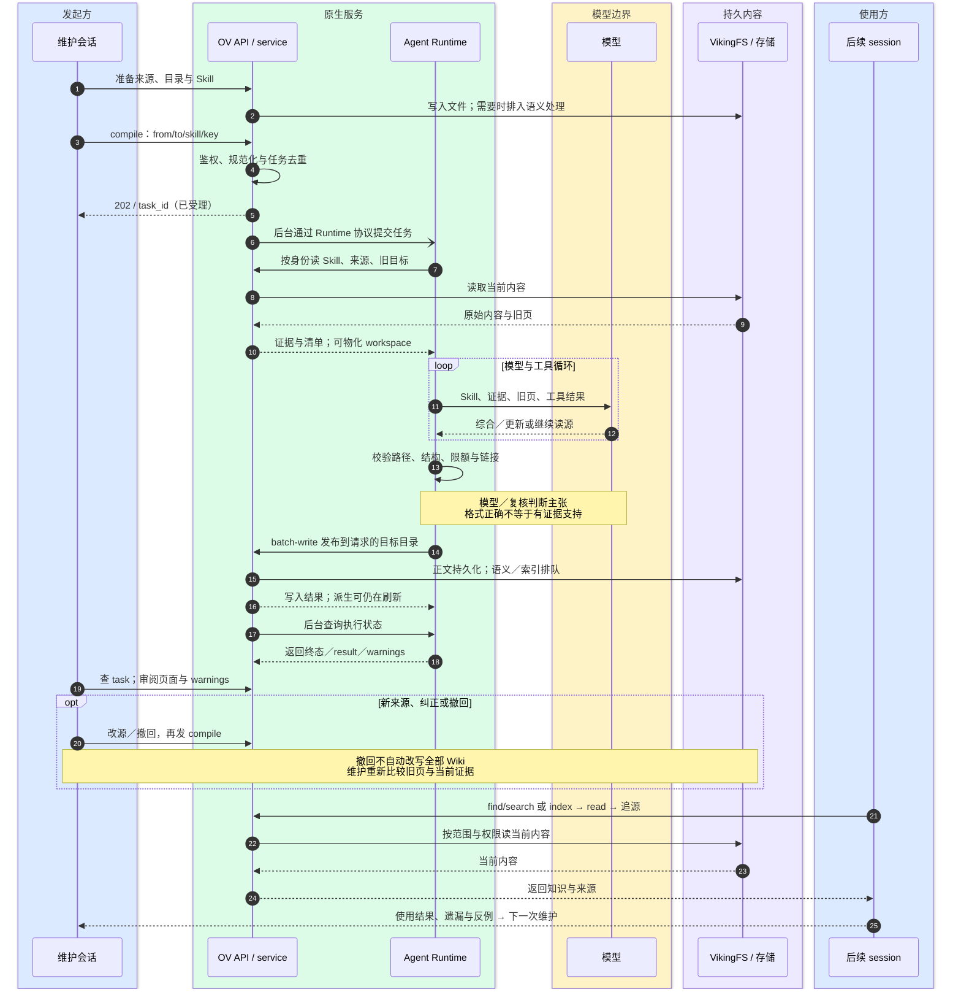
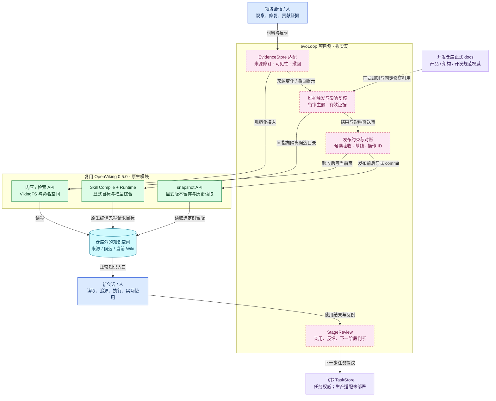

# OpenViking 0.5.0 架构：进程、数据与修订边界

> 状态：研究与接入提议，非 evoLoop 现行架构决定。2026-10-19。固定 `openviking[bot]==0.5.0` / `20f9c11362ad16193b0daa4a414e1095061af427`；本轮仅核源码与绘图，未启动 OpenViking 服务或模型实验。

**普通 API 通过 service、VikingFS 和存储即可读写；Skill 型 Wiki 编译另需 Agent Runtime。模型负责综合判断，运行时负责工具范围、结构校验和发布，存储负责保存；这三种责任不能互相代替。**

本页回答系统如何组成、哪些数据应被信任到什么程度、一次修订如何跨越组件，以及 evoLoop 应在哪一层接入或修改。功能清单、试验结果与有效性假设分别见[功能与机制](feature-workflows.md)、[验证结果](results.md)、[接入判断](integration.md)。evoLoop 的当前正式边界仍以[架构总览](../../architecture/overview.md)和[接口约定](../../architecture/contracts.md)为准。

## 统一图例与读图规则

| 颜色 | 含义 | 使用边界 |
| --- | --- | --- |
| 蓝色 `#dbeafe` | 人、业务会话、消费者或客户端 | 发起或使用，不表示某个业务角色已部署 |
| 绿色 `#dcfce7` | OpenViking 原生模块／协议 | 有固定版实现；不代表本轮逐项运行验收 |
| 黄色 `#fef3c7` | 模型推理／模型服务 | 摘要、抽取、综合与 embedding 等调用 |
| 紫色 `#ede9fe` | 原始内容、规则输入、版本对象或权威边界 | 文件持久化不自动使内容为真 |
| 青色 `#cffafe` | 派生且可持久的认识／检索表示 | Wiki、memory、摘要、索引的语义地位各不相同 |
| 粉色虚线框 `#fce7f3` | evoLoop 拟新增的治理／适配 | 尚未部署，也不是 0.5.0 原生保证 |

实线箭头标调用或数据派生；虚线表示可选依赖、规则输入或拟增加的约束，具体语义以箭头文字为准。流程框内写模块，进程框写进程；数据目录不画成守护进程。时序图用同色分组标参与方，异步箭头表示工作交给后台继续，不保证跨组件原子事务。

## 图一：系统分层与进程边界

图中采用此前实际使用的单 Server、本机独立 VikingBot Runtime 形态。一个框中多个模块并不表示多个服务；向量库和文件后端的远端选项另按配置决定。

**这张图的三个边界：**

1. **Server 内部是组合模块。**`app.py` 注册 REST、MCP、WebDAV 与 Studio 相关路由；`OpenVikingService` 组合文件、资源、检索、Session、Compile、队列与模型依赖。VikingFS 是 Python 抽象，RAGFS 是载入的 Rust binding；不能因为名字中有“FS”或目录路径就另画一个必需的存储服务。[Server 装配][server]、[service 装配][core]、[Rust binding 加载][binding]。
2. **Runtime 是条件依赖。**`--with-bot` 的 bootstrap 会另起 VikingBot 子进程，Server 配置本地 Runtime endpoint；也可配置远端 Runtime。Runtime 的读写经数据 API 回到 Server，具体回调在图三展开，图一省略这条长回边。普通内容 read/write、目录操作与检索不依赖 Bot。资源摘要、embedding、长期记忆本身仍可能调用模型；“无需 Bot”不等于“无需模型”。[启动与子进程][bootstrap]、[CompileService][compile-service]。
3. **队列与模型不是知识权威。**QueueManager 的处理器在服务内推进工作，QueueFS 后端保存生命周期状态；它不是独立业务任务系统。内容后端和向量后端分离，可出现正文已写而摘要／索引仍在刷新。memory 后端等非持久选项不能按图中的默认持久形态承诺恢复。[存储][storage]、[队列生命周期][queue]。

图中省略的是可选外围组件，而非不存在：OpenViking Gateway 是另一个模型 API 代理服务，可做召回／捕获；VikingBot Gateway 是 Bot 的交互服务，两者不能按同一个“gateway 进程”理解。媒体／飞书／外部 parser、OAuth 与多渠道也有独立配置要求。本页不把未运行的部署组合画成已验证拓扑。[Gateway][gateway]、[VikingBot][bot]。

## 图二：内容、认识、索引和快照的关系

这张图画**数据关系**，不画执行进程。青色对象可以落盘并被重复使用，却仍是模型或索引机制派生的状态。Wiki 当前稿是团队候选认识的读取入口，不自动升格为原始证据或正式产品决定。

| 数据 | 由谁产生／更新 | 应当承担的权威 | 不能从持久化推出什么 |
| --- | --- | --- | --- |
| 原料与原始归档 | 来源提供者、摄入器、Session append/commit | 记录来源实际说过／观察到什么；真实性还要核来源 | 原料不会被删改、外部链接永远可用；保留原料的 Skill 要求不是全局不可变存储 |
| Skill | 官方或调用方维护 | 本次模型工作的步骤、范围与约束 | 模型必然遵守、每条事实完整正确 |
| Memory | 策略／schema 下的模型提取与更新框架 | 用户／Peer 范围的可修订长期状态 | 已自动汇入共享 Wiki；读取某条经验就证明产生收益 |
| Wiki | 模型综合＋运行时发布，维护者再复核 | 来源支撑的当前认识与分歧 | 自动拥有逐主张 claim/evidence 账本、无遗漏或全局撤回传播 |
| L0/L1 | 语义处理生成的目录 sidecar | 定位与导航的短表示 | 与每个普通文件一一对应；等于跨来源综合 Wiki |
| 向量索引 | embedding、元数据与索引更新机制 | 可重建的检索表示 | 最新、完整、与内容在一个跨存储事务中提交 |
| snapshot | 显式 commit 保存选定文件树 | 已提交范围的历史字节与版本标识 | 普通 write 自动留版；历史 ACL／向量索引随文件回滚 |

**修订和恢复的准确位置：**固定版已有原生 snapshot，默认配置允许该功能，但每次版本仍需显式 commit。Rust 的枚举规则保留目录 L0/L1，排除运行范围、锁和向量索引等；另受 `.ovgitignore` 约束。restore 将所选版本写回当前工作树并产生前向恢复提交，需要时异步重建索引；它不把历史 ACL 恢复，也不提供普通页的读改写 CAS。[快照指南][snapshot-guide]、[快照实现][snapshot-code]、[枚举规则][snapshot-enumerate]。

**迁移包另有范围：**OVPack 保存当前支持内容与可选兼容 dense 向量，不包含原生 snapshot 历史、账号/API-key registry 或运行队列／锁等。若要求灾备，需单独设计内容、版本对象、身份配置和队列的一致检查点。此前通过的是人工停服冷备到新位置后读取／消费；原生受认证 OVPack 全链路与 snapshot 调用没有实测通过。[OVPack][ovpack]、[验证边界](results.md)。

## 图三：Wiki 初编译、增量修订和后续读取

时序用六个参与方拆出责任；图中的“后台”包括 OV 外部任务队列推进与 Runtime 自己的 AgentLoop，不是整个请求同步等待模型完成。持久内容写入经 OV API 回到 VikingFS，Runtime workspace 只是编译中间区。

- **谁思考：**模型按官方 llm-wiki Skill 做主题归并、旧页比较、证据取舍和分歧保留。Skill 明确维护 canonical pages 与 index；这是工作流要求，不是数据库强制的知识真值规则。[官方 Skill][wiki-skill]。
- **谁调度：**OV 保存自己的任务与提交身份，后台处理器向 Runtime 提交并同步状态；本地 Runtime 为 VikingBot 子进程。`compile --skill memory` 是另一个服务内记忆整理模式，不经过本图的 Bot 路径。[CompileService][compile-service]、[外部任务处理器][external-task]。
- **谁校验和写入：**Runtime 的 bundle／target-checkout 路径检查输出，renderer 可验证来源 ID、路径、格式并处理链接，然后经 API batch-write。不是让模型直接掌握底层文件后端；若启用 direct exec，sandbox 也不等于安全隔离。[编译执行与发布][runtime-code]、[renderer][renderer]。
- **何时异步：**compile 返回 ID 在前，模型和发布在后；发布正文后，派生摘要与索引可继续刷新。要同时检查任务 result／warnings 与关键内容，不能只看 completed；固定版有保存部分 workspace 结果的 salvage 路径。[任务 API][tasks]、[发布实现][runtime-code]。

这条路径已实际跑过原料和 Session 原始归档的 Wiki 编译、一次用户纠正、两种解释保留，以及来源删除后显式再编译。**默认页级并发保护没有通过**：同基线两次普通覆盖均成功、前一更新丢失。Runtime 的同目标锁和 Compile 提交去重，不能约束 Studio 或直接内容 API 的旁路写入。[实测结果](results.md)。

## 图四：evoLoop 接入与拟修改位置

粉色模块是项目侧拟增加的责任与适配，不是已存在的 harness，也不代表已经选定 OpenViking 为正式后端。当前应用技术栈未定；图按现行接口约定表达责任，不预设某种数据库或队列产品。

图中省略回到下一轮的长回边：采纳后的飞书任务再进入领域会话，正式规则变化由责任者另行修订 docs。这不另造任务状态或规范权威。

**候选目录是接入提议中的约束位置。**原生 compile 本身会写 `to` 指定的目标，并没有产品原生的“先语义审阅、再发布到当前 Wiki”审批阶段。若 evoLoop 要贡献与发布分开，可先令 compile 写隔离候选目录，检查差异和引用后再受控写当前目录；这需要项目适配与验收，不能在图中悄悄算作原生支持。引用重写、候选到当前的稳定标识、失败恢复也都待实现。

**这张图不是逐主张账本。**EvidenceStore 的来源修订状态、受影响页定位、主张类型和发布记录都是 evoLoop 合同需要的治理语义；两候选均尚未证实有持久逐主张 claim/evidence 账本。0.5.0 的 source_ids、Markdown 引用、Memory links/backlinks 和 snapshot 分别可复用，但拼在一起不自动等于完整证据图或来源撤回传播。

### 接入或改造应落在哪一层

| 修改目标 | 优先复用／接入位置 | 真要改上游时核对的模块 | 仍需补齐的保证 |
| --- | --- | --- | --- |
| 来源贡献与修订登记 | 项目 `EvidenceStore`／`KnowledgeRepository` 适配，调用资源／内容 API | ResourceService、内容路由、来源与记忆关系服务 | 稳定来源修订、观察／记录时间、撤回状态及可见范围；不是只覆盖同 URI |
| 维护触发与冲突复核 | 项目侧维护者选择有效来源、旧目标与 Skill，显式 submit compile | CompileService、Runtime 的来源清单／workspace 读取、官方 Skill | 自动触发时限、受影响内容发现、撤回后暂降级和复核；Skill 不替代状态存储 |
| 候选内容与发布验收 | 先编译到隔离目标；项目侧检查后串行发布 | Runtime renderer／发布路径、content batch-write、VikingFS 内容写入 | 路径、链接、基线与操作 ID 可核；多页发布和跨存储仍非原子事务 |
| 多维护者旧基线保护 | 0.5.0 试点只允许串行受控写入；回读＋快照辅助 | 服务端 batch-write 请求、VikingFS 写入、Runtime 最终发布 | 服务端真实条件写与冲突返回，且全部入口遵守；单机客户端锁可被绕过 |
| 可读修订与恢复 | 原生 snapshot、任务状态、内容读取；另核 OVPack | RAGFS git 模块、VikingFS snapshot、PackService | 每次何时 commit、恢复范围和身份配置；原生相关路径未实测通过 |
| 阶段学习与职责变化 | 项目 StageReview 连接实际产物、用户反馈、任务提议 | 通常不需改内容存储；可参考 Experience/trajectory 观测入口 | 知识被采用和改善行动的证据；不按 page 数、读次数或新角色数判成功 |

对应的上游修改点分别见[service 组合][core]、[内容路由][content-route]、[内容写入][content-write]、[编译执行][runtime-code]、[renderer][renderer]、[快照][snapshot-code]和[PackService][pack-code]。这些是可调查的代码落点，不代表现在必须 fork 或全面改造上游。

### 发布限制不能只写成一条箭头

即使增加粉色发布模块，Studio、普通 API、原生 compile 仍可能绕开它。只有实际限制写权限／入口并对旁路变化做对账，才能在限定部署范围内维持串行发布；0.5.0 不能据此对外承诺服务端 CAS。原生 snapshot 的 refs 并发控制也不等于 Wiki 页的旧内容条件写。

**版本注释，未混入四图：**当时另观察的 main `27db441230f451380d03084322d1fde31e4357cb` 已有 batch-write `expected_sha256` 和新版 compile finalize 冲突处理源码；未运行验证。若采用，应固定该提交或后续发行版重跑对应并发／重试案例，不把它计入 0.5.0 成绩。[main 内容接口](https://github.com/volcengine/OpenViking/blob/27db441230f451380d03084322d1fde31e4357cb/openviking/server/routers/content.py)、[main finalize](https://github.com/volcengine/OpenViking/blob/27db441230f451380d03084322d1fde31e4357cb/bot/vikingbot/compile/ops/finalize.py)。

## 证据强度与本页检查

| 项目 | 已有证据 | 没有因此成立的结论 |
| --- | --- | --- |
| 进程／模块装配 | 固定提交 bootstrap、app、service、binding 源码；此前 Server＋Bot 实际运行 | 所有多 worker、远端 Runtime 或 Gateway 组合均验收 |
| 编译与独立消费 | 三批真实编译、归档→Wiki、正常 API 新会话消费 | Wiki 总比原材料更完整／高效；原小样本反而未显示收益 |
| 用户纠正与撤回 | 一次纠正采用，删除源后显式再编译修订 | 任意来源自动失效、连续多轮维护质量已证实 |
| 并发／重试 | 普通同页覆盖失败；Compile 提交去重实测；有限适配另计 | 0.5.0 默认安全多维护者发布、跨实例永久 exactly-once |
| 版本／恢复 | snapshot 与 OVPack 源码已核；人工冷备恢复与再次消费实际通过 | 原生 snapshot／受认证 OVPack／历史 ACL 恢复通过 |
| 身份／权限 | 源码有 account/user/Peer、可选资源 ACL 与角色检查；见过权限拒绝 | 多租户、最小权限、撤权后检索／历史访问已安全验收 |

本轮只新增本研究页，未改共享站点清单。检查包括：

- 文档工具的 7 项测试通过；现有正式白名单的 `docs:check` 通过。
- 在独立临时白名单中加入本页，用同一工具完成 31 页检查与 HTML 构建；四个 Mermaid 块在本地打包的 Mermaid 12.2.0、strict 安全配置下均生成完整 SVG。浏览器实际查看四图，压短标签、去掉接入图长回边，并检查横向滚动与原字号显示。
- 本页站内相对链接、固定源码路径、私有地址和凭据样式扫描、Git 空白检查通过；原生权限／并发／恢复的证据边界与上表一致。

临时构建、截图和检查记录留在 gitignored 的本地检查目录，不作为公开日志链接。Node 无 DOM 的直接 parse 尝试遇到环境依赖，未把它记作语法通过；语法与布局结论采用实际浏览器离线渲染。本页没有新增产品运行实验、远程 CI 或发布结果；正式导航由主会话统一集成。

[server]: https://github.com/volcengine/OpenViking/blob/20f9c11362ad16193b0daa4a414e1095061af427/openviking/server/app.py
[core]: https://github.com/volcengine/OpenViking/blob/20f9c11362ad16193b0daa4a414e1095061af427/openviking/service/core.py
[binding]: https://github.com/volcengine/OpenViking/blob/20f9c11362ad16193b0daa4a414e1095061af427/openviking/pyagfs/__init__.py
[bootstrap]: https://github.com/volcengine/OpenViking/blob/20f9c11362ad16193b0daa4a414e1095061af427/openviking/server/bootstrap.py
[compile-service]: https://github.com/volcengine/OpenViking/blob/20f9c11362ad16193b0daa4a414e1095061af427/openviking/service/compile_service.py
[storage]: https://github.com/volcengine/OpenViking/blob/20f9c11362ad16193b0daa4a414e1095061af427/docs/en/concepts/05-storage.md
[queue]: https://github.com/volcengine/OpenViking/blob/20f9c11362ad16193b0daa4a414e1095061af427/docs/en/concepts/16-queue-lifecycle.md
[gateway]: https://github.com/volcengine/OpenViking/blob/20f9c11362ad16193b0daa4a414e1095061af427/docs/en/guides/15-gateway.md
[bot]: https://github.com/volcengine/OpenViking/blob/20f9c11362ad16193b0daa4a414e1095061af427/docs/en/concepts/15-vikingbot.md
[snapshot-guide]: https://github.com/volcengine/OpenViking/blob/20f9c11362ad16193b0daa4a414e1095061af427/docs/en/guides/15-snapshot.md
[snapshot-code]: https://github.com/volcengine/OpenViking/blob/20f9c11362ad16193b0daa4a414e1095061af427/openviking/storage/viking_fs/_snapshot.py
[snapshot-enumerate]: https://github.com/volcengine/OpenViking/blob/20f9c11362ad16193b0daa4a414e1095061af427/crates/ragfs/src/git/enumerate.rs
[ovpack]: https://github.com/volcengine/OpenViking/blob/20f9c11362ad16193b0daa4a414e1095061af427/docs/en/guides/09-ovpack.md
[wiki-skill]: https://github.com/volcengine/OpenViking/blob/20f9c11362ad16193b0daa4a414e1095061af427/examples/compile/ov-compile-skills/llm-wiki/SKILL.md
[external-task]: https://github.com/volcengine/OpenViking/blob/20f9c11362ad16193b0daa4a414e1095061af427/openviking/storage/queuefs/external_task_processor.py
[runtime-code]: https://github.com/volcengine/OpenViking/blob/20f9c11362ad16193b0daa4a414e1095061af427/bot/vikingbot/compile/service.py
[renderer]: https://github.com/volcengine/OpenViking/blob/20f9c11362ad16193b0daa4a414e1095061af427/bot/vikingbot/compile/renderer.py
[tasks]: https://github.com/volcengine/OpenViking/blob/20f9c11362ad16193b0daa4a414e1095061af427/docs/en/api/17-tasks.md
[content-route]: https://github.com/volcengine/OpenViking/blob/20f9c11362ad16193b0daa4a414e1095061af427/openviking/server/routers/content.py
[content-write]: https://github.com/volcengine/OpenViking/blob/20f9c11362ad16193b0daa4a414e1095061af427/openviking/storage/content_write.py
[pack-code]: https://github.com/volcengine/OpenViking/blob/20f9c11362ad16193b0daa4a414e1095061af427/openviking/service/pack_service.py
