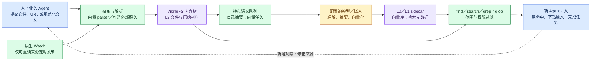
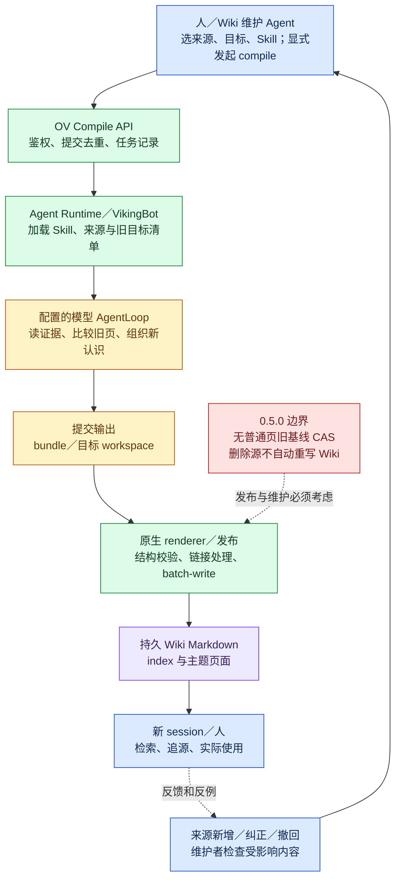
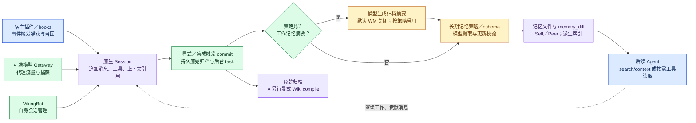

# OpenViking 0.5.0：主要功能与完整工作流程

> 状态：研究记录，非正式选型；公开整理版 2026-10-19；原始运行证据外置未发布；未重新运行实验。阶段：固定版功能核查与后续可证伪测试设计。

2026-10-19。固定版本：`openviking[bot]==0.5.0`，提交 **`20f9c11362ad16193b0daa4a414e1095061af427`**。本次补查实际外置 checkout 的 HEAD 与该提交一致；下列上游链接全部固定到该提交，不用浮动 main 代替发行版。

**OpenViking 在这个版本已经是资源、记忆、Skill、会话、检索、Agent 执行和运维接口组成的服务。它也确实有显式的 Wiki 编译器：调用方指定来源、目标与 Skill，由 Agent Runtime 调用模型整理，再由运行时写回持久文件。自动目录摘要、长期记忆提取和 Wiki 编译是三条不同路径。**

本报告补齐产品范围，不重新判定两候选胜负，也没有重启服务、调用付费模型或改写原实验结果。实测结论见[验证结果](results.md)；当时的[计划](plan.md)、[接入判断](integration.md)、[共同协议](../wiki-validation-protocol-20261019.md)及[跨候选验证摘要](../../references/validation-summary.md)可帮助区分观察、后续核查与建议。

## 证据口径

- **原生机制**：固定版代码提供的存储、鉴权、协议、任务、校验与执行接口。源码存在和本机实际通过分开记录。
- **官方 Skill／模型行为**：模型按 Skill 生成结论、整理冲突、引用、选择页面；语义正确性需要验证。提示词写了“保留事实”不等于数据库保证不会漏掉事实。
- **新增适配**：本实验的输入转换、证据封装和唯一写入保护试验。不能回填为产品原生能力。
- **手动动作**：实验者导入、触发 compile、审阅、停服冷备、操作 Studio；不能写成人类用户已经满意。

下文“已实测”仅指此前本 session 的隔离运行；“源码已核／未实测”表示有对应文档、入口或实现，但没有完成运行验收。共同输入只有八条需求重建合成材料，不能推断真实历史规模表现。

## 功能全景

| 功能域 | 0.5.0 已提供的主要能力 | 本 session 的证据边界 |
| --- | --- | --- |
| 输入与摄入 | 本地文件／目录上传、URL、代码仓库、网页／站点／feed、飞书、文档与媒体解析、Connector／外部解析可选路径、资源 Watch | 实测 Markdown 来源写入和批量写入；其余以固定源码为证 |
| 文件系统与上下文层 | Viking URI、资源／用户／Peer／共享 Skill 命名空间、内容与向量分离、L0／L1／L2、文件操作、标签、重建索引 | 读写、目录、摘要、原文、删除、持久化已跑；并非每种后端已跑 |
| 检索与上下文组装 | find、带会话的 search、可选意图规划／rerank、范围／权限过滤、grep／glob、context 模式 | find 和正常目录／原文消费已跑；复杂规划、rerank、context 注入质量未测 |
| Session 与记忆 | 消息／工具／图像／上下文引用、归档、异步提取、记忆类型／策略、审计 diff、Self／Peer、记忆合并 | session→原始归档→Wiki 已跑；当时特意关闭记忆提取和工作记忆，未测其质量 |
| Skills | 导入、私有／账号共享范围、语义发现、按需加载、支撑文件、隐私配置版本 | 原样官方 llm-wiki Skill 注册、读取和编译已跑；隐私提取未测 |
| Context Compile | 真实持久 Wiki、图谱、日报、知识蒸馏等 Skill；另有不经 Bot 的 memory consolidation | Wiki 三批和归档会话编译已跑；其他 Skill 与 memory 模式未跑 |
| Studio 与 VikingBot | 文件预览／编辑、会话、Skill、Compile 管理；AgentLoop、工具、模型、渠道、sandbox、定时任务 | Studio 树／阅读／测试页编辑、Bot compile 已跑；渠道聊天、自动化未跑 |
| 集成协议 | REST、Python／TypeScript／Go SDK、Rust ov CLI、原生 HTTP MCP、插件／hooks、WebDAV 子集 | 主要使用 REST；未对所有 SDK／MCP／hooks 做端到端验收 |
| 来源、历史与一致性 | 来源引用与 renderer 校验、显式 snapshot commit/log/show/diff/restore、路径锁、任务去重 | 引用与变化已跑；快照源码已核但未调用；0.5.0 普通同页覆盖实测丢更新 |
| 撤回与维护 | 删除文件和关联索引、记忆引用清理路径、显式重新编译／重索引 | 删除源不自动修订资源 Wiki；再次 compile 实测修订，不能推广为自动撤回传播 |
| 身份、权限与隔离 | account／user／peer、ROOT／ADMIN／USER、API key／trusted、可选 OAuth、资源 ACL／组、隐私、文件加密 | 本机 dev 主流程、权限拒绝已见；多租户、ACL、OAuth、加密未做安全验收 |
| 任务、运行与恢复 | 异步任务、取消／状态／事件、队列恢复、Observer／Prometheus、OVPack、快照、存储副本、模型网关 | 任务轮询／提交去重、冷备恢复已跑；OVPack 权限阻塞，其余未完整跑 |

## 1. 输入、解析、资源更新

**谁启动：** 人、业务 Agent、SDK 客户端或定时 Watch。`add_resource` 负责获取与解析，`content/write` 则适合已经规范化的内容；两者不能混为同一个解析测试。

固定版有文本／Markdown、PDF、HTML、Office／EPUB（统一 AnyDoc 路径）、ZIP、目录、图片、音频和视频解析器；accessor 层处理本地、HTTP、Git、飞书、网页及 web feed。代码仓库和目录扫描支持过滤、`.gitignore` 与结构保留。外部 Understanding parser 和 Connector 是可选路径，有各自凭据、目标和异步限制；不是所有格式都只靠本地开源解析完成。[资源 API][resources]、[parser 注册实现][parsers]。

网页默认导入入口页，递归深度、页数和路径筛选需要显式参数；sitemap／RSS／Atom 可以作为站点摄入入口。飞书包含文档、wiki、表格、多维表格、思维笔记及目录类入口，但需对应访问凭据／权限。**能把飞书内容摄入为知识，并不等于已经实现 evoLoop 的飞书任务协作。**[资源 API][resources]。

媒体“可以导入原文件”与“模型理解媒体内容”分开：音视频理解默认关闭，启用需要兼容模型与配置；不是内置 Whisper 转录或本地关键帧流水线。[资源 API][resources]。

**自动刷新：** `watch_interval` 给可再次读取的远端来源创建 Watch，支持查看、暂停、恢复、触发和删除。通过上传得到的 `temp_file_id` 是静态快照；Python HTTP SDK 上传的本地文件／目录不能据此宣称实时监听本地变化。Watch 重摄入也不自动等于刷新独立目标 Wiki。[Watch API][watches]、[Watch 实现][watch-code]。

**声明式资产：** `openviking-assets/1` 支持 Manifest／Catalog 解析、Git 访问预检与规范化计划，供 CLI／自定义客户端执行；Resolver 本身不克隆仓库、不写资源、不启动同步任务。[Assets API][assets]。

已实测范围是八条材料转换为固定 Markdown，经原生 write／batch-write 按批次进入实例；没有拿这八条测试冒充 PDF、飞书或网站摄入验证。

## 2. VikingFS、L0／L1／L2 与检索

VikingFS 用 `viking://` 组织内容：账号共享资源在 `resources`；用户资源、会话、记忆和私有 Skill 在 `user/{user_id}`；Peer 是该用户下进一步的隔离范围；账号共享 Skill 可放 `agent/skills`。底层存储增加 account 前缀，表面相同 URI 不表示跨账号共享。[上下文类型][types]、[URI][uri]、[多租户][tenant]。

文件正文与语义 sidecar 由 RAGFS／AGFS 保存，向量库保存 URI、向量、摘要和检索元数据。文件读写与向量检索因此不是同一份物理数据。文件后端包括 localfs／S3-compatible／memory；向量后端包括 local／HTTP／Volcengine，部署选项不等于已经逐项跑过。文件操作含 ls／tree／stat、mkdir／rm／mv、read／download、write／edit、标签、grep／glob 和 reindex；普通文本写入有 create／replace／append／upsert 等模式，batch-write 用于合并刷新。[文件 API][fs]、[内容 API][content]、[存储][storage]。

- **L0**：目录 `.abstract.md`，默认生成正文预算为 256 **字符**。
- **L1**：目录 `.overview.md`，默认生成正文预算为 4,000 **字符**，用于更详细的导航。
- **L2**：实际文件与子目录，按需读取。

L0／L1 是目录 sidecar，不为每一个普通文件都额外创建同名层级；文件理解结果可汇入父目录概要。刚创建的目录可能只有 L0。自动摘要用于组织与检索，不能把它叫作跨来源 Wiki 已编译。[上下文分层][layers]。

图中一般资源路径并非所有输入都经过同一 parser；规范化内容写入可直接落盘。正文先成功而派生摘要／向量稍后完成，是实际会出现的中间状态。

**检索实现的重要细节：** 固定版 `HierarchicalRetriever` 虽保留这个名字，文档和实现描述的是每个查询做一次**全局向量召回**，不是从根目录一层层递归下降。L0／L1／L2 和目录范围仍有用，但不能据名字宣称一定采用树状搜索算法。[检索机制][retrieval]、[检索实现][retriever-code]。

`find` 不做会话意图分析；`search` 可利用会话摘要／最近消息，由模型规划 typed queries，可选 rerank；rerank 是召回后的重排，不会再发起一轮目录搜索。`search(mode="context")` 还可组装可注入上下文，带预算／会话去重等机制；旧 recall API 是兼容预设。还提供 BM25 keywords 路径，但需要带全文索引的远端 VikingDB，不应写成本地默认可用；事件记忆可按标签选择时间衰减，不能简单把“更新较新”当成事实更真。结果仍需消费者判断，调用成功不等于答案正确。[检索 API][search-api]。

本轮实际用 find 找到当前规则页，也让独立消费者经目录／内容 API 交付阶段方案；未验证意图规划、rerank 或 context 模式的质量及成本。独立 Wiki 消费没有显示优于直接读八条材料，漏写 Markdown 许可的首次产物仍保留。

## 3. Session、长期记忆与经验

**显式 Session 路径：** 先创建 session，再追加消息；消息可包含文本、图像、工具输入输出和上下文引用。commit 第一阶段保存原始归档并返回 task，后续由队列做允许的摘要与长期记忆提取，产生 `memory_diff.json`。它能记录记忆增加、修改、删除及跳过的操作，便于审计。[Session][session]、[Memory API][memory]。

这里有一个容易误读的默认值：** 0.5.0 的 working memory 默认关闭**。commit 仍保存原始消息并按长期记忆策略提取，不能从“提交成功”推断已经生成归档 overview／压缩摘要。Bot 的会话管理、部分接管型集成可以显式请求 WM；一般客户端需要检查实际生效策略。[WM 默认关闭说明][wm]。这也解释了本实验在禁用 WM 后仍能把 `messages.jsonl` 交给 Wiki compile：编译消费的是归档原文，不依赖伪造出来的记忆提取结果。

内置类型包括 profile、preferences、entities、events、identity、soul，以及 case／trajectory／experience；tools、skills 这两类**记忆 schema**默认禁用，不能与独立 `SKILL.md` 功能混淆。策略、类型模板、用户／会话选择和 Self／Peer 范围共同影响能提取什么；不保证每次 commit 都增加记忆。[上下文类型][types]、[记忆 API][memory]。

还有两项此前没有跑过的能力：

1. `compile --skill memory --to .../memories` 是**服务内原地整理**，不经 VikingBot，也不接受 `--from`；使用记忆框架去重、合并、拆分、压缩并维护部分链接。事实保留仍依赖模型与校验，应检查 changes／errors，不能照抄文档保证语义无损。[Memory Consolidation][consolidation]、[Compile service][compile-service]。
2. Agent Evolution 可以查某条 Experience 被读取后关联的 trajectories 及结果分布。**被读取不是已遵循，更不是产生收益的因果证明**。它提供后续评价的数据入口，没有自动解决 evoLoop 如何判断应新增角色。[Agent Evolution API][evolution]。

## 4. Skill 与真正的 Wiki 编译

Skill 是带元数据的 `SKILL.md` 及支撑文件，可导入、检索、按需读入模型上下文。默认私有目录与账号共享 `agent/skills` 都有原生入口；把 Skill 装进隔离 OpenViking 实例，不等于往 Codex 全局技能目录安装。[Skills API][skills]。

**谁启动：** 调用方显式 `POST /api/v1/compile`／`ov compile`，或通过 Studio 的 Compile 表单。普通摄入不会自动触发任意 Wiki 维护。请求包含 `from`（一个或多个来源）、`to`（输出目录）、`skill` 和可选 instruction；OV 拥有异步任务，配置的 Agent Runtime 执行。内置可用 VikingBot，也有远端 Runtime 协议。[编译总览][compile]、[Runtime API][runtime]。

**谁推理：** VikingBot 的专用 AgentLoop 加载 Skill、来源与目标目录清单，按预算读取／可选物化到 workspace；模型决定主题、页面、合并、引用与改写。编译工具集对 OpenViking 读取范围做约束，在 workspace 提供文件／可选 exec 工具，最后提交 bundle 或目标 checkout。`direct` sandbox 不能因名称带 sandbox 就被当成强隔离。[编译实现][bot-compile]、[VikingBot][bot]。

**谁写入：** 运行时验证目标、路径、输出结构和限额，渲染／整理 bundle 后调用原生 batch-write；不是实验者手工写入知识答案。结构化 bundle 路径验证有效 `source_ids`，可补来源链接、生成页面链接；目标 checkout 路径还有自己的格式处理。**路径和链接有效不证明主张确实被来源支持，也不是完整主张级反向依赖。**[renderer][renderer]。

**谁维护：** 官方 llm-wiki Skill 要求先读旧 index 和目录，再按稳定主题更新 canonical pages，保留来源、分歧和知识变化，维护 index；默认 entity／concept，按用途选择 method／comparison／analysis；只有 instruction 明确要求才做 source summary。它是可替换、可修改的官方工作流，产品并不把页面类型和事实可信度变成不可违反的数据库约束。[Wiki 示例][wiki]、[官方 Skill][wiki-skill]。

该图是此前实际跑通的主路径。DeepSeek 首轮三批得到 16 页；重新用原生 CodexVLM 的 GPT-6 Sol／medium 三批得到 5 页，均包含纠正采用和争议保留。不同页数不能当效果分数。归档 Session→5 页 Wiki 也有独立运行证据。后续新会话确实通过普通入口使用这些知识，消费者产物与限制见原报告。

编译不限 Wiki：固定仓库还附 knowledge graph、daily report、knowledge distillation 等 Skill，以及 Wiki／图谱 HTML 可视化脚本。这些是**官方示例工作流与脚本**，不意味着存储引擎已经是支持任意图查询的图数据库；本轮没有运行这些例子。[编译总览][compile]。

## 5. Studio、VikingBot、模型网关是不同组件

**Studio** 是服务的 Web 管理／阅读界面：文件系统浏览、正文预览与编辑；还有会话、Skill、Compile 列表／新建／详情／取消／打开目标、设置和 Gateway 管理等页面。此前只实际走了文件树、知识页与相对链接、测试副本保存；原生来源绝对 `viking://` 链接在当时预览里 href 为空，API 来源却可读，问题在 UI 追溯路径。不能把这个局部问题写成产品完全没有引用功能。[Compile UI 文档][compile]、[Studio routes][studio]。

**VikingBot** 是 Agent runtime：CLI／HTTP／多渠道消息进入同一个 AgentLoop，调模型、执行工具、持久会话并回复。源码还提供外部 MCP 工具、subagent、Direct／SRT／OpenSandbox／AIO 后端、Cron／Heartbeat、反馈和可观测性。渠道覆盖飞书、Slack、Telegram、Discord 等；需要各自配置和凭据。本轮只用了编译运行时，没有验证任一实际平台收发，也未启用 Bot 的自动任务。[VikingBot][bot]、[Bot API][bot-api]。

**OpenViking Gateway** 是另外的模型 API 代理：客户端可改 base URL 时，Gateway 在新消息前检索上下文、可向上游模型提供 OV 工具并自己执行、保存会话和做压缩。支持 Anthropic Messages、OpenAI Chat Completions／完整历史的 Responses 形态，管理 upstream、context profile、gateway key 和日志；管理接口由 OV Server 代理，但模型流量走 Gateway 自己端口。它不是 Wiki Compile，也不是普通 MCP 连接。[Gateway guide][gateway]、[Gateway API][gateway-api]。

**新增配置核对：** 0.5.0 的 Codex Responses adapter 实际构造请求时转发 model／reasoning effort，却未将传入的 temperature、max_tokens／max_completion_tokens 映射到 Responses 请求。此前“温度0、上限12000”是配置层记录，不能作为生成端已生效的采样／输出限制；medium 有实际对象与转发源码支持。此差异不推翻真实产物，但进一步限制了严格模型对齐的说法。[Codex adapter][codex-adapter]。

不能从“我们用 CodexVLM 复用现有订阅成功”推出“所有订阅客户端都能把模型 base URL 改成 Gateway”。它们是不同认证与接入路径；本轮没有运行 Gateway。

## 6. REST、SDK、CLI、MCP 与宿主集成

| 入口 | 使用方式与责任 | 不能省略的边界 |
| --- | --- | --- |
| REST | 自定义业务系统直接调用资源、文件、Session、检索、Compile、任务和管理接口 | 调用方负责身份、轮询、重试与结果审阅 |
| Python／TypeScript／Go SDK | 封装 HTTP 数据操作；功能以各 SDK 实际覆盖为准 | 不能推断所有 SDK 对所有路由都有包装；Bot 交互文档明确以 HTTP／CLI 为主 |
| `ov` CLI | Rust 命令行，资源／文件／检索／Session／compile／任务／快照／打包等显式操作 | 单独运行 CLI 不会自动抓取宿主对话 |
| 原生 MCP `/mcp` | 同服务端口的 Streamable HTTP；20 个注册工具覆盖 find/search/read/list/tree/grep/glob、remember/write/edit、add_resource/add_skill、forget、Watch、用户／组／ACL 和 health | **没有把全部 REST 管理接口都暴露为 MCP 工具；固定工具表没有 compile、snapshot、OVPack 工具**，需要 REST／CLI／自行包装 |
| 宿主插件／hooks | 在 prompt 前召回、session 起始注入、捕获消息、达到阈值或退出时 commit | 各宿主事件、阈值、退出预算不同；“连上 MCP”只获得可调用工具，不自动获得全部生命周期行为 |
| WebDAV | `/webdav/resources` 提供文件协议子集，外部编辑器可读写资源 | 仅 resources；PUT 是 UTF-8 文本；内部 sidecar 隐藏；不是任意命名空间、二进制和全套 WebDAV 协议支持 |

源码入口包括 Server 路由注册、MCP 工具注册和三种 SDK。MCP 可接 API key 或可选 OAuth 2.1（DCR／PKCE 等）；配置存在并不代表本实验已经装了全局 MCP 或完成远程 OAuth。[API 总览][api]、[SDK][sdk]、[MCP 实现][mcp-code]、[MCP guide][mcp]、[集成能力说明][integrations]、[WebDAV][webdav]。

图中长期记忆提取也可被策略关闭；WM 关闭不等于长期记忆关闭。三种捕获入口是可选集成，不是必须叠加；重复配置会引入捕获／召回重复。普通 MCP 客户端可按需 read／remember，但自动捕获要由宿主集成或显式 Session API 提供。

## 7. 来源、修订、并发、撤回：各自解决什么

| 机制 | 0.5.0 能保证／提供什么 | 没有据此成立的保证 |
| --- | --- | --- |
| Wiki Skill 的引用／冲突规则 | 指导模型按证据写、维护旧页、保留不确定性；本样本实际做到部分目标 | 每条事实完整、引用蕴含主张、所有冲突自动处理 |
| renderer 的结构／路径／链接校验 | 有源 ID、目标目录、更新目录清单和限额等校验；资源输出补引用与页间链接 | 所有输出路径都实现同一结构化主张表；自动反向依赖失效传播 |
| Memory links／backlinks／version、memory_diff | 记忆框架有自己的关联、版本字段和变更审计 | 普通资源 Wiki 每次写入都会自动成为可回读的历史版本 |
| 原生 snapshot | 显式 commit 保存树；log／show／diff 读历史；restore 写回并形成新 commit；可限定 URI／目录与 ignore 规则 | 不调用 commit 的内容也能恢复；快照版本化 ACL／向量库；默认 compile 自动 commit |
| 路径锁／持久队列 | 协调参与该协议的当前操作，推进语义／Session 等后台处理 | 旧页读取到最终覆盖之间的语义 CAS；跨内容／索引的通用回滚事务 |
| Compile Idempotency-Key | 同调用者、同 key、同参数恢复同任务；改参数返回 409，本轮已跑 | 页级旧基线保护、永久 exactly-once、任意实例间永久去重 |
| 来源 rm | 删除源与相关索引，部分记忆清理有专门机制 | 删除任意资源来源就自动改写所有 Wiki 主张或把另一解释判真 |

**快照是本次重要补充。**0.5.0 已有 gitoxide／RAGFS 原生 snapshot API 和 SDK／CLI，能读取某版本的文件。restore 是在当前 HEAD 上做新的恢复提交，保留历史；不是强制重置过去。ACL 按当前权限检查，ACL／向量库本身不版本化，恢复可触发索引重建。此前只是没有实测／没有证明自动留版，不能将其简化为“产品无历史”。本轮只核实现，未新增快照实验。[Snapshot API][snapshot]、[实现][snapshot-code]。

**并发缺口仍然成立。**0.5.0 `write replace` 两个写者同基线分别写，均成功且前者丢失；正确 `/content/batch-write` 接口拒绝 `expected_sha256`。Compile 自身有同目标锁和提交去重，不会自动约束 Studio 或另一写入通道。版本历史可帮助恢复，也不能代替旧基线检查。[内容路由][content-code]、[事务边界][transaction]。

**撤回实测：** 在恢复副本删除 S05 后，相关 Wiki 页立即不变，返回的 memory cleanup 未发现该资源 Wiki 的引用；再次显式 compile 后七页变化，S05 精确引用消失，没有把 S06 判真。这证明“人工识别候选页＋官方工作流维护”能工作，未证明自动主张失效传播。记忆框架的 links／backlinks 与资源 Wiki 引用不是可以任意互换的能力。

唯一额外适配 `guarded_write.py` 是单机项目锁、hash 基线、快照和 operation_id；实测保护只对经过它的写者生效。它可被 Studio／直接 API／原生 compile 绕过，仍不构成服务端保证。[原实验与限制](results.md)。

## 8. 权限、多租户、隐私与加密

固定版具有 account 隔离、用户私有空间、用户内 Peer 隔离、账号共享资源／Skill。API-key 模式的 root key 主要管理账号／用户；租户数据操作需要合适的 user／admin 身份。trusted 模式依赖可信上游注入身份；dev 模式只适用于本机。这些不是“因为跑过 localhost 就已经验收”的安全结论。[多租户][tenant]、[认证][auth]。

**ACL 原生存在，但默认未启用。**它适用于 `viking://resources` 的目录／文件，以 user／group／账号 wildcard 为 principal，read／write／manage 继承，并支持 restricted 边界。共享根默认 `user:* = manage`；启用开关本身不自动把项目变成最小权限，需实际配置目录边界。私有用户资源不能通过该 ACL 直接变为共享；通常需移动到共享空间。检索与文件操作均有对应权限过滤路径。[ACL][acl]、[ACL API][acl-api]。

Skill privacy extraction／restore 是独立配置能力：写入时抽取敏感值为占位符、读取时按当前私有配置恢复；配置有版本／激活记录。它不代表通用密钥保险箱，也不会在外部服务轮换／撤销凭据。[隐私配置][privacy]。

文件后端可配置透明 AES-256-GCM 加密及账号派生密钥，provider 有本地／Vault／云 KMS 路径。它不自动加密独立向量库、日志、导出的 OVPack 或所有副本，也不会自动重写已存在的明文文件。以上本轮均未启用或做安全验收。[加密][encryption]。

## 9. 异步任务、运维、快照与备份恢复

任务 API 覆盖摄入、Session commit、reindex、restore、compile 等，支持状态／列表／事件／取消。提交返回 task ID 只是 accepted；轮询停止不等于取消。队列 pending 与 processing 都为零才叫当前无未确认消息，队列空也不等于所有历史操作成功。持久化后端支持重启恢复；memory 队列不支持跨进程恢复。[Tasks][tasks]、[队列生命周期][queue]。

Compile 的 `completed` 还应查看 result／warnings／页数与产物：固定源码有预算／迭代终止时保存 workspace 部分输出的 salvage 路径，不能用绿色终态代替知识验收。普通输出发布与派生刷新也应分开看。[编译实现][bot-compile]。

Observer 提供 queue、vector DB、model、lock、retrieval、filesystem、system 等运行状态，另有 `/metrics`、统计与日志接口；VikingBot 还有 token／工具／反馈及可选追踪。它们提供排错与预算观测入口，未证明已具备 evoLoop 的业务阶段验收和角色治理。[Observer][observer]、[Metrics][metrics]。

三种原生恢复／复制功能需要分开：

1. **Snapshot**：服务内选定树的版本管理与恢复；不是完整灾备。
2. **OVPack**：export／import 单根内容，backup／restore 账号资源与用户内容；有 manifest／checksum 和可选纯 dense 向量快照、冲突／向量兼容策略。账号／API-key registry、运行队列／锁／watch 控制文件／`.relations.json` 不在其迁移范围；不能推断单独的账号共享 `agent/skills` 已包含在只列 resources／user 的全量包中。导出是解密后的普通包，要单独保护。向量可重算，不能把任何索引都称为原样复制。[OVPack][ovpack]、[Pack 实现][pack-code]。
3. **Multi-write**：一个 primary 加多个备份后端，可同步／异步复制、读路由、redirect／exclude。它不是“多个 Agent 同时改一页”的并发合并。历史数据不自动回填；同步确认失败时 primary 可能已写入；没有自动提升副本为主的承诺。[多写存储][multiwrite]。

本轮实测的是**停服冷备整个 data 到新位置再启动**：16 页＋8 来源逐字一致、归档与已存 Skill 保留，再由一个无历史消费者完成 T1。它比 OVPack 内容迁移的范围更宽，是实验者手动运维动作。原生 OVPack 在 dev／仅 root 配置的试验遇到 403，提示应使用租户 user／admin，未完成该路径；**权限阻塞不等于产品没有备份能力**。此补查不重新申请／创建凭据、不重跑导出。

## 10. 前次没测到、但固定产品已提供的能力

以下均应进入候选功能比较，状态写“原生／官方已有，未运行验收”，不能留空或划为缺失：

| 补充能力 | 对 evoLoop 的潜在用途 | 仍需验证的实际问题 |
| --- | --- | --- |
| 原生 snapshot commit/log/show/diff/restore | 维护前后留版、指定版本引用、纠错回看 | 哪些阶段自动 commit；权限、删除、恢复和索引重建的一致性 |
| ACL、组、多租户／Peer、OAuth | 区分项目、领域会话、人和外部客户 | 默认共享根过宽，实际最小权限与泄露测试未做 |
| Session 长期记忆与 memory consolidation | 从持续工作积累偏好、事件、经验，再清理冗余 | 与共享 Wiki 的权威边界、提取质量、撤回和成本 |
| Experience→trajectory／outcome 查询 | 为“认识被使用后有什么结果”提供观测线索 | 阅读不等于采用；业务成效和归因仍需设计 |
| Watch、站点／feed、飞书与 Git 摄入、资产清单 | 定期刷新规范和外部来源，声明项目资料 | 更新源后何时重编 Wiki；凭据／失败恢复／删除传播 |
| HTTP MCP 与宿主插件／hooks | 多 session 正常读写、自动召回和捕获 | 宿主生命周期与版本差异、退出丢失、重复注入 |
| Gateway、VikingBot chat／渠道／定时任务 | 无插件 API 客户端接入，或独立维护 Agent | 额外模型／服务成本、身份、安全和维护责任 |
| 图谱／日报／蒸馏 Skill 与可视化脚本 | 将同一来源转换为不同消费入口 | 实际质量、增量维护及能否影响下一阶段行动 |
| OVPack、multi-write、加密、隐私配置 | 迁移、备份和受控部署 | 本轮没有完成原生灾备、安全或跨主机验收 |
| WebDAV 与多语言 SDK | 编辑器及自建工具接入 | 支持范围、语义刷新与一致性，不应默认全协议兼容 |

## 11. 接入 evoLoop 仍需补齐

1. **确定责任和触发条件。**领域会话提交有来源的观察并负责修复；Wiki 维护会话合并、处理争议和过时内容；由明确事件触发 compile 和审阅，不能只开启 Watch 就认为认识持续维护。飞书继续是任务权威，正式规范在开发仓库，认知正文保持外置。
2. **保护发布。**对 0.5.0 限定串行维护与允许写入的入口，显式留原生 snapshot／外部可恢复备份；如要并发，固定新版并重测 CAS，不只套一个可绕过的客户端锁。
3. **建立撤回流程。**记录来源状态，定位引用及受影响主张，显式维护后检查新页、旧页和索引。来源删除、结论相反、结论待证实是三种不同状态。
4. **落实消费与阶段反馈。**下一会话应交付实际动作／产物并回链读过的依据、真实使用结果与判断变化；采集角色收益、交接成本、回看／退出。Experience API 可以辅助，但不自动替代这些安排。
5. **用原生能力补运维，而非重造整套服务。**试点中优先核 snapshot、user／admin、ACL 和 OVPack 的正确路径，再决定哪些需要小适配。补明确调用预算、日志／队列保留、备份负责人和故障恢复；真实人阅读纠错、历史规模成本、跨机器恢复仍待验收。
6. **保留公平比较边界。**本轮正式独立消费／原始材料对照为 GPT-6.1 Sol／medium；OpenViking 原生编译为 GPT-6 Sol／medium，与另一候选外部维护的小版本不同。另有 embedding 依赖和运行时差异；不能把全部质量或成本差值归因于存储后端。

## 12. 本 session 的版本／能力误判与修正

| 旧线索或容易形成的误读 | 已核修正 | 仍保留的实质差异 |
| --- | --- | --- |
| OpenViking 只是分层 RAG／摘要，没有真正 Wiki | 0.5.0 已有 Compile、官方 llm-wiki Skill、模型 AgentLoop、原生发布，三批真实运行 | 普通摄入不自动变 Wiki；语义正确性依赖 Skill／模型 |
| 文档写 HierarchicalRetriever 就是递归目录搜索 | 本提交采用全局向量召回＋可选 rerank，名字保留 | 目录范围与 L0／L1／L2 加载仍有价值；本轮未测复杂搜索 |
| 没证明默认页历史，进而误读成完全没有修订功能 | 显式 snapshot 已有，并可 show 过去文件／diff／restore；Memory 另有版本和 diff | 未调用 snapshot、不在范围内的未提交修改不会凭空留版；普通 Wiki 自动留版仍未证实 |
| OVPack 403 表示没有导出／恢复 | 固定版已有完整打包接口和实现，当前失败是使用身份不合适 | 本轮仅冷备恢复通过；原生受认证打包恢复仍未通过 |
| 0.5.0 同页覆盖失败意味着当日 main 一定也失败 | 当时观察的 main `27db441230f451380d03084322d1fde31e4357cb` 已有批量 `expected_sha256` 和新版发布冲突代码 | main 未实际运行，不能给它通过，也不能把源码改进补记到 0.5.0 |
| 主分支配置、下划线 batch_write 可直接套发行版 | 初次配置字段不兼容；真实路由是 `/content/batch-write`，纠正后基线字段确实被拒绝 | 第一次 404 与纠正后 400 都保留，原生并发失败不是拼错接口得出的 |
| 余额不足来自 ChatGPT，必须另配生成 API key | DeepSeek 后续额度不足；原生 CodexVLM 实际复用现有 OAuth 成功 | 不是所有依赖都免费；embedding 仍用独立已有额度，本轮不扩大到任意订阅代理承诺 |
| temperature=0／max_tokens=12000 配上就一定在 Codex 模型端生效 | 本版 Responses adapter 未透传这两项；只是配置值，reasoning effort 则实际映射到请求 | 同名模型／effort还不足以称全部采样条件受控；后续按实际 wire 参数和预算比较 |
| 配 bot.agents.model 后根 reasoning_effort 仍会继承 | 本版该写法丢失根 effort；正式轮改为 bot 继承完整根配置，核运行对象为 medium | 默认 effort 试跑独立保留，不混作正式统一轮 |
| commit 会默认生成压缩摘要／记忆提取就是 Wiki | WM 默认关闭且可独立配置；原始归档、长期记忆、Wiki 是三条路径 | 实验已跑归档→Wiki，没有实测开启记忆提取后的质量 |
| 来源引用全由提示词产生，产品完全无校验 | bundle renderer 有 source_ids、目标／路径／结构和引用处理，Memory 有关联元数据 | 尚非逐主张证据蕴含与任意来源撤回传播；资源 Wiki／Memory 不可混同 |

这里的“修正”也包括防止从前报告的**未验证**被进一步概括成**不存在**。本次没有修改前报告或覆盖首次实验。

## 13. 机制与有效性：为什么可能有用，证据到哪一层

需要区分五个结果层次：** 材料可持久读取 → 能找到相关证据 → 能形成／修订正确认识 → 新会话实际采用 → 产品使用效果或下一阶段选择改善**。前一层成功不自动证明后一层。以下按“现象→机制→作用假设→条件→失效→证据强度”逐项展开。

### M1. 把认识移出单个会话，降低接续时的状态丢失

- **观察到的使用现象：** 没有构建历史的消费者从正常 API 读到来源与当前页；停服冷备到新位置后，另一名消费者仍能形成 T1 方案。
- **底层机制／调用链：** 业务客户端→VikingFS 写文件→外置持久内容与派生索引；新客户端按 URI／目录／检索读取，不依赖原 Agent 的短期上下文。冷备包含了本轮选择保存的内容树、索引和运行数据。
- **为什么可能改善认知与行动：** 接手者不必复述完整旧聊天，能先定位“当前规则及来源”，把有限上下文用于新任务；来源可回查，为纠错保留证据。
- **必要条件：** 贡献确实进入共享且可访问的空间，入口能发现，来源标识稳定，权限和备份有效；接手者实际读取并理解，而非仅看到搜索摘要。
- **反例／失效方式：** 知识写入私有用户目录、索引过期、任务没有回链、引用链接打不开、页面中旧决定未更新，都可能使持久化只保存错误或找不到的状态。
- **已有证据强度：** **本样本的持久读取与可接续较强；改善真实团队接力较弱。**产物证明读到了知识，未测长链误解累积或真实交接成本。

### M2. 分层摘要与检索把“扫描全部材料”变成“定位后下钻”

- **观察到的使用现象：** find 能把当前 canonical 页排在前面；消费者通过 index／主题页／来源读到所需规则。正式 Wiki 消费仍用了 14 次 HTTP 操作、约 94.651 秒。
- **底层机制／调用链：** 资源内容→语义队列→模型生成目录 L0／L1、embedding→全局召回／可选规划和重排→返回 URI、摘要或组装上下文→按需读 L2。分层不等于递归搜索算法，也不等于跨来源综合。
- **为什么可能改善认知与行动：** 材料很多且查询只涉及小部分时，先读短表示可减少无关输入；若目录概要保留主题关系，它也可能帮助挑选正确原文。
- **必要条件：** 材料量或噪声足够大，摘要覆盖目标概念，embedding 适合语言与领域，权限过滤后仍有证据；消费者会为关键主张下钻。
- **反例／失效方式：** 否定、例外、版本和精确参数容易被压缩；语义近似可召回“看起来类似”的旧规则。小材料全集本来就便宜，额外查询／网络／工具轮次可能更慢。
- **已有证据强度：** **命中与下钻路径已证实，降成本未证实。**没有做 L2-only 对照或层级消融，不能把现有表现归因于 L0／L1；八条材料对照恰好显示额外开销。

### M3. Wiki 综合把散落观察变成面向问题的当前判断

- **观察到的使用现象：** S01 旧提案后加入 S02，主题页采用新边界并保留旧提案状态；E17 保留两种解释。三次正式编译产出五页，消费者给出了比简单问答更完整的诊断／分工方案。
- **底层机制／调用链：** 显式 Compile→加载官方 llm-wiki Skill、来源和旧目标→模型对主题、时间和证据作比较→提交完整页／更新→运行时校验结构并发布。综合的“认知”主要来自模型在这个循环中的比较与编辑；存储负责使结果持久、可查。
- **为什么可能改善认知与行动：** 与只找原文相比，维护好的主题页可以提前完成跨来源对齐，分开已采纳规则／被取代建议／未决解释，让多个后续消费者复用同一次比较劳动。
- **必要条件：** 来源的时间、权威与适用范围明确；模型真的读了旧页及相关来源；Skill 避免逐源堆摘要；发布后有人检查主张和遗漏；后续任务与这些主题有复用关系。
- **反例／失效方式：** 模型可以漏掉 Markdown 许可、把假设写成事实，或创建新页而不更新旧 canonical 页。renderer 能验证 source_id／路径，不能验证每条主张被支持或全部要求已覆盖；错误页反复复用会放大错误。
- **已有证据强度：** **纠正采用和不武断定责有局部证据；完整性有明确反证。**同模型正式消费者的 T1 漏项，而原材料对照没有漏；不能称 Wiki 全面提高理解准确率。

### M4. “持续修订”需要触发、比较、发布和再消费闭环

- **观察到的使用现象：** 分批显式 compile 后知识更新；删除 S05 后页面不动，再 compile 才修订；普通页同基线双写静默丢失。
- **底层机制／调用链：** 资源更新／删除只处理源及相关索引；维护者另发 Compile，让模型读当前证据和旧页，再经 batch-write 改目标。0.5.0 没有普通页旧基线 CAS；路径锁保护当前操作，不覆盖模型思考期间的整条读改写链。
- **为什么可能改善认知与行动：** 如果更新事件能可靠触发维护，并且旧结论的撤回／降级传播到消费者入口，知识才不会停留为“曾经的总结”。显式版本快照又可帮助审阅变化和回退。
- **必要条件：** 明确维护责任、触发时限、版本基线、所有写入口、受影响页面定位、发布后检查；不能把“源更新了”当维护完成。
- **反例／失效方式：** Watch 只刷新源、compile 未触发；S05 删除被误读成 S06 正确；另一个维护者覆盖了更晚结论；失败后部分输出仍被当作完整发布。
- **已有证据强度：** **手动触发维护路径已证实；自动传播没有。**并发反例已经足以否定 0.5.0 默认多写者维护保证，无需更多漂亮消费结果来抵消。

### M5. 长期 memory 与共享 Wiki 解决不同的重复劳动

- **观察到的使用现象：** 本实验只实际使用了原始 Session 归档作为 Wiki 来源；长期提取和 WM 被关闭，故没有长期记忆质量实验。
- **底层机制／调用链：** Session commit→持久原始消息→按策略／类型 schema 运行 ExtractLoop 与更新校验→写用户／Peer 记忆及 diff；Wiki 则是显式跨资源编译到独立主题目录。memory consolidation 在原记忆空间整理，不等于重建公共 Wiki。
- **为什么可能改善认知与行动：** 稳定偏好、个人约束、可复用经验可由 memory 跨会话携带；公共规则和多方依据适合 Wiki。两者各保留适当范围，可能减少每次重新介绍与研究。
- **必要条件：** 个人／团队权威边界清楚、提取策略不超范围、能追踪来源及纠正，实际需要这些记忆；宿主完成 capture／commit／recall。
- **反例／失效方式：** 用户私有偏好被误当团队规范；同一事实在 memory 和 Wiki 分叉；captured 未 commit；WM 关闭却依赖压缩摘要；读取经验被错误解释为经验造成成功。
- **已有证据强度：** **机制源码较清楚，效果未知。**不把本次 Wiki 消费成功记到未启用的 memory 功能名下。

### M6. 编译前置成本只有在“合格复用”中才可能摊薄

- **观察到的使用现象：** 正式三次 Compile 实际运行共约 214.8 秒，输入 127,748／输出 7,056 tokens，尚未计来源语义与嵌入；一次 Wiki 消费 94.651 秒，直接材料 82.784 秒，且前者多漏一项。
- **底层机制／调用链：** Wiki 把跨源比较提前做一次、储存结果，期望降低后面 N 次消费者的获取与推理成本；每次新增／纠正又会产生维护与复核成本。
- **为什么可能改善认知与行动：** 当相似主题被多次使用、变化率较低，且每次从原文恢复关系很贵时，较小的当前主题集合可能使“前置编译＋复用”总成本下降。
- **必要条件：** 同等质量下消费成本确实下降、复用次数足够、来源不过度变化、维护和人工复核可控；先过关键准确性门槛，再谈便宜。
- **反例／失效方式：** 一次性探索、材料很少、每个问题都全新、频繁全面重编、消费者仍要读全集核错，都可能让编译成为额外工作。若错误被传播，修复损失也要算成本。
- **已有证据强度：** **本次对“八条材料也会更省”的假设给出反证；对大材料多次复用仍未知。**本样本消费差约 +11.867 秒，单次也更贵，不能计算出正的摊薄拐点，更不能外推规模化一定有效。

可用成本账本为 `总成本_W(N) = 摄入 + 摘要/索引 + 初编译 + 累计维护/复核 + N次合格消费 + 故障修复`；对照同样计入其摄入／搜索／消费。只有在质量合格且 `单次对照成本 > 单次Wiki成本` 时，才有可能用前置增量成本除以这项差额估算复用拐点。墙钟延迟、累计模型 tokens／费用、人主动时间和基础设施成本分别报告，不能把并行墙钟时间当总算力费用。

### M7. 改进阶段目标需要环境反馈，而非更像样的文字

- **观察到的使用现象：** 消费者能提出 A 先处理容量、B 试行持续体验责任，并写出回看／退出；它们处理的是给定合成观察，没有真实执行这些方案。
- **底层机制／调用链：** 已有 Wiki／来源→消费者模型提出动作→业务执行与产品使用→新的 trace／用户评价→再贡献、维护与下阶段判断。OpenViking 覆盖存取／召回／综合及部分经验观测，后半段执行、验收和目标采纳需 evoLoop 接起来。
- **为什么可能改善认知与行动：** 如果关键判断连着来源、结果和反例，下一阶段可依据失败模式调整方法或目标，避免把积压机械解释成新角色需求。
- **必要条件：** 真实产品使用、可观察目标与失败、持续负责人、可回查的决策理由、允许拒绝 Wiki 建议；不能由生成者自己宣布收益。
- **反例／失效方式：** 更多报告却没有使用；沿袭旧目标而不看用户实际卡点；把“阅读次数／页数／新增角色数”当效果；建议本来从原材料就能容易推出。
- **已有证据强度：** **只有方案可用性的局部证据，产品／目标改善尚无实证。**本轮不能宣称完成了 evoLoop 的认知进化闭环。

## 14. 可证伪测试设计

以下均为**下一轮设计，未启动**。已有单点实验明确另列；不能将这些设计计作新通过结果。目标是辨别机制与适用条件，不做一个没有诊断力的总分榜。

### 共同控制与评价办法

- **版本与配置 F：** 固定 OpenViking 0.5.0／上述提交；使用此前核实的原生 `gpt-6-sol`、medium、VLM 并发 2；配置保留 temperature=0／max_tokens=12000，但本版 Codex adapter 不透传它们，**不得列为生成端已受控参数**。各组优先走同一 adapter，统一任务／迭代／读取预算，按实际输出计成本；编译使用未改官方 llm-wiki Skill，嵌入固定 `doubao-embedding-vision-251215`／1024 维。消费者也优先用同一模型／effort／入口包装；真实不可用时阻塞该比较或单列新轮，不静默换模型。记录实际响应模型、实际 wire 参数、上下文上限、工具定义和失败重试；若消费者只能用宿主子Agent，同名模型之外的调用／截断差异必须单列，不能称完全受控。这里是拟固定条件，不表示已验证未来额度／可用性。
- **同任务／同信息边界：** 生成器不看答案与评价表；消费者都是全新上下文，拿同一任务、相同权限与预算。Wiki 组允许按正常引用追源，但把源读取量单列；只读 Wiki 的限制只用于消融，不能冒充产品正常使用。
- **独立评价：** 预先冻结来源事实表、硬约束、可区分假设与实际验收；评价者不知实验组／候选，先检查产物与来源，再按预定标准判断。主评分不依赖单个模型裁判；歧义由两名独立核对者对照证据裁决。计算漏项、无依据断言、过时动作及真实任务失败，保留首次结果与所有失败。
- **重复与规模：** 首轮小样本用于排错和否定明显假设，不宣称统计显著；扩大时按任务族分层、随机化顺序、多次新上下文重复，并报告分布／不确定性。不要把同一问题十种改写当十个完全独立任务。
- **成本账本：** 分别记输入获取、解析、L0／L1、embedding／rerank、编译、维护、消费者、人工复核、故障恢复的 tokens／调用数／墙钟／人主动时间。共同成本也登记，摊薄用真实消费次数；失败和废弃输出不从分母删除。

### C1／P0：直接原材料 vs 检索原料 vs 维护 Wiki

- **目标假设：** 在跨源关系复杂且反复使用的任务上，Wiki 比“只检索原料”有额外收益；在小材料单次任务上允许无收益甚至更差。
- **输入与扰动：** 先保留现有 8 条作为负对照，再用约 80 条分布在多个主题的有来源材料；包含无关干扰、术语别名、跨文件规则和局部例外。任务覆盖查事实、跨源诊断、约束方案和决策，预先选取至少 12 个独立任务族，避免只挑 Wiki 擅长的题。
- **固定配置／分组：** F。A 直接读取全部可容纳原料／统一分批读取；B 同份原料经原生检索与按需原文；C 相同来源先编 Wiki，再用 Wiki＋正常追源。B／C 的公共读取工具、权限和消费者预算一致。全部材料不能塞进上下文时，A 仍允许统一的逐批读法，不能故意截掉关键事实。
- **真实任务／产物：** 阶段实施方案、可执行诊断清单、变更决策及引用依据；至少一个任务要实际操作隔离测试项目并给结果。不能只有问答正确率。
- **独立评价／指标：** 盲查硬约束与引用，核动作是否与证据匹配；记准确性、漏项、追源命中、原文读取量、完成时间、人工纠错及合格任务总成本，按 1／5／10 次复用计算累计成本。
- **失败判据／成本归属：** C 仍更漏项或需要读近乎全部来源，或者在约定复用范围内总成本不下降，就不支持知识综合的额外收益。C 的编译与维护全部入账；B 的索引和规划也入账。
- **当前是否已运行：** 仅有 8 条上的 A 与 C 一次正式对齐消费，C 更慢且漏项；**B、80 条、重复消费与真实操作未跑**。

### C2／P1：关键机制消融——分层、综合、维护分别贡献什么

- **目标假设：** L0／L1 改善定位，主题综合减少跨源比较，维护降低过时决策；三者作用不同。
- **输入与扰动：** 复用 C1 任务和索引快照，不新增更有利题目；再加入一条晚到的高权威纠正。
- **固定配置／分组：** F，做三个独立配对，避免全组合爆炸：①同一原料 B，检索候选限制 L2 vs 允许 L0／L1／L2；②同样正文预算，原料检索 vs 主题 Wiki；③同一 Wiki 冻结不维护 vs 加入纠正后显式维护。读取范围／查源预算、候选数与最终输入量需记录；差异无法控制时明确这是路径对比，不是纯机制因果效果。
- **真实任务／产物：** 定点查证、综合方案及纠正后的迁移／验收计划，逐项标读过哪些层和原文。
- **独立评价／指标：** 层级组看相关来源召回与遗漏；综合组看跨源关系和额外推理轮次；维护组看过时主张率和最终动作变化，统一盲评可执行产物。
- **失败判据／成本归属：** 只有查询变短而关键原文召回变差，或综合页未优于相同预算原料，则不能给对应机制收益；每一组单计摘要、编译或维护的增量成本。
- **当前是否已运行：** **未跑消融。**已观察到摘要、综合、维护各自存在，不等于已确定贡献大小。

### C3／P0：反复纠正、非对称证据、冲突与来源撤回

- **目标假设：** 维护后当前知识与消费者动作跟随有效证据，而非“后写入者永远对”；撤回一个依据只降低相关主张，不自动证明反命题。
- **输入与扰动：** 同一主题连续 5 轮：提案→明确采纳→低权威相反陈述→范围受限的新决定→撤回其中一份关键依据。顺序交错，并保留一个持续成立的例外和两个互相不排斥的故障解释。
- **固定配置／分组：** F。A 每轮只直接用有效来源；B 更新源但冻结 Wiki；C 每轮用同一通用 instruction 显式维护。每轮冻结快照后，新消费者做同一类任务；可追源，但分别评分页面本身和消费者产物。
- **真实任务／产物：** 当前规则／未知清单、实际迁移变更或排障下一动作、影响页清单和修订差异；应明确哪项旧动作现在必须停止。
- **独立评价／指标：** 按预注册时间／权威表核当前性、例外保留、两方解释、撤回范围和动作正确性；旧入口／重定向也检查，不能只挑更新最好的一页。记录纠正到合格发布的延迟与人工修复。
- **失败判据／成本归属：** 硬约束反复丢失、用时间替代权威、撤回后仍引用失效依据、反命题被判真，或需要构建者手填答案，即未支持可靠维护；所有重编、追源、复核和故障重试算入 C。
- **当前是否已运行：** 已跑一次用户纠正、两解释与单来源删除后的显式维护；**五轮、反转顺序和独立动作连续性未跑**。

### C4／P1：长期材料增长与“何时值得编译”的拐点

- **目标假设：** 合格消费的边际成本能在某个规模／复用／变化率组合下降；也可能找不到值得采用的区域。
- **输入与扰动：** 冻结资料逐步从约 80→200→1,000 条增长；分别设置低变化与高变化分支。既有重复主题，也有一次性新问题；记录来源总量与有效信息量，避免只靠重复灌水。
- **固定配置／分组：** F，沿用 C1 的 A／B／C，独立数据树；相同查询计划在每个规模重放，新增主题另测，至少 10 次真实消费后再谈摊薄。
- **真实任务／产物：** 每个阶段完成文档查证、方案、诊断与项目操作组合，不能只输出更多页。
- **独立评价／指标：** 合格率、旧知识污染、新主题覆盖、阅读量、p50／p95 延迟、编译／维护变化范围、队列积压和累计成本曲线。绘制质量门槛之上的成本，不把失败廉价答案当节省。
- **失败判据／成本归属：** 规模增长后维护越来越接近全量重编、错误累积，或预计使用次数内无法摊薄，就否定该适用区间；人工整理时间和索引／后台失败一并入账。
- **当前是否已运行：** **未跑长期增长。**现有原生首轮和订阅轮的页数／tokens差异不能代替增长实验。

### C5／P0：无历史多 session 接力与知识采用

- **目标假设：** 共享 Wiki 能让接手者少做重复调查，正确延续并修正前一会话的动作，而不把旧错误层层放大。
- **输入与扰动：** 至少 6 条独立接力链，每链三会话：调查→实施→验收。第二棒前加入纠正，第三棒需要识别一条未证实假设；禁止会话间私聊／传构建历史，任务入口给相同目标和允许的资料链接。
- **固定配置／分组：** F、相同模型和工具；A 任务＋原材料；B 任务＋检索原材料；C 任务＋Wiki／来源。先都关闭额外长期 memory／WM 以隔离 Wiki，后续另做开启 memory 的单因素分支。写入全程串行，避免把已知并发缺陷混入语义实验。
- **真实任务／产物：** 可运行的项目修改、下一棒能执行的交接、验收记录；接手者注明采用／拒绝的认识及依据，而非抄一份 Wiki 摘要。
- **独立评价／指标：** 对最终产物运行既定验收，核过时动作、交接误读、重复调查、人主动纠错分钟数、知识实际改变了哪个操作；与同任务对照比较。
- **失败判据／成本归属：** Wiki 链没有减少调查、造成更多误读，或关键修正未到达下一棒，即未证明跨 session 采用收益；建库、维护、每棒消费和交接修复都计成本。
- **当前是否已运行：** 已跑一个 fresh consumer 及一个恢复后 fresh consumer；**没有三棒实际接力链**。

### C6／P0 门槛：并发、丢回包、重启与恢复

- **目标假设：** 允许的写入路径能辨识旧基线冲突与重复操作，故障后不会把未知状态当成功；内容和可查版本能恢复。
- **输入与扰动：** 同基线 A／B 写入；实际提交成功后丢响应；重复 append／compile；取消与写入竞争；队列处理中受控重启；源删除后恢复旧快照；在新位置恢复 OVPack 并检查权限和引用。
- **固定配置／分组：** 固定 0.5.0，模型部分用 F，纯写入故障子例不调用模型。分别测原生 API、受限串行发布、已有单机适配；不能把适配成功记给原生。若测 main 的 CAS，必须新固定提交／新结果组，不能替代本版成绩。
- **真实任务／产物：** 操作账本、每次请求／基线／返回、最终文件与索引检查、snapshot diff、恢复后独立读取或消费；不人工合并以掩盖失败。
- **独立评价／指标：** 期待操作集合与最终树逐项比对；静默丢失、重复副作用、残留引用、任务不明状态、恢复时长／丢失范围和额外人工介入。
- **失败判据／成本归属：** 一次可复现静默丢更新就拒绝对应多写入口；恢复前后声称完整而实际漏内容／权限越界也失败。重试、回读、备份、重建索引和恢复模型调用分别入账。
- **当前是否已运行：** **部分已跑且原生同页并发已失败。**提交去重、适配丢回包恢复、手动冷备恢复已跑；完整故障矩阵、原生 snapshot／受认证 OVPack 未跑。无需为了同一结论再次消耗模型。

### C7／P1：真实阶段使用、反馈修订与下一阶段目标推导

- **目标假设：** 知识能帮助解释真实产品使用中的失败，并提出更合适的下一步；不是只让报告更完整。
- **输入与扰动：** 在一个可回退的真实项目中选两组相近工作，经历交付→人和 Agent 实际使用→反馈→修订→下一阶段。包含一个“增加同职责容量即可”的问题和一个可能需要持续独立观察的问题，允许最终拒绝新增角色。
- **固定配置／分组：** F、受限串行试点；对照用相同模型和原始 trace／检索入口，实验组有持续维护 Wiki。按相近任务配对并交错顺序，记录跨组学习／信息泄漏，不能把真实项目天然不一致包装成严格因果试验。
- **真实任务／产物：** 实际产品变更、操作录像／运行结果、用户反馈、原判断与修订理由；下一阶段目标候选、依据、替代方案、可验收指标与退出条件。目标是否采纳由实际责任人决定，模型提案不算已改善目标。
- **独立评价／指标：** 用户能否找到入口、完成代表任务、理解验收；同类问题复发、交接时间、返工、反馈到修订延迟；盲查新目标是否来自有效新证据、是否改变后续真实动作与结果。
- **失败判据／成本归属：** 只有新报告／更多角色而无产品效果，错误归因重复，或提议从原 trace 更容易推出且 Wiki 增加负担，就不支持采用；完整阶段维护和用户／Agent使用时间都计入。
- **当前是否已运行：** **未跑真实阶段试点。**A／B 合成消费只验证建议内容，不证明收益。

### C8／P1：身份隔离、来源权限与可恢复治理

- **目标假设：** 有来源的共享认知在多用户接入后仍可按权限访问、维护与恢复，不因检索／历史／备份旁路泄漏。
- **输入与扰动：** 两个 account，每个含 admin、普通用户与组，用户内加 Peer；共享项目树设 restricted ACL，混合允许与拒绝来源；修改组成员，撤权后执行 search／snapshot show／compile／OVPack。
- **固定配置／分组：** 0.5.0，启用 API-key 与 ACL，明确 root 管理／租户 admin 数据身份；与默认 dev 配置分开。模型步骤用 F，仅保留对该身份可读来源；不真实加入敏感数据。
- **真实任务／产物：** 访问矩阵、每条请求与拒绝、允许用户完成方案、拒绝用户看不到正文／摘要／历史、合法管理员新位置恢复后再验证同一矩阵。
- **独立评价／指标：** 与预期权限逐项核对，泄漏任何未授权正文／摘要即失败；误拒、恢复缺项和权限配置工时也记录。
- **失败判据／成本归属：** 跨 account／user／Peer 泄漏，或团队无法维护所需授权范围，拒绝对应共享部署；管理、快照、导出和索引重建成本单列。
- **当前是否已运行：** 只见 dev／root 导出权限拒绝；**该矩阵未跑**，不能按功能存在判安全通过。

### 最小下一轮、优先级与停止条件

**最值得先做的三个 case 是 C1、C3、C5。**先在小规模机制层回答三件事：Wiki 是否超出检索原料的价值；多次纠正后当前判断是否可靠；新会话是否真正少调查、少做错事。可将首轮缩为 8／80 条各 6 个任务族、3 轮状态变更、3 条三棒接力，作为有界筛查；通过后再扩样，不从小样本宣布统计胜出。

0.5.0 已知并发失败是使用边界：这些筛查只走串行发布。C6 的纯接口／快照／认证备份缺项可作为独立无模型门槛工作；若目标必须允许多个写者直接发布，则先解决并验证该门槛，**不应继续花钱靠语义测试掩盖它**。C2 只对 C1／C3 观察到的差异做针对性消融，C4 检验规模与摊薄区间；C7 的真实阶段使用在机制筛查后进行，C8 在多用户或对外部署前完成。不是要求一次跑所有组合。

出现以下结果，应停止或缩小采用范围：关键约束／来源状态反复失守；现有需求必须多写但无法防静默覆盖；目标使用次数与变化率下总成本仍高于原料检索且没有更好行动结果；维护严重依赖构建者手填答案；或真实阶段只增加报告负担。可以保留为资料检索／阅读工具，而不把它提升为团队当前认知权威。

## 固定引用与实际证据

上游源码／文档链接均锁定 0.5.0 对应提交；仓库文档里的嵌套 main 链接不作为本报告版本依据。Context7 仅用于定位，最终按本地固定 checkout 和以下链接核对。找到测试文件不代表本轮运行了那些测试。

以下为开发仓库外、未发布的原始证据标识；保留名称供复核定位，不提供个人设备路径，也不伪造公开链接：

- 版本／模型：`evidence/version.json`、`runtime-profile-verified.json`、`codex-probe.json`；version.json 早期 `checkout_commit` 字段记录初始 main，后补的 `runtime_commit_verified` 与本次实际 HEAD 才是运行版依据。
- 摄入与持久 Wiki：`evidence/native-batch-1..3/`、`runs/chatgpt/evidence/`、`logs/api.jsonl`、各运行 Bot 日志。
- 归档→Wiki：`evidence/session-ingest.json`、`session-compile-status.json`、`session-wiki/`。
- 一致性／撤回：`evidence/V3-native.json`、`V3-CAS-correct-route.json`、`V3-compile-retry.json`、`V3-adapter.json`、`V4-native-delete.json`、`V4-review.json`。
- 恢复与 UI：`evidence/V7-cold-backup.json`、`V7-restored-read.json`、`V7-native-pack-roundtrip.json`、`V8-ui.json` 与截图。
- 新会话实际消费：`consumers/wiki-aligned/`、`raw-aligned/`、`restored-aligned/` 的产物、trace 和 timing；收尾为 `evidence/closeout.json`，当时临时服务已关闭。

[resources]: https://github.com/volcengine/OpenViking/blob/20f9c11362ad16193b0daa4a414e1095061af427/docs/en/api/02-resources.md
[parsers]: https://github.com/volcengine/OpenViking/blob/20f9c11362ad16193b0daa4a414e1095061af427/openviking/parse/registry.py
[watches]: https://github.com/volcengine/OpenViking/blob/20f9c11362ad16193b0daa4a414e1095061af427/docs/en/api/15-watches.md
[watch-code]: https://github.com/volcengine/OpenViking/blob/20f9c11362ad16193b0daa4a414e1095061af427/openviking/resource/watch_manager.py
[assets]: https://github.com/volcengine/OpenViking/blob/20f9c11362ad16193b0daa4a414e1095061af427/docs/en/api/22-openviking-assets.md
[types]: https://github.com/volcengine/OpenViking/blob/20f9c11362ad16193b0daa4a414e1095061af427/docs/en/concepts/02-context-types.md
[uri]: https://github.com/volcengine/OpenViking/blob/20f9c11362ad16193b0daa4a414e1095061af427/docs/en/concepts/04-viking-uri.md
[tenant]: https://github.com/volcengine/OpenViking/blob/20f9c11362ad16193b0daa4a414e1095061af427/docs/en/concepts/11-multi-tenant.md
[fs]: https://github.com/volcengine/OpenViking/blob/20f9c11362ad16193b0daa4a414e1095061af427/docs/en/api/03-filesystem.md
[content]: https://github.com/volcengine/OpenViking/blob/20f9c11362ad16193b0daa4a414e1095061af427/docs/en/api/12-content.md
[storage]: https://github.com/volcengine/OpenViking/blob/20f9c11362ad16193b0daa4a414e1095061af427/docs/en/concepts/05-storage.md
[layers]: https://github.com/volcengine/OpenViking/blob/20f9c11362ad16193b0daa4a414e1095061af427/docs/en/concepts/03-context-layers.md
[retrieval]: https://github.com/volcengine/OpenViking/blob/20f9c11362ad16193b0daa4a414e1095061af427/docs/en/concepts/07-retrieval.md
[retriever-code]: https://github.com/volcengine/OpenViking/blob/20f9c11362ad16193b0daa4a414e1095061af427/openviking/retrieve/hierarchical_retriever.py
[search-api]: https://github.com/volcengine/OpenViking/blob/20f9c11362ad16193b0daa4a414e1095061af427/docs/en/api/06-retrieval.md
[session]: https://github.com/volcengine/OpenViking/blob/20f9c11362ad16193b0daa4a414e1095061af427/docs/en/concepts/08-session.md
[memory]: https://github.com/volcengine/OpenViking/blob/20f9c11362ad16193b0daa4a414e1095061af427/docs/en/api/16-memory.md
[wm]: https://github.com/volcengine/OpenViking/blob/20f9c11362ad16193b0daa4a414e1095061af427/docs/en/guides/working-memory-default-off.md
[consolidation]: https://github.com/volcengine/OpenViking/blob/20f9c11362ad16193b0daa4a414e1095061af427/docs/en/context-compilation/06-memory-consolidation.md
[compile-service]: https://github.com/volcengine/OpenViking/blob/20f9c11362ad16193b0daa4a414e1095061af427/openviking/service/compile_service.py
[evolution]: https://github.com/volcengine/OpenViking/blob/20f9c11362ad16193b0daa4a414e1095061af427/docs/en/api/19-agent-evolution.md
[skills]: https://github.com/volcengine/OpenViking/blob/20f9c11362ad16193b0daa4a414e1095061af427/docs/en/api/04-skills.md
[compile]: https://github.com/volcengine/OpenViking/blob/20f9c11362ad16193b0daa4a414e1095061af427/docs/en/context-compilation/01-overview.md
[runtime]: https://github.com/volcengine/OpenViking/blob/20f9c11362ad16193b0daa4a414e1095061af427/docs/en/api/23-agent-runtime.md
[bot-compile]: https://github.com/volcengine/OpenViking/blob/20f9c11362ad16193b0daa4a414e1095061af427/bot/vikingbot/compile/service.py
[renderer]: https://github.com/volcengine/OpenViking/blob/20f9c11362ad16193b0daa4a414e1095061af427/bot/vikingbot/compile/renderer.py
[wiki]: https://github.com/volcengine/OpenViking/blob/20f9c11362ad16193b0daa4a414e1095061af427/docs/en/context-compilation/02-llm-wiki.md
[wiki-skill]: https://github.com/volcengine/OpenViking/blob/20f9c11362ad16193b0daa4a414e1095061af427/examples/compile/ov-compile-skills/llm-wiki/SKILL.md
[bot]: https://github.com/volcengine/OpenViking/blob/20f9c11362ad16193b0daa4a414e1095061af427/docs/en/concepts/15-vikingbot.md
[bot-api]: https://github.com/volcengine/OpenViking/blob/20f9c11362ad16193b0daa4a414e1095061af427/docs/en/api/24-vikingbot.md
[studio]: https://github.com/volcengine/OpenViking/tree/20f9c11362ad16193b0daa4a414e1095061af427/web-studio/src/routes
[gateway]: https://github.com/volcengine/OpenViking/blob/20f9c11362ad16193b0daa4a414e1095061af427/docs/en/guides/15-gateway.md
[gateway-api]: https://github.com/volcengine/OpenViking/blob/20f9c11362ad16193b0daa4a414e1095061af427/docs/en/api/25-gateway.md
[api]: https://github.com/volcengine/OpenViking/blob/20f9c11362ad16193b0daa4a414e1095061af427/docs/en/api/01-overview.md
[sdk]: https://github.com/volcengine/OpenViking/tree/20f9c11362ad16193b0daa4a414e1095061af427/sdk
[mcp-code]: https://github.com/volcengine/OpenViking/blob/20f9c11362ad16193b0daa4a414e1095061af427/openviking/server/mcp_endpoint.py
[mcp]: https://github.com/volcengine/OpenViking/blob/20f9c11362ad16193b0daa4a414e1095061af427/docs/en/guides/06-mcp-integration.md
[integrations]: https://github.com/volcengine/OpenViking/blob/20f9c11362ad16193b0daa4a414e1095061af427/docs/en/agent-integrations/16-capability-reference.md
[webdav]: https://github.com/volcengine/OpenViking/blob/20f9c11362ad16193b0daa4a414e1095061af427/docs/en/api/20-webdav.md
[snapshot]: https://github.com/volcengine/OpenViking/blob/20f9c11362ad16193b0daa4a414e1095061af427/docs/en/api/11-snapshot.md
[snapshot-code]: https://github.com/volcengine/OpenViking/blob/20f9c11362ad16193b0daa4a414e1095061af427/openviking/storage/viking_fs/_snapshot.py
[content-code]: https://github.com/volcengine/OpenViking/blob/20f9c11362ad16193b0daa4a414e1095061af427/openviking/server/routers/content.py
[transaction]: https://github.com/volcengine/OpenViking/blob/20f9c11362ad16193b0daa4a414e1095061af427/docs/en/concepts/09-transaction.md
[auth]: https://github.com/volcengine/OpenViking/blob/20f9c11362ad16193b0daa4a414e1095061af427/docs/en/guides/04-authentication.md
[acl]: https://github.com/volcengine/OpenViking/blob/20f9c11362ad16193b0daa4a414e1095061af427/docs/en/concepts/15-acl.md
[acl-api]: https://github.com/volcengine/OpenViking/blob/20f9c11362ad16193b0daa4a414e1095061af427/docs/en/api/12-acl.md
[privacy]: https://github.com/volcengine/OpenViking/blob/20f9c11362ad16193b0daa4a414e1095061af427/docs/en/concepts/13-privacy.md
[encryption]: https://github.com/volcengine/OpenViking/blob/20f9c11362ad16193b0daa4a414e1095061af427/docs/en/concepts/10-encryption.md
[tasks]: https://github.com/volcengine/OpenViking/blob/20f9c11362ad16193b0daa4a414e1095061af427/docs/en/api/17-tasks.md
[queue]: https://github.com/volcengine/OpenViking/blob/20f9c11362ad16193b0daa4a414e1095061af427/docs/en/concepts/16-queue-lifecycle.md
[observer]: https://github.com/volcengine/OpenViking/blob/20f9c11362ad16193b0daa4a414e1095061af427/docs/en/api/18-observer.md
[metrics]: https://github.com/volcengine/OpenViking/blob/20f9c11362ad16193b0daa4a414e1095061af427/docs/en/api/09-metrics.md
[ovpack]: https://github.com/volcengine/OpenViking/blob/20f9c11362ad16193b0daa4a414e1095061af427/docs/en/guides/09-ovpack.md
[pack-code]: https://github.com/volcengine/OpenViking/blob/20f9c11362ad16193b0daa4a414e1095061af427/openviking/service/pack_service.py
[multiwrite]: https://github.com/volcengine/OpenViking/blob/20f9c11362ad16193b0daa4a414e1095061af427/docs/en/concepts/14-multi-write-storage.md

[codex-adapter]: https://github.com/volcengine/OpenViking/blob/20f9c11362ad16193b0daa4a414e1095061af427/openviking/models/vlm/backends/codex_responses_adapter.py
