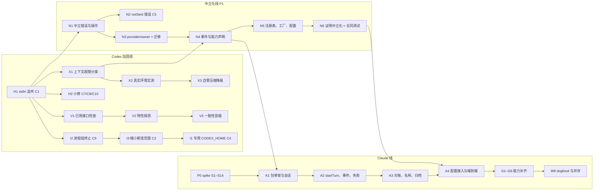

# 运行时修复与 Claude Agent SDK 适配：实施规划

> 性质：实施规划提案，**不是采纳决定**。代码基线为 `main@d8f60eb`，日期 2026-11-08。§1 的事项拍板以后，应登记到[决定记录](../decisions.md)。
>
> 输入文档，下文用简称：
> - “审计”：[Codex 适配器审计](codex-adapter-audit-20261108.md)，问题编号 C1–C10。
> - “集成方案”：[Claude Agent SDK 集成方案](claude-agent-sdk-integration-20261108.md)，阶段 P0–P4，验证项 S1–S14。
> - “并存文档”：[Codex × Claude 并存抽象](runtime-coexistence-codex-claude-20261108.md)，待定事项 D1–D8，P1 共 11 步。
>
> 取舍依据：运行时设计准则（提案 PROP-012，草稿尚未进入仓库）。本文里“稳定接口”和“实验接口”的取舍以该页为准。
>
> 本文自己的编号：拍板事项 K1–K5；PR 按工作流分组：H（热修）、X（上下文超限）、I（进程隔离）、V（版本策略）、N（中立化）、A（Claude 适配器）、G（能力补齐）；真实环境验收 R1–R7。

## 0. 结论

**三条线并行推进。**

1. **Codex 加固线。** 先修会让 coordinator 整个崩掉的 C1，然后依次做上下文超限识别、进程隔离、版本策略。每项都是小 PR，不用等 Claude。
2. **中立化线**，也就是集成方案的 P1。把 Codex 专属的错误、owner、事件、能力声明和工厂抽进 contracts。审计里需要抽象层才能修好的 C5（区分“没发出去”），以及 C2 的能力声明，也放在这条线上。
3. **Claude 线。** 第一天就开始做 P0 spike。spike 只写 `scripts/research/`，不碰主代码，所以不和前两条线冲突。等 P1 的能力声明（N4）合入、spike 结论也出来了，再写适配器。

**关键路径**：N4（能力声明）加上 spike 的 S1–S4、S7、S14，然后是 Claude MVP（A1–A4）。一个人全职，大约 6 周能到 Claude MVP 可以 dogfood；两个人分线并行，大约 4 周。

**第一个合入的应该是 H1**（C1 的 stdin 监听）。改动只有几行，修的是能让整个进程退出的问题。

**最大的三个不确定性：**

1. Claude 转录里没有显式的“Turn 结束”记录。S3 和 S4 要确认：在“每个 Turn 起一次 query”的形态下，CLI 子进程已经退出，能不能直接当作终止证据。不能的话，A3 要加一张 turn ledger 表。
2. 专用 `CODEX_HOME` 会让已有的 owned Thread 无法 resume，切换方式要定（K3）。
3. 迁移编号冲突。059–063 已经被开放的 PR 占了：#204 用 058–061，其中 058 还和 main 上的冲突；#217 用 062；#209 用 063。本规划里唯一的迁移（N3）在合入时取当时下一个空号，文中写作 `0xx_runtime_provider`。

**复核时的更正。** 写这份规划时我重新读了 `browser-read.ts`。浏览器读取本来就是全局单飞：忙的时候直接拒绝。所以审计初稿说 C6 “误伤其他 Session”并不成立，C6 已降为“低，容量问题”，审计文档已经改过来了。本规划不再为 C6 单独开 PR。

---

## 1. 开工前要拍板的事

| # | 问题 | 推荐 | 卡住哪些 PR | 最晚何时定 |
| --- | --- | --- | --- | --- |
| K1 | Claude 的计费路径：Anthropic API Key、Bedrock 还是 Vertex | 先用 API Key。grant 加 `maxBudgetUsd`，Run 记录 `total_cost_usd` | 所有需要真实 API 的 spike，以及 A4 验收 | 第 1 周 |
| K2 | 自管压缩是删掉、降为可选，还是保持现状 | 降为可选、默认关闭，代码先留着。X2 实测通过以后再决定删不删 | X3 | X2 完成后 |
| K3 | 是否改用专用 `CODEX_HOME`；已有 owned Thread 怎么办 | 改用，做成配置项。新部署从一开始就设置；现有部署在维护窗口排空后切换（见 I1） | I1 | 第 2 周 |
| K4 | 版本策略：继续精确锁版本，还是改成“最低版本 + 坏版本表 + 已用接口检查” | 后者作为默认；精确锁定保留成部署选项 `protocolCheck: 'exact'` | V1、V3 | 第 2 周 |
| K5 | “零 Turn 激活并回读”这项要求的理由是什么。理由成立，就继续用 `thread/settings/update`（实验接口可以用，做成能力位）；不成立，就改用 `turn/start` 上的覆盖参数 | 请维护者按运行时设计准则的准则 2 补写理由。确认前不动 | V4（可选） | 不急 |
| D1–D8 | 并存文档 §9 的 8 项 | 沿用并存文档的推荐。其中 D2（能力不足时派发前拒绝）卡 N4，D5 卡 G2，D8 卡 W8 | 见左 | N4 开工前定 D2 |
| — | 技能装载用方案 A 还是 B；`settingSources` 怎么设 | 方案 A（输入注入）；`['project']` | A1（`settingSources`）、G 线（技能） | A1 开工前 |

---

## 2. 工作流和依赖



这张图里的依赖分两种：

- **硬依赖**：后一个 PR 要用前一个的类型或行为。比如 A1 要用 N4 定下的能力类型；A4 要用 N6 的合同测试套件。
- **顺序依赖**：两个 PR 改同一个文件，排队是为了少解冲突。比如 H1 → N1，X1 → N4，都改 `contracts/src/runtime.ts`；I3 → I1 都改适配器 `index.ts`。

---

## 3. PR 拆分

规模：S 不超过 1 天，M 2–3 天，L 1 周左右。每个 PR 都要过 `npm run build`、`npm run typecheck` 和受影响的单元测试；动到持久化的，还要对专用 PostgreSQL 跑 `npm run test:integration`（[开发规范](../development/standards.md)）。

### 3.1 Codex 热修（H）：现在就能做

**H1 · stdin 写入失败会让 coordinator 崩溃（C1，高，S）**

- **问题。** 适配器只给子进程本身和 stdout 挂了监听，`child.stdin` 没有 `error` 监听。App Server 正在退出、还没被回收的时候，写入会抛 EPIPE，变成未捕获异常，coordinator 整个进程退出。审计里已用脚本复现。
- **改法。** 在 `packages/adapter-codex-app-server/src/index.ts:475` 的 `spawn` 之后、和 `:489`、`:508` 同一处，加上：
  ```ts
  child.stdin.on('error', () => { if (this.child === child) this.disconnect('stdin error', 'stdin_error'); });
  ```
  `NativeChildStopReason` 增加 `stdin_error`。这个类型定义在两处，要一起改：适配器的 `index.ts:151`，和 `packages/contracts/src/runtime.ts:104` 的 zod 枚举。PG schema 里对它没有 CHECK 约束，不需要迁移。
- **测试。** 给 fake app-server（`test/fixture.mjs`）加一个模式：初始化后关闭自己的 stdin，但进程不退出。然后调用 `startTurn`。断言三件事：
  1. 测试进程不崩；
  2. 在途请求以 `RuntimeUnknownError` 结束；
  3. 诊断里 `firstLossReason` 是 `stdin_error` 或 `stdout_closed`，以先到者为准。
- **顺带。** 这条用例也要写进 N6 的合同测试套件。Claude 适配器同样通过 stdin 给 CLI 传输入，也要过这条。

**H2 · 几处低风险小修（C7、C8、C10，S）**

| 问题 | 改法 | 测试 |
| --- | --- | --- |
| C7：`create()` 忽略 `spec.reasoningEffort` | 收到带 effort 的 spec 就明确拒绝，报“effort 只能通过执行画像激活”。现有调用路径不会触发，加拒绝比加实现安全 | 单元：带 effort 的 spec 被拒 |
| C8：`seenToolCalls`（`:276`）只增不减 | 连接更换时清空；再加一个上限（例如 1 万条，FIFO 淘汰）。重复 callId 的判定只需要覆盖一个 Turn 的时间窗口 | 单元：超过上限后最早的条目被淘汰；同一 callId 在窗口内仍被拒 |
| C10：`:779` 的 elicitation 分支不可达；readline 没有单行长度上限 | 删掉不可达分支。给单行设上限，比如 64 MiB；超限就 `disconnect(..., 'protocol_error')` | fixture 发一行超长 JSON：断开连接，进程不崩 |

### 3.2 上下文超限（X）：把 C3 落到实处

**X1 · 新增失败分类 `context_window_exceeded`（S–M）**

- `packages/contracts/src/runtime.ts:157` 的 `RuntimeTurnFailure.category` 加上 `context_window_exceeded`。它只是 TS 类型，不入库约束，不需要迁移。
- Codex 的 `turnFailure()`（`index.ts:81-98`）目前只解析 `message` 里的 HTTP 状态。改成**先读原生的 `codexErrorInfo`**，值为 `contextWindowExceeded` 时归到新分类，摘要写“上下文超出模型窗口”；读不到时，保持现有的 HTTP 状态解析。
- 恢复门和 Workbench 的提示文案：在原 Thread 上 retry 或 resume 就行，原生会在下一个 Turn 开始前自动压缩。
- **测试。** fixture 发一个 `turn/completed`：状态为 failed，`error.codexErrorInfo` 为 `contextWindowExceeded`。断言分类正确。再加一条集成用例，确认 retry 走的是原 Thread。
- 字段名和枚举值要用当时锁定版本的生成 schema 核对。我没有在仓库里找到已提交的 schema 文件。

**X2 · 真实环境实测（M，人工，对应 R2）**

- 在锁定的 `0.166.0-alpha.5.1` 和当前允许的 `0.167.0-alpha.3.2` 上，各制造一次上下文超限失败。办法是用小窗口模型，或者塞一个大输入。然后在同一个 Thread 上 retry，确认两件事：rollout 里出现了 `contextCompaction` Item；retry 成功。另外用 kill 进程再 resume 的方式重复一次。
- 顺带向维护者确认：PR #210 当时那次 Leader 故障，到底是不是上下文超限。
- 证据按[证据与交付](../development/standards.md#证据与交付)保存，原始会话不进公开 Git。
- 产出是一份简短报告，作为 K2 的依据。

**X3 · 自管压缩降级（M，取决于 K2）**

- 新增配置 `runtime.compaction.owned`，默认 `false`。关闭时，恢复门不再提示“先压缩”；HTTP 和 CLI 入口返回“已停用”。
- 如果保留，就把 `index.ts:1235`、`:1279` 写死的 alpha.6 版本判断，改成 V2 的特性探测结果，同时更新 `docs/development/owned-compaction.md`。
- 如果删除，表（迁移 058）先保留只读，以后再清理。

### 3.3 进程隔离和故障范围（I）

**I2 · 关闭时终止整个进程组（C9，S）**

- `spawn` 加 `detached: true`，关闭时用 `process.kill(-pid, 'SIGTERM')`，超时后再发 `SIGKILL`。
- 注意：`detached` 以后，终端里按 Ctrl-C 不会再把信号传给子进程组，所以 coordinator 的 `SIGINT`/`SIGTERM` 处理里要显式调用关闭。
- **测试。** fake app-server 拉起一个孙进程 `sleep`。关闭以后，孙进程也不在了。

**I3 · 缩小断连范围（C2，M）**

现在共享连接上任何一处异常都会 `disconnect()`，所有 Session 的在途 Turn 一起变成 unknown。改法是逐个检查断连点，分两类处理：

| 位置 | 现在 | 建议 |
| --- | --- | --- |
| `index.ts:714` 非法 server request | 断开连接 | 只给这个请求回 JSON-RPC 错误（`-32600`），连接保留 |
| `:766-767` 审批监听失败 | 断开连接 | 需要维护者确认。审批证据是安全要求，可能是故意断的。如果保留，在诊断里标明原因 |
| JSON 解析失败、单行超长 | 断开连接 | 保留。这时协议已经失去同步，只能断 |

测试：两个 Session 各有一个在途 Turn，向其中一个注入非法 server request。断言另一个 Turn 正常完成。

**I1 · 专用 `CODEX_HOME`（C4，M，取决于 K3）**

- **配置。** 新增 `runtime.codex.home`。不设置时保持现在的行为。设置后，子进程的 `CODEX_HOME` 指向它。`HOME` **保留透传**，因为 Codex 拉起的 shell 命令里，git、ssh、npm 都要用 `HOME`；只把 `CODEX_HOME` 从继承改为显式指定（`index.ts:49-56`）。
- **认证。** 在专用目录里单独执行一次 `codex login`，或者使用 API Key。**不要复制用户的 `auth.json`**：两份副本各自刷新同一个 refresh token，可能互相把对方挤下线。这一点需要实测确认。
- **已有 Thread。** 旧 rollout 在用户的 `~/.codex/sessions` 下。换 home 以后，`thread/resume` 找不到它们。推荐在维护窗口排空：先停止派发，等在途 Turn 结束，关闭或退役 owned Session，再切换。新 Session 从新 home 开始。长期运行的 Leader Session 会因此丢失上下文，需要提前告知维护者。“复制旧 rollout 到新 home”不推荐，因为新版 Codex 还有自己的索引状态，只复制文件不一定够，要另做验证。
- **验收（R3）**：
  1. 新 home 下认证可用；
  2. 用户 `~/.codex/config.toml` 里的 MCP server 和全局 `AGENTS.md` 不再进入 owned Thread（回读 Thread 配置确认）；
  3. Desktop 里看不到 owned Thread。这一条正好也堵住了审计 §2.2 说的 Desktop 误发。

### 3.4 版本策略（V）

对应审计 §7 的建议。目标是：升级 Codex 的时候不用每次改代码，同时又能拦住真正不兼容的版本。

| PR | 内容 | 规模 |
| --- | --- | --- |
| V1 | **已用接口检查。** 在适配器里维护一张清单，列出 evoLoop 实际调用的方法、订阅的通知、读写的字段。启动时只检查这张清单在当前二进制生成 schema 里的部分：新增可选字段放行；删除字段、改类型、新增必填参数则拒绝。配置改成“最低版本 + 坏版本表”，替换 `configuration.ts:125` 的单一版本值。整份 schema 哈希的检查（`index.ts:537-543`）保留为 `protocolCheck: 'exact'` 选项 | M |
| V2 | **特性探测。** `supportsModernProtocol`、`supportsExperimentalWorkspace`（`index.ts:40-44`）和压缩的 alpha.6 判断，都从版本号判断改成根据 schema 里有没有对应方法来判断。实验接口（`thread/settings/update`、`dynamicTools`、`tool/requestUserInput` 等）只在探测到时启用，探测不到就按 N4 的能力声明拒绝或降级 | S–M |
| V3 | **一致性冒烟测试。** 新增 `npm run codex:conformance -- --bin <path>`：在临时 `CODEX_HOME` 下，用真实二进制跑一遍 `thread/start` → `turn/start`（廉价提示）→ `thread/read` → `turn/interrupt` → `thread/archive`。新版本必须先通过它，才能移出“未验证”。需要真实认证，所以不进默认 CI，作为人工发布步骤（R4） | M |
| V4 | （可选，取决于 K5）如果“零 Turn 激活回读”的理由不成立，改用 `turn/start` 的覆盖参数，去掉这条多余的路径 | M–L |

### 3.5 中立化（N）：集成方案 P1，加上审计里需要抽象层的问题

整体验收沿用集成方案 §8 P1：`npm test` 和 `npm run test:integration` 全绿；Codex 真实 owned Turn 回归一次（R5）；core 和 coordinator 里，除了工厂，不再 import `adapter-codex-app-server`，也不再出现 Codex 方法名的字面量。

| PR | 内容（对应并存文档 §8 的步骤） | 行为变化 | 规模 |
| --- | --- | --- | --- |
| N1 | 步骤 1–2：中立错误类移到 contracts，Codex 包改为 re-export；引入 `RuntimeOperation`，改 `RuntimeFault` 和 `dispatchFailureDetail`（`runner.ts:25-56`） | 无 | S–M |
| N2 | **C5：区分“确定没发出去”。** 见下文 | **有，修复** | M |
| N3 | 步骤 3–4：`RuntimeProvider`、`RuntimeOwner`、`ownerOf`；改 `bindingOf()`（`runner.ts:83`）和 core 的三处 owner 校验（`core/runtime/service.ts:53,171,207`）；迁移 `0xx_runtime_provider`，见下文 | 无 | M |
| N4 | 步骤 5–6：中立事件 `kind`；`capabilities()` 和各切面类型，Codex 写出自己的声明，语义判断改为读声明。见下文 | 无 | M–L |
| N5 | 步骤 7–9：`readFinalMessages` 下沉到适配器；`RuntimeRegistry`、bridge 多路订阅、`runtime/factory.ts`；配置改为判别联合 | 无 | M–L |
| N6 | 步骤 10–11：`preTurnProof` 和压缩 `requestRef` 中立化，兼容解析旧数据；合同测试套件 `packages/contracts/testkit/runtime-contract.ts`，Codex 通过 | 无 | M |

**N2 的细节。** 现在 `send()` 同步失败时，请求**确定没有写出**，却被 `fail()` 包成了 `RuntimeUnknownError`（`index.ts:578-588`）；`runner.ts:1022-1028` 又把 `startTurn` 的任何异常都标成 unknown。改法：

- contracts 增加 `RuntimeNotSentError`。
- 适配器只在**同步检查不通过、还没调用 `stdin.write()`**时抛它，比如未连接、stdin 已不可写。一旦调用过 `write()`，就算随后 EPIPE，也仍然算 unknown，因为数据可能已经到了对方。
- runner 收到 `RuntimeNotSentError` 时，撤回本次派发（可以安全重派），和消息 pump 现有的 `failBeforeStart` 分支对齐。
- **测试**：
  1. 先断开连接再派发：Run 回到可派发状态，只重派一次，原生端只收到一次 `turn/start`；
  2. 写出以后才断开：仍然是 unknown，没有重发。
- 这是 P1 里唯一有意改变行为的 PR，PR 描述里要单独写明。

**N3 的迁移。** 把并存文档 §6 列出的列一次性加齐，避免以后再加第二次迁移：

- `runtime_session.runtime_provider`：`NOT NULL DEFAULT 'codex'`，加 CHECK，再用 UPDATE 触发器禁止修改；
- `runtime_session.capability_snapshot`；
- `runtime_run` 的 `usage`、`cost_usd`、`trace_fidelity`；
- `session_compaction` 的 `native_request_ref` 和 `outcome`；
- `native_child_diagnostic.session_id`。

按[开发规范的高影响变更要求](../development/standards.md#开始业务实现时)，用真实旧模式样本跑专用数据库，确认以下几点：旧 Session 读出来是 `codex`；修改 provider 会被触发器拒绝；旧的 `preTurnProof` 能解析；迁移以后旧 Run 能继续对账。

**N4 的能力声明。** 并存文档 §4.2 已经有 `process: "shared" | "per_session"`，对应 C2：Codex 是 `shared`，runner 据此知道一次断连会影响所有 Session，要批量对账。在此基础上补三项：

- `delivery`：对应审计 §5.4，包括 `newTurnOnly`、`midTurnInput`、`callerAssignedTurnKey`、`callerAssignedSessionId`。
- `errors`：声明会返回哪几种结果，`unknown`、`notSent`、`rejected`（N2）。
- `compaction.autoCompacts: boolean`：原生会不会自动压缩，两个 provider 都是 `true`。X3 降级以后，恢复门据此提示“retry 即可”，不再提示“先压缩”。原有的 `compaction.mode` 继续描述手动压缩怎么触发。

D2 要在 N4 开工前定下来：能力不足时，派发前拒绝，还是静默降级。

### 3.6 Claude spike：集成方案 P0（2–3 天，可从第 1 天开始）

- **位置**：脚本在 `scripts/research/claude-agent-sdk/`，报告写成 `docs/research/claude-agent-sdk-spike-<日期>.md`。开始前把 SDK 版本精确锁定。需要 K1 的真实 API Key。
- **执行顺序按“卡住谁”排**：

| 优先级 | 验证项 | 决定什么 | 不通过怎么办 |
| --- | --- | --- | --- |
| 1（卡 A1） | S7 配置隔离 | `CLAUDE_CONFIG_DIR`、`settingSources`、关闭 auto memory 能否把用户全局配置挡在外面 | **硬阻断**。隔离不成立就不进 A1 |
| 1（卡 A1） | S1 预分配 sessionId，S2 uuid 回显 | 身份能否做成 `preassigned` | 退回和 Codex 一样：等原生应答拿 ID，靠首行标记对账。设计变复杂，但不阻断 |
| 2（卡 A2、A3） | S3 结果是否进转录，S4 kill 以后 resume 的形态，S14 fold-in | 要不要 turn ledger；unknown 怎样对账 | 加 ledger（A3 增加一个 M 级工作量） |
| 3（卡 G 线） | S5 压缩，S6 原生提问和 defer，S9 进程内 MCP，S11 tag/rename，S12 工具结果结构，S13 effort 回读 | 对应能力怎么实现，或者声明为不支持 | 声明为 `unavailable`，不阻断 MVP |
| 4 | S8 资源占用，S10 端到端走 evoLoop CLI | HostPool 默认值；CLI 链路是否需要改动 | 调整参数 |

关于 S3/S4 的一个判断：MVP 用的是“每个 Turn 起一次 query 再 resume”（审计 §5.2 的形态 A）。在这个形态下，coordinator 崩溃时，CLI 子进程大概率会随 stdin 关闭而退出。如果 S4 证实这一点，那么“转录里有我方 uuid，但子进程已经不在了”本身就是终止证据，可以判为“中断，结果未知”，**可能就不需要 ledger**。

### 3.7 Claude 适配器 MVP（A）：集成方案 P2

新包 `packages/adapter-claude-agent-sdk`。测试用 fake CLI：通过 `spawnClaudeCodeProcess` 注入，回放 spike 录下的 stream-json 样本（脱敏后放进 `test/fixtures/`），**不调用真实 API**。

| PR | 内容 | 规模 |
| --- | --- | --- |
| A1 | 包骨架。锁 SDK 版本；子进程 env 白名单；专用 `CLAUDE_CONFIG_DIR`；`settingSources`；`permissionMode: 'bypassPermissions'` 加 `PreToolUse` 守卫（对齐 DEC-033）；stdin 错误监听（H1 的教训）。实现 `create`（预分配 sessionId，**先落库**）、`resume`、`close`。并发上限和在途登记表（形态 A 下 HostPool 实际上就是这个） | M |
| A2 | `startTurn`：预分配 `SDKUserMessage.uuid`，和操作一起落库，首行仍写 `[evoloop-run-operation:<id>]`，两个 provider 共用对账代码；`maxTurns` 改名 `maxAgentSteps`。实现 `onEvent` 事件映射；失败映射，包括 `context_window_exceeded`（复用 X1）、预算超限、认证失败（归到 `rejected` 或 `notSent`）；`interruptTurn`，先核对当前在途的就是那个 Turn | M–L |
| A3 | 对账：`listTurns`、`listItems`、`readWorkPage`，基于 `getSessionMessages`，先找预分配 uuid，找不到再找标记；视 S3/S4 结果决定是否加 ledger。`readThreadName`、`setThreadName`，以及用 tag 实现的 `archive`（D4） | M（加 ledger 是 L） |
| A4 | 配置 `provider: 'claude'`，在工厂里注册；合同测试套件里已声明的切面全部通过。**验收（R6）**：一个真实 Task 走完 Queue → Run → Claude Session，由 CLI 提交 Delivery；coordinator 重启后 Run 对账正确 | M |

### 3.8 能力补齐（G）和 dogfood（W8）：集成方案 P3、P4

| PR | 内容 | 依赖 |
| --- | --- | --- |
| G1 | 手动压缩：`/compact`，声明 `compaction.mode: 'slash_command'`。如果 K2 决定降级，这项可以不做，只声明 `autoCompacts: true` | S5、K2 |
| G2 | 原生提问：`AskUserQuestion` 接 `NativeInputBridge`；用 `defer` 实现跨重启 | S6、D5 |
| G3 | 工作区历史和 Workbench Session 时间线 | A3 |
| G4 | 浏览器读取改走进程内 MCP。审计 C6 说的全局单飞限制同样适用；两个 provider 都要并发读取时，再按 C6 的建议改成 context 池 | S9 |
| G5 | 执行画像激活（`setModel`、effort）和 `listModels`。effort 回读不到时，按 D3 标成“已配置、未观测” | S13、D3 |
| G6 | 成本：`total_cost_usd` 和 `usage` 写进 Run 事件（N3 的列），Workbench 的 Runtime 面板显示 | N3 |

W8 dogfood：按 grant 选择 provider（D8）；用现有 evaluation 机制，对同一个 Task 修订、同一份固定依据做 Codex 和 Claude 的对照；评估 `sessionStore` 是否镜像转录到 PG；通过以后登记 DEC，修订[接入架构](../architecture/codex-integration.md)。

---

## 4. 排期和并行

### 4.1 一个人全职的顺序（粗估）

| 周 | 加固线 | 中立化线 | Claude 线 | 要拍板 |
| --- | --- | --- | --- | --- |
| 1 | H1、X1、H2、I2 | N1 | spike 优先级 1、2 | K1、K3、K4 |
| 2 | X2（R2）、V1、I3 | N2、N3 | spike 优先级 3、4，出报告 | D2、K2 |
| 3 | V2、I1（R3） | N4、N5 | — | 技能方案、`settingSources` |
| 4 | V3（R4）、X3 | N6，R5 回归 | A1 | — |
| 5–6 | — | — | A2、A3、A4（R6） | D3、D4 |
| 7–8 | — | — | G1–G6 | D5 |
| 之后 | — | — | W8 | D8 |

两个人：一人负责加固线和中立化线，另一人负责 spike，再做 A1–A3。A1 可以先基于 N4 的分支开发，N4 合入后 rebase。这样第 4 周左右能到 A4。

### 4.2 冲突热点

| 文件 | 会改它的 PR | 建议顺序 |
| --- | --- | --- |
| `packages/adapter-codex-app-server/src/index.ts` | H1、H2、X1、I1、I2、I3、V1、V2、N1、N2、N4 | H1 → X1 → H2 → N1 → N2 → I2 → I3 → V1 → V2 → N4 → I1，同一时间只开一个 |
| `packages/contracts/src/runtime.ts` | H1、X1、N1–N4、N6 | 跟上一行同序 |
| `apps/coordinator/src/runtime/runner.ts` | N1、N2、N3、N5 | 按 N 的顺序 |
| `apps/coordinator/src/main.ts`、`session-messages/pump.ts` | N5，以及开放的 #217、#209 | N5 等 #217、#209 合入或关闭以后再开 |
| 迁移目录 | N3，以及开放的 #204、#217、#209 | N3 合入时取下一个空号 |

---

## 5. 真实环境验收

单元测试和 fake 适配器证明不了原生行为。下面这些要在真实二进制或真实 API 上跑一次，证据按[证据与交付](../development/standards.md#证据与交付)保存，原始会话不进公开 Git。

| # | 时机 | 做什么 | 通过标准 |
| --- | --- | --- | --- |
| R1 | H1 之后 | Turn 进行中和消息派发过程中，分别 `kill -9` App Server | coordinator 不退出；受影响的 Run 和消息变成 unknown，对账以后收敛，没有重复发送 |
| R2 | X2 | 制造上下文超限，在原 Thread 上 retry | 分类为 `context_window_exceeded`；retry 前自动压缩并成功 |
| R3 | I1 | 用专用 `CODEX_HOME` 新建 Session，跑一个 Turn | 认证可用；用户全局 MCP 和 `AGENTS.md` 不生效；Desktop 里看不到这个 Thread |
| R4 | V3 和以后每次升级 | 对新二进制跑一致性冒烟 | 全部步骤通过才把版本移出“未验证” |
| R5 | N6 | Codex 真实 owned Turn 回归，包括一次重启后对账 | 和 P1 之前行为一致 |
| R6 | A4 | Claude 端到端，包括重启后对账 | 见 A4 |
| R7 | 任意时候 | 对普通消息做一次有界验收（审计 §6 第 6 条） | 把审计 §2.1 里的 `unverified` 换成有证据的状态 |

---

## 6. 风险

| 风险 | 影响 | 缓解 |
| --- | --- | --- |
| N2 把“可能发出去了”误判为“没发出去” | 重复发送，违反“只发一次” | 只在调用 `write()` 之前的同步检查失败时判 notSent；测试同时覆盖“写出后断开仍是 unknown” |
| 专用 `CODEX_HOME` 的切换 | 已有 owned Thread 无法 resume，Leader 丢上下文 | 默认不开启；维护窗口排空以后再切换；提前告知维护者 |
| 认证副本互相挤下线 | 用户 Desktop 或 evoLoop 突然掉登录 | 专用 home 单独登录或用 API Key，不复制 `auth.json`；R3 观察 24 小时 |
| 放宽版本检查后出现静默协议漂移 | 字段语义变了，代码没察觉 | V1 检查已用接口的结构；V3 冒烟是升级的必经步骤；精确锁定保留成选项 |
| `detached` 进程组 | coordinator 异常退出时留下孤儿 App Server | 在 coordinator 信号处理里显式关闭；启动时清理上次残留的进程组 |
| 开放 PR 改同样的文件 | 反复 rebase | 按 §4.2 排队；N5 等 #217、#209 |
| spike 结论不利（S3、S6） | A3、G2 工作量变大 | 不影响 MVP 底线：声明为 `unavailable`，或加 ledger |
| Claude API 成本 | 和 Codex 的订阅计费结构不同 | grant 设 `maxBudgetUsd`；G6 把成本展示出来；dogfood 期间按周回看 |

---

## 7. 不在本规划内

- 由 coordinator 基于 git 统一计算 Turn diff（并存文档 D6）。这和 provider 无关，单独立项。
- Claude 常驻流式输入（审计 §5.2 的形态 B）和中途插话：需要低时延对话时，作为 `delivery.midTurnInput` 能力再开放。
- 浏览器读取的多 Session 并发池（C6）：等 Session 并发真的上来再做。
- 自管压缩的最终去留：由 X2 和 K2 决定，不在这里预判。
