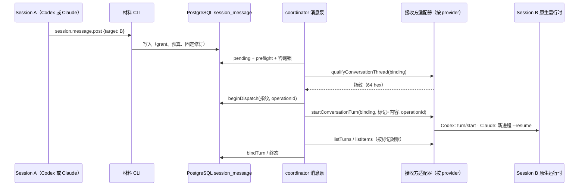
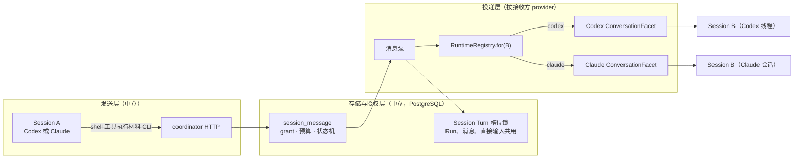

# 会话间通信、跨运行时消息与 DeepSeek 执行模型（研究，2026-11-08）

> 状态：研究与设计提议，**未被采纳为当前约定**。当前约定仍以[决定记录](../decisions.md)、[Codex 接入](../architecture/codex-integration.md)和[契约](../architecture/contracts.md)为准。本文同时记录 Claude 适配器对真实 CLI 的一致性验证结果。

## 0. 问题与结论

本轮要回答五个问题：

1. Claude Code 的会话之间靠什么通信？
2. Codex 会话之间能不能通信？
3. 如果 evoLoop 要让会话之间通信，包括 Codex 会话和 Claude 会话之间，应该怎么做？
4. 能不能让 DeepSeek 作为 Codex App Server 背后的执行模型？
5. 启动时能不能直接复用桌面版 Codex 和 Claude 已有的登录？

结论：

| 问题 | 结论 | 证据类型 |
| --- | --- | --- |
| Claude 会话间通信 | 有三套机制，互不相同：<br>① Agent teams 用 JSON 文件收件箱，靠轮询读文件，也就是"不断读文件"的那一套；<br>② 独立本地会话用每个进程自己绑定的 Unix socket 加会话登记文件；<br>③ SDK 宿主可直接往运行中的会话写入用户消息（`priority`）。 | 外部文档；对固定版本 CLI 的源码推断；第 ② 套另有实际运行 |
| Codex 会话间通信 | 独立线程之间**没有**原生消息通道。`multi_agent` 只在同一个 agent 树里有效（父子线程）。如果要让两个独立线程互通，必须由宿主转发。 | 外部文档；固定版本 schema |
| evoLoop 会话间通信 | 已经有一条经过授权的通道：Session 消息（路径 B，见第 3 节）。<br>一个 Codex Session 今天就能通过材料 CLI 的 `session.message.post`，在精确 grant 下给另一个 Session 发消息。<br>Claude Session 缺少 `qualifyConversationThread` / `startConversationTurn` 两个接入点，所以**尚不能接收**这类消息。 | 源码阅读 |
| 跨运行时通信怎么做 | 不建议打通 Claude socket 与 Codex 线程之间的原生通道。<br>建议让 PostgreSQL 里的 Session 消息成为唯一授权通道，分三层：发送层与存储授权层与 provider 无关，只有投递层按**接收方** provider 选适配器。四种组合（Codex→Codex、Claude→Claude、Codex→Claude、Claude→Codex）走同一条代码路径。<br>混合组合有一个结构性前提：一个数据库只允许一个 coordinator，而它今天只驱动一种 provider，所以需要先有能同时持有两种运行时的 `RuntimeRegistry`。<br>各运行时的原生 peer 通道一律关闭：本轮已对 Claude 做到，Codex 侧另行评估。 | 源码阅读；设计提议 |
| DeepSeek 作为 Codex 执行模型 | 可行，**已在本机实际运行**。<br>不配 `codexHome` 时，适配器与桌面版 Codex 共用 `~/.codex`，自动沿用桌面已配置的 provider。本机的配置是一个 Responses 兼容网关，凭据写在 Codex 自己的配置里，所以不需要改适配器的环境白名单。grant 里写 DeepSeek 的模型 ID 即可。<br>经 evoLoop 适配器的真实运行 10 项全部通过（第 5.4 节）。期间发现并修复一个 0.167 的短暂拒绝问题。<br>若改用专用 `CODEX_HOME` 并直接以环境变量传密钥，仍需要 `envPassthrough`。上游已知缺陷仍需专门盯住。 | 实际运行；外部文档与 issue |
| 登录态复用 | **Codex 会复用，Claude 不会。**<br>Codex 适配器在未配置 `codexHome` 时共用 `~/.codex`，桌面版的登录和 provider 直接生效。<br>Claude 适配器按设计使用专用的 `CLAUDE_CONFIG_DIR`，看不到 `~/.claude` 的登录。桌面宿主注入的会话令牌虽然通过了白名单，但在子进程中返回 401（第 7.1 节）。 | 实际运行 |

本轮还发现并修复了一个安全问题：Claude CLI 在 `crossSessionInbound` 未设置时，会把**声称**同为 bypass 权限类别的本地 peer 消息直接送进运行中的 Turn。evoLoop 的 Claude 子进程都以 bypass 模式运行，所以任何同用户的本地进程都可能绕过 evoLoop 的 grant 向它们注入指令。处理见 [2.4](#24-对-evoloop-的风险与处置)。

## 1. 范围与方法

固定版本：

- `@anthropic-ai/claude-agent-sdk` 0.3.319，及其捆绑的 Claude Code CLI 2.1.319。
- 仓库锁定的 Codex 版本。

DeepSeek 文档和 issue 按 2026-11-08 的状态核对。

用到的方法：

- **源码推断**：在捆绑 CLI 的打包代码中检索字符串和函数上下文。打包代码经过压缩，函数名不稳定，结论只针对这个版本。
- **实际运行**：`scripts/claude-conformance.mjs` 驱动真实 CLI 二进制，通过 evoLoop 适配器调用 127.0.0.1 上的模拟 Messages API。子进程只拿到给模拟服务用的假令牌，宿主自身的 `ANTHROPIC_*` 和 `CLAUDE_*` 凭据全部剥离。**没有任何请求到达真实模型。**
- **外部文档**：Anthropic 与 OpenAI 的官方文档、DeepSeek 接入指南、上游 issue。

## 2. Claude Code 的原生会话通信

### 2.1 Agent teams：文件收件箱

需要设置实验开关 `CLAUDE_CODE_EXPERIMENTAL_AGENT_TEAMS=1`。

- **收件箱与轮询**：每个成员有一个 JSON 收件箱，位于 `<config>/teams/<team>/inboxes/<agent>.json`，写入时加锁文件。接收方轮询这个文件：交互式会话每 1000 ms 一次，进程内队友每 500 ms 一次。
- **投递方式**：消息在两个 turn 之间投递，包在 `<teammate-message>` 里。
- **可靠性**：没有已读回执；标记已读失败时会重复投递。
- **启动限制**：团队只能由交互式会话创建，SDK 和 `-p` 都不能创建。

结论：**evoLoop 的 headless 子进程用不上这套机制。** 它也不提供 evoLoop 需要的授权、固定修订和恢复语义。

### 2.2 独立本地会话：每个进程一个 Unix socket

ListAgents 与 SendMessage 两个工具从 v2.1.224 起提供。

- **socket 与登记**：每个 CLI 进程绑定 `${XDG_RUNTIME_DIR | CLAUDE_CODE_TMPDIR | /tmp}/cc-socks/<pid>.sock`，并把 `messagingSocketPath` 写进 `<CLAUDE_CONFIG_DIR>/sessions/<pid>.json`。
- **协议**：NDJSON，每行一帧。第一行可以是认证帧；Windows 上必须有。接收方会核验对端 pid，但这只能证明对方是本机同一用户的某个进程。
- **投递时机**：运行中的 Turn 在工具调用之间读取消息；空闲时消息开启新 Turn。
- **呈现给模型**：消息包在 `<cross-session-message>` 里，origin 为 `{kind:'peer', verifiedPeerPid}`。单条上限 1M 字符。
- **SDK 进程也会绑定**：SDK 的 `query()` 不加 `--bare`，所以 evoLoop 启动的每个 Claude 子进程**也会绑定这个 socket 并登记**。登记文件在本轮的真实运行中出现过（见第 7 节）。
- **接收策略** `settings.crossSessionInbound`：
  - `accept`：投递。
  - `hold`：暂存，等用户放行。
  - `refuse`：在处理附件之前直接丢弃，并回送"refused"回执。
  - **未设置时按模式对等处理**：发送方声明的权限类别与本会话相同（bypass↔bypass 或 prompting↔prompting）就自动投递；未声明类别的发送方，在本会话为 bypass 时被暂存。
  - **关键问题**：发送方的类别来自消息文本头部的 `from-mode="bypass"` 属性，由发送方自己填写。

### 2.3 SDK 宿主注入

SDK 宿主在流式输入模式下，可以直接给运行中的 `query()` 写入 `SDKUserMessage`。`priority` 决定何时处理：

- `next`（默认）：当前 Turn 内，下一次工具调用之后读取。
- `later`：当前 Turn 结束后处理。
- `now`：打断当前 Turn。

这是 Claude 侧实现 "steer" 的稳定接口，不需要经过 socket。

### 2.4 对 evoLoop 的风险与处置

evoLoop 的 Claude 子进程有三个特点：

- 以 `bypassPermissions` 运行；
- 有自己专用的 `CLAUDE_CONFIG_DIR`；
- 每个 Turn 一个进程。

在 `crossSessionInbound` 未设置时，同一用户下的任何本地进程都能连上子进程的 socket，声明 `from-mode="bypass"`，让消息直接进入 Turn。所有共用同一配置目录的 evoLoop Claude 工作进程，也能通过 ListAgents/SendMessage 彼此直接通信。这两条路都绕过了 PostgreSQL 中的 grant、预算和来源记录。

已在适配器中处置：

1. 每个子进程（包括列模型时的子进程）都通过 flag 设置层传入 `{"crossSessionInbound":"refuse"}`。SDK 把它转成 `--settings {"crossSessionInbound":"refuse"}`，单元测试和真实 CLI 的 argv 都核对过。flag 层是用户可控设置中优先级最高的一层；项目设置只能把策略收紧，不能放松。
2. 默认禁用工具中加入 `SendMessage` 与 `ListAgents`，切断出站方向。
3. 一致性脚本新增两项检查（S9），结果见第 7 节：
   - **正对照**：对显式 `accept` 的 CLI 注入消息，确认确实能送达模型；
   - **负对照**：对适配器启动的 Turn 注入同样的消息，确认被拒。

## 3. evoLoop 现有的消息路径

| 路径 | 由谁发起 | 到达运行时的方式 | 授权与恢复 |
| --- | --- | --- | --- |
| A. Run 派发 | 常驻队列、编排、`runtime.run.reserve`、`queue.continue` | `startTurn`，输入带 `[evoloop-run-operation:<id>]` 标记 | Run 状态机；`RuntimeNotSentError` 撤回后可重试；其他启动错误记为 unknown，不重试 |
| B. Session 消息 | 工作台、材料 CLI `session.message.post`、leader 结果通知（PG 触发器，迁移 046） | 消息泵 `session-messages/pump.ts`：先 `qualifyConversationThread`，再 `startConversationTurn` | 表 `session_message` 与 `session_message_processing`（迁移 031）；精确 grant 匹配发送方与接收方的 actor、role、cwd；`assert_session_turn_slot` 咨询锁保证 Session 内互斥；**只等空闲，不 steer**；按标记对账 |
| C. 直接输入 | 仅工作台（迁移 059） | `steerTurn` 或 `startConversationTurn` | `requireDirectInputRuntime` 要求运行时提供 steer |
| D. 原生输入回复 | 运行时向宿主请求输入 | 仅 Codex | — |

关于"一个 Codex Session 能否给另一个 Session 发消息"：**今天可以，走路径 B。**

- Session A 的材料 CLI 调用 `session.message.post`，目标是 `{kind:'owned', sessionId:B}`，需要一个精确 grant。
- Worker 被 `workers/guard.ts` 禁止这样做。
- 目前没有一条测试以 Session actor 作为发送方。

调度器和任务引擎给 Session 推送信息，本质上走的也是同一套接入点：路径 A 用 `startTurn`，路径 B 用 `startConversationTurn`。所以"已经有通信抽象"这个判断是对的：**缺的不是抽象，而是 Claude 适配器对路径 B 的实现，以及消息泵的几处 provider 相关修正。**

## 4. 跨运行时会话通信设计（提议）

### 4.1 原则

1. **只有一条授权通道。** Session 之间的消息，不论哪个 provider，都写入 PostgreSQL 的 `session_message`，再由 coordinator 的消息泵投递。发送方是 Codex 还是 Claude 都无关紧要，接收方的适配器负责把消息变成一个原生 Turn。
2. **原生 peer 通道关闭。** 关闭的对象包括 Claude 的 socket 与 SendMessage，以及 Codex 跨树的 `send_input`。各运行时自带的会话间机制只能用在自己内部的子 agent（同一个 Turn 内），不能承载跨 Session 消息，否则会绕过 grant、预算和来源记录。
3. **发送不等于消费。** 遵循 `contracts.md` 的既有约定：消息被投递成 Turn，只证明接收方开始处理，不证明它读懂或执行了。完成判断仍来自接收方 Turn 的结果和后续证据。
4. **接收方的 provider 决定投递方式，发送方的 provider 不参与路由。** 路由只看接收方 Session 落库的 `runtime_provider`（迁移 060，不可修改）。这样四种组合（Codex→Codex、Claude→Claude、Codex→Claude、Claude→Codex）走的是同一条代码路径，区别只在最后一步由哪个适配器启动 Turn。
5. **只做异步。** 回复是反方向的一条新消息，不是发送方 Turn 里的返回值。任何一方都不能在自己的 Turn 里同步等待对方回复，原因见 [4.7](#47-会话语义回复回环与死锁)。



### 4.2 拓扑：三层与四种组合

先说两个现有约束，它们决定了跨 provider 通信的形状：

- **一个数据库只有一个 coordinator。** `apps/coordinator/src/lease.ts` 用 `pg_try_advisory_lock` 取单写租约，第二个 coordinator 启动时直接报错退出。
- **一个 coordinator 今天只驱动一种 provider。** 新 Session 按 coordinator 的 provider 预留；Run 派发会过滤掉其他 provider 的 Session（`runner.ts` 中 "Sessions of another provider are left untouched"）。

所以"开两个 coordinator，一个跑 Codex、一个跑 Claude"不可行：租约不允许；即使允许，两个消息泵也会争抢同一张表。**混合通信只能由一个 coordinator 同时持有多个运行时来完成**，也就是[运行时并存](runtime-coexistence-codex-claude-20261108.md#45-路由runtimeregistry)提出的 `RuntimeRegistry`。

通信拆成三层，只有最下面一层与 provider 有关：

| 层 | 负责什么 | 与 provider 的关系 |
| --- | --- | --- |
| 发送层 | 发送方 Session 里的 agent 用 shell 工具执行材料 CLI，经 coordinator HTTP 写入 `session_message` | 中立。任何有 shell 工具的 agent 都能发，前提是会话准备时把 CLI 命令交给了它，并且这个命令在它的子进程环境里能执行 |
| 存储与授权层 | 有方向的 grant、预算、固定 Task 修订、消息状态机、`assert_session_turn_slot` 咨询锁（与 Run 派发、直接输入共用） | 中立，全部在 PostgreSQL |
| 投递层 | 消息泵取出消息，按接收方 Session 选适配器，调用 `ConversationFacet`，再按标记对账、结算 | 按接收方 provider：`registry.for(接收方 Session)` |



四种组合各自还缺什么：

| 发送方 → 接收方 | 发送层还缺 | 投递层还缺 | 现状 |
| --- | --- | --- | --- |
| Codex → Codex | 无 | 无，Codex 适配器已实现 facet | **可用**（路径 B）；缺一条以 Session actor 为发送方的测试 |
| Claude → Claude | Claude 会话准备时交付材料 CLI 指令，并确认命令可执行 | Claude `ConversationFacet` | 不可用 |
| Codex → Claude | 无 | Claude `ConversationFacet` 与 `RuntimeRegistry` | 不可用：coordinator 只驱动一种 provider |
| Claude → Codex | 同 Claude → Claude | `RuntimeRegistry` | 不可用：coordinator 只驱动一种 provider |

两个同 provider 组合只需补齐该 provider 自己的实现；两个混合组合还需要 `RuntimeRegistry`。四种组合没有各自专用的代码，这是设计目标：**再增加一种 provider，只需要在发送层做到"能执行 CLI"、在投递层实现 facet，组合数增加不会带来新代码。**

发送方身份需要单独说明。`session_message.sender_actor_id` 记录的是材料 CLI 的 actor，不是发送方 Session。材料 CLI 可以按 Session 绑定，也可以按 Role 绑定（`runtime.materialCli`）；按 Role 绑定时，多个 Session 共用一个 actor，从消息上无法确定是哪个 Session 发的。回复路由和回环检测都需要知道发送方 Session，所以建议增加可空的 `sender_session_id`：凭据绑定到 Session 时写入，否则为空。这需要一次迁移，细节尚未设计。

### 4.3 契约：把可选方法收成一个 facet

现在 `startConversationTurn`、`qualifyConversationThread` 和 `steerTurn` 是三个分别可选的方法，各处用 `typeof` 检查。建议在 contracts 中定义：

```ts
export interface ConversationFacet {
  qualifyConversationThread(binding: RuntimeBinding): Promise<{ available: boolean; reason: string; fingerprint: string | null }>;
  startConversationTurn(binding: RuntimeBinding, input: string, operationId: string): Promise<RuntimeTurn>;
  steerTurn?(binding: RuntimeBinding, turnId: string, input: string, operationId: string): Promise<void>;
}
```

`RuntimePort` 以 `Partial<ConversationFacet>` 的形式组合这个 facet，并由 `capabilities()` 声明是否具备。消息泵和直接输入服务只认这一个 facet。

### 4.4 Claude 适配器实现要点

- **`qualifyConversationThread`**
  - 先确认以下几点，任一不满足就返回不可用：账本中有这个 Session、它没有被归档、没有进行中的 Turn、`resumeProfile` 是完整的执行画像。
  - 指纹是以下内容的 sha256：`admission:'evoloop-claude-conversation-v1'`、CLI 版本、projectId、sessionId、roleId、nativeSessionId、cwd、授权范围、执行画像、模型、`CHILD_SETTINGS`、禁用工具清单、`settingSources`。
  - 与 Codex 一样，缓存 5 秒内有效；指纹变化就判为不可用。
- **`startConversationTurn`**
  - 复用 `startTurn` 的启动路径，即账本、`turn.sent` 证明和 NotSent 分类。
  - 增加三条约束：同一 operationId 只能启动一次；同一 Session 同时只能有一个启动在进行；必须有新鲜的准入结果。
  - 标记保留在输入首行。消息泵现有的 `userMessage` 标记对账可以直接使用，因为 Claude 适配器的 `listItems` 第一项就是带原始输入的 `userMessage`。
- **`steerTurn`（可选）**
  - 对活着的 Turn 进程，向它的流式输入写一条 `priority:'next'` 的用户消息。
  - 用 stdin 写入钩子证明消息"已写入"，用转录中该 uuid 的记录证明"已被 CLI 接收"。
  - 进程不在时返回明确的错误，由调用方回退为排队等待空闲。

### 4.5 消息泵与直接输入的修正

1. **NotSent 应当重新排队，不应失败。** `RuntimeNotSentError` 继承自 `RuntimeProtocolError`。所以消息泵现在会走 `failBeforeStart`，消息终态变为失败。实际上 NotSent 证明了没有发送，应该回到 queued，或者至少记为"可重试的阻塞"。Run 派发已经按这个原则处理（`runner.ts` 中的 `native_not_sent`）。
2. **按 provider 过滤，按 provider 判断就绪。** 今天的消息泵有两个问题：
   - 它不看接收方的 provider，直接用当前运行时对接收方 binding 调用 `registerBinding`。如果接收方是另一种 provider 的 Session，适配器校验 owner 失败并抛出 `RuntimeProtocolError`。结果是这条消息每个轮询周期报一次错，一直停在 queued，也没有阻塞说明。
   - `cycle()` 在唯一的运行时未就绪时整体返回。

   修正分两步。P0：取到 Session 后先核对 `sessionProvider(session)` 是否等于当前运行时的 provider，不一致就记为阻塞并说明原因，与 Run 派发的过滤保持一致。P2：改为 `registry.for(session)`，并把就绪判断下放到单条消息，这样 Claude 运行时不可用时，只有发往 Claude Session 的消息需要等待。
3. **steer 改为可选。** 运行时没有 steer 时，`requireDirectInputRuntime` 应退化为"只排队到空闲后启动"，而不是整体拒绝。
4. **补测试**：发送方是 Session actor 的消息，以及 [4.8](#48-分阶段落地与测试) 中的混合矩阵测试。

### 4.6 Codex 侧需要另行确认的原生通道

`multi_agent` 默认开启。v1 的 `send_input` 按进程范围解析原始 ThreadId，可能越出自己的 agent 树。这一点没有文档说明，是推断，未验证。

如果确认存在，有两个选择：

- 对 evoLoop 托管的线程关闭 `multi_agent`；
- 在 `thread/start` 时只开放 v2 的树内消息。

无论哪种，都需要固定一个版本做实际验证。

### 4.7 会话语义：回复、回环与死锁

- **回复**：`session_message.reply_to_message_id` 已经存在。B 回复 A，就是 B 用自己的材料 CLI 给 A 发一条新消息，并引用原消息。这需要一个 B→A 方向的 grant；A→B 的 grant 不隐含反方向。
- **结果回读**：A 的消息被结算时，消息泵把 B 那次 Turn 的最终消息写入结算记录（`settle`），A 可以通过 CLI 读回。这只是 B 那次 Turn 的输出，不等于 B 已经完成了 A 要的事。
- **不能同步等待**：每个 Session 同一时刻只能有一个 Turn（槽位锁）。假设 A 在自己的 Turn 里轮询等待 B 的回复，而 B 的回复是发给 A 的一条新消息，那么这条回复必须等 A 当前的 Turn 结束才能投递。于是 A 永远等不到，只能等到超时或预算耗尽。因此：
  - 材料 CLI 不应提供"发送并等待回复"；
  - agent 指令里应写明：发出消息后结束本 Turn，回复会作为新的 Turn 到达。
- **回环**：两个 agent 互相回复会形成乒乓。现有的消息预算（`MESSAGE_BUDGET_EXHAUSTED`）和有方向的 grant 已能给出上限。建议再加一个链深度：沿 `reply_to_message_id` 往回数，超过上限就阻塞，等人处理。
- **不跨边界传原生对象**：消息内容只是文本（不超过 16000 字符），加上中立的元数据：发送方 actor、可选的发送方 Session、Task 上下文、回复引用。Codex 的 item ID、Claude 的 uuid 和工具名都不越过 Session 边界。

### 4.8 分阶段落地与测试

| 阶段 | 内容 | 打通的组合 |
| --- | --- | --- |
| P0 | 消息泵修正：NotSent 重新排队、按 provider 过滤、以 Session actor 为发送方的测试。不改变 Codex 现有行为 | Codex→Codex 补齐测试与恢复 |
| P1 | Claude `ConversationFacet`；Claude 会话准备时交付材料 CLI 指令，并确认命令在 Claude 子进程的环境白名单下能执行 | Claude→Claude |
| P2 | `RuntimeRegistry`（即并存方案的 P1）；消息泵、直接输入和各个 bridge 改为按 Session 路由；`sender_session_id` 迁移 | Codex↔Claude |

测试按"接收方 provider"组织，不按组合组织：

- **共享合同测试**：同一组消息场景，分别对 Codex 假服务和 Claude 假 CLI 运行。场景包括：
  - 标记对账；
  - NotSent 重新排队；
  - 指纹变化后阻塞；
  - 同一 operation 只启动一次；
  - 启动结果未知时只按原标记恢复。
- **混合矩阵测试**：一个 coordinator 注册两个假运行时，四种组合各发一条消息，断言：
  - 每条消息只由接收方 provider 的适配器启动，另一个适配器没有任何调用；
  - 一方运行时不可用时，只有发往它的消息等待。
- **真实运行**：P1、P2 完成后，各做一次受控的真实运行验证。这需要凭据，见第 8 节。

## 5. DeepSeek 作为 Codex App Server 的执行模型

DeepSeek 原生提供 Responses API，并发布了官方 Codex 接入指南：<https://api-docs.deepseek.com/quick_start/agent_integrations/codex>。可用模型为 `deepseek-flash` 和 `deepseek-v4-pro`，上下文窗口均为 1M。

### 5.1 配置

有两种做法。

**做法一：共用桌面版的 `~/.codex`（本机实际使用）。** runtime 配置不写 `codexHome`，`executable` 指向桌面版捆绑的 codex，`protocolVersion` 写它的版本（本机为 `0.167.0-alpha.3.2`）。适配器只把 `HOME`、`CODEX_HOME` 等白名单变量传给子进程，子进程读到的就是桌面版的配置：桌面已配好的 DeepSeek provider、登录和模型目录都直接生效，evoLoop 不需要改代码。

代价有三点：

- 两边共享同一份状态。evoLoop 创建的线程会写进用户自己的 Codex 历史；本轮的探针线程在运行结束时已归档。
- 桌面版升级会同时换掉 evoLoop 使用的二进制。版本与 schema 指纹不符时适配器会拒绝启动，需要重新核对协议后再改 `protocolVersion`。
- 桌面里对 provider 的改动会直接影响 evoLoop 的 Session。线程绑定了 provider，换 provider 后旧线程不能续用（见 5.2 第 3 点）。

**做法二：专用 `CODEX_HOME`。** 适合与桌面隔离的长期运行。为 coordinator 单独建一个目录，例如 `/srv/evoloop/codex-deepseek`，按 DeepSeek 官方指南直连：

```toml
model_provider = "deepseek"
model = "deepseek-v4-pro"
forced_login_method = "api"
web_search = "disabled"
model_catalog_json = "/srv/evoloop/codex-deepseek/models.json"   # 指南提供；apply_patch_tool_type = "freeform"

[model_providers.deepseek]
name = "DeepSeek"
base_url = "https://api.deepseek.com"
wire_api = "responses"          # 唯一可用值；chat 在 rust-v0.95.0 已移除
env_key = "DEEPSEEK_API_KEY"

[model_providers.deepseek.capabilities]
remote_compaction = "unsupported"
```

### 5.2 evoLoop 需要的改动

1. **把密钥按名字传进子进程（只有做法二需要）。** Codex 适配器的子进程环境白名单 `CHILD_ENV_KEYS` 目前不含任何 API 密钥名。如果 provider 用 `env_key` 读密钥，就需要增加 `envPassthrough` 配置项，例如 `["DEEPSEEK_API_KEY"]`。密钥只按名字传递，适配器不记录密钥的值。做法一的凭据写在 Codex 自己的配置文件里，不经过环境变量，所以不需要这一项。
2. **grant 与模型列表。** `model/list` 只列默认 provider 的目录，固定版本中没有 provider 参数。grant 里的模型 ID 应写成 DeepSeek 的 ID。
3. **记录实际 provider。** `thread/start` 返回的 `modelProvider` 已经被记录为 `observedProvider`。用另一个 provider 恢复同一线程会得到 `-32600 modelProviderMismatch`，所以**切换 provider 后旧线程不能续用**，必须新建 Session。

### 5.3 已知风险（上游 issue）

| openai/codex issue | 影响 | 建议 |
| --- | --- | --- |
| #45227 / #42067 / #41690 | 工具调用 `call_id` 引发 400，之后线程无法继续（0.154 版本中出现过） | 验证时专门构造多工具调用的 Turn；在 evoLoop 中把这类 400 归入 `provider_rejected`，不自动重试 |
| #45393 | 压缩回放失败 | 设置 `remote_compaction = "unsupported"`；运行长会话前先测试本地压缩 |
| #36586 | MultiAgentV2 与第三方 provider 不兼容 | 不启用 v2 |
| #42249 | reasoning_text 处理 | 观察时间线中的推理项 |
| #37786 / #45585 | 工具 schema 中出现 `null` 类型 | 检查 evoLoop 注入的工具定义 |
| #37245 | 已登录 ChatGPT 时，自定义 provider 被覆盖 | 使用 `forced_login_method = "api"` 并配专用目录 |

### 5.4 真实运行结果（做法一）

**方法**：直接调用 evoLoop 的 `CodexAppServerAdapter`，驱动桌面版捆绑的 codex 0.167.0-alpha.3.2，按做法一共用 `~/.codex`，模型为 `deepseek/deepseek-flash`。协议检查用 `exact`，工作目录是临时目录，完全访问、`approvalPolicy: never`。运行结束时归档探针线程。

**结果**：10 项检查全部通过。

| 编号 | 验证内容 | 观察到的结果 |
| --- | --- | --- |
| X0 | 版本与 schema 指纹；模型列表 | 精确版本与指纹均通过；列出 10 个模型，含 `deepseek/deepseek-flash` |
| X1 | 新建线程 | `observedModel = deepseek/deepseek-flash`；`observedProvider` 为桌面配置的网关 provider |
| X2 | 首个 Turn | completed，约 3.6 秒 |
| X3 | 第二个 Turn | 续接后记得第一个 Turn 给的暗号 |
| X4 | 工具 | shell 在 Session 工作目录中写出文件，内容一致 |
| X5 | 路径 B | `qualifyConversationThread` 判定空闲线程可用；`startConversationTurn` 完成，按消息标记在历史中对上唯一的 Turn |
| X6 | 中断 | 运行 `sleep 60` 时中断，终态为 interrupted |
| X7 | 归档 | 探针线程已归档 |

**发现并修复的问题**：第一次运行在 X2 失败，`thread/turns/list` 返回 -32601（method_not_found）。

- 用空的临时 `CODEX_HOME` 复现，不调用模型。新线程在首条用户消息之前调用这个方法，得到 -32600 "not materialized yet"。`turn/start` 返回后立刻调用，得到 -32601 "list_turns is not supported yet"。约 50 毫秒后再调用就正常了。
- 是否带 `experimentalApi` 能力对结果没有影响，所以这不是实验接口的门槛，而是 0.167 在 Turn 开始后挂接历史存储的一个短暂窗口。
- coordinator 在 `turn/start` 绑定之后会立刻读取 Turn 列表。撞上这个窗口时不会把 Run 判为失败，但会记一次 `run_reconcile` 故障，下一轮成功后再清除，在健康状态上表现为一次误报。
- 修复：适配器的 `listTurns` 只对 `thread/turns/list` 的 -32601 做有界重试，最多 5 次，间隔递增，总计约 1.5 秒。读取没有副作用，所以可以重试。其它拒绝照常抛出，例如缺少 rollout 的 -32600。持续拒绝在重试用尽后仍然抛出。已加回归测试，Codex 适配器 258 项测试全部通过。修复后的第二次运行即上表结果。

**仍未覆盖**：

- 多工具调用的 Turn（上游 `call_id` 缺陷）；
- 超过压缩阈值的 Turn；
- 进程被杀后恢复；
- 经 coordinator 和工作台的端到端运行（第 5.5 节）；
- 做法二。

另外，DeepSeek 也提供 Anthropic 兼容端点（`https://api.deepseek.com/anthropic`）。它可以作为 Claude 运行时的低成本真实运行验证路径：给专用配置目录设置 `ANTHROPIC_BASE_URL` 和 `ANTHROPIC_AUTH_TOKEN`。但它与官方 API 并不完全等价，不能代替官方 API 下的验收。

### 5.5 工作台只读状态

**方法**：从本分支构建 coordinator 与工作台，连接一次性的 PostgreSQL 18 测试库（只监听回环地址），runtime 按做法一配置并只授权 `deepseek/deepseek-flash`。使用本轮生成的测试身份，在应用内浏览器中登录。

**已核对**：

- 登录、项目列表、团队分工页、空的 Sessions 目录均正常显示；
- 控制台没有错误，页面发出的 API 请求全部返回 200；
- `/health` 报告 `runtime: true`；
- `/api/projects/:id/runtime/models` 返回 `available`，模型选择已按 grant 收窄为 `deepseek/deepseek-flash`，可选思考强度为 low、high、max。

**未核对**：需要真实 Session 的页面状态，包括 Session 卡片、模型控件、消息列表、Turn 时间线，以及上面那次短暂拒绝是否还会在健康状态中出现。

原因：新 Session 按 DEC-033 固定为完全访问、`approvalPolicy: never`，schema 中没有受沙箱限制的选项。本轮执行环境的自动审查拒绝在用户 `~/.codex` 登录下创建这样的 Agent，需要用户明确批准后再做。

## 6. 与现有文档的关系

- DEC-033 与 `codex-integration.md` 描述的是 Codex 路径；本文第 4 节是把它推广到多 provider 的提议。
- 先前的研究 [运行时并存](runtime-coexistence-codex-claude-20261108.md) 已提出 `ConversationFacet` 和 `RuntimeRegistry`。本文补上三部分：Claude 侧的实现要点、原生通道的风险，以及会话通信在四种组合下对 `RuntimeRegistry` 的依赖（第 4.2 节）。
- `contracts.md` 中"发送不等于消费"的约定继续适用。

## 7. Claude 适配器对真实 CLI 的一致性验证

**方法**：`node scripts/claude-conformance.mjs` 通过 evoLoop 的 Claude 适配器驱动 SDK 捆绑的真实 CLI 2.1.319。模型请求打到 127.0.0.1 上的模拟 Messages API，子进程只拿到给模拟服务用的假令牌，宿主自己的 `ANTHROPIC_*` 和 `CLAUDE_*` 变量全部剥离；配置目录、工作目录和 HOME 都是临时目录，运行后删除。**这证明的是 CLI 进程、参数、转录、进程生命周期、错误分类和隔离行为，不证明真实模型的输出、计费或限流。**

**结果**：26 项检查全部通过，退出码 0。

| 编号 | 验证内容 | 观察到的结果 |
| --- | --- | --- |
| C0 | 从 initialize 读取模型列表 | 5 个模型，没有发出 API 请求 |
| C1 | 首个 Turn | completed；`--session-id` 使用调用方给的 ID；带 `bypassPermissions`、禁用工具清单和 `--settings`；按 Turn 报告 usage 与费用 |
| S7 | 隔离 | 只以 Bearer 发送假令牌；只加载项目级 CLAUDE.md 和项目级 hooks；配置目录与 HOME 下的 CLAUDE.md、命令都不出现；禁用工具不提供给模型；未启用自动记忆；init 报告 `apiKeySource: none` |
| S1、S2 | 转录 | 转录文件以调用方的 session ID 命名；输入消息的 uuid 写入转录。转录中没有 result 记录，所以终态只能来自 SDK 的 result 消息 |
| C2 | 第二个 Turn | 以 `--resume` 续接；每个 Turn 的费用由累计总额相减得到（两次都是 0.008） |
| C3 | 工具 | 在 Session 工作目录中以完全访问权限执行 Bash，写出文件 |
| S4 | 中断与进程丢失 | 中断后为 interrupted；`kill -9` 后为 `process_lost`；之后能续接并完成。续接后的费用为 null，因为丢失的那个 Turn 没有累计基线，适配器不做估算 |
| C5 | 401 | `authentication_failed`，HTTP 401 |
| C6 | 上下文超长 | `context_window_exceeded`，`prompt_too_long`，HTTP 400 |
| S9 | 原生 peer 消息 | 正对照：显式 `accept` 的 CLI 收到注入的标记，并向模型提供 ListAgents。负对照：适配器启动的 Turn 同样发布了 socket，注入的标记没有到达模型，Turn 正常完成 |
| C8 | 进程回收 | 记录的 9 个 CLI 进程在验证结束时都已退出 |

**验证中发现并已修复的问题：**

1. **连续启动的竞态。** 账本已显示上一个 Turn 结束，但它的进程还在退出时，下一次 `startTurn` 会报"another Turn is running"，并被分类为 NotSent。修复方法：启动前有界地等待上一个已结束 Turn 的进程退出，超时后发送 SIGTERM，然后重新检查。已加回归测试，适配器单元测试 18 项通过。
2. **一致性脚本自身的缺陷**，均已修正，不是 CLI 的行为：
   - argv 检查误读了列模型时的那次启动；
   - 模拟服务按转录中第一个模式标记分流，导致后续请求被误判。早先一轮里"上下文超长卡住"的现象就是这个原因造成的，已作废。

**运维层面的观察**（CLI 行为，未改代码）：在默认重试设置下，401 不会很快结束。实测 60 秒内发出 7 次请求，仍然没有 result，最后被脚本中断。设置 `CLAUDE_CODE_MAX_RETRIES=2` 后，约 1.8 秒内得到 `authentication_failed`。所以生产配置需要明确重试次数和 Turn 超时，否则凭据失效时 Turn 会长时间挂起。

**仍未覆盖**：

- init 报告了 16 个 skill 和 3 个插件，而配置目录是全新的，推测来自 CLI 内置，没有逐项核对来源；
- 真实模型的输出、计费、限流；
- `steerTurn` 与 `ConversationFacet`，因为尚未实现。

### 7.1 复用现有登录的真实运行

**方法**：在 Claude 桌面应用的 Code 会话里，用 evoLoop 的 Claude 适配器发起真实 Turn。不另外登录，也不提供密钥，只依赖当前环境里已有的凭据。配置目录是新建的专用目录，`CLAUDE_CODE_MAX_RETRIES=2`。

**结果**：

- 模型列表可以读到（5 个别名）。读取模型列表不发 API 请求，所以不能证明凭据有效。
- 前三个 Turn 都在约 1 秒内以 `authentication_failed`（HTTP 401）结束，用量和费用为 0。重试上限生效，没有出现长时间挂起。

**解释**：

- 专用 `CLAUDE_CONFIG_DIR` 是有意的设计：子进程不加载用户的设置、hooks、记忆和转录，因此也看不到 `~/.claude` 里的登录。这一点与 Codex 做法一不同。
- 桌面宿主会给自己启动的进程注入一个会话令牌。它的变量名在适配器白名单内，所以能传到子进程，但服务端拒绝了它。这个令牌由宿主管理和刷新，属于宿主自己的会话，不是给第三方进程复用的凭据。
- 把它改名成其它凭据变量再试的做法，被执行环境的自动审查拒绝，本轮没有执行。

**可行的接入方式**，都需要用户本人操作：

1. 在终端运行 `claude setup-token` 生成长期 OAuth 令牌，在协调服务的环境中设为 `CLAUDE_CODE_OAUTH_TOKEN`。这个变量已在白名单内。
2. 以 `CLAUDE_CONFIG_DIR=<configRoot>` 运行一次 `claude` 并登录，让登录状态只存在专用目录里。
3. 在协调服务的环境中提供 `ANTHROPIC_API_KEY`（按 API 计费）。

## 8. 未知与下一步

- **已验证**：经适配器的真实 Codex + DeepSeek 运行（第 5.4 节）；工作台只读状态（第 5.5 节）。
- **未验证**：
  - 带有效凭据的真实 Claude 运行（第 7.1 节：现有桌面会话令牌返回 401）；
  - 经 coordinator 与工作台的真实 Session、消息和 Turn 端到端运行（第 5.5 节）；
  - Codex `send_input` 跨树的猜测；
  - socket 认证帧在 Windows 上的行为。
- **未确认**：Claude 子进程能否实际执行材料 CLI 包装脚本。适配器的环境白名单已经传递 PATH，包装脚本用 `#!/usr/bin/env node`，按理可以执行，但没有端到端测试。
- **需要决定**：
  - 按第 4.8 节的顺序落地：先做 P0 消息泵修正，再做 P1 Claude `ConversationFacet`，最后做 P2 `RuntimeRegistry`；
  - 是否增加 `sender_session_id` 和回复链深度上限（第 4.2、4.7 节）；
  - 是否给 Codex 适配器加 `envPassthrough`。只有采用第 5.1 节做法二时才需要；
  - Claude 的凭据接入方式（第 7.1 节的三种之一），由用户本人完成登录或生成令牌；
  - 是否批准在共用的 `~/.codex` 登录下创建完全访问的测试 Session，以完成工作台端到端核对。
